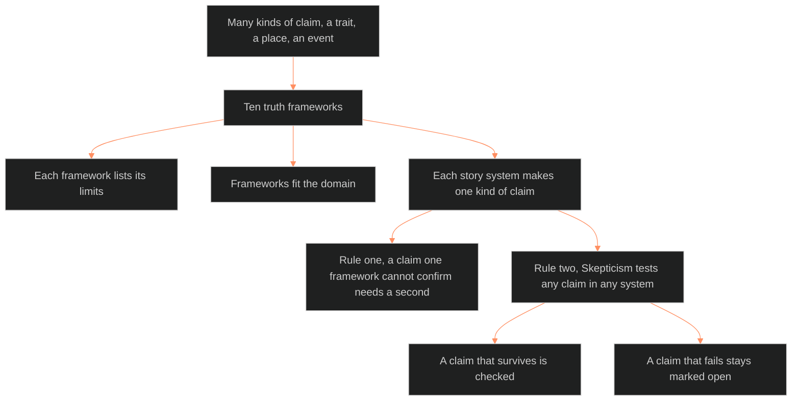

**Who it's for:** a writer or Chief deciding how to prove a claim · **What it does:** explains why the ten truth frameworks exist · **Type:** concept

# Truth verification: why ten frameworks

*The mind model: ten frameworks test many kinds of claim, and two rules decide checked or open.*

## One test cannot prove every claim

The Command makes many kinds of claim. A trait is true to a person. A place exists. An event caused the next one. Each kind needs a different test.

The source doc names ten tests and calls them truth frameworks. A framework is one method for deciding whether a claim is true.

## Truth is the foundation of the work

Truth is the cornerstone of knowledge. A writer who uses several methods gets clarity and accuracy. The source says this holds for narrative development and worldbuilding.

## The frameworks work alone and together

The ten frameworks run independently or in combination. One claim often needs several frameworks. Each framework shows a different side of validity.

The ten start with Empirical Observation, Logical Reasoning, Intuition and A Priori Knowledge, Consensus, and Coherence Theory. They end with Correspondence Theory, Pragmatic Theory, Skepticism and Critical Thinking, Revelation or Faith, and Historical Method. The [reference](2-reference.md) lists each one.

## Every framework carries its own limits

Each framework lists its limits next to its strengths. Empirical observation cannot verify non-physical claims. Coherence cannot prove a system matches reality. Pragmatic theory cannot show that "works" means "true". A writer who knows the limits knows when to add a second framework.

## Each story system makes one kind of claim

The ten frameworks form the validity layer under the grand argument. Character, setting, plot, theme, tracking and worldbuilding each make one kind of claim. The source assigns each system its checking frameworks.

## Two rules cover every system

First, a claim that one framework cannot confirm needs a second framework. Second, Skepticism tests any claim in any system. A claim that survives Skepticism is checked. A claim that fails it stays marked open.

## Frameworks fit the domain

The source pairs each domain with primary and secondary frameworks. Narrative development leans on Coherence and Pragmatic theory. Historical analysis leans on Historical Method and Consensus. The writer picks the domain first, then the frameworks.

## The long read

The source names five benefits of knowing the frameworks. They are credibility, nuanced analysis, bias mitigation, shared language across fields, and sharper critical thinking. The doc has no dependencies on other SSOTs. Other SSOTs may cite it for truth verification. Its trunk is BLACK. The two worked examples are an economic system and Victoria Midnight's change of belief. Each shows a claim confirmed when three or four frameworks converge. See the [tutorial](4-tutorial.md).

Related pages: [reference](2-reference.md) · [how-to](3-how-to.md) · [tutorial](4-tutorial.md)
