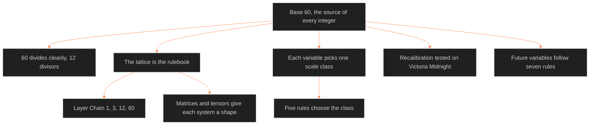

**Who it's for:** a writer or designer asking why the numbers are what they are · **What it does:** explains why base 60 sits under every number · **Type:** concept

# Base 60: why every number has a reason

*The mind model: base 60 is the hub, and its divisor lattice shapes every number below it.*

## No scaled number in any system is arbitrary

Every scaled number in any system derives from base 60. A time code is an address, not a scale, so it takes no scale class. Scales, point costs, thresholds and ranges all lock to patterns in the divisor lattice of 60. The doc is the mathematical foundation. Every downstream system that touches a number cites it as the authority on why that number exists.

## 60 divides cleanly

60 is the smallest number divisible by 1, 2, 3, 4, 5 and 6. It has 12 divisors. A scale on 60 splits into halves, thirds, quarters, fifths, sixths, tenths, twelfths, fifteenths, twentieths and thirtieths. A formula that divides by 2, 3, 4, 5 or 6 returns an exact integer. No rounding, no floor operation, no drift across chained calculations.

The old system used base 10, which has four divisors. Dividing by 3 on a 0-10 scale made fractions. One derived formula needed a floor operation. Base 60 removes that need.

## The lattice is the rulebook

The divisors of 60 form a lattice: a divisor sits below every divisor it divides. Each upward path from 1 to 60 is a divisor chain. The chains tie the character architecture to the numbers. The 3-tier, 12-layer structure is native to base 60 through the chain 1, 3, 12, 60. The doc calls it the Layer Chain.

## Matrices and tensors give each system a shape

A matrix splits 60 into rows and columns. A tensor splits it into three or more dimensions. The doc names the ones that matter. They are 3 tiers by 20 attribute units, 5 planets by 12 layers, and 12 layers by 5 variables. The tensor is 3 tiers by 4 throughlines by 5 variables.

## Each variable picks one scale class

A scale class is a valid numeric range whose top value divides 60. Every variable gets exactly one. Five rules choose it, and a formula that divides a variable constrains which values that variable may hold. Those constraints are not limits. They are the system enforcing clean arithmetic.

## Recalibration tested the idea on Victoria Midnight

The doc re-expresses Victoria Midnight in base 60 as the proof case. Her point costs already fit. Her derived statistics changed and exposed a negative Stress Threshold the old mixed scales hid. The doc treats that as a finding, not an error.

## Future variables follow seven rules

A new variable takes a scale class from the doc and respects the divisibility constraints. The writer also names its place in the lattice. No ad hoc ranges.

## The long read

The doc keeps its false starts in the derived-statistic section. It tries three formula fixes, drops each, and settles on one rule: compute in internal 0-60 space, then display. The Victoria table shows the payoff. Her CORE costs exactly 60 points, one full base unit. The doc calls that the system expressing itself. The Sumerian and Babylonian use of base 60 for angles, hours and minutes is the historical precedent it cites. See the [reference](2-reference.md) for every table and the [tutorial](4-tutorial.md) for a worked check.

Related pages: [reference](2-reference.md) · [how-to](3-how-to.md) · [tutorial](4-tutorial.md)
