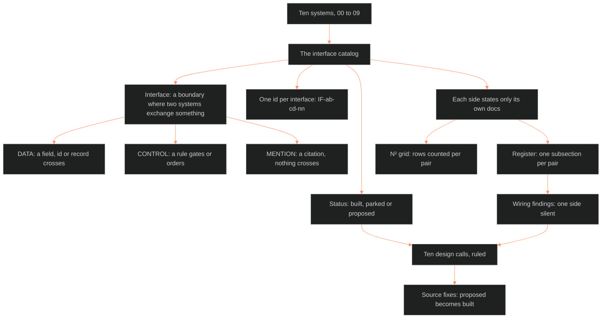

**Who it's for:** the CDR, the writers and Chief, who want to understand why the Command keeps a map of where its ten systems touch · **What it does:** explains what an interface is, why the catalog records both sides, and how the findings and the ten design calls close the gaps · **Type:** concept

# Interface catalog: concept

*Start at the catalog and follow the arrows: the ten systems feed one register, and the register feeds the findings that the ten calls close.*

## Ten systems touch in 45 pairs, and the Command had no map of them

Chief ordered the map on 2026-10-04: "patterns in which possible patterns can influence and interface with each other."

The Command documented its systems one at a time (BOLO 102 stage 1). The docs covered each system alone. The catalog is the map of where they touch.

The catalog maps the seams. It lists every place one system hands another a field, an id, a record or a rule. All 45 pairs of the ten systems touch.

## An interface is a boundary where two systems exchange something

The catalog borrows the word from NASA's Systems Engineering Handbook, which treats interface management as its own discipline. An interface sits where two systems meet.

The catalog sorts what crosses into three kinds. A DATA interface carries a field, a record, an id or a structure that another system reads. A CONTROL interface carries a rule that gates, triggers or orders another system. A MENTION carries nothing: one doc cites another for a definition.

DATA and CONTROL earn a row in the register. A MENTION earns only a "named only" line. The split keeps the register to things that cross.

## Each side states only what its own docs say

Six extractors read the 58 core docs. Each took one system's slice and logged every interface from its own side.

The catalog keeps both statements. When A says "I write X to B", and B never says "I read X from A", both rows stand. The catalog does not pretend the docs agree.

This choice turns disagreement into a finding. A doc that states a hand-off nobody else acknowledges shows where a system has an unwritten dependency.

## One id names each interface, and a status says how real it is

Every interface gets an id, `IF-ab-cd-nn`. The two system numbers come first, lower number first. The row's place in the pair follows. The page rules that an id never changes once published.

Every interface also carries a status. `built` means the source states it as working. `parked` means the source marks it phase 2. `proposed` means the extractor judged that the system needs it and the source never says so.

The statuses keep three kinds of claim apart. The source states one. The source defers one. The extractor argues one. A reader never mistakes a proposal for a working wire.

## The N² grid shows where the systems lean on each other

The grid counts rows for every ordered pair of systems. The row is the system whose docs state the interface. The column is the other system.

All 45 pairs touch. The heaviest cells are 01 Narrative frameworks to 03 Setting (32 rows), 00 Base to 02 Character (30) and 01 to 02 (25). The gaps show where a system speaks about a neighbor little or not at all.

The grid also marks proposed rows in parentheses. A cell with many parentheses names a pair that needs more wiring than its docs state.

## The wiring findings name the silent side of each one-sided interface

A DATA row is one-sided when one system states it and the other never does. The silent side is the gap.

At version 0.2.0 the findings list 14 exchanges that a writer states and a reader never acknowledges. They list 24 exchanges that a reader states and a writer never acknowledges.

Each gap closes the same way. The silent side gains one line that names the interface by its id. The findings turn a vague worry about coverage into a list of specific lines to write.

## Ten design calls fold the proposed rows into rulings

The register held 115 proposed rows. They fell into ten calls. Each call states a problem and a recommendation.

The ten calls, in order:

1. One clock.
2. Theme wires in.
3. The world catalog widens.
4. The Ownership Rule completes.
5. The plot–setting handshake.
6. The cards carry the checks.
7. Style names its inputs.
8. Base 60 and the truth check scope.
9. Operations files true.
10. One of each.

Chief ruled all ten as recommended on 2026-10-05 ("My word"). Each call is now a source-fix batch with one writer per system. A row moves from `proposed` to `built` when its fix lands and the register rebuilds.

## The register is generated, so the JSON is the truth

A script merged the six extractors' files and numbered the rows. The truth is a JSON register, `_tools/docs/out/ifc_candidates.json`. The catalog page is its printout.

The build script, `_tools/docs/ifc_build.py`, writes the page. A reader who wants a change edits the JSON and rebuilds. A reader who edits the page loses the edit at the next build.

The generated page, not a hand-kept list, makes the map cheap to keep honest. A fix batch changes a status in the JSON. The rebuild moves every count on the page at once.

Next, see the [reference](2-reference.md) for the full list of pairs, the [how-to](3-how-to.md) for the four tasks, and the [tutorial](4-tutorial.md) for a worked lookup. The source is [ShroomsQ/_CANON/_SSOT/00_EPISTEMOLOGY/📐 ssot_00_interface_catalog.md](../../../_SSOT/00_EPISTEMOLOGY/📐%20ssot_00_interface_catalog.md).
