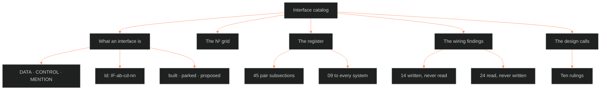

**Who it's for:** the CDR and the writers, looking up an interface, a count or a ruling before touching a field another system reads · **What it does:** lists every part of the interface catalog, in the source's order · **Type:** reference

# Interface catalog: reference

*Read the diagram top to bottom: the catalog has five looked-up parts, and the register holds one subsection per system pair.*

This page follows the source: [ShroomsQ/_CANON/_SSOT/00_EPISTEMOLOGY/📐 ssot_00_interface_catalog.md](../../../_SSOT/00_EPISTEMOLOGY/📐%20ssot_00_interface_catalog.md), version 0.2.0. This page leaves out PURPOSE and VERSION HISTORY, which are boilerplate. The numbers below are the source's at 0.2.0 and move when the register rebuilds. The truth is `_tools/docs/out/ifc_candidates.json`; the source page is its printout. The page is generated by `_tools/docs/ifc_build.py`. Related pages: [concept](1-concept.md) · [how-to](3-how-to.md) · [tutorial](4-tutorial.md).

## WHAT AN INTERFACE IS

An interface is a boundary where two systems exchange something (NASA SE Handbook, interface management). The catalog keeps three kinds apart.

| Kind | Meaning | On the page |
|---|---|---|
| **DATA** | One system produces a field, record, id or structure that another reads. | A row. |
| **CONTROL** | One system's rule gates, triggers or orders another. | A row. |
| **MENTION** | A doc cites another for a definition. Nothing crosses. | The "named only" line under the pair. |

**Row columns.** Every register row carries seven columns.

| Column | Holds |
|---|---|
| `id` | The interface id, `IF-ab-cd-nn`. |
| `side` | The stating system and the direction: `writes`, `reads`, `gates` or `gated_by`, from the stating doc's side. |
| `kind` | DATA or CONTROL. MENTION never gets a row. |
| `payload` | The named thing that crosses. A note in parentheses and italics records what the extractor found odd. |
| `trigger` | When the exchange fires. A dash means the source names no trigger. |
| `stated in` | The stating doc and the section where it says so. |
| `status` | `built`, `parked` or `proposed`. |

**Status values.**

| Status | Meaning |
|---|---|
| `built` | The source states the interface as working. |
| `parked` | The source marks it phase 2. |
| `proposed` | The extractor's judgment: the system needs it and the source never says so. |

**The id.** The format is `IF-ab-cd-nn`. `ab` and `cd` are the two systems, lower number first. `nn` is the row's place in that pair. The 09 subsection that covers every system uses `ALL` as `cd`, as in `IF-09-ALL-01`. The source rules that an id never changes once published. A retired row keeps its id and says so.

> **OPEN:** The page rules that an id never changes. But `ifc_build.py` numbers each pair's rows by sort order on every build, by kind, status, side and doc. A new row or a proposed-to-built flip can shift later ids. The source states no rule that pins ids.

**Both sides, as stated.** Each side logs what its own docs say. When A says "I write X to B" and B never says "I read X from A", both rows stand. The gap is a finding (see THE WIRING FINDINGS). The catalog records the statements. It does not make them agree.

**Where it connects.** The N² grid counts these rows. The register lists them. The wiring findings test their directions. The design calls close the proposed ones.

## THE N² GRID

The grid counts interfaces per ordered pair of systems. It is a table of ten rows and ten columns.

**How to read it.** The row is the system whose docs state the interface. The column is the other system. A cell counts DATA and CONTROL rows. Proposed rows sit in parentheses. A dot means no rows. A square marks the diagonal.

| states → other | 00 Base | 01 Narr | 02 Char | 03 Sett | 04 Plot | 05 World | 06 Theme | 07 Style | 08 Track | 09 Ops |
|---|---|---|---|---|---|---|---|---|---|---|
| **00 Base** | ■ | 3 (3) | 30 (3) | 3 (4) | 7 (5) | 2 (1) | 2 | 1 (2) | 3 (3) | 3 |
| **01 Narr** | 2 (2) | ■ | 25 | 32 | 18 (2) | 4 (5) | 2 (3) | 3 (2) | 8 (8) | 6 |
| **02 Char** | 2 (1) | 13 (2) | ■ | 1 (2) | 10 (3) | 0 (2) | 0 (1) | 4 | 3 (2) | · |
| **03 Sett** | · | 6 (1) | 5 (1) | ■ | 13 (4) | · | 1 | · | 3 | · |
| **04 Plot** | · | 8 (1) | 4 (1) | 7 (3) | ■ | 0 (1) | 0 (1) | · | 2 (2) | 1 |
| **05 World** | · | 3 (3) | 5 | 7 | 4 (1) | ■ | 1 (2) | 1 (2) | 4 (2) | 3 |
| **06 Theme** | · | 8 | 2 (2) | 3 | 4 (2) | 1 (2) | ■ | 1 (2) | 0 (4) | 0 (1) |
| **07 Style** | 2 | 11 | 3 | 2 | 1 (1) | 1 (3) | 2 (2) | ■ | 2 (2) | 10 |
| **08 Track** | · | 4 | 6 | 3 | 11 (1) | 0 (2) | 1 (1) | 0 (1) | ■ | 1 |
| **09 Ops** | 5 | 4 (1) | 15 (1) | 2 (1) | 3 | 2 | 1 (1) | 6 (1) | 2 | ■ |

**Totals at 0.2.0.** 573 rows · 514 interfaces (DATA 350 · CONTROL 164) · 59 named-only citations · 115 proposed · 45 of 45 system pairs touch.

**One cell, read aloud.** Row 01 Narr, column 03 Sett holds 32. The 01 docs state 32 rows that cross to 03. None of the 32 is proposed.

**Where it connects.** The grid reads the same rows as THE REGISTER, split by the stating side. A pair's two cells add up to that pair's rows, except the `ALL` rows, which the grid leaves out.

## THE REGISTER

The register holds one subsection per system pair, lower number first. Inside a pair, rows run DATA then CONTROL. Within each kind they run built, parked, then proposed. A "Named only" line follows a pair's table when a doc cites another and nothing crosses.

This page lists each pair with one line on what crosses and its counts. The full rows live in the source, under the same heading.

### 00 Base ↔ 01 Narrative frameworks

**What crosses:** 00 writes Pattern 2 and the scale ladder's rungs to 01. 01 reads the `touchstone` field. Five proposed rows ask for ladder links, registry fields and table rows.

**Rows:** 10 interfaces (6 DATA, 4 CONTROL) · 5 built, 0 parked, 5 proposed · ids `IF-00-01-01` to `IF-00-01-10` · named-only citations: yes

### 00 Base ↔ 02 Character (LEECHSEED)

**What crosses:** 00 writes scale classes, derived-stat formulas and flag thresholds to 02. 00 reads layer domains and module fields. Control rows fix modules to the 12-layer schema.

**Rows:** 36 interfaces (28 DATA, 8 CONTROL) · 27 built, 5 parked, 4 proposed · ids `IF-00-02-01` to `IF-00-02-36` · named-only citations: yes

### 00 Base ↔ 03 Setting

**What crosses:** 00 reads `setting_ref` entries from 03. The truth table checks setting claims. Four proposed rows ask for a prefix and setting inputs.

**Rows:** 7 interfaces (4 DATA, 3 CONTROL) · 3 built, 0 parked, 4 proposed · ids `IF-00-03-01` to `IF-00-03-07` · named-only citations: none

### 00 Base ↔ 04 Plot

**What crosses:** 00 writes `touchstone` and `growth_requirement` for plot use. The truth table checks plot claims. Five proposed rows ask for event ids, a source field, a storyform owner, a prefix and a scale rule.

**Rows:** 12 interfaces (8 DATA, 4 CONTROL) · 6 built, 1 parked, 5 proposed · ids `IF-00-04-01` to `IF-00-04-12` · named-only citations: none

### 00 Base ↔ 05 Worldbuilding

**What crosses:** The truth table checks worldbuilding claims, and the registry holds a pointer row for 05. One proposed row asks for a belief-system record.

**Rows:** 3 interfaces (1 DATA, 2 CONTROL) · 2 built, 0 parked, 1 proposed · ids `IF-00-05-01` to `IF-00-05-03` · named-only citations: yes

### 00 Base ↔ 06 Theme

**What crosses:** The truth table checks theme claims. The registry holds one pointer row for 06's fields.

**Rows:** 2 interfaces (0 DATA, 2 CONTROL) · 2 built, 0 parked, 0 proposed · ids `IF-00-06-01` to `IF-00-06-02` · named-only citations: yes

### 00 Base ↔ 07 Style

**What crosses:** 00 writes `voice_sheet` for style. 07 writes vocabulary pages and gates 00 docs with the SSOT frame. Two proposed rows ask for a truth-table row and a registry pointer.

**Rows:** 5 interfaces (2 DATA, 3 CONTROL) · 3 built, 0 parked, 2 proposed · ids `IF-00-07-01` to `IF-00-07-05` · named-only citations: yes

### 00 Base ↔ 08 Tracking

**What crosses:** 00 writes `primary_attachment_object` for relational tracking. The truth table and the Ownership Rule gate 08. Three proposed rows cover claim status, state-diff keys and a scale rule.

**Rows:** 6 interfaces (3 DATA, 3 CONTROL) · 3 built, 0 parked, 3 proposed · ids `IF-00-08-01` to `IF-00-08-06` · named-only citations: none

### 00 Base ↔ 09 Operations

**What crosses:** 00 reads the Command loop from SOP §1. 09 reads scale classes and module entries from 00. The local application rows are parked.

**Rows:** 8 interfaces (5 DATA, 3 CONTROL) · 6 built, 2 parked, 0 proposed · ids `IF-00-09-01` to `IF-00-09-08` · named-only citations: yes

### 01 Narrative frameworks ↔ 02 Character (LEECHSEED)

**What crosses:** 01 reads the filled 12-layer stack, astrology aspects and `storyform_id` from 02. 01 writes state diffs back. Twelve control rows gate the exchange.

**Rows:** 40 interfaces (28 DATA, 12 CONTROL) · 35 built, 3 parked, 2 proposed · ids `IF-01-02-01` to `IF-01-02-40` · named-only citations: yes

### 01 Narrative frameworks ↔ 03 Setting

**What crosses:** 01 reads setting rows against character rows. 01 writes scene-card `collision:` lines and genre `world_build`. It holds 34 DATA rows, the most of any pair.

**Rows:** 39 interfaces (34 DATA, 5 CONTROL) · 35 built, 3 parked, 1 proposed · ids `IF-01-03-01` to `IF-01-03-39` · named-only citations: yes

### 01 Narrative frameworks ↔ 04 Plot

**What crosses:** 01 writes genre obligations, `genre_load` and setpiece data onto the plot card. 01 reads firing addresses. Eras 1 to 5 and the world clock cross.

**Rows:** 29 interfaces (22 DATA, 7 CONTROL) · 20 built, 6 parked, 3 proposed · ids `IF-01-04-01` to `IF-01-04-29` · named-only citations: yes

### 01 Narrative frameworks ↔ 05 Worldbuilding

**What crosses:** 01 reads catalog entries by their `WB-<TYPE>-<nnnn>` ids. 05 reads story records and `tropes:` keys. Eight proposed rows widen the exchange.

**Rows:** 15 interfaces (13 DATA, 2 CONTROL) · 4 built, 3 parked, 8 proposed · ids `IF-01-05-01` to `IF-01-05-15` · named-only citations: yes

### 01 Narrative frameworks ↔ 06 Theme

**What crosses:** 01 writes rail ids R1 to R4 into `keys.theme`. 06 reads storyform cells and Touchstone ids. 06 writes `cost_and_meaning` and motifs.

**Rows:** 13 interfaces (10 DATA, 3 CONTROL) · 10 built, 0 parked, 3 proposed · ids `IF-01-06-01` to `IF-01-06-13` · named-only citations: yes

### 01 Narrative frameworks ↔ 07 Style

**What crosses:** 01 writes meta-genre and register keys for style. 07 reads texture layers and genre labels. 07 writes each scene's distance setting.

**Rows:** 16 interfaces (9 DATA, 7 CONTROL) · 14 built, 0 parked, 2 proposed · ids `IF-01-07-01` to `IF-01-07-16` · named-only citations: yes

### 01 Narrative frameworks ↔ 08 Tracking

**What crosses:** 01 writes story `id` and payoff-ledger entries. 08 reads the scale ladder's rungs. 01 reads time codes from 08. Eight proposed rows add more.

**Rows:** 20 interfaces (18 DATA, 2 CONTROL) · 9 built, 3 parked, 8 proposed · ids `IF-01-08-01` to `IF-01-08-20` · named-only citations: yes

### 01 Narrative frameworks ↔ 09 Operations

**What crosses:** 01 reads the `rung:` frontmatter. 09 writes the Dramatica and narratological add-on outputs. ORANGE rows ride the subsidiary firewall.

**Rows:** 11 interfaces (5 DATA, 6 CONTROL) · 10 built, 0 parked, 1 proposed · ids `IF-01-09-01` to `IF-01-09-11` · named-only citations: yes

### 02 Character (LEECHSEED) ↔ 03 Setting

**What crosses:** 02 reads `setting_ref` on L5 and L7 entries. 03 reads S12 `link` and the place-flag grammar. Three proposed rows and one parked row remain.

**Rows:** 9 interfaces (8 DATA, 1 CONTROL) · 5 built, 1 parked, 3 proposed · ids `IF-02-03-01` to `IF-02-03-09` · named-only citations: yes

### 02 Character (LEECHSEED) ↔ 04 Plot

**What crosses:** 02 writes the Lifecycle Protocol and L3 fields to 04. 04 writes `event_id`, which 02 stores as `origin_event`. 04 gates which layers need a dated event.

**Rows:** 18 interfaces (17 DATA, 1 CONTROL) · 12 built, 2 parked, 4 proposed · ids `IF-02-04-01` to `IF-02-04-18` · named-only citations: yes

### 02 Character (LEECHSEED) ↔ 05 Worldbuilding

**What crosses:** 05 reads 02 person records and writes `WB-GRP` ids for them. Two proposed rows let 02 read world regime and community entries.

**Rows:** 7 interfaces (5 DATA, 2 CONTROL) · 5 built, 0 parked, 2 proposed · ids `IF-02-05-01` to `IF-02-05-07` · named-only citations: none

### 02 Character (LEECHSEED) ↔ 06 Theme

**What crosses:** 06 reads images from character material. Three proposed rows cover L11 `growth_axis`, knowledge states and rail-to-character bindings. A rider gates the controlling idea.

**Rows:** 5 interfaces (4 DATA, 1 CONTROL) · 2 built, 0 parked, 3 proposed · ids `IF-02-06-01` to `IF-02-06-05` · named-only citations: none

### 02 Character (LEECHSEED) ↔ 07 Style

**What crosses:** Six of the seven rows are CONTROL: narration never states motive, erotic pacing devices and one idea, one name. 07 reads L5 and L6.

**Rows:** 7 interfaces (1 DATA, 6 CONTROL) · 7 built, 0 parked, 0 proposed · ids `IF-02-07-01` to `IF-02-07-07` · named-only citations: none

### 02 Character (LEECHSEED) ↔ 08 Tracking

**What crosses:** 02 reads time codes, `told_at` and story points from 08. 08 reads checkpoints and character field paths from 02.

**Rows:** 11 interfaces (9 DATA, 2 CONTROL) · 8 built, 1 parked, 2 proposed · ids `IF-02-08-01` to `IF-02-08-11` · named-only citations: yes

### 02 Character (LEECHSEED) ↔ 09 Operations

**What crosses:** 09 reads the ingest templates, field tags and checkpoints from 02. 09 writes relationship record updates. Seven control rows gate the pipeline.

**Rows:** 16 interfaces (9 DATA, 7 CONTROL) · 11 built, 4 parked, 1 proposed · ids `IF-02-09-01` to `IF-02-09-16` · named-only citations: yes

### 03 Setting ↔ 04 Plot

**What crosses:** 03 reads fabula `origin_event` ids. 03 writes faction states and shared scene-card fields. The DCUS rename lattice crosses as three eras.

**Rows:** 27 interfaces (24 DATA, 3 CONTROL) · 17 built, 3 parked, 7 proposed · ids `IF-03-04-01` to `IF-03-04-27` · named-only citations: yes

### 03 Setting ↔ 05 Worldbuilding

**What crosses:** 05 reads `places:` and S5, S7 from 03. 05 writes catalog entries found at each place. Four control rows keep faction cards and building fabric in 03.

**Rows:** 7 interfaces (3 DATA, 4 CONTROL) · 7 built, 0 parked, 0 proposed · ids `IF-03-05-01` to `IF-03-05-07` · named-only citations: none

### 03 Setting ↔ 06 Theme

**What crosses:** 06 writes the citation test and a theme read onto 03's scene cards. 06 reads images already present in setting material.

**Rows:** 4 interfaces (4 DATA, 0 CONTROL) · 4 built, 0 parked, 0 proposed · ids `IF-03-06-01` to `IF-03-06-04` · named-only citations: none

### 03 Setting ↔ 07 Style

**What crosses:** 07 reads S3 SENSORIUM from 03. The SSOT frame gates 03 docs.

**Rows:** 2 interfaces (1 DATA, 1 CONTROL) · 2 built, 0 parked, 0 proposed · ids `IF-03-07-01` to `IF-03-07-02` · named-only citations: none

### 03 Setting ↔ 08 Tracking

**What crosses:** 03 reads `told_at` time codes. 03 writes single-field changes as story points. 08 writes world-clock dating and reads place threads.

**Rows:** 6 interfaces (6 DATA, 0 CONTROL) · 5 built, 1 parked, 0 proposed · ids `IF-03-08-01` to `IF-03-08-06` · named-only citations: yes

### 03 Setting ↔ 09 Operations

**What crosses:** 09 reads `setting_ref`. A setting-state checkpoint and a folder category for 03 are not yet wired.

**Rows:** 3 interfaces (2 DATA, 1 CONTROL) · 1 built, 1 parked, 1 proposed · ids `IF-03-09-01` to `IF-03-09-03` · named-only citations: none

### 04 Plot ↔ 05 Worldbuilding

**What crosses:** 05 reads fabula `event_id` as `origin:`. Two proposed rows cover world-clock records and first-narrated scenes. CT3 and CT9 gate the catalog.

**Rows:** 6 interfaces (3 DATA, 3 CONTROL) · 4 built, 0 parked, 2 proposed · ids `IF-04-05-01` to `IF-04-05-06` · named-only citations: yes

### 04 Plot ↔ 06 Theme

**What crosses:** 06 writes rails R1 to R4 and value-scale steps for the plot. Three proposed rows cover scene tests, gauge names and the timing of the Stop. Every scene declares the debate it tests.

**Rows:** 7 interfaces (5 DATA, 2 CONTROL) · 4 built, 0 parked, 3 proposed · ids `IF-04-06-01` to `IF-04-06-07` · named-only citations: none

### 04 Plot ↔ 07 Style

**What crosses:** 07 gates 04 docs with the SSOT frame. One proposed row asks 07 for a focal character per scene.

**Rows:** 2 interfaces (1 DATA, 1 CONTROL) · 1 built, 0 parked, 1 proposed · ids `IF-04-07-01` to `IF-04-07-02` · named-only citations: yes

### 04 Plot ↔ 08 Tracking

**What crosses:** 08 reads the world clock and the fabula `enable` edge. 04 reads the `backstory` tag. P1 `address` takes the 08 time code.

**Rows:** 16 interfaces (14 DATA, 2 CONTROL) · 13 built, 0 parked, 3 proposed · ids `IF-04-08-01` to `IF-04-08-16` · named-only citations: none

### 04 Plot ↔ 09 Operations

**What crosses:** 04 writes 135 grid nodes. 09 reads `event_id`. Two control rows cover the locked-storyform gate and the category route to folder 04.

**Rows:** 4 interfaces (2 DATA, 2 CONTROL) · 4 built, 0 parked, 0 proposed · ids `IF-04-09-01` to `IF-04-09-04` · named-only citations: none

### 05 Worldbuilding ↔ 06 Theme

**What crosses:** 05 reads CT11 reinforcement. 06 writes the civilization gauge rule. Four proposed rows add gauges on entries, motif links and verdicts.

**Rows:** 6 interfaces (6 DATA, 0 CONTROL) · 2 built, 0 parked, 4 proposed · ids `IF-05-06-01` to `IF-05-06-06` · named-only citations: yes

### 05 Worldbuilding ↔ 07 Style

**What crosses:** 07 gates catalog write-ups through 07.1 and the SSOT frame. Five proposed rows include LNG entries and page rulings for the world view.

**Rows:** 7 interfaces (2 DATA, 5 CONTROL) · 2 built, 0 parked, 5 proposed · ids `IF-05-07-01` to `IF-05-07-07` · named-only citations: none

### 05 Worldbuilding ↔ 08 Tracking

**What crosses:** 05 reads the 08 time code and writes `state: <kind>:<slug>` subjects. Four proposed rows add founding endpoints and new 08 subject kinds.

**Rows:** 8 interfaces (7 DATA, 1 CONTROL) · 4 built, 0 parked, 4 proposed · ids `IF-05-08-01` to `IF-05-08-08` · named-only citations: yes

### 05 Worldbuilding ↔ 09 Operations

**What crosses:** 05 writes `catalog/_INDEX.md` and the world view page. 09 runs the compiler and gates 05 through SOP §5 and Spec tags.

**Rows:** 5 interfaces (1 DATA, 4 CONTROL) · 4 built, 1 parked, 0 proposed · ids `IF-05-09-01` to `IF-05-09-05` · named-only citations: none

### 06 Theme ↔ 07 Style

**What crosses:** 07 reads the story's motifs. The front-of-book disclaimer holds Touchstone TS 1:1. Four proposed rows add motif routing, the disclaimer and the motive rule.

**Rows:** 7 interfaces (3 DATA, 4 CONTROL) · 3 built, 0 parked, 4 proposed · ids `IF-06-07-01` to `IF-06-07-07` · named-only citations: none

### 06 Theme ↔ 08 Tracking

**What crosses:** 08 reads motif ids as story-point fields. Five proposed rows cover scene gauges, rail tests, the Anna reader track and gauge lanes.

**Rows:** 6 interfaces (6 DATA, 0 CONTROL) · 1 built, 0 parked, 5 proposed · ids `IF-06-08-01` to `IF-06-08-06` · named-only citations: none

### 06 Theme ↔ 09 Operations

**What crosses:** Three rows, none built: Theme Report data for 09, a folder category for 06 and SOP §5's 1.0 bar.

**Rows:** 3 interfaces (1 DATA, 2 CONTROL) · 0 built, 1 parked, 2 proposed · ids `IF-06-09-01` to `IF-06-09-03` · named-only citations: none

### 07 Style ↔ 08 Tracking

**What crosses:** 07 reads audience tempo from 08. Three proposed rows ask for beat boundaries, planned tempo and workspace view rules.

**Rows:** 5 interfaces (3 DATA, 2 CONTROL) · 2 built, 0 parked, 3 proposed · ids `IF-07-08-01` to `IF-07-08-05` · named-only citations: none

### 07 Style ↔ 09 Operations

**What crosses:** 07 reads the teach-back record, the dependency template and the design system. Twelve control rows, including SOP §7's plain register, gate 07.

**Rows:** 17 interfaces (5 DATA, 12 CONTROL) · 16 built, 0 parked, 1 proposed · ids `IF-07-09-01` to `IF-07-09-17` · named-only citations: yes

### 08 Tracking ↔ 09 Operations

**What crosses:** 09 writes single-field changes to 08 as story points. 08 gates the timeline tool's store shape. A folder category for 08 is parked.

**Rows:** 3 interfaces (1 DATA, 2 CONTROL) · 2 built, 1 parked, 0 proposed · ids `IF-08-09-01` to `IF-08-09-03` · named-only citations: none

### 09 Operations → every system

**What crosses:** 09 gates every system: review before `_CANON/`, the design system, the build loop, YAML keys and file naming. Seventeen of 18 rows are CONTROL.

**Rows:** 18 interfaces (1 DATA, 17 CONTROL) · 14 built, 1 parked, 3 proposed · ids `IF-09-ALL-01` to `IF-09-ALL-18` · named-only citations: none

## THE WIRING FINDINGS

A DATA row is one-sided when one system states it and the other never does. The silent side is the gap.

**The test.** The build script (`ifc_build.py`) looks at DATA rows only. It skips `proposed` rows and the `ALL` rows. For each pair it collects the writes the writer states and the reads the reader states. A direction with only one of the two is one-sided.

**How to read a pair.** Each entry is `A→B`. The arrow points the way the data flows: A is the writer, B is the reader.

**Stated as written, never stated as read (14).** The writer states the exchange. The reader is silent.

`00→04` · `00→07` · `00→08` · `05→02` · `05→03` · `05→08` · `05→09` · `06→01` · `06→04` · `07→00` · `07→01` · `07→09` · `09→02` · `09→08`

**Stated as read, never stated as written (24).** The reader states the exchange. The writer is silent.

`01→00` · `02→01` · `02→03` · `02→05` · `02→06` · `02→07` · `02→08` · `02→09` · `03→00` · `03→05` · `03→06` · `03→07` · `03→09` · `04→01` · `04→05` · `04→08` · `05→01` · `06→07` · `06→08` · `08→01` · `08→05` · `08→07` · `09→00` · `09→07`

**The closing rule.** Each gap closes with one line on the silent side that names the IF id. The fix batch runs after the calls are ruled.

> **OPEN:** The test reads register rows, not source docs. The source does not say how a closed wiring leaves these lists. A silent-side line in a source doc changes no row. See [how-to](3-how-to.md#close-a-one-sided-wiring).

**Where it connects.** Each entry points at a pair in THE REGISTER. The pair's rows name the stating side.

## THE DESIGN CALLS — RULED 2026-10-05 (Chief: "My word", all ten as recommended)

The 115 proposed rows fell into ten calls. Chief ruled all ten as recommended on 2026-10-05. Each call is now a source-fix batch with one writer per system. A row moves from `proposed` to `built` when its fix lands and the register rebuilds.

The source states each call as a problem plus a **Rec** (the recommendation, now the ruling). The table keeps the fields and sections each ruling names.

| # | Call | The problem | The ruling |
|---|---|---|---|
| 1 | One clock | Fourteen rows date things five ways: the time code, the ladder address, movement tags, free text and calendar years. | The 08 time code is the one address for anything dated in any system. 08 gains a section, "The address". Free text and movement tags retire as aliases. |
| 2 | Theme wires in | 06 names no character id, no plot field and no tracking store. 08 expects motif ids 06 never mints. | 06 gains `holders:` on each rail and mints `motif.<slug>` ids. Scene and plot cards carry a theme record. 08 `subject.kind` gains `theme` and `gauge`. 02 L11 gains `rail_ref`. |
| 3 | The world catalog widens | Nineteen rows want a field the 05 entry schema lacks. | The entry schema gains `gauge:`, `portable:`, `narrated_in:`, `founded:`, `current:`, `motif_ref:` and `ct11_verdict:`. 08 `subject.kind` accepts 05's kinds plus `world`. Character world fields take `catalog_ref:`. |
| 4 | The Ownership Rule completes | The variable registry has no prefix for S1–S12 or P1–P12. It has no rows for 01, 07 or 09. It has no owner for REL or the storyform record. | Prefixes `SET.` and `PLT.`. Rows for 01, 07 and 09. The 02 state architecture owns REL.*. 04 owns the storyform record. Every module variable carries the Static/Dynamic tag. |
| 5 | The plot–setting handshake | Eleven rows are fields the fabula, the plot card and the setting slice each expect the other to hold. | The fabula event record gains `source_kind:`, `canon_source:`, `produces:` and `scheduled:`. P7 gains `reveal_content` and `reveal_type`. P12 gains `domain_ref`. S8 `witness` takes a character id. Flags store their `event_id`. Anna Colson (the copy) gets her own character record. |
| 6 | The cards carry the checks | P8–P10 claim every plot element passes the three checks, but only entity sheets hold the fields. Hooks and breaches have no ledger. | Plot card and scene card gain `fantasy:`, `sexy:` and `aesthetic:`. 08 §9A gains a hook ledger and a Touchstone breach log. The scene card gains `focal:`. 07.1 sets the beat-boundary mark. |
| 7 | Style names its inputs | 07.1 reads five things it never names. | 07.1 lists them: the medium, texture's T6 values, 05's LNG entries, 08's planned tempo and 06's motif list. 07.3 names two pages it rules. The truth table gains rows for 01 and 07. |
| 8 | Base 60 and the truth check scope | Base 60's purpose says every system. Its scope says the character pipeline. | The scope line becomes "every scaled number in any system". S- and P-layer numerics take SC classes. Time codes do not. The `checked \| open` status sits on the claim's own record. |
| 9 | Operations files true | A 02 module and a 00 design system sit in 09. The flow's "vertical slice" collides with the LEECHSEED Vertical Slice. Eleven 01 docs lack `rung:`. | The two files move. The flow's P3 becomes "proof slice". `rung` and `trunk` join the AIP's required keys. A script backfills `rung:` on every core doc. |
| 10 | One of each | Two trope keyings, two genre tools, two "scale ladders" and two 1.0 bars. | `register.json` is the one key store. Ryan's nine-axis scoring is the genre-contract tool. "Scale ladder" is 01's R1–R8. 05's three tiers become "the reach". The 1.0 bar is SOP §5's six. |

The source gives each ruling in full, with every field name. The table above compresses it. Read the source before landing a fix.

**With the rulings.** The one-sided pairs in THE WIRING FINDINGS close by one line each. The silent side names the interface by its IF id. One writer per system makes one pass.

**Where it connects.** Each call names the docs and fields it changes. Call 9 moved two files: the character pipeline to 02 and the design system to 00. Call 4 acts on the variable registry's Ownership Rule.
