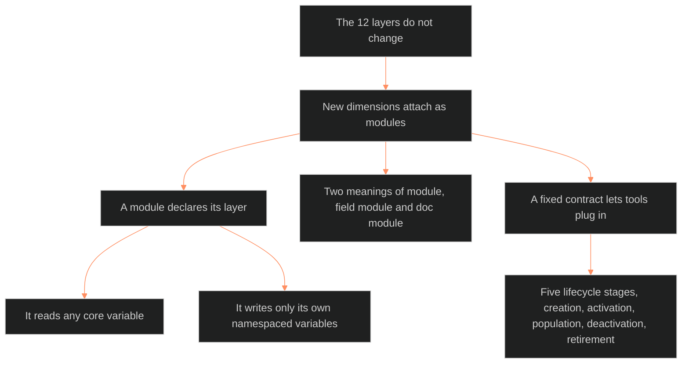

**Who it's for:** a designer or writer extending the character system · **What it does:** explains why modules attach under fixed layers · **Type:** concept

# Module architecture: the layers stay, modules attach

*The mind model: twelve fixed layers stay put, and modules attach beneath them under one contract and one lifecycle.*

## The 12 layers do not change

The LEECHSEED Character System is a fixed schema. It does not grow. The layers are L1 CORE, L2 VITAL, L3 SOCIAL, L4 WILL, L5 WOUND and L6 DRIVE. The rest are L7 ORIGIN, L8 IMPRINT, L9 EROS, L10 SHADOW, L11 DESTINY and L12 FUNCTION. Together they define the complete character.

## New dimensions attach as modules

Walking style, music interests, combat style and cultural conditioning are new dimensions. Each attaches as a Layer-Locked Module, a sub-table under an existing layer. The source compares layers to tracks in a music workstation and modules to the effects loaded onto them.

## A module knows its place

Every module declares the layer it semantically belongs to. The system checks that declaration against the layer's domain. Walking style fits L2 VITAL because walking is physical. Music interests fit L8 IMPRINT because formative emotion conditions taste. Combat style spans L2 VITAL and L4 WILL because it needs capacity and resistance.

## A module reads the core and writes only its own data

A module may read any core variable. It may write only its own namespaced variables. It cannot change a core layer, a derived statistic or a flag. A module needs no other module to work.

## Two meanings of "module" need two names

A field module is a set of variables under a layer. A doc module is a sibling document that holds one method and adds no variables. The registry lists field modules only. The writer says "field module" or "doc module" whenever the bare word is unclear.

## A fixed contract lets tools plug in

The module API contract gives every module the same blocks: declaration, variables, reads, optional computation and data exchange. The module lifecycle has five stages: creation, activation, population, deactivation, retirement. Deactivation hides data and never deletes it.

## The long read

The source pictures a future application like a music workstation. A Layer Rack lists L1 to L12 as vertical strips. A Main Panel shows the selected layer and its module sub-tables. A Bottom Panel recomputes derived statistics and flags in real time. A Module Rack holds one tab per enabled module. The source treats this as a vision for Phase 4B and later, not a built tool. The [reference](2-reference.md) holds the exact blocks and rules.

Related pages: [reference](2-reference.md) · [how-to](3-how-to.md) · [tutorial](4-tutorial.md)
