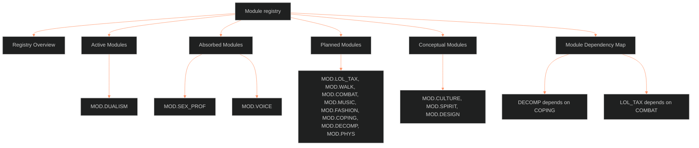

**Who it's for:** a designer looking up a field module · **What it does:** lists every module declaration, variable and status · **Type:** reference

# Module registry: reference

*The page as a tree: the overview, the modules sorted by status, then the dependency map.*

Source: `ShroomsQ/_CANON/_SSOT/00_EPISTEMOLOGY/📐 ssot_00_module_registry.md`, version 1.2.0, status canonical. The source sits on trunk BLACK at tier foundation, with `module_of: ssot_00_module_architecture`. It was last updated 2026-10-05. Dependencies: `ssot_00_module_architecture`, `ssot_00_variable_registry`, `ssot_02_character_systems_vertical_slice`. Why it exists: see the [concept](1-concept.md). Rules for modules: [module architecture](../ssot_00_module_architecture/2-reference.md).

All modules use tier 3. All declarations use `tier_min: 3`.

## Registry Overview

| Module ID | Display name | Attachment | Status | Variables | Derived | Flags |
|---|---|---|---|---|---|---|
| `DUALISM` | Dualism Charge System | All layers | active | 12+ | Yes | Yes |
| `LOL_TAX` | LoL Character Taxonomy | Multiple | planned | 70+ | Yes | No |
| `WALK` | Walking Style | L2 VITAL | planned | 3 | No | No |
| `COMBAT` | Combat Archetype | L2, L4 | planned | 5 | Yes | No |
| `SEX_PROF` | Sexuality Profile | L9 EROS | absorbed | 0 (was 5) | No | No |
| `MUSIC` | Music Interests | L8 IMPRINT | planned | 4 | No | No |
| `VOICE` | Vocal Signature | L2, L3 | absorbed | 0 (was 4) | No | No |
| `FASHION` | Fashion/Aesthetic Profile | L3 SOCIAL | planned | 5 | No | No |
| `COPING` | Coping Mechanism Catalog | L4 WILL | planned (narrowed) | 2 (was 4) | Yes | Yes |
| `DECOMP` | Decompensation Profile | L5 WOUND | planned | 4 | No | Yes |
| `PHYS` | Physical Detail | L2 VITAL | planned | 6 | No | No |
| `CULTURE` | Cultural Conditioning | L7, L8 | conceptual | parked | parked | parked |
| `SPIRIT` | Spiritual Framework | L11 DESTINY | conceptual | parked | parked | parked |
| `DESIGN` | Design Focus Power Board | Meta | conceptual | 12 | Yes | No |

Audit 2026-10-04 (slice 3.3.1): 1 active, 2 absorbed, 8 planned, 3 conceptual. None dropped. "Parked" means `⏸ module build (phase 2)`: the scope is written, the variable list waits for the module build.

## Active Modules

### MOD.DUALISM — Dualism Charge System

- **Declaration:** `module_id: DUALISM`, version 1.0.0, author LEECHSEED, `tier_min: 3`, `depends_on: []`. Attachment points: all 12 layers (CORE, VITAL, SOCIAL, WILL, WOUND, DRIVE, ORIGIN, IMPRINT, EROS, SHADOW, DESTINY, FUNC).
- **Description:** assigns a bipolar charge (-30 to +30) to each layer. It encodes the character's position on a dualistic spectrum per domain. Snap boundaries sit at ±60 for transcendent outliers.
- **Variables (per layer, 12 instances):**

| Path | Type | Scale | Range | Tag |
|---|---|---|---|---|
| `MOD.DUALISM.[LAYER].charge_value` | int | SC-60 (signed) | -30 to +30 | Dynamic |
| `MOD.DUALISM.[LAYER].pole_negative` | str | N/A | freeform trait label | Static |
| `MOD.DUALISM.[LAYER].pole_positive` | str | N/A | freeform trait label | Static |
| `MOD.DUALISM.[LAYER].behavior_desc` | str | N/A | freeform, a LoL ability-style sentence | Static |

Every module variable carries a `Static` or `Dynamic` tag (IF-00-02-27; IF catalog call 4, ruled 2026-10-05). The module architecture requires the tag. Each planned module declares its tags when it moves to `draft`.

- **Reads:** all core layer base values, `T3.FUNC.resolve`.
- **Derived:** `MOD.DUALISM.total_charge` (sum of the 12 charge values); `MOD.DUALISM.charge_variance` (standard deviation of the 12).
- **Flag:** `MOD.DUALISM.FLG.transcendent_outlier` fires when any charge value is above 30 or below -30.
- **Note:** the only module attached to all 12 layers. The range is native to base 60.

## Absorbed Modules

An absorbed module is closed. The core schema holds its fields, so it never builds. The slice is `ShroomsQ/_CANON/_SSOT/02_CHARACTER_SYSTEMS/📐 ssot_02_character_systems_vertical_slice.md`, section 3.3.1.

### MOD.SEX_PROF — Sexuality Profile (absorbed)

| Old variable | Where it went |
|---|---|
| `orientation_coding` | L9 `orientation_dimensions` (behavior, desire, identity) and `attraction_channels`. L1 `identity_frame` holds the stated label. |
| `power_dynamic` | L9 `polarity_role` for the role. L9 `power_exchange` for the bond. |
| `display_confidence` | L9 `exposure_shame` and L3 `self_presentation`. |
| `repression_index` | L9 `exposure_shame` and L10 `moral_incongruence`. |
| `erotic_autonomy` | L9 `desire_vector.desire_object` and `consent_posture`. |
| derived `sexual_legibility_internal`, flag `erotic_suppression` | Dropped with the module. `DRV.truth_exposure_index` and `DRV.expressive_range` measure legibility. |

### MOD.VOICE — Vocal Signature (absorbed)

| Old variable | Where it went |
|---|---|
| `register` | L3 `voice_sheet.register`. |
| `speech_pace` | L3 `voice_sheet.native_pace`. |
| `texture` | Kept by Texture, the writing rule for how the voice is narrated (slice, L3 `voice_sheet`). |
| `silence_usage` | Dropped. The slice has no field for it. |

## Planned Modules

### MOD.LOL_TAX — LoL Character Taxonomy

- **Declaration:** `LOL_TAX`, "League of Legends Character Taxonomy", version 0.1.0, author LEECHSEED, attachments VITAL, SOCIAL, WILL, IMPRINT, EROS, SHADOW, `depends_on: [COMBAT]`.
- **Description:** the 12-domain character taxonomy from the LoL analysis project, consolidated under existing layers with foreign key references.
- **Domain-to-layer mapping:**

| LoL domain | Layer | Note |
|---|---|---|
| Physical Appearance | L2 VITAL (via MOD.PHYS) | Body data |
| Psychological Archetype | L8 IMPRINT | Psych conditioning |
| Kinetic Behavior | L2 VITAL | Movement style |
| Coping Mechanisms | L4 WILL (via MOD.COPING) | Stress management |
| Decompensation | L5 WOUND (via MOD.DECOMP) | Breakdown patterns |
| Mental Illness Predisposition | L5 WOUND | Clinical echoes |
| Sexuality Profile | L9 EROS (core fields, SEX_PROF absorbed) | Sexual dynamics |
| Openness/Disposition | L3 SOCIAL | Big Five traits |
| Fetish/Kink Alignment | L9 EROS | Desire communities |
| Combat Archetype | L2 VITAL (via MOD.COMBAT) | Fight role |
| Social Role | L3 SOCIAL | Group positioning |
| Design Focus Power Board | Meta (via MOD.DESIGN) | Meta-distribution |

- **Status:** still planned. Needs COMBAT built first. Several domains map to other planned modules, so the dependency chain is composite.

### MOD.WALK — Walking Style

- **Declaration:** `WALK`, version 0.1.0, attachment VITAL, no dependencies.
- **Description:** catalogs gait, pace and physical movement signature as expressions of L2 VITAL.
- `MOD.WALK.gait_type` (enum): measured, urgent, languid, predatory, bouncing, shuffling, mechanical, flowing.
- `MOD.WALK.pace_default` (enum): slow, moderate, brisk, variable.
- `MOD.WALK.signature_tell` (str): the one physical detail a witness would remember.
- **Reads:** `T1.VITAL.base_value`, `T3.SHADOW.regression_pattern`.

### MOD.COMBAT — Combat Archetype

- **Declaration:** `COMBAT`, version 0.1.0, attachments VITAL and WILL, no dependencies.
- **Description:** the character's fighting philosophy, win condition and martial identity, at the meeting of physical capacity and psychological resistance.
- `archetype` (enum): striker, grappler, tactician, berserker, guardian, ghost, controller, predator.
- `philosophy` (str): the one-sentence fight doctrine.
- `win_condition` (str): what winning looks like for this fighter.
- `lethality` (int, SC-12): 0 is incapable of lethal force; 12 is killing as default output.
- `survivability` (int, SC-12): 0 is glass; 12 refuses to stay down.
- **Reads:** `T1.VITAL.base_value`, `T2.WILL.base_value`, `T3.SHADOW.regression_pattern`.
- **Derived:** `MOD.COMBAT.threat_index_internal = (lethality × 5 + survivability × 5) / 2`. Constraint: lethality plus survivability must be even.

### MOD.MUSIC — Music Interests

- **Declaration:** `MUSIC`, version 0.1.0, attachment IMPRINT, no dependencies.
- **Description:** music taste as an expression of emotional conditioning and aesthetic DNA.
- `primary_genre` (str): the genre the character returns to under stress.
- `formative_artist` (str): the artist or band that imprinted during conditioning.
- `listening_mode` (enum): immersive, background, social, analytical, emotional_regulation.
- `sonic_signature` (str): the quality of sound the character gravitates toward.
- **Reads:** `T3.IMPRINT.emotional_range`, `T3.IMPRINT.conditional_patterns`.

### MOD.FASHION — Fashion/Aesthetic Profile

- **Declaration:** `FASHION`, version 0.1.0, attachment SOCIAL, no dependencies.
- **Description:** how the character presents visually, as social signal management.
- `aesthetic_code` (str).
- `signal_intent` (enum): invisible, functional, aspirational, defiant, seductive, institutional.
- `grooming_level` (int, SC-12): 0 unmanaged; 12 meticulously curated.
- `brand_relationship` (enum): indifferent, hostile, strategic, devotional, aspirational.
- `body_display` (enum): concealed, functional, highlighted, weaponized, neutral.
- **Reads:** `T1.SOCIAL.base_value`, `T3.EROS.shame_index`.

### MOD.COPING — Coping Mechanism Catalog

- **Declaration:** `COPING`, version 0.1.0, attachment WILL, no dependencies.
- **Description:** how the character manages stress before decompensation.
- **Narrowed 2026-10-04:** the strategy now lives at L4 `coping_strategy` (slice 2.1.0). The two strategy enums are gone. The module keeps two scores and the stats built on them.
- `effectiveness` (int, SC-12): 0 coping consistently fails; 12 reliably restores function.
- `cost_to_others` (int, SC-12): 0 self-contained; 12 maximum collateral damage.
- **Reads:** `T2.WILL.coping_strategy`.
- **Derived:** `sustainability_internal = (effectiveness × 5) - (cost_to_others × 5 / 2)`. Constraint: cost_to_others must be even.
- **Flag:** `MOD.COPING.FLG.coping_failure` fires when `effectiveness < 4 AND T2.WOUND > 6`.

### MOD.DECOMP — Decompensation Profile

- **Declaration:** `DECOMP`, version 0.1.0, attachment WOUND, `depends_on: [COPING]`.
- **Description:** the specific breakdown pattern when WOUND exceeds WILL's capacity.
- `breakdown_type` (enum): rage, collapse, dissociation, paranoia, self_harm, flight, freeze, performance_escalation.
- `visibility` (int, SC-12): 0 invisible to others; 12 maximally public.
- `recovery_speed` (int, SC-12): 0 does not recover without intervention; 12 bounces back at once.
- `residue` (str): what the breakdown leaves behind.
- **Flag:** `MOD.DECOMP.FLG.decompensation_risk` fires when `DRV.stress_threshold < 0 AND MOD.COPING.effectiveness < 6`.

### MOD.PHYS — Physical Detail

- **Declaration:** `PHYS`, version 0.1.0, attachment VITAL, no dependencies.
- **Description:** extended physical description: body type, distinguishing marks, physicality source.
- `body_type` (enum): lean, athletic, heavy, wiry, compact, imposing, fragile, unremarkable.
- `physicality_source` (enum): labor, sport, military, dance, martial_art, genetic, neglect, institutional.
- `distinguishing_marks` (array_str).
- `beauty_read` (str).
- `age_presentation` (enum): younger_than_actual, accurate, older_than_actual, ambiguous.
- `physical_confidence` (int, SC-12): 0 disconnected from body; 12 body is the primary instrument of identity.
- **Reads:** `T1.VITAL.base_value`.

### Audit of Planned Modules (2026-10-04)

| Module | Slice check | Verdict |
|---|---|---|
| `LOL_TAX` | Composes other modules. Its Sexuality Profile domain now reads L9. | Still planned. Depends on COMBAT only. |
| `WALK` | No gait field in the slice. | Still planned. |
| `COMBAT` | No combat field in the slice. | Still planned. |
| `MUSIC` | No music field in the slice. | Still planned. |
| `FASHION` | L3 `self_presentation` covers public persona only, not dress, grooming or body display. | Still planned. |
| `COPING` | L4 `coping_strategy` holds the strategy. | Still planned, narrowed to the two scores. |
| `DECOMP` | L5 `wound_work` covers how a wound is worked, not the breakdown pattern. | Still planned. Depends on COPING. |
| `PHYS` | L2 `physiology_stack` is a text checklist. The typed fields go beyond it. | Still planned. Reads `physiology_stack`. |

## Conceptual Modules

These modules reserve their IDs and attachment points. Their variable lists are parked as `⏸ module build (phase 2)`.

### MOD.CULTURE — Cultural Conditioning

- **ID:** `CULTURE`. **Attachment:** L7 ORIGIN, L8 IMPRINT.
- **Concept:** extended cultural background: language, religion, ethnic identity, diaspora status, code-switching.
- **Scope:** holds the cultural conditioning that shaped the character. Reads L7 `origin_class` and `origin_disciplinary_formation`, L8 `conditional_patterns` and L3 `community_membership`.
- **Variables:** parked. **Status:** conceptual.

### MOD.SPIRIT — Spiritual Framework

- **ID:** `SPIRIT`. **Attachment:** L11 DESTINY.
- **Concept:** belief system analysis: orientation, relationship to transcendence, existential framework, death attitude.
- **Scope:** holds the belief system and how it bends the growth vector. Reads L11 `growth_axis`, `soul_evolution_archetype` and `karmic_memory`, and L8 `conditional_patterns`.
- **Variables:** parked. **Status:** conceptual.

### MOD.DESIGN — Design Focus Power Board

- **ID:** `DESIGN`. **Attachment:** Meta (all layers).
- **Concept:** the meta-distribution of design energy across all domains. It shows which aspects got the most authorial investment and which stayed at default. 12 domains from the LoL taxonomy, rated on SC-12.
- **Scope:** rates authorial investment per domain. Reads every layer's base value and writes none.
- **Status:** conceptual.

## Module Dependency Map

- **Independent:** WALK, COMBAT, MUSIC, FASHION, COPING, PHYS, DUALISM.
- **Single dependency:** DECOMP depends on COPING. LOL_TAX depends on COMBAT.
- **Absorbed (closed):** SEX_PROF, VOICE.
- **Conceptual:** CULTURE (reads L7, L8, L3), SPIRIT (reads L11, L8), DESIGN (reads every layer). None has dependencies.
- **Build order:** WALK, PHYS, COMBAT, FASHION, MUSIC, COPING, DECOMP, LOL_TAX.

Related pages: [concept](1-concept.md) · [how-to](3-how-to.md) · [tutorial](4-tutorial.md)
