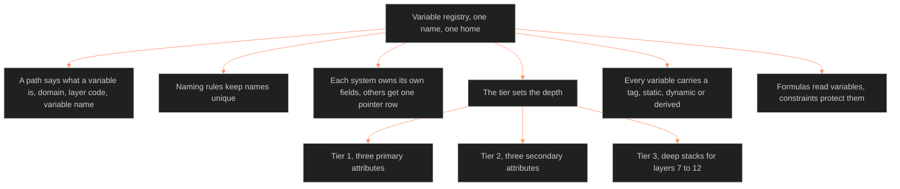

**Who it's for:** a writer or designer asking why variables live in one registry · **What it does:** explains why the registry exists and how its parts fit · **Type:** concept

# Variable registry: one name, one home

*The mind model: one registry is the single lookup, and its path, tiers and tags decode any variable.*

## Every variable has one lookup

The registry is the single lookup for every variable in the character system. Any document, template, formula, flag or tool that names a variable uses the canonical name defined here. A designer registers a new variable here first.

## A path says what a variable is

Every path reads `[DOMAIN].[LAYER_CODE].[variable_name]`. The domain says the kind. The kinds are tier 1, 2 or 3 attribute, derived statistic, flag, astrology, state diff, metadata, relationship or module. The layer code says the layer. The name says the variable. A reader decodes the whole variable from the path.

## Naming rules keep names unique

Variable names use snake_case, layer codes use upper case, and no name passes 30 characters. No two variables share a name in any namespace. These rules let a tool find a variable by name alone.

## Each system owns its own fields

The registry holds the character fields, derived statistics, flags, astrology and state-diff paths, and the module namespace. For every other system it holds one pointer row. A field kept in two places drifts, so the registry never copies one.

## The tier sets the depth

Tier 1 holds the three primary attributes. Tier 2 holds the three secondary attributes. Tier 3 holds the deep stacks for layers 7 to 12. Each variable lists its minimum tier. A lower-tier character skips the deeper fields.

## Every variable carries a tag

A tag says how a variable moves. Static is set once at origin. Dynamic changes across the story, and each change is a state diff. Derived is computed from layer values and never stored as a diff. No variable ships without a tag.

## Formulas read variables, and constraints protect them

Derived statistics and flags read named variables. Some variables hold constraints, such as even values only, so formulas divide exactly. The [base 60 concept](../ssot_00_base_60_number_system/1-concept.md) explains why.

## The long read

The registry grew in layers. Version 1.0.0 held 50-plus layer variables, six derived statistics, five flags, 25-plus astrology variables, state-diff fields and metadata. Version 1.1.0 added four fields from the L9 propagation. Version 1.2.0 folded in 94 slice fields, each with a tag, scale class, source and consumer. Version 1.2.1 renamed `narrative_invariant` to `touchstone` and kept one alias row. Some fields have read aliases, such as `primary_attachment_object` for `secure_base_object`. An alias gives an old name a way to stay readable while the canonical name moves. See the [reference](2-reference.md) for every entry.

Related pages: [reference](2-reference.md) · [how-to](3-how-to.md) · [tutorial](4-tutorial.md)
