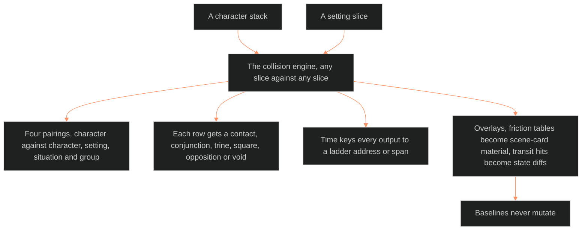

**Who it's for:** a writer or designer asking why slices are read against each other · **What it does:** explains why friction is dramatic material · **Type:** concept

# The collision engine: why friction is the material

*The mind model: two slices meet in the engine, every output carries a time address, baselines never change.*

## Drama lives where two things rub

A character stack alone describes a person. A setting slice alone describes a place. Neither one produces a scene. The collision engine reads one slice against another, and the friction between them becomes the scene. Generalized synastry is the engine's model: any slice against any slice.

## The engine sits above the schemas and never touches them

The Command ruled the architecture on 2026-08-26. The engine is a layer above the entity schemas. It feeds results back down as overlays: friction tables become scene-card material, and transit hits become state diffs. Baselines never mutate. The engine inherits the immutability rule of Cat 11, 12 and 13 verbatim, so no operation modifies the natal record.

## Time keys every output

Time is the substrate. The engine keys every output to a ladder address or span. A collision with no address cannot be placed in the story, so the engine refuses to produce one. The [scale ladder](../ssot_01_scale_ladder/1-concept.md) supplies those addresses.

## Four pairings cover the story

The engine names four classes: character against character, character against setting, character against situation, and character against group. Each class has its own machinery. Each writes its own output record. The first three are specified. The group class waits for the first ensemble need.

## A healthy table has cold rows

Each row of a collision table gets a contact: conjunction, trine, square, opposition or void. Void is a legal result. It means the two layers produce no drama, and that is information. The discrimination rule follows: an engine that declares every row hot is astrology-as-flattery, not analysis.

## The proof found what canon already knew

The Command ran the engine on Tori Midnight against the DCUS, all twelve rows. It found seven hot rows, two cold rows and one canon gap. It re-derived one beat canon already held, the economic tracker's first detection. It found one thing canon had not stated. The source calls that the instrument working.

## The tool stays clinical so the output can burn

The three-check lines state the stance. The fantasy line is "God of chemistry". The sexy line is that synastry is about chemistry, so the tool stays clinical. The aesthetic line is the mirror diagonal. Each line keeps the engine's method plain and lets the scenes carry the heat.

## The long read

The engine joins two vocabularies for one relationship. When a pair of characters is the storyform's RS, the composite chart is the RS throughline's astrological body. The Dramatica reading and the astrology reading describe one object. The proof shows the same join at larger scale. Row 12 of the Tori run needs no interpretation. The storyform already binds the main character into the OS arena. The engine reads that row for nothing. It is the storyform itself.

Next, see the [reference](2-reference.md) for every class, contact and row.
