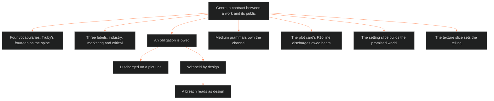

**Who it's for:** a writer asking why genre is a system · **What it does:** explains genre as a contract between a work and its public · **Type:** concept

# The genre system: genre is a contract

*The mind model: genre is a contract, the genre system names what a work owes, other systems discharge it.*

## A genre is a promise made to a reader

The genre system treats genre as the contract between a work and its public. The contract names the label a work is sold under and the family it belongs to. It also names the conventions the work owes the reader. The reader holds the work to that promise before the first scene is drafted.

## The contract reading is one tradition of three

The Command's contract reading is not the neutral default. Bawarshi and Reiff trace three incompatible traditions: literary, linguistic and rhetorical. The Command's reading comes from the literary-structuralist branch, Jameson's genres as social contracts. Miller's rhetorical tradition, genre as typified social action, is the field's dominant position today.

## A convention list is not enough

Trade convention lists name what a genre owes. The shelf adds four clauses those lists never carry. Truby supplies the moral argument and core binary. Todorov supplies the reader's stance and resolution mode. Mendlesohn supplies the delivery mode. Neale supplies the industrial life of a label. The system makes each clause a required field.

## Four vocabularies cover one territory

Snyder's ten, Coyne's clover, Selbo's sixteen and Truby's fourteen all describe the same reader contract. They are four vocabularies, not one vocabulary spelled four ways. None maps onto another without remainder. A model that borrows one list wholesale loses what the other three see. The Command keeps Truby's fourteen as the spine and carries the rest as aliases.

## Genre is a process, not a corpus

Neale's law says industry, marketing, critical and audience uses of one label diverge at the same moment. No single definition serves all four. So the system stores three labels as three fields: industry, marketing and critical. A critic-coined category can be a legitimate genre with no industry name.

## Genre owns the obligation, other systems discharge it

The genre system names what a work owes. Four other systems pay it. Medium grammars own the channel. The plot card's P10 line discharges owed beats one by one. The setting slice builds the promised world. The texture slice sets the telling. This split keeps each fact in one home.

## A breach reads as design

The contract runs as a loop. An obligation is owed. It is discharged on a plot unit, or withheld by design. A breach reads against the obligatory scene as a deliberate choice, never as an error. The loop recurs at every rung of a work and across a genre's own history.

## The long read

The twelve layers mirror the character, setting, plot and texture stacks. They run from surface to depth to structural function. G12 is fed from the storyform, exactly as L12, S12, P12 and T12 are. A genre entry with G12 empty is a shelf label: owed conventions with no argument to serve. A genre entry with G12 filled is the argument's contract. Medium is deliberately not a layer. It belongs to the [medium grammars](../ssot_01_medium_grammars/1-concept.md), linked at G1 and G8 and never re-derived here.

The OXO instance shows the method. Cultcore is OXO's series genre, ruled 2026-09-29. Every other OXO line is a worked example awaiting phase 2.

See the [reference](2-reference.md) for every layer and field.
