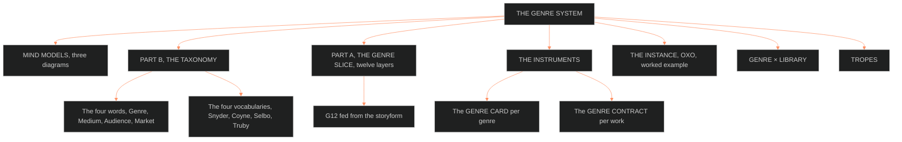

**Who it's for:** a writer or builder looking up a genre fact · **What it does:** lists each layer, field, instrument and source · **Type:** reference

# The genre system: reference

*The page as a tree: the taxonomy, the twelve-layer slice and the instruments, then instance and library.*

Source: [📐 ssot_01_genre_system.md](../../../_SSOT/01_NARRATIVE_FRAMEWORKS/📐%20ssot_01_genre_system.md). Version 1.1.0, ruled 2026-10-04 (Chief: "rec"; BOLO 100). Trunk: BLACK. Applies to all IPs. Why it exists: [concept](1-concept.md).

## MIND MODELS

The source carries three Mermaid diagrams.

- **Diagram 1, the whole system.** Root: THE GENRE SYSTEM. Branches: the four words (Genre, Medium, Audience, Market). The Genre Slice has twelve G-layers, with G12 fed from the storyform. The instruments are GENRE CARD per genre and GENRE CONTRACT per work. The library holds BVX.0191, 0576, 0580, 0581, 0614, 0599, 0236, 0163, 0175. The boundaries: medium is the medium grammars doc, and beats are P10 on the plot card. World is the setting slice, and telling is the texture slice.
- **Diagram 2, Neale's process loop.** Industry label plus market position feeds the text's contract. The contract feeds audience expectation plus verisimilitude regime. That feeds uptake, and uptake feeds the industry label again. The four vocabularies (Snyder, Coyne, Selbo, Truby) feed the contract node.
- **Diagram 3, the contract discharged per unit.** States: Owed, Discharged (P10 fires on a plot unit). Then Breached (withheld by design), Revised, and Owed again at the next unit. A breach is design, never error.

## PART B · THE TAXONOMY, the four words and the four vocabularies

**The four words**

| Word | What it decides | Owned by |
|---|---|---|
| Genre | The label, family and conventions a work is sold and read under | This doc; fed by BVX.0191 and BVX.0236 |
| Medium | Which channel's grammar re-instruments the telling, M1 to M10 | [medium grammars](../ssot_01_medium_grammars/2-reference.md), linked at G1 and G8 |
| Audience | The cognitive model a genre builds in a reader | BVX.0576 (the ICM), BVX.0581 (uptake) |
| Market | The industrial cycle, budget tier and risk position | BVX.0580 |

**The four vocabularies**

| Vocabulary | Count | Basis | Names the others do not carry |
|---|---|---|---|
| Snyder's ten (BVX.0163) | 10 | Commercial, page-keyed | Golden Fleece and Whydunit |
| Coyne's clover (BVX.0236) | 5 axes; Content splits to about 9 external and 3 internal kinds | Theoretical, five independent axes | Comedy sits on the Style leaf, not Content |
| Selbo's sixteen (BVX.0576) | About 16 chaptered, plus a 30-term overview | Industry marketing category | Coming-of-Age and Fish-Out-of-Water as full genres; splits Action from Adventure, Disaster from War |
| Truby's fourteen (BVX.0191) | 14 | Moral-argument tradition, fixed chapter schema | Myth, Science Fiction, Fantasy, Gangster have no Coyne content-genre name |

**Rules and facts**
- Truby's fourteen are the spine of the GENRE CARD register. The other three are aliases (OPEN 3, ruled 2026-09-16).
- Bawarshi and Reiff name three traditions: literary, linguistic, rhetorical. The Command's contract language is literary-structuralist.
- Neale's law: genre is a process, not a corpus. G1 carries three labels as three fields.
- A critic-coined genre (film noir) is a legitimate study object when criteria are explicit. The corpus must also not be built backward from a canonized core.

## PART A · THE GENRE SLICE, twelve layers, mirror of the character, setting, plot and texture stacks

Layer names are house coinage, ruled 2026-09-16 (OPEN 2).

| Layer | Question it answers | Source | Field it writes |
|---|---|---|---|
| G1 LABEL | What is the work called by industry, marketing and critics, and do they agree? | BVX.0580 | `industry_label`, `marketing_label`, `critical_label` |
| G2 FAMILY | Which family, and what is its polar opposite? | BVX.0191, 0236 | `family`, `polar_opposite` |
| G3 CONTRACT | What conventions does the genre owe: components, criteria steps, obligatory scenes? | BVX.0576, 0236, 0163 | `basic_elements`, `criteria_steps`, `obligatory_scenes` |
| G4 ARGUMENT | What moral argument, what core binary, does the structure prove? | BVX.0191 | `core_binary`, `mind_action_view`, `thematic_recipe` |
| G5 STANCE | What position does the reader hold, and how does the hesitation resolve? | BVX.0614 | `resolution_mode` |
| G6 DELIVERY | How does the strange enter, is it explained, and to whom? | BVX.0599 | `delivery_mode` |
| G7 VERISIMILITUDE | Against which two verisimilitudes is the genre judged plausible? | BVX.0580 | `verisimilitude_regime` |
| G8 WORLD | What story-world does the genre promise to build? | BVX.0191 | `world_build` |
| G9 UPTAKE | What does the genre call forth, and which genre answers next? | BVX.0581 | `uptake_chain` |
| G10 AUDIENCE | What cognitive model (ICM) does the genre build before a scene? | BVX.0576, 0089 | `icm` |
| G11 MARKET | What cycle, budget tier and risk position does the label carry? | BVX.0580 | `cycle`, `budget_tier`, `risk_position` |
| G12 FUNCTION | What does the genre do for the Grand Argument? | BVX.0089 | `story_point`, `storyform_id` |

**Layer notes**
- G5 carries Todorov's spectrum: hesitation sustained or resolved, resolving to uncanny, marvelous, or the pure fantastic at the median.
- G6 carries Mendlesohn's four delivery modes: portal-quest, immersive, intrusion, liminal. None is interchangeable.
- G7 carries Neale's two verisimilitudes: the generic regime and the cultural regime.
- G4 holds only the propositional binary. Affective telos (catharsis, wonder) lives on the texture mood curve, T7.
- G1 keeps three label fields, never one.

**Handoffs (IF catalog calls 2 and 3, ruled 2026-10-05)**. The writer hands G4's `core_binary`, `mind_action_view` and `thematic_recipe` to the [06 theme system](../../../_SSOT/06_THEME_SYSTEMS/📐%20ssot_06_theme_system.md). The 06 theme system takes them as the seed of the controlling idea. The writer points G8's `world_build` promise at the [05 worldbuilding catalog](../../../_SSOT/05_WORLDBUILDING_SYSTEMS/📐%20ssot_05_worldbuilding_system.md). The `WB-<TYPE>-<nnnn>` entries (rules, institutions) make the promise good.

**Binding rule.** G12 is fed independently from the storyform, keyed by `storyform_id`. G12 empty means a shelf label. G12 filled means the argument's contract. Medium is deliberately not a G-layer.

## THE INSTRUMENTS · the GENRE CARD and the GENRE CONTRACT

**The GENRE CARD.** One per genre. It merges Truby's chapter schema with Selbo's field list.

| Field | Holds | Layer |
|---|---|---|
| name & labels | industry / marketing / critical labels | G1 |
| family | family placement, polar opposite | G2 |
| basic elements | criteria steps, obligatory scenes | G3 |
| core binary | Mind-Action philosophy, thematic recipe | G4 |
| resolution mode | sustained hesitation, resolves natural, resolves supernatural, or normalized from the start | G5 |
| delivery modes | portal-quest, immersive, intrusion, liminal | G6 |
| verisimilitude | generic regime, cultural regime | G7 |
| world build | the promised story-world | G8 |
| calls forth | what the uptake chain answers next | G9 |
| audience ICM | schematic, specific and relevant knowledge | G10 |
| market notes | cycle, budget tier, risk position | G11 |
| transcending | named hybrid variants | none |
| expiry_note | when a rival vocabulary absorbs the conventions: date and successor | none |

**Card completeness rule (G3).** Each card lists exactly three required ingredients (the ingredient triad, BVX.1125). Fewer is a shelf label. More is a split. The writer counts them before filing.

**The GENRE CONTRACT.** One per work.

| Field | Holds |
|---|---|
| primary genre | The overriding genre |
| mix | Overriding plus supporting genres, percentage balance (Selbo) |
| delivery mode | Portal-quest, immersive, intrusion or liminal |
| resolution mode | Per the card's G5 |
| register | The sensorium promise (links texture T6, setting S3) |
| obligations owed | A list, each discharged on the plot card's P10 line |
| storyform binding | `storyform_id` |
| contract_state | A list parallel to Axis 4 TIME; each entry holds `from_unit`, the changed field and the new value |

**Contract state track.** The contract is fixed once per work unless `contract_state` says otherwise. Units before `from_unit` read the first value. Units from it onward read the new one. The `from_unit` value is an 08 time code (IF catalog call 1, ruled 2026-10-05).

**Mix rule.** The overriding genre must clear its own criteria in full. A supporting genre counts toward the mix only if its criteria are substantially met.

**Genre-contract tool (IF catalog call 10, ruled 2026-10-05)**. Ryan's nine-axis ontological scoring (BVX.0630) is the genre-contract tool for 01 and 03 both. Baur's five-lineage taxonomy (BVX.0458) stays as lineage.

**The genre-load metric (method).** The writer scores each unit on `genre_load`, an integer 0 to 3.

| Score | Meaning |
|---|---|
| 0 | The unit owes nothing and discharges nothing |
| 1 | It touches an obligation in passing |
| 2 | It discharges or breaches one obligation as a main beat |
| 3 | The unit exists to discharge or breach the contract |

The writer scores only units whose P10 is filled; the rest stay blank, not 0. The field sits on the plot card and the inheriting scene card, under P10. The movement average is the sum divided by scored units. The writer compares it, and the share at 2 or 3, against the mix percentages. A supporting genre that never reaches 2 is gestured at, not met.

> **OPEN:** the first genre-load trial on OXO is parked as "genre-load trial (phase 2)".

## THE INSTANCE · OXO, worked example (phase 2 fills)

A worked example, not a ruling, except G1. Each line stays parked until Chief strikes or keeps it.

| Layer | OXO line |
|---|---|
| G1 | Cultcore, RULED 2026-09-29 (BOLO 91), OXO's series genre and critical label. Industry and marketing label reads as a prestige-school drama, a YA-adjacent institutional dystopia |
| G2 | Truby's Coming-of-Age primary, individual-focus family; polar opposite the Gangster/Crime society-focus family |
| G3 | Weakness-need and self-revelation frame, system-as-opponent, apparent-choice-versus-restriction world build, Coyne's obligatory scenes for Worldview and Society genres |
| G4 | Merit does not earn freedom; visibility invites ownership |
| G5 | The generalized fantastic: the abnormal given as norm from page one; an adaptation-curve payoff (Todorov) |
| G6 | Immersive: natives, not visitors; Sync is used, never explained (Mendlesohn) |
| G7 | Cultural regime of the American prestige school; generic regime of the institutional dystopia |
| G8 | The Southern Gothic register ruling, the DCUS slice, the descent clean to NEON-ROT to hunt |
| G9 | Series, six movements, seriality's own poetics |
| G10 | Selbo's ICM for coming-of-age and institutional dystopia, stacked; Vicarious V dominant |
| G11 | Mid-budget serial, YA-adjacent shelf; unknown where the distills are silent |
| G12 | `storyform_id: oxo_primary_v1`; appreciations arena, style and feel from the spine |

**Cultcore conventions (G3 basic elements, each parked until Chief rules).**
1. Outsiders set against an institution that shapes identity, not merely one that restrains.
2. The cult-as-container: power holds inside a bounded space and fades or turns dangerous once the container breaks. It is Touchstone TS 1:1, soft strength, BOLO 91.
3. The newcomer-vs-group induction beat: Snyder's Institutionalized obligatory scene, discharged at scene level per P10 (call 77-Z).
4. Visibility as the institution's currency: being seen and ranked is both reward and danger.
5. Belonging and selfhood trend opposite: the closer she is drawn in, the more of her prior self she gives up.

> **OPEN:** every OXO line except G1, and all five cultcore conventions, wait for Chief and the phase 2 genre reading.

## GENRE × LIBRARY

The L7 shelf holds 174 items keyed 9/16 (BOLO 18), nine distilled to date.

| ID | Book | Feeds hardest | Gives the system |
|---|---|---|---|
| BVX.0191 | Truby, *The Anatomy of Genres* | G2, G3, G4 | Fourteen genres as moral-argument traditions; chapter schema; the dystopia mechanism |
| BVX.0576 | Selbo, *Film Genre for the Screenwriter* | G3, G10 | The ICM; overriding and supporting genre; percentage-balance audit |
| BVX.0580 | Neale, *Genre and Hollywood* | G1, G11 | Inter-textual relay; two verisimilitudes; three labels; genre as process |
| BVX.0581 | Bawarshi & Reiff, *Genre* | G9 | Typified social action; uptake; meta-genre; three traditions |
| BVX.0614 | Todorov, *The Fantastic* | G5 | Reader position; hesitation; resolution spectrum; a genre's expiry |
| BVX.0599 | Mendlesohn, *Rhetorics of Fantasy* | G6 | Four delivery modes |
| BVX.0236 | Coyne, *The Story Grid* | G3 | Five-leaf clover; obligatory scenes; Content split |
| BVX.0163 | Snyder, *Save the Cat!* | G1, G3 | Ten commercial genres; page-timed beat sheet |
| BVX.0175 | McKee, *Story* | G3 | Genre as audience contract; convention-and-prop-list method |
| BVX.1125 | Brody, *Save the Cat! Writes a Novel* | G3 | Her ten alias Snyder's; the ingredient triad |
| BVX.1126 | Aristotle, *Poetics* | G4 | Hamartia as action-level error; catharsis maps to the mood curve; wonder as tragedy's telos |

Next candidates by name: BVX.0840 Carroll, BVX.0577 Grant, BVX.0620 Horsley, BVX.0190 Black. After those come BVX.0232 Storr, BVX.0257 Cron, BVX.0564 Dunleavy, BVX.0642 Bould. Truby's two Anatomy books (BVX.0193, BVX.0191) have no Zotero record: an orphan pair.

**Interfaces.** Read from 07: the 07.1 style bible is the home of the meta-genre. Each IP's telling profile is a meta-genre instance under it (IF-01-07-07).

## TROPES

Added 2026-09-29 (BOLO 89). The [trope register](../ssot_01_trope_register/2-reference.md) keys every TV Tropes trope in the genre domain to G1 through G12. The pull list lives at `_tools/tropes/data/domains/LAYERS.md` under genre. A layer that needs a known pattern pulls from its list. The register holds each trope's one-line definition.

**Closed OPEN calls (ruled 2026-09-16 or 2026-10-04).** Twelve layers hold (1). Names stay provisional (2). Truby is the register spine (3). Four clauses become required fields (4). Balance adopted, metric defined (5). Mode row built in medium grammars v1.1.0 (6). `contract_state` built (7). Neale keying rule landed in the Zotero README (8). Meta-genre landed in ssot_07_1_prose_style (9). `expiry_note` built (10). Dystopia mechanism landed in the setting system (11). OXO bench is the worked example (12). Three label fields (13). Ingredient triad rule (14). G4 affect note (15).
