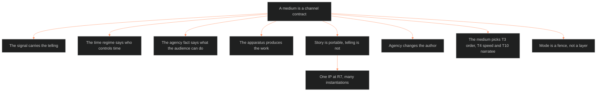

**Who it's for:** a writer asking why each medium re-tells a story · **What it does:** explains the channel-contract law · **Type:** concept

# The medium grammars: the medium is a contract

*The mind model: a medium is a contract of four facts, and each medium rebuilds the telling.*

## A medium is a channel contract

The grammars doc defines a medium by four facts. The signal carries the telling. The time regime says who controls time. The agency fact says what the audience can do. The apparatus produces the work. Together they form a contract between the channel and the audience.

## Story is portable, telling is not

The governing law reads: story-side is medium-independent, and discourse-side is where the medium bites. A storyform survives adaptation intact. A Telling Profile does not. Every medium re-instruments the Ten Questions with its own machinery.

## One IP, many instantiations

This is the transmedia principle from McErlean (0126). The IP sits at R7 of the [scale ladder](../ssot_01_scale_ladder/1-concept.md). Each medium then instantiates it. The writer keeps the storyform and rebuilds the telling per channel.

## Agency changes the author

Six media have no audience agency. Games give the player co-authorship. A TTRPG gives the table collective authorship. Short-form gives only the swipe, and the retention economy turns that swipe into a verdict on every second. In games the contract inverts: the player co-authors.

## The medium picks which texture answers change

Three texture answers move most per channel: T3 order, T4 speed and T10 narratee. The grammars restate them medium by medium. Film turns focalization into shot selection and duration into editing. Prose keeps interiority native and duration elastic. A game collapses the narratee into the player.

## Mode is a fence, not a layer

Mode means animation, documentary, mini-series and the like. It changes how a genre is made and sold. It does not change what the genre owes the reader. So the grammars doc lists mode per medium, and the genre system never holds it.

## Craft lives here, content lives elsewhere

The ORANGE rows ride the subsidiary firewall. This public doc carries craft grammar only. Content systems live on the Ultrasin side. The three gap mediums, music video, social and PMV/HMV, are v1 scaffolds until the BOLO 16 pass deepens them.

## The long read

The grammar of each medium follows from its contract. TV is film grammar plus the R6 and R7 machinery made native. Seasons become nested storyforms. "Previously on" becomes repetition as apparatus. A TTRPG is the purest structural mirror of the lattice. The GM acts as a live extradiegetic narrator. Rules act as Touchstones made mechanical. Sourcebooks act as printed setting slices. The scaffolding runs both directions: TTRPG books validate the slice, and the slice can author TTRPG books.

For every medium's rules, see the [reference](2-reference.md).
