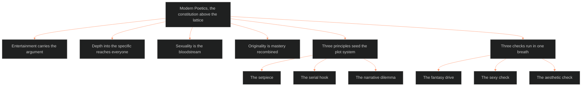

**Who it's for:** a writer asking what the Command's stories must be · **What it does:** explains the prescriptive constitution · **Type:** concept

# Modern poetics: the constitution of the house stories

*The mind model: Modern Poetics sits above the lattice as a constitution, and each principle rules one part.*

## The lattice describes, the poetics command

The lattice's machinery answers what a story is. Modern Poetics answers what our stories must be. It sits above the lattice as a constitution, not beside it as a lens. Every principle carries a forbid-list. These principles are Touchstone-shaped and candidate Standing Orders.

## Entertainment carries the argument

The primacy principle says the primary function of storytelling is to entertain. All other objectives ride on its back. The spine says a story is a Grand Argument. The two compose. The argument is the cargo, and entertainment is the delivery system. Storyforming decides the argument. Storyencoding and storyweaving are where entertainment-first governs.

## Depth into the specific reaches everyone

The audience contract says house stories are for Americans: rooted, localized, specific. Universality comes by depth into the specific, never by flattening. The American terrain is story fuel, not backdrop.

## Sexuality is the bloodstream

Sexuality is aesthetic, not genre. It lives in the narrative's DNA. The writer neither flattens it to sex scenes nor neuters it to metaphor. This is the BLACK/ORANGE seam stated as doctrine.

## Originality is mastery recombined

The library charter says originality is mastery recombined with intent, not rebellion from ignorance. The writer knows the canon in order to bend it. This is the BVX-LEARN thesis in doctrine form.

## Three principles seed the plot system

The setpiece, the serial hook and the narrative dilemma are the first shelves of the plot_systems domain. The setpiece is the apex unit of spectacle. The hook welds the ladder's containers. The dilemma advances plot and exposes character in one stroke.

## Three checks run in one breath

Chief coined three native checks on 2026-08-31: the fantasy drive, the sexy check and the aesthetic check. The mode is the doctrine. Each answer comes off the cuff, in one breath, in voice-memo register. Taxonomies, nested frameworks, meta-layers and scoring rubrics are forbidden for all three. Chief's voice is the line of quality and the canon form.

## The long read

The project has three generations. The 2023 FUZZ intertext fed the May 2025 Leechseed Manifesto, which fed the 2026 Story Lattice. The proof of continuity is concrete. The Drop's tone ruling of 8/26 ("007/Kojima blockbuster sincerity") restates the primacy dictum from May 2025. The American Experience doc named Southern Gothic fifteen months before DCUS was ruled into that register. The recurring stall pattern ran a full cycle on this material, and this doc closes it. Originals stay untouched in the imported-Joplin manifesto folder. The canonization is non-destructive.

For each principle's law, forbid-list and dictum, see the [reference](2-reference.md).
