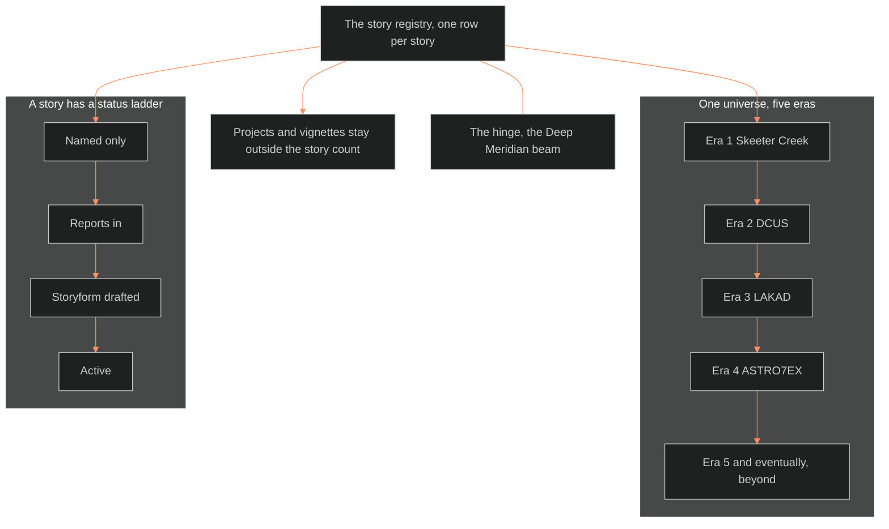

**Who it's for:** a writer asking why one file lists all stories · **What it does:** explains the registry's single-list rule · **Type:** concept

# The story registry: one list, one row per story

*The mind model: one registry lists every story, the eras run outward, and projects stay outside the count.*

## Nothing else lists stories

The registry is the one place that lists every story in the universe. A story joins the registry before any doc names it in `applies_to`. A story joins before any tracking file starts for it. The workspace's `stories:` filter and every doc's `applies_to` read from here.

## One universe, five eras, moving outward

The universe is one eon in five eras, ruled 2026-09-29. They run from Earth outward. Era 1 is Skeeter Creek, the founding through the Red Hills century. Era 2 is DCUS on Earth. Era 3 is LAKAD in cislunar space. Era 4 is ASTRO7EX on the Moon. Era 5 is "and eventually, beyond". Overlap is allowed at the seams.

## A hinge joins the eras

The hinge is the Deep Meridian beam. A drill probe at Deep Meridian fires a radiation beam that signals the quasar reaching Vivian's time. The Moon Severance and the AI Collapse follow. Deep Meridian is a place and an event, not a story. The fabula's world clock holds the full note.

## A story has a status ladder

A row's status climbs a ladder: named only, reports in, storyform drafted, active. A story sourced from a digest and not yet ruled reads provisional (seed). The ladder says how real a story is without hiding the seeds.

## Seeds sit beside active work

The registry holds the active story, OVEREXITOUT, next to seeds and named-only rows. Every row has the same columns. Chief decides which seeds grow. Blank slots carry two marks. A dash means unnamed. A parked marker means Chief deferred the slot to a pass. Neither mark counts as unfinished work.

## Projects and vignettes stay outside the story count

Games, businesses and tools are projects, not stories. They get their own table. A vignette is a short told piece with no full arc. It shows one place, group or custom, so the world builds up around it. It carries no storyform and never counts as a story. A vignette is lineage by default and becomes canon only when Chief rules it in.

## The long read

The registry names its own boundaries. The Outliers is OXO's series title, not a second story. BVIPDS and Bold Venture are the methodology and studio, not a story. In the LEECHSEED row, the Sockett is marked PORTABLE, so other stories may borrow it. Generation Zero's vanished-precursor framing echoes the AI Collapse structurally. The registry logs that echo and does not link it. Linking later is free.

For each row and field, see the [reference](2-reference.md).
