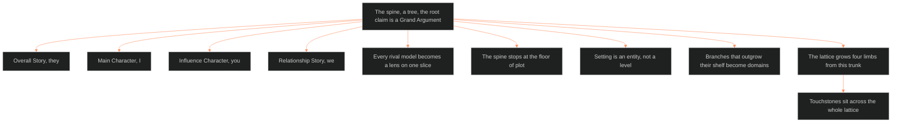

**Who it's for:** a designer building an IP · **What it does:** explains why one tree answers "what is a story" · **Type:** concept

# The story spine: one tree, many lenses

*The mind model: one Grand Argument roots the tree, four seats complete it, and rival models become lenses.*

The source doc is [📐 ssot_01_story_spine_comparative_tree.md](../../../_SSOT/01_NARRATIVE_FRAMEWORKS/📐%20ssot_01_story_spine_comparative_tree.md). Look up facts in the [reference](2-reference.md). Do tasks with the [how-to](3-how-to.md). Learn by doing in the [tutorial](4-tutorial.md).

## A story needs one answer to "what is it made of"

Chief ruled one canonical answer to "what are the components of a story." That answer is the **spine**. The spine is a tree, and Dramatica is the ruled model.

Dramatica won because it is the only model that is a complete tree. Every rival model is a list. A list names parts. A tree says how the parts nest.

## Every rival model becomes a lens

The Command does not throw the rivals away. Each rival model maps onto the spine as a lens. Aristotle, Egri, McKee, Campbell, Truby, Snyder, Coyne and the others each model one slice of the tree. The spine shows which slice.

The rival map gives each model a verdict. Campbell and Vogler model only the main-character line. Snyder gives a timed beat template, not a theory. The verdicts keep the shelf honest. No rival replaces the tree.

## The root claim is an argument

The spine defines a story as a **Grand Argument**. The story makes one complete argument, through one Story Mind, that an approach to a problem succeeds or fails. Every level below the root exists to make that argument airtight from every angle.

Egri's premise is the direct ancestor of this claim. McKee's controlling idea and Egri's premise compress the same thing.

## Four seats make the argument complete

The spine examines one problem from four seats. They are Overall Story (they), Main Character (I), Influence Character (you), and Relationship Story (we). No rival model has all four. Most rivals fold the main character into the overall story and treat the other two as subplot. This is the spine's largest structural advantage.

The second advantage is that function and perspective are independent. A protagonist is not always the main character. An antagonist is not always the influence character.

## The spine stops at the floor of plot

The spine says what a story is. It does not author events, psychology or presentation. Plot systems author scenes, beats and sequences. The LEECHSEED Character System and Character Astrology flesh out persons. The texture system governs the telling.

The spine constrains. It never authors. This boundary lets the spine stay one tree while other systems grow from it.

## Setting is an entity, not a level

Chief ruled that setting stays an entity, never a spine level. Old textbooks list setting beside plot and character as an ingredient. The Command treats a place as a person. A place has its own 12-layer sheet, changes over time and can be compared with characters. A bullet point cannot do any of that.

The touchpoint map links setting to each spine level by relation, not membership.

## Branches that outgrow their shelf become domains

Each spine level has a first layer of branches and a starter shelf of sources. A branch that outgrows its shelf becomes its own domain. Character did (02). Setting did (03). Plot is next (04).

## The lattice grows four limbs from this trunk

The spine covers the structure axis only. Four sibling modules grow from it: the scale ladder, the setting system, the texture layer and the medium grammars. The lattice is IP-agnostic. The Outliers is the test bed that each module validates against. It does not own the lattice.

Touchstones sit across the whole lattice as a constraint layer. Tropes describe. Touchstones forbid.

## The long read

The spine answers a question that most craft books answer in pieces. Aristotle names plot, character, thought, diction, melody and spectacle. Egri proves a premise. McKee charges every scene with value. Campbell walks one hero down one road. Each is right about its slice. Each fails when it claims the whole.

Dramatica claims the whole and earns it by structure. Its four throughlines make four complete perspectives. Its nesting runs Domain, Concern, Issue, Problem, in quads of four. Its eight dynamics say how the story moves and how it ends. The outcome and judgment pair gives the ending matrix: triumph, personal triumph, hollow victory, tragedy. The Outliers takes the personal triumph shape: Failure with Good judgment.

The Command adds a house layer. Every library source gets a spine address through the `feeds:` field. The spine becomes the keying structure for the library. A book on Egri files at L0, and a book on genre files at L7.
