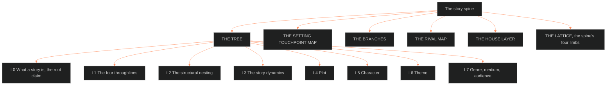

**Who it's for:** a designer or writer looking up a level or a rival · **What it does:** lists every component of the spine doc · **Type:** reference

# The story spine: reference

*The page as a tree: THE TREE runs from L0 to L7, and five more sections sit beside it.*

Source: [📐 ssot_01_story_spine_comparative_tree.md](../../../_SSOT/01_NARRATIVE_FRAMEWORKS/📐%20ssot_01_story_spine_comparative_tree.md), version 1.0.2, trunk BLACK, status canonical (ruled by Chief 2026-08-25). Why it exists: [concept](1-concept.md).

**Header facts.** Dependencies: `ssot_02_dramatica_integration_protocol`, `oxo-storyform` (populated instance). Applies to: OVEREXITOUT, BVX-LEARN, all future IPs. Tier: narratology.

**Division of labor.** Dramatica is the structure engine. It covers the argument and each character's mechanical role. It does not produce plot events, psychology or presentation. Those belong to plot_systems, the 12-Layer Database and Character Astrology.

## THE TREE

The canonical tree, levels L0 to L7. Each level names the Dramatica position, then the rival models that land there.

### L0 · What a story is — the root claim

Dramatica: a story is a **Grand Argument**. One Story Mind makes a complete argument that an approach to a problem succeeds or fails. It also argues that the approach is worth it or not.

| Rival | Root claim |
|---|---|
| Aristotle | mimesis of a complete action (plot primacy) |
| Egri | proof of a premise ("X leads to Y"); the direct ancestor of the Grand Argument |
| McKee | character revealed through choice under pressure; the controlling idea |
| Storr / Cron | a simulation the brain runs to learn; models the audience, not the artifact |

Sources: BVX.0089 · BVX.1123 · BVX.1126 · BVX.0175.

### L1 · The four throughlines — one problem, four perspectives

| Throughline | Perspective | Rival vocabulary |
|---|---|---|
| **OS** Overall Story | THEY, the problem among everyone | "the A-plot," McKee's arch-plot, the external genre (Coyne) |
| **MC** Main Character | I, the problem from inside one skin | the hero's journey (Campbell/Vogler models only this line) |
| **IC** Influence Character | YOU, the perspective that pressures the MC to change | mentor/shadow/love interest; McKee's Character (BVX.0064) feeds the house IC derivation |
| **RS** Relationship Story | WE, the argument between MC and IC | "the B-story" (Snyder), the internal genre (Coyne) |

No rival model has all four.

### L2 · The structural nesting — Domain → Concern → Issue → Problem

Each throughline descends four levels. Each level is a quad (four elements in dynamic tension).

| Level | Count | What it fixes |
|---|---|---|
| Domain (Class) | 4 | Situation (Universe) · Activity (Physics) · Fixed Attitude (Mind) · Manipulation (Psychology) |
| Concern (Type) | 16 | what the throughline is about (Situation: The Past / Progress / The Future / The Present) |
| Issue (Variation) | 64 | the thematic axis, always with a Counterpoint |
| Problem (Element) | 64 unique | the atomic engine: Problem / Solution / Symptom (Focus) / Response (Direction) |

Each throughline claims one Domain. The structure chart is BVX.0091. The OXO §9 rotation is an instance of the exclusivity.

### L3 · The story dynamics — the eight switches

| Dynamic | Values | OXO instance |
|---|---|---|
| Resolve | Change / Steadfast | Change |
| Growth | Start / Stop | Stop |
| Approach | Do-er / Be-er | Do-er |
| Problem-Solving Style | Linear / Holistic | Linear |
| Driver | Action / Decision | Action |
| Limit | Optionlock / Timelock | Optionlock |
| Outcome | Success / Failure | Failure |
| Judgment | Good / Bad | Good |

**Ending matrix** (Outcome × Judgment): Success/Good triumph · Failure/Good personal triumph (OXO's shape) · Success/Bad hollow victory · Failure/Bad tragedy. Weiland's positive/flat/negative arcs equal this matrix plus Resolve. Sources: BVX.0089.

### L4 · Plot — the argument dramatized in time

- **Static appreciations (8):** Goal · Consequence · Cost · Dividend · Requirements · Prerequisites · Preconditions · Forewarnings.
- **Progressive:** each throughline runs 4 Signposts and 3 Journeys. That makes a fixed 4-act order per throughline and 16 signposts across the form. Drivers (action or decision) turn the acts.
- **Below the floor:** scenes, sequences and beats. The storyform constrains them. plot_systems authors them.

| Rival plot model | Where it lands |
|---|---|
| Three-act (Field) | act turns ≈ Drivers; the OS progressive skeleton only |
| Save the Cat (Snyder/Brody) | 15 beats, a timed commercial template over the signpost layer |
| Hero's journey (Campbell/Vogler) | stations ≈ the MC signpost sequence in mythic dress |
| Five acts (Yorke) | fractal act logic; change-as-universal ≈ Resolve generalized |
| Story Grid (Coyne) | five commandments recur fractally; the scene-level grammar the spine does not specify |
| McKee | the gap between expectation and result; value charge per scene |
| Propp / Murphy | function sequences, the signpost grammar's folk ancestor |

Sources: BVX.0089 · BVX.0175 · BVX.0236 · BVX.0163 · BVX.1124.

### L5 · Character — functions before persons

- **64 elements** spread across the cast in four quads of quads: Motivation · Methodology · Evaluation · Purpose.
- **8 archetypes:** Protagonist · Antagonist · Guardian · Contagonist · Reason · Emotion · Sidekick · Skeptic. They are pre-bundled element sets. Complex characters are custom bundles.
- **Protagonist ≠ MC; Antagonist ≠ IC.** Function and perspective are independent axes.
- **House binding:** L12_FUNCTION carries `dramatica_archetype`, `mc_problem_element` (RULED 8/24), the methodology, evaluation and purpose elements, and the dynamics. L12_DRAMATICA_EXTENDED carries the deep cells. L1 to L11 and Character Astrology carry persons, downstream of the spine.

| Rival | Where it lands |
|---|---|
| Egri | three dimensions = proto-L1–L11; unity of opposites ≈ Problem/Solution |
| Truby | character web = element distribution seen socially; moral argument ≈ theme levels |
| Vogler | archetype cast ≈ the 8 archetypes |
| Weiland | arc mechanics = Resolve × ending matrix on the MC line |
| McKee Character (BVX.0064) | role/cast design, already used for the IC derivation |

### L6 · Theme — the argument's value layer

Theme is structural position, not a bolted-on message. Issue against Counterpoint is the 64-level pair. Problem against Solution is the atomic pair. Outcome and Judgment pass the verdict. McKee's controlling idea equals OS Problem/Solution plus Outcome compressed to a sentence. Sources: BVX.0175 · BVX.1123 · BVX.0193.

### L7 · Genre, medium, audience — the outermost ring

- Dramatica's own stance: genre is audience appreciation (arena, style, feel). It is the model's weakest ring.
- Strong holdings: Coyne's genre clover and obligatory conventions; Truby's *Anatomy of Genres*; Snyder's genre wheels as commercial compression.
- **Four production stages:** storyforming (decide the argument) · storyencoding (clothe it in subject matter) · storyweaving (order its exposure) · reception (the audience runs it). The neuro shelf (Storr, Cron) explains stage four.

Sources: BVX.0236 · BVX.0191 · BVX.0576.

## THE SETTING TOUCHPOINT MAP — RULED 2026-08-26

Setting stays an entity (domain 03), never a spine level. The map links setting to each level.

| Spine level | Where setting plugs in |
|---|---|
| L2 Nesting | S12 FUNCTION: a load-bearing place embodies a throughline's Domain (DCUS = OS Situation / The Past) |
| L3 Dynamics | S11 VECTOR: a place's trajectory can run the ending's geometry (DCUS collapse = the Failure/Good corridor) |
| L4 Plot | scene cards (setting + state per scene); setting states keyed to acts; the setting arc as a plot thread |
| L5 Character | the collision diagonal Lx × Sx (Module 5); C×Situation transits fire through place-states |
| L6 Theme | the Argue function mode: the place makes the argument in matter |
| L7 Genre | genre-setting contracts ("Southern Gothic," "western," "space opera") |

## THE BRANCHES — first layer down (breadth pass, RULED + delivered 2026-08-26)

Each level has branches and a starter shelf. Doctrine: a branch that outgrows its shelf becomes a domain. Stage 1 of the full sweep (BOLO 18) is banked in [📐 ssot_01_spine_house_inventory.md](../../../_SSOT/01_NARRATIVE_FRAMEWORKS/📐%20ssot_01_spine_house_inventory.md). RULED 2026-09-16: plot is `04_PLOT_SYSTEMS/`; style guides moved to `06_`.

### L0 · Root — theories of what story is

- **Branches:** argument theory (Dramatica/Egri, the ruled position) · mimesis theory (Aristotle) · audience-simulation theory (neuro school) · myth/transmission theory (Campbell).
- **Shelf:** BVX.0089 · 0603 · 0232 · 0257 · 0616. Egri and Poetics were acquisition gaps. House: this doc; the BVX four-domains artifact.

### L1 · Throughlines — the four seats, each its own anatomy

- **Branches:** OS anatomy · MC anatomy · IC anatomy (the BVX.0064 derivation is house canon) · RS anatomy (plus the composite-chart join, Module 5) · perspective theory (I/you/they/we) · cross-form roles (R6).
- **Shelf:** 0064 (distilled) · 0193. House: oxo-storyform §§2–6 · victoria-midnight · the Anna IC derivation · integration protocol.

### L2 · Nesting — the chart itself

- **Branches:** the four Domains with their 4 Concerns each · quad theory · Issue/Counterpoint mechanics · the atomic quad · chart navigation.
- **Shelf:** 0089 · 0090 (the Dictionary) · 0091 (the structure chart). House: oxo-storyform §9.

### L3 · Dynamics — the eight switches, one node each

- **Branches:** the eight switches · the ending matrix · the arc-taxonomy translation.
- **Shelf:** 0071/0072 (Weiland arcs) · 0127 (Yorke). House: storyform §1.

### L4 · Plot — the richest branch; next domain candidate (plotsystems, 04)

- **Branches:** static appreciations · signposts and journeys · drivers and act turns · act theory (3/4/5-act) · sequence method · scene grammar · beat mechanics · the Movement↔Signpost mapping (standing flag) · plot templates as instances · pacing of events (T4's story-side twin).
- **Shelf:** 0175 · 0236 · 0154 · 0226 · 0274 · 0238 · 0188 · 0092 · 0228 · 0163/0164 · 0127 · 0105 · 0244. House: plot_sequence.TXT · story_engine_settings.TXT · the Six Movements sources · Character Astrology Cat 10 and Cat 13.

### L5 · Character — already a domain

- **Branches:** `02_CHARACTER_SYSTEMS/` is the branch-down: archetypes and 64 elements · the 12-layer stack · the DAI · state architecture · vertical slice · collision Cat 11.
- **Shelf:** 0064 · 0071/0072 · 0193. Egri was a gap. House: the whole 02 domain and victoria-midnight.

### L6 · Theme — the value layer

- **Branches:** premise lineage · Issue/Counterpoint argumentation · value spectrums (Coyne) · moral argument (Truby) · theme-craft (Weiland) · the invariants join (`cost_and_meaning` is theme with enforcement teeth).
- **Shelf:** 0289 · 0193 · 0236 · 0175. House: DOCTRINE-0 · the storyform's Judgment rationale.

### L7 · Genre & Audience — the outer ring

- **Branches:** genre as reader-contract · genre as moral tradition · commercial compression · audience appreciations · reception neuroscience · genre-setting contracts · seriality as TV-genre poetics · the four production stages.
- **Shelf:** 0191 · 0236 + 0103 · 0163 · 0232 · 0257 · 0554 · 0565. House: the Southern Gothic register ruling (DCUS) · the medium grammars doc (M3).

## THE RIVAL MAP — one row per model

| Model | Holdings | What it models | Verdict vs the spine |
|---|---|---|---|
| Dramatica (Phillips/Huntley) | BVX.0089 · 0090 · 0091 + house SSOT | the whole tree | **CANONICAL SPINE** |
| Aristotle, *Poetics* | BVX.1126 · 0603 | first taxonomy: plot, character, thought, diction, melody, spectacle | root ancestor; OS-biased |
| Egri | BVX.1123 | premise-as-proof; character dimensions | the Grand Argument's direct ancestor |
| Campbell / Vogler | BVX.0616 · 0244 · 0098 · mythology corpus 0110–0112, 0823–0841 · BVX.1124 | MC throughline in mythic dress | one line mistaken for the whole |
| McKee | BVX.0175 · 0064 · 0050 · 0174 | scene/beat value mechanics; controlling idea; cast design | the beat-level engine below the floor |
| Truby | BVX.0193 · 0191 | 22-step merged MC/OS line; character web; moral argument; genre traditions | best rival synthesis; no IC/RS separation |
| Field / three-act | not held directly (via Aronson 0188 · Fink 0092 · Frayne 0228) | OS plot skeleton | subset of L4 |
| Snyder / Brody | BVX.0163 · 0164 · 1125 | timed beat template; genre wheels | template, not theory |
| Coyne / Story Grid | BVX.0236 · 0049 · 0103 | fractal scene grammar; genre conventions | strongest below-the-floor and L7 complement |
| Yorke | BVX.0127 | fractal five-act | L3/L4 corroboration |
| Weiland (7 vols) | BVX.0046 · 0071 · 0072 · 0146–0148 · 0182 · 0183 · 0271 · 0289 | arcs, outlining, structure, theme | the applied workbook shelf |
| Storr / Cron | BVX.0232 · 0257 | audience neuroscience | explains why the spine works; models the reader |
| Propp lineage | BVX.0105 (Murphy) | function-sequence grammar | signpost ancestor |
| Mittell, *Complex TV* | BVX.0565 | seriality, episodic architecture | maps to nested storyforms (integration protocol Pattern 1) |

**Acquisition gaps (BVX.1107+ candidates):** Egri · Aristotle *Poetics* (primary) · Field *Screenplay*. The source's OPEN list adds Snyder, Vogler, Field, Egri and Aristotle to the queue.

## THE HOUSE LAYER — how the spine is wired in

- **Populated reference instance:** [oxo-storyform.md](../../../../../_CANON_NODES/oxo-storyform.md), storyform v2.0, §9 engine form canon.
- **Character pipeline:** spine → Dramatica ingest → L12 binding → Character Astrology → 12-Layer → Vertical Slice.
- **Library keying:** every CRE/LIT source gets a spine address in the locked `feeds:` field. Syntax: `feeds: [SPINE.L4]`, levels L0–L7, optional node path such as `SPINE.L2.OS.concern`. Provisional notation.
- **plot_systems** (future domain) owns everything below L4's floor.
- **BOLO 15** (multimedia ingestion, seed): non-book media enter by the same addresses.

## THE LATTICE — the spine's four limbs (RULED 2026-08-25)

Standing doctrine (Chief, 2026-08-26): the lattice is IP-agnostic. The Outliers (OXO) is the test bed.

| # | Limb | Doc | Status |
|---|---|---|---|
| 1 | The scale ladder | [📐 ssot_01_scale_ladder.md](../../../_SSOT/01_NARRATIVE_FRAMEWORKS/📐%20ssot_01_scale_ladder.md) | delivered 2026-08-25 |
| 2 | The setting system | [📐 ssot_03_setting_system.md](../../../_SSOT/03_SETTING_SYSTEMS/📐%20ssot_03_setting_system.md) | delivered 2026-08-25 |
| 3 | The texture layer | [texture layer](../ssot_01_texture_layer/2-reference.md) | delivered 2026-08-26 |
| 4 | The medium grammars | [📐 ssot_01_medium_grammars.md](../../../_SSOT/01_NARRATIVE_FRAMEWORKS/📐%20ssot_01_medium_grammars.md) | delivered 2026-08-26; M6–M8 scaffolds await BOLO 16 |

**Cross-cutting, ruled the same session:**

- **Collision engine (Module 5), built 2026-08-26:** generalized synastry. Pairs: C×C · C×S · C×Situation · C×G. Proven on Tori×DCUS, twelve rows.
- **Constraint layer, Touchstones (wired 2026-08-25):** not a level. The prescriptive register over the whole lattice. Scope addresses: universe · IP · story · movement · place (Ecclesial Laws → S12) · character (Tori ×4). Tropes describe; Touchstones forbid. See the [Touchstones register](../ssot_01_touchstones_register/2-reference.md) and [DOCTRINE-0-INVARIANTS.md](../../../../../DOCTRINE-0-INVARIANTS.md).
- **Trope register:** not a limb. See the [trope register](../ssot_01_trope_register/2-reference.md).
- **Domain lexicons:** shelves keyed to the setting schema. Starter shelf: weaponology (seed: MIL's 46) · food · cars.
- **TTRPG scaffolding:** feeds Setting and Mediums.

**OPEN items in the source**

- Spine-address notation (`SPINE.Lx`): provisional, awaiting Chief's ruling.
- Egri, Poetics and Field acquisitions go to the BVX.1107+ queue.
- Distills beyond BVX.0064: *Story* (0175), *Anatomy of Story* (0193) and *Story Grid* (0236) are the highest-leverage next reads.
- THE GAP (3,768 z-lib favorites, unindexed): story-craft holdings inside it are unknown.

**Version history**

| Version | Date | Change |
|---|---|---|
| 1.0.0 | 2026-08-25 | Authored: comparative tree, 14 rival models, library keying proposed |
| 1.0.1 | 2026-10-04 | BOLO 100 TOUCH BATCH 1: field renamed; constraint-layer prose uses Touchstone |
| 1.0.2 | 2026-10-04 | BOLO 100 D3: Sources lines added to L0, L3, L4, L6, L7 |
