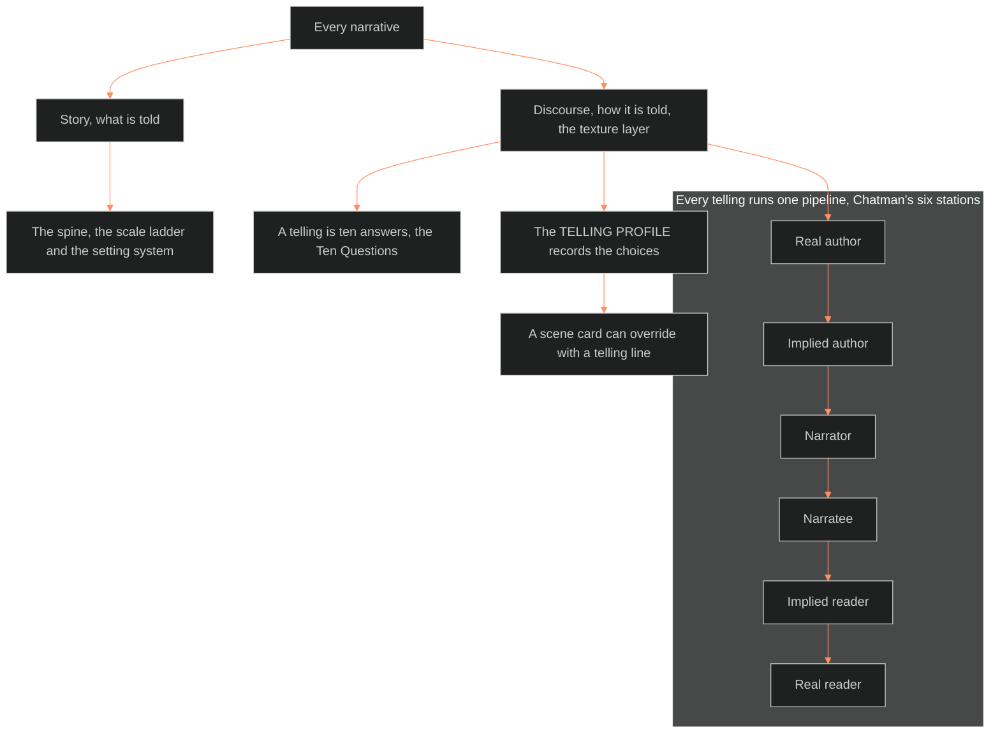

**Who it's for:** a designer who asks how a story is told · **What it does:** explains the story/discourse split and the Ten Questions · **Type:** concept

# The texture layer: the telling is half of narrative

*The mind model: every narrative has a story side and a discourse side, and texture holds the discourse side.*

Source: [📐 ssot_01_texture_layer.md](../../../_SSOT/01_NARRATIVE_FRAMEWORKS/📐%20ssot_01_texture_layer.md). Look things up in the [reference](2-reference.md). Do tasks with the [how-to](3-how-to.md). Learn by doing in the [tutorial](4-tutorial.md).

## Story and discourse are two sides of every narrative

Chatman's distinction is the load-bearing frame. **Story** is what is told: events and existents, meaning characters and settings. **Discourse** is how it is told.

The spine, the scale ladder and the setting system all sit on the story side. The texture layer is the whole discourse side. Chief called it "ancillary." It is not. It is the dimension the spine deliberately lacks, and the vocabulary critics use to categorize narrative.

## Every telling runs one pipeline

Chatman's communication model has six stations: real author, implied author, narrator, narratee, implied reader, real reader. Every narrative runs this pipeline. A texture decision lives at every arrow.

## A telling is ten answers

Every telling is one configuration of ten answers. The Ten Questions are the taxonomy. They ask who speaks, who sees, in what order, at what speed and how often. They also ask in what words, with what feeling, through what thresholds, breaking which frames, and to whom.

The questions are separate on purpose. Each question is one decision a writer can make and change.

## Who speaks is not who sees

The most common craft confusion collapses voice and vision. A narrator outside the story can see through one character only. Separating T1 from T2 removes the confusion. The translation grid shows how.

## Workshop words are compressed settings

Craft terms such as "third limited" and "head-hopping" are not new ideas. Each is a configuration of T1 and T2. "Show, don't tell" is a distance dial, not a commandment. "Slow burn" is a duration pattern.

The grid translates craft vocabulary into texture configuration. A writer who knows the configuration can choose it on purpose.

## The TELLING PROFILE records the choices

The storyform records the story's argument. The TELLING PROFILE is its twin for discourse. It records a work's fixed answers to the ten questions at a ladder address. A scene card can override the profile with a `telling:` line.

## The profile for OXO is an unmade decision set

No prose exists for The Outliers. The file `outliers.fdx` is empty. OXO has no ruled Telling Profile. The layer hands Chief a decision menu. Chief rules the profile when prose opens.

## The long read

Texture matters because readers feel it before they understand it. Two stories with the same events can feel opposite. One tells it once, close, in plain words. The other tells it three times, from far, in ornate words. The events are the same. The experience is not.

The layer therefore treats the telling as a design surface. Paratext is the clearest case. Episode titles, movement names and in-world documents are all surfaces a builder designs. A reader crosses them before the first line of story.

The layer ties to the library through `feeds:` keys. Chatman gives the frame. Bal gives focalization and description. Genette gives paratext. Hogan gives affect. Alber and Richardson give the unnatural.
