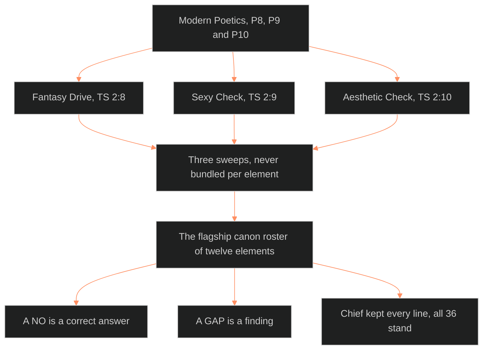

**Who it's for:** a designer asking why three checks run per element · **What it does:** explains the pass and its method · **Type:** concept

# The three-check pass: three questions, never bundled

*The mind model: three principles become three separate sweeps over twelve elements, and every answer is kept.*

Source: [📐 ssot_01_three_check_pass.md](../../../_SSOT/01_NARRATIVE_FRAMEWORKS/📐%20ssot_01_three_check_pass.md). Look things up in the [reference](2-reference.md). Do tasks with the [how-to](3-how-to.md). Learn by doing in the [tutorial](4-tutorial.md).

## Modern Poetics gives three questions

The three-check pass applies principles P8, P9 and P10 of Modern Poetics. P8 is the Fantasy Drive. P9 is the Sexy Check. P10 is the Aesthetic Check. The [Touchstones register](../ssot_01_touchstones_register/1-concept.md) rules all three in. They are TS 2:8, TS 2:9 and TS 2:10.

The pass runs them over the flagship canon roster of twelve elements. It is a module of Modern Poetics.

## Each check is a separate sweep

The pass runs three sweeps. It never bundles the checks per element. A single bundled line would let one answer hide another. A sweep asks one question of every element, then moves on.

## Each check asks something different

The Fantasy Drive asks what the audience gets to be, feel or do through the element. The Sexy Check asks yes or no, then gives one line of why. The Aesthetic Check asks which carrier makes the element interesting: color, shape or texture.

## A NO is a correct answer

The Sexy Check does not push every element toward heat. Five elements answered NO and the pass marked them correct or acceptable. The Drop is dread in a comic register, so heat would blunt the horror. The storyform is chassis, not skin. It protects the heat. The tool elements stay clinical so their output can burn.

## A GAP is a finding

Anna has no authored body, chart or visual tissue. The pass marks her sexy line thin and her aesthetic line a GAP. It does not invent the missing lines. The gap blocks the Tori×Anna collision proof. It parks as ⏸ Anna sheet (phase 2).

## Chief kept every line

Chief struck or kept by number. On 2026-09-29 he ruled "keep all." All 36 lines stand. Kept lines land on the entity sheets as `fantasy:`, `sexy:` and `aesthetic:` fields. Six elements have no sheet, so their lines live in the pass.

## The long read

The roster covers canon and tools together. Tori, Anna and DCUS are people and places. The Drop, the Sync-dive, the Star-Rating and the scream etiquette are world mechanisms. The storyform, the Story Lattice, the Collision Engine, DARKROOM and the taxonomy engine are the Command's own machinery.

The pass treats them alike. Each gets a fantasy, even the machinery. The Collision Engine's fantasy is to be a god of chemistry. DARKROOM's is to command the light table. The method does not care whether an element is a character or a tool.

The answers then teach by contrast. Tori is TEXTURE first and color second. The Drop is the purest SHAPE in canon. The Star-Rating is COLOR. A carrier shows what the element is built from.
