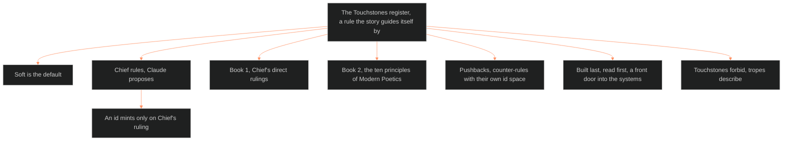

**Who it's for:** a writer or designer asking what a Touchstone is · **What it does:** explains Touchstones and the register · **Type:** concept

# The Touchstones register: the rules a story guides itself by

*The mind model: one register holds the Touchstones, Chief rules them, and it is a front door.*

Source: [📐 ssot_01_touchstones_register.md](../../../_SSOT/01_NARRATIVE_FRAMEWORKS/📐%20ssot_01_touchstones_register.md). Look things up in the [reference](2-reference.md). Do tasks with the [how-to](3-how-to.md). Learn by doing in the [tutorial](4-tutorial.md).

## A Touchstone guides the story

A Touchstone is a rule the story guides itself by. The register is its one home. Chief renamed "invariants" to Touchstones. Cite one as TS book:number, for example TS 1:1.

A Touchstone guides the story and opens up the opportunity. It does not cage the story.

## Soft is the default

Every Touchstone is soft unless Chief says hard. Soft means a tendency, never a rule. This keeps the register useful to a writer and not a list of bans.

## Chief rules, Claude proposes

Claude never writes a Touchstone's content. Claude proposes candidates quoted from their source. An id mints only on Chief's ruling. Authority stays with Chief.

## The register was built last and is read first

Chief said the invariants should come last, after the systems are done. They would describe the finished machinery. Then he said they should come first for the reader: "user-end first." The systems underneath are complex. The Touchstones are the easy way in.

The register is therefore a front door. A reader enters by it and follows the links into the systems.

## Books keep Touchstones by origin

Book 1 holds Chief's direct rulings. Book 2 holds the ten principles of Modern Poetics. Each book keeps its own number space. An entry points to its law and does not copy it.

## Pushbacks are counter-rules

A pushback is a Touchstone-shaped counter-rule with its own id space, `PB n:m`. The register holds it the same way. Three pushbacks wait for Chief's ruling.

## Touchstones forbid, tropes describe

Tropes describe recurring patterns. Touchstones constrain. The two sit across the whole lattice at different jobs. The [trope register](../ssot_01_trope_register/1-concept.md) holds the patterns. This register holds the guides.

## The long read

The register is short because it is a bootstrap. Chief called it "just some sort of bootstrap to keep there as a placeholder, just to know that we have it." It holds one Book 1 entry and ten Book 2 entries.

TS 1:1 shows how a Touchstone reads. Erotic or ritual power tends to hold inside a container: a circle, a rite, an end date, a boundary. Without a container it fades or turns dangerous. The Touchstone is soft, so the sex stays fantasy first. Chief refined where the container lives: outside the story, as a viewer-discretion disclaimer at the front of every book. The scenes inside stay free of it.

Parked items show what comes next: the three vetoes, `cost_and_meaning`, the Star-Rating rule and the three pushbacks. All wait for the OXO fill in phase 2.
