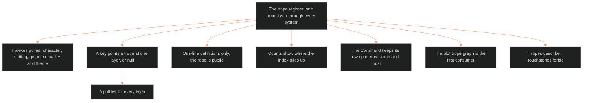

**Who it's for:** a designer asking why tropes sit in one register · **What it does:** explains the register's idea and limits · **Type:** concept

# The trope register: one trope layer through every system

*The mind model: one register keys tropes to the layers of each domain, and tropes describe while Touchstones forbid.*

Source: [📐 ssot_01_trope_register.md](../../../_SSOT/01_NARRATIVE_FRAMEWORKS/📐%20ssot_01_trope_register.md). Look things up in the [reference](2-reference.md). Do tasks with the [how-to](3-how-to.md). Learn by doing in the [tutorial](4-tutorial.md).

## A trope is a reusable pattern

A trope is a reusable pattern a layer can draw on. A character's L5 WOUND, a place's S10 UNDERSIDE and a genre's G1 LABEL each get a pull list. Each list holds known patterns. The patterns are keyed and ready.

## One register serves every system

The plot trope graph keys tropes from TV Tropes' Plot indexes onto plot nodes. The register extends the idea. It pulls the character, setting, genre, sexuality and theme indexes, and later texture, tracking and style. It keys each trope to a layer of its own domain's twelve-layer slice.

The trope graph is the register's first consumer. The register rebuilds nothing in it.

## A key points a trope at one layer

Each trope carries domain tags and one key per domain. A key is a layer id, such as L3, S4 or T2, or null. A null means the trope fits no layer of that domain. The register does not force a fit.

## The repo is public, so definitions stay short

Each record carries a one-line definition from the TV Tropes index. It never carries page text, because the repository is public. A trope with no one-line definition keys by its title and domain tags and carries `def: undefined`.

## Counts show where the index piles up

The counts table shows that tropes pile on some layers. Character piles on L12 FUNCTION and L1 CORE. Setting piles on S1 BODY and S4 and S8. The source reads these piles as what the index holds, not a keying fault.

The register checks itself against default dumps. A pass that sent 797 setting tropes to S1 was re-keyed with sharper rules until no layer swallowed a domain.

## Tropes describe, Touchstones forbid

A trope names a pattern. It does not tell a writer what to do. The [Touchstones register](../ssot_01_touchstones_register/1-concept.md) holds the guides. The trope register holds the patterns.

## The Command keeps its own patterns

Not every pattern comes from TV Tropes. Chief keeps some on purpose across the Command's own worlds. They file in the same format, flagged `source: command-local`. The register's first is the Signature Wound: a sibling dies in a vehicle disaster. It names a pattern. It changes no character.

## The long read

The register is built to be pulled from. A writer working Tori's L5 WOUND asks the register for the tropes keyed there. A builder working a place's S10 UNDERSIDE does the same. The pull list for every layer sits in LAYERS.md.

The keying was done by Payload Specialists on disjoint batches. A script reviewer caught broken files, misspelled slugs and illegal keys at the fan-in. The count of findings fell to zero each time. The same method re-keyed the default dumps. The register's confidence field says how far to trust each key: high, medium or low.

The register stays honest about what it does not know. A large block of tropes has no one-line definition. A large block of theme tropes argues none of the four rails. The register records both as facts about its source, not flaws to hide.
