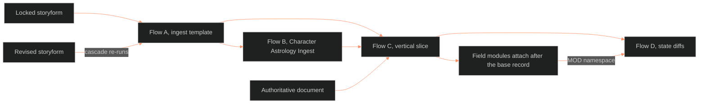

**Who it's for:** a narrative designer who needs to see how character data moves from storyform to state diffs · **What it does:** explains why the character pipeline runs as four flows with gates and how to read the illustration · **Type:** concept

# Character data moves through four flows

*The mind model: flows A, B and C run in order; flow D repeats; a revised storyform re-enters at A.*

The **Process Illustration** shows how data moves through the LEECHSEED character pipeline. Each flow says what goes in, what decisions are made, what comes out, and where the output lands. It is a worked example of the 02 pipeline. The method itself lives in the vertical slice (section 3.3.1) and its doc modules. Where the two disagree, the module wins.

## The page answers one question

The source says to read it when you need to answer "What do I do next?" at any point in character development. The appendix table answers it by what the designer holds and needs.

## Four flows run in sequence and in repetition

Flow A extracts a locked Dramatica storyform into an ingest template. Flow B translates that template into a Character Astrology Ingest through the 18-step DAI sequence. Flow C combines both ingests with the authoritative document into the LEECHSEED vertical slice. Flow D records how a character differs from the base record at each fabula event.

Flows A, B, and C run in order for each new Tier 3 character. Flow D runs repeatedly during story development.

## Gates stop bad data early

Each flow has hard gates. A designer never extracts from a draft storyform. A red source-verification result blocks the slice. A value that fails a check sends the designer upstream. The rule across the flows is the same: derived statistics and flags are diagnostic. A wrong result means wrong inputs, never a wrong flag.

## A revised storyform re-enters the flows

A revised storyform is a new version, not an edit. The cascade re-runs flows A and B, then parts of C. It then checks each state diff against the new base record.

## Field modules attach after the base record

Layer-locked field modules attach after the base record exists. They do not take part in flows A to C. Their dynamic variables appear in state diffs under the `MOD.[CODE]` namespace.

For every component, read the [reference](2-reference.md). For the tasks, read the [how-to](3-how-to.md). For a worked run, read the [tutorial](4-tutorial.md).

## The long read

Tier matters. Tier 3 characters use the ingest forms. Tier 2 and Tier 1 characters do not. A Tier 2 character gets an element signature and relational roles from the integration protocol, plus a partial chart. The Step 1 gate checks what the tier requires. The source ties each flow to a doc module. It ties A to the Dramatica ingest template and integration protocol, and B to the DAI and astrology ingest template. It ties C to the Step 1 source verification protocol, and D to the character state architecture. The page holds Mermaid diagrams for Obsidian; this documentation set restates each as steps in the reference.
