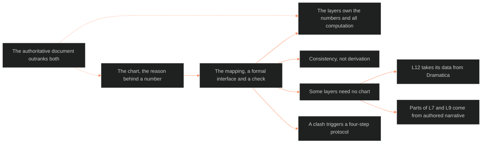

**Who it's for:** a narrative designer assigning layer values · **What it does:** explains why the chart justifies layer numbers without setting them · **Type:** concept

# Character Astrology to 12-Layer mapping: the idea

*The mind model: the chart gives the reason behind a number, the layers own the number. The authoritative document outranks both.*

## Two notations describe one character

Character Astrology and the LEECHSEED Character System are parallel datasets. They describe the same character in different notation systems. This document is the formal interface between them.

Without it, the link between chart and layers lives in the designer's intuition. With it, the link is written down. When the designer assigns a value to L8 IMPRINT, the document says which chart elements the value must agree with. It also says how to verify it.

## Feed, not replace

Character Astrology feeds the 12-Layer system. It does not replace it. The layers assign numbers by GURPS-derived mechanics and point budgets. Astrology supplies the reason for a number and the behavioral texture around it.

The number is the layer's job. The meaning behind the number is astrology's job.

## Consistency, not derivation

No formula turns a Sun in Taurus into CORE = 13. The relationship is consistency. A Sun in Taurus agrees with a CORE that reads stubborn, material and labor-earned. If chart and number disagree, one of them is wrong.

This principle is why the document works as a check and never as a calculator.

## Some layers need no chart

L12 FUNCTION takes its data from Dramatica. Parts of L7 ORIGIN and L9 EROS come from authored narrative. Astrology supplements those layers and does not govern them. The feed table marks each as partial or independent.

## The authoritative document outranks both

Chart and layers are both representations of the character the locked authoritative document defines. When that document conflicts with either, the document wins. Neither representation has authority over the source.

## The layers own the numbers

Astrology gives the qualitative justification. The layer system owns the quantitative values and all computation. Astrology explains why WILL = 14 makes sense. The layer system computes what WILL = 14 does to the Stress Threshold. These are different jobs, and the independence boundaries keep them apart.

## Conflicts resolve toward the source, then the math

A chart that clashes with a layer value triggers a four-step protocol. Identify the clash. Ask the authoritative document. If it is ambiguous, the layer value wins so that derived statistics and flags stay valid. If the document itself contradicts, revise the document first.

## The long read

The mapping is a translation table between a symbolic language and a numeric one. Neither language is truth. The locked character document is truth, and both languages report on it. Each layer's section reads like a short interpreter's note. It says what the layer needs and what the chart can offer. It also says where the interpreter should say nothing. Some of the most important lines are refusals. L12 gets no feed, and the schema-pass fields mostly get none. A mapping that knows where to stop stays trustworthy where it speaks.

See also: [reference](2-reference.md) · [how-to](3-how-to.md) · [tutorial](4-tutorial.md) · source: [🔮ssot_02_character_astrology_12_layer_mapping.md](../../../_SSOT/02_CHARACTER_SYSTEMS/🔮ssot_02_character_astrology_12_layer_mapping.md)
