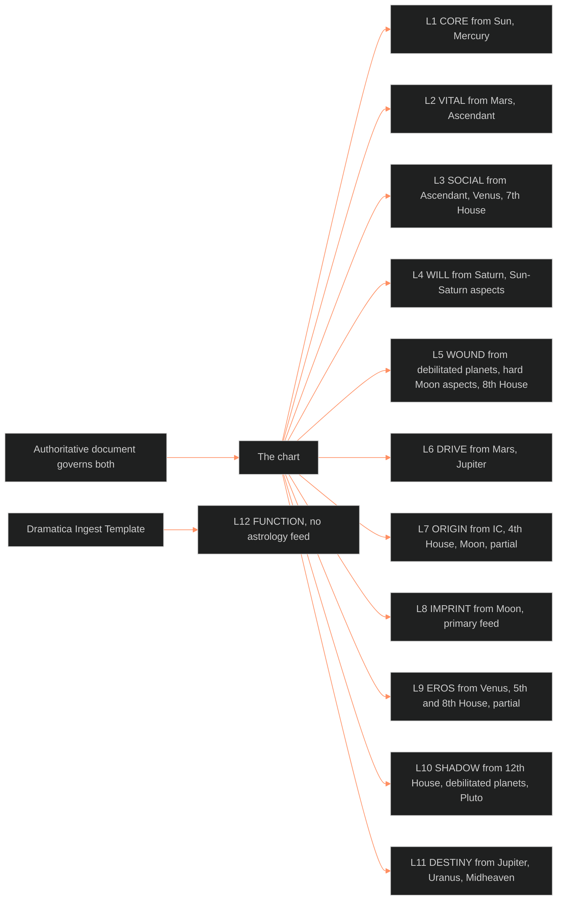

**Who it's for:** a narrative designer looking up a feed or boundary · **What it does:** lists every component of the mapping · **Type:** reference

# Character Astrology to 12-Layer mapping: reference

Source: [🔮ssot_02_character_astrology_12_layer_mapping.md](../../../_SSOT/02_CHARACTER_SYSTEMS/🔮ssot_02_character_astrology_12_layer_mapping.md). Concept: [1-concept.md](1-concept.md).

*The master feed table as a graph. Each layer and the chart elements that feed it. L12 has no chart feed.*

## Governing Principles

| # | Principle | Rule |
|---|---|---|
| 1 | Feed, Not Replace | Astrology feeds the 12-Layer system. Layers assign numbers (GURPS-derived mechanics, point budgets). Astrology gives symbolic justification and texture. |
| 2 | Consistency, Not Derivation | No formula derives a layer value from a chart variable. The two must be consistent. If they contradict, one is wrong. |
| 3 | Not Every Layer Needs Astrology | L12 comes from Dramatica. Portions of L7 and L9 come from authored documentation. Astrology supplements, never governs, these. |
| 4 | The Authoritative Document Governs Both | When the locked character bible conflicts with the chart or a layer value, the bible wins. |

## The Master Feed Table

| Layer | Astrology source(s) | Feed type | Required for slice |
|---|---|---|---|
| L1 CORE | Sun sign, Sun dignity, Mercury sign, Mercury dignity | Justification + texture | Yes |
| L2 VITAL | Mars sign, Mars dignity, Ascendant sign | Justification + texture | Yes |
| L3 SOCIAL | Ascendant sign, Venus sign, 7th House contents, Venus aspects | Justification + texture | Yes |
| L4 WILL | Saturn sign, Saturn dignity, Sun-Saturn aspects | Justification + ceiling logic | Yes |
| L5 WOUND | Debilitated planets, hard aspects to Moon, 8th House contents | Texture + trigger identification | Yes |
| L6 DRIVE | Mars sign, Mars aspects, Jupiter sign | Justification + fuel source | Yes |
| L7 ORIGIN | IC sign, 4th House contents, Moon sign | Partial, supplements authored origin data | Partial |
| L8 IMPRINT | Moon sign, Moon aspects, Moon dignity, 8th House contents | Primary feed, attachment architecture | Yes |
| L9 EROS | Venus sign, Venus aspects, Mars-Venus aspect, 5th House contents, 8th House contents | Supplemental, enriches authored eros data | Partial |
| L10 SHADOW | 12th House contents, debilitated planets, Pluto sign, Pluto aspects, hard aspects to Sun | Primary feed, repression architecture | Yes |
| L11 DESTINY | Jupiter sign, Uranus sign, Midheaven sign, Jupiter-Saturn aspects | Primary feed, growth vector | Yes |
| L12 FUNCTION | None, fed from the Dramatica Ingest | Independent | N/A |

Feed types:

- **Justification + texture:** explains why the number is what it is and adds behavioral detail.
- **Justification + ceiling logic:** constrains the plausible range. Saturn in domicile justifies a higher WILL ceiling than Saturn in fall.
- **Texture + trigger identification:** names the conditions where the layer activates or escalates.
- **Primary feed:** the chart is the main source of content. Without it the layer is thin.
- **Supplemental:** enriches content authored from other sources.
- **Partial:** the chart gives some, not all, of the layer's content.
- **Independent:** no feed relationship.

## Layer-by-Layer Feed Specifications

### L1 CORE ← Sun, Mercury

L1 needs a numeric value (default 10, GURPS IQ-equivalent) for cognitive and psychological mass. The writer justifies it by documented mental capacity and ideological framework.

- Sun sign gives the identity axis. Earth: practical, methodical. Air: abstract, relational. Fire: intuitive, visionary. Water: emotional, empathic.
- Sun dignity informs the ceiling. Domicile or exaltation: CORE at or above the tier median. Detriment or fall: capacity undermined by the sign's distortion ("intelligence running on misaligned firmware").
- Mercury sign gives processing style. Dignity decides clean or glitchy. Debility: capable but operationally costly.
- Consistency check: read Sun and Mercury descriptions together. Does the CORE number match the portrait?

### L2 VITAL ← Mars, Ascendant

L2 needs a numeric value (default 10, GURPS DX-equivalent) for physical and energetic presence.

- Mars sign gives kinetic style. Fire: explosive. Earth: disciplined, endurance. Air: technique-oriented, moderate. Water: emotionally modulated.
- Mars dignity informs the ceiling. Exaltation (Capricorn) or domicile (Aries, Scorpio): VITAL 12+. Fall (Cancer) or detriment (Taurus, Libra): VITAL with a specific cost.
- Ascendant gives the texture of physical presentation. It does not set VITAL numerically.
- Consistency check: a Mars in Capricorn and Aries Ascendant with VITAL = 10 needs a documented explanation.

### L3 SOCIAL ← Ascendant, Venus, 7th House

L3 needs a numeric value (default 10, GURPS HT-equivalent) for relational interface.

- Ascendant gives the first-impression mask. Cardinal: initiating. Fixed: stable or immovable. Mutable: adaptable or elusive.
- Venus sign gives what the character values in exchange and how they attract or repel.
- 7th House planets give the one-to-one relational mode.
- Nuance: low SOCIAL is not incompetence. Victoria Midnight has SOCIAL = 10 with Aries Ascendant and Virgo Venus: accurate but unmanaged.
- Consistency check: harmonious Ascendant and Venus signs mean a coherent interface. Tense signs mean an internal contradiction the value should reflect.

### L4 WILL ← Saturn, Sun-Saturn Aspects

L4 starts at WILL = CORE, buyable up or down at 5 pts per level. It is resistance to coercion and systemic pressure.

- Saturn sign gives the nature of the limit and the capacity to endure it. Domicile (Capricorn, Aquarius): structural resistance. Fall (Aries): impulsive resistance.
- Saturn dignity informs buy-up or buy-down. Dignity: WILL >= CORE. Debility: WILL < CORE, or WILL > CORE with a fragility note.
- Sun-Saturn aspects:

| Aspect | Reading |
|---|---|
| Conjunction | Identity and limit fused. WILL high but rigid. |
| Square | Active conflict. WILL tested constantly, forged in friction. |
| Trine | Easy flow. WILL stable but possibly untested. |
| Opposition | Binary opposition. WILL swings between poles. |

### L5 WOUND ← Debilitated Planets, Hard Moon Aspects, 8th House

L5 is a value 0 (undamaged) to 10 (functional collapse threshold) for accumulated unresolved damage. The designer assigns it during history entry as a record of what happened.

| Debilitated planet | Wound domain |
|---|---|
| Mars | Action/agency: physical trauma, kinetic helplessness, violence received |
| Moon | Emotional/attachment: neglect, abandonment, conditioning failure |
| Saturn | Structural failure: institutional betrayal, authority collapse, harmful rule systems |
| Venus | Desire/value: shame, unworthiness, punished desire |

- Hard Moon aspects (squares, oppositions) name the activating stressors. Moon square Saturn: duty and emotional need collide. Moon opposition Pluto: power dynamics and loss of control.
- 8th House contents give transformation through crisis: what was lost, taken, or gained through loss.
- Feed logic: counts of debilitated planets and hard aspects do not produce the number. The chart shows what kind of damage and what triggers it.

### L6 DRIVE ← Mars, Jupiter

L6 starts at DRIVE = VITAL, buyable at 3 pts per level. It is narrative motivation fuel.

- Mars sign gives fuel type. Fire: impulse and conviction. Earth: discipline and material goals. Air: ideas and strategy. Water: emotional necessity.
- Jupiter sign gives the replenishment source. A compatible element with Mars replenishes naturally. A conflicting element creates a recovery gap.
- Mars-Jupiter aspects: trine, action leads to expansion. Square, action may undermine recovery.
- Ambition-driven (DRIVE = VITAL) versus meaning-driven (DRIVE < VITAL): Mars in dignity with a compatible Jupiter fits ambition-driven. A compromised Mars or a Jupiter in tension fits meaning-driven.

### L7 ORIGIN ← IC, 4th House, Moon

L7 is a stack: origin_class, origin_stability, family_coherence, origin_wound_seed, tech_level, system_exposure. The designer authors it from backstory. The chart feed is partial.

- IC sign gives the buried root. Earth: material or class-defined. Water: emotionally defined. Fire: ambition or conflict. Air: intellectual or social.
- 4th House planets give the foundational environment. Saturn: heavy authority. Moon: emotionally saturated. Mars: conflict at the root.
- Moon sign gives the emotional baseline carried out of origin.
- Feed logic: the chart supplements. An apparent mismatch (IC in Cancer with origin_stability = 9) is not necessarily a contradiction. Note and justify it.

### L8 IMPRINT ← Moon (Primary)

L8 is a stack of fields. The attachment fields are attachment_style (secure, anxious, avoidant, fearful_avoidant), attachment_style_score and attachment_dimensions {anxiety, avoidance}. The other fields are emotional_range, conditional_patterns and imprint_flexibility. Next is secure_base_object (renamed from `primary_attachment_object` in 2.1.0, old name a read alias). The last fields are protest_behaviors, deactivating_strategies, vandalism_event, somatic_archive and sexual_script_acquisition.

Moon sign sets the attachment baseline:

| Moon element | Reading |
|---|---|
| Water (Cancer, Scorpio, Pisces) | High intensity. Anxious or enmeshed likely. Range high. |
| Earth (Taurus, Virgo, Capricorn) | Stability and reliability. Secure or avoidant likely. Range controlled. |
| Fire (Aries, Leo, Sagittarius) | Admiration and freedom. Secure-anxious or dismissive likely. Range reactive. |
| Air (Gemini, Libra, Aquarius) | Intellectual connection and harmony. Avoidant or secure likely. Range modulated. |

Moon aspects modify the baseline:

- Conjunct Venus: attachment and desire fused. Imprint flexibility may be low.
- Square Saturn: attachment tested by duty. Duty-based love language likely.
- Opposition Pluto: power dynamics and loss. Secure attachment is difficult. Primary attachment objects may be lost or threatening.

Feed scope:

- The Moon feeds attachment_style, attachment_dimensions, conditional_patterns and imprint_flexibility, as a lean, never a pick. Water leans toward high anxiety. Earth or Air leans toward high avoidance. fearful_avoidant has no single Moon signature.
- No feed: secure_base_object, protest_behaviors, deactivating_strategies, vandalism_event, somatic_archive, sexual_script_acquisition. The authors set them from the authoritative document.
- Moon dignity informs imprint_flexibility. Dignity (Cancer domicile, Taurus exaltation): functional, relatively healthy. Debility (Capricorn detriment, Scorpio fall): operational but compromised.

### L9 EROS ← Venus, Mars-Venus, 5th/8th House

L9 has about twenty variables. They are erotic_blueprint_type (with arousal_curve) and desire_vector (with resolution_type). Next come exposure_shame and role_shame (the split of `shame_index`, old name a read alias for exposure_shame). Then come intimacy_mode, armor_index, satisfaction_cycle_truncation and erotic_safety_precondition (with scope). The rest are consent_posture, client_script, signal_fluency, disclosure_posture, template_origin, orientation_dimensions, charmed_circle_position, resonance_profile, polarity_role and love_lust_cleft. Partly authored, partly inferred. The chart feed is supplemental.

| Mars-Venus aspect | Reading |
|---|---|
| Conjunction | "To desire is to act." Low exposure_shame likely. |
| Square | Desire and action conflict. Higher exposure_shame and role_shame likely. |
| Trine | Desire flows into action. Comfortable, low friction. |
| Opposition | Desire and action split. May want one thing and pursue another. |

- Venus sign gives the desire quality.
- 5th House gives creative and romantic expression. 8th House gives intimate transformation.
- Feed scope: the chart hints at erotic_blueprint_type and desire_vector (Venus). It hints at exposure_shame and role_shame (Mars-Venus aspect). The chart only checks polarity_role and love_lust_cleft. All other L9 variables have no feed.
- Feed logic: L9 is the most inference-heavy layer. The chart validates authored choices and does not produce them.

### L10 SHADOW ← 12th House, Debilitated Planets, Pluto

L10 is a stack: shadow_density, projection_tendency, regression_pattern, shadow_content. The chart feed is primary.

- 12th House planets feed shadow_content directly. They hold repressed variables.
- Each debilitated planet adds a shadow content entry: the thing the character cannot do well and cannot face.
- Pluto sign and aspects give the power and control relationship. Hard Pluto aspects to Sun, Moon, Mercury, Venus or Mars mean intense shadow material.

Shadow density estimate, from the count of debilitated planets, 12th House planets and hard Pluto aspects:

| Count | shadow_density | Reading |
|---|---|---|
| 0-1 | 1-3 | Light, relatively integrated |
| 2-3 | 4-6 | Moderate, active denial or projection |
| 4+ | 7-10 | Heavy, repressed content drives behavior |

This is an estimation guideline, not a formula. The designer adjusts to the documented psychology.

### L11 DESTINY ← Jupiter, Uranus, Midheaven

L11 is a stack: growth_axis, resistance_index, soul_evolution_archetype, karmic_memory, growth_requirement. The chart feed is primary.

- Jupiter sign gives growth permission. It informs growth_axis.
- Uranus sign gives the disruption the character must accept (Change) or resist (Steadfast). It informs growth_requirement.
- Midheaven sign gives the public expression of destiny. It informs soul_evolution_archetype.

| Jupiter-Saturn aspect | Reading |
|---|---|
| Conjunction | Growth through constraint. |
| Square | Active conflict. High resistance_index. |
| Trine | Flow. Lower resistance_index. Clear path, possibly lacking urgency. |
| Opposition | Binary tension. Oscillates between expansion and contraction. |

### L12 FUNCTION ← No Astrology Feed

L12 comes entirely from the Dramatica Ingest Template. The boundary is absolute. Dramatica governs narrative function. Astrology governs symbolic character data. They do not cross at L12. See the [Dramatica integration protocol](../ssot_02_dramatica_integration_protocol/2-reference.md).

## Schema-Pass Fields: Feed Notes

The main doc added fields after this doc's 1.0.0. The chart justifies a layer value and never sets these fields. The authors set them from the authoritative document. The source calls these notes the writer's first call, open to the narrative designer's review.

| Layer | Field (added) | Chart feed |
|---|---|---|
| L1 | `identity_frame` (2.5.0) | No feed. The Sun does not name the gender persona or label. |
| L3 | `community_membership` (2.5.0) | No feed. |
| L3 | `agreement_style` (2.5.0) | No feed. |
| L3 | `self_presentation` (2.5.0) | No feed. The Ascendant feeds L3 SOCIAL but does not set the built public self. |
| L3/L6 | `risk_management_practice` (2.5.0) | No feed. |
| L4 | `resistance_mode` (2.5.0) | No feed. |
| L6 | `motivation_stack` (2.5.0) | Texture only, through the L6 feed (Mars, Jupiter). Never sets stated or real motives. |
| L6 | `drive_texture` (2.5.0) | Texture only, through the L6 feed (Mars, Jupiter). |
| L7 | `origin_disciplinary_formation` (2.5.0) | No feed. IC and 4th House do not name an institution. |
| L8 | `sexual_script_acquisition` (2.5.0) | No feed. |
| L9 | `polarity_role` (2.5.0) | Check only, through the Mars-Venus aspect. Never sets the role. |
| L9 | `love_lust_cleft` (2.5.0) | Check only, through Venus and the Mars-Venus aspect. |
| L2 | `body_capital` (3.0.0) | No feed. |
| L3 | `circumplex` (3.0.0) | No feed. Optional scored dial. |
| L4 | `locus_of_control` (3.0.0) | No feed. |
| L6 | `futurity_stance` (3.0.0) | No feed. |
| L10 | `dark_triad`, `light_triad` (3.0.0) | No feed. Optional scored dials. The L10 feed covers shadow content only. |
| L7 | `hereditary_predisposition` (2.1.0) | No feed. |
| L1-L3 | `psychology_stack`, `physiology_stack`, `sociology_stack` (2.1.0) | No feed. The L1-L3 feeds justify numbers, not the Egri checklists. |

Fields added in 2.2.0 to 2.4.0 follow the L9 and L8 notes above. They come from the L9 synthesis, wave 2 and wave 3 lists.

## Tier 2 Charts

A Tier 2 chart is Sun, Moon and one defining aspect. See the [DAI](../ssot_02_character_astrology_dai/2-reference.md).

- The Sun feeds L1 CORE. The Moon feeds L8 IMPRINT.
- Every other row of the feed table reads "no feed" for a Tier 2 character.
- The Feed Validation Checklist runs only its L1 and L8 lines.

## Independence Boundaries

Astrology elements with no feed to the 12-Layer system:

| Element | Reason |
|---|---|
| Network Topology (Unicursal Hexagram) | Relationship-level data. Feeds relationship tables. |
| Lifecycle Protocol (6 Movements) | Story-structure data. Feeds plot_systems. |
| Synastry Overlays | Relationship-level data. Feeds relationship tables. |
| Progressions | State-overlay data. Feeds the character state diff system. |
| Transits | State-overlay data. Feeds the character state diff system. |
| Reset Protocol | Story-structure data. Feeds plot_systems. |
| Sextile aspects | Minor aspects. Documented but feed no specific layer value. |

12-Layer elements with no feed from astrology:

| Element | Fed by |
|---|---|
| L1-L3 numeric values | GURPS point-budget logic and authored justification |
| L4 WILL numeric value | Derived from CORE + buy-up/down |
| L5 WOUND numeric value | Authored from character history |
| L6 DRIVE numeric value | Derived from VITAL + buy-up/down |
| L7 ORIGIN variable stack (most variables) | Authored from backstory |
| L12 FUNCTION (entire layer) | Dramatica Ingest Template |
| All derived statistics | Computed from layer values |
| All flag trigger conditions | Computed from layer values and derived statistics |

## Conflict Resolution Protocol

When the chart and the layer values are inconsistent:

1. Identify the conflict. State which chart element contradicts which layer value.
2. Check the authoritative document. If it supports the chart, adjust the layer value. If it supports the layer value, adjust the chart.
3. If the document is ambiguous, the layer value wins for computation, so derived statistics and flags stay valid. Adjust the chart. Document the resolution in the astrology ingest (Section 9 feed map notes) and in the Vertical Slice layer justification.
4. If the conflict reveals a real contradiction in the document, flag it for narrative designer review. Do not adjust either system. Revise the document first, then update both representations.

## Feed Validation Checklist

Run it after completing both the Character Astrology Ingest Template and the Vertical Slice. The blank form of the template is [ssot_02_template_astrology_ingest.md](../../../_SSOT/02_CHARACTER_SYSTEMS/📐%20ssot_02_template_astrology_ingest.md). Every item must pass or carry a documented exception.

1. Sun sign is consistent with L1 CORE justification prose.
2. Mars sign + dignity is consistent with L2 VITAL value and justification.
3. Ascendant + Venus is consistent with L3 SOCIAL value and justification.
4. Saturn sign + dignity is consistent with the L4 WILL buy-up/down decision.
5. Debilitated planets and hard Moon aspects are consistent with L5 WOUND triggers.
6. Mars + Jupiter is consistent with L6 DRIVE derivation (ambition vs meaning driven).
7. IC and 4th House are consistent with L7 ORIGIN variables (where authored).
8. Moon sign + aspects + dignity are consistent with L8 IMPRINT attachment architecture.
9. Venus + Mars-Venus aspect are consistent with L9 EROS variables (where authored).
10. 12th House + debilitated planets + Pluto are consistent with L10 SHADOW content.
11. Jupiter + Uranus + Midheaven are consistent with L11 DESTINY growth vector.
12. L12 FUNCTION has no astrology feed (confirmed independent).
13. No derived statistic is contradicted by chart data.
14. No flag trigger condition is contradicted by chart data.
15. All conflicts are resolved per the Conflict Resolution Protocol.
