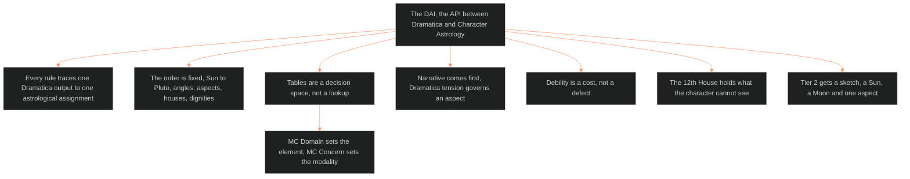

**Who it's for:** a narrative designer new to Character Astrology · **What it does:** explains why the chart comes from Dramatica and how the rules think · **Type:** concept

# Dramatica-Astrology Interface: the idea

*The mind model: one interface turns Dramatica output into chart placements, in a fixed order, with the narrative always ruling.*

## The chart is derived, so it stays traceable

The DAI is the API specification between Dramatica and Character Astrology. Every rule traces one Dramatica output to one astrological assignment. The designer does not pick a Sun sign because it feels right. The designer reads it off the storyform.

This gives each placement a reason that a second reader can check. If the sign feels wrong, the designer re-examines the rule's inputs, not the mood.

## The order is fixed because each step feeds the next

The designer works from Sun to Pluto, then angles, then aspects, then houses, then dignities. The source forbids skipping or reordering. Aspects need placed planets. Houses need planets to house. Dignities need signs and houses to be final.

Steps 1-7 plus aspects, houses and dignities make the minimum viable chart. The rest completes the full chart. The Vertical Slice can proceed on the minimum.

## Tables are a decision space, not a lookup

The mapping tables turn Dramatica terms into elements, modalities and signs. They are guidelines. The designer selects the sign that best encodes the character's whole Dramatica configuration, never one element in isolation.

The one exception to flexibility is structure. The Sun sign follows a grid: the MC Domain sets the element and the MC Concern sets the modality.

## Narrative comes first

When sign geometry and Dramatica tension disagree about an aspect, the Dramatica tension governs. When a planet's traditional dignity disagrees with the story, the designer may override with a written reason. The chart serves the character, and the character serves the storyform.

## Debility is a cost, not a defect

A debilitated planet is not an inability. The source says debility means the function runs at internal cost. A character can excel at a function that costs them. This is a feature of the system.

## The 12th House holds what the character cannot see

Planets in the 12th House carry functions the character does not recognize. They are active but inaccessible to conscious processing. When Mercury aspects one, the character feels a pattern they cannot name.

## Tier 2 gets a sketch

A Tier 2 chart is a behavioral sketch: a Sun, a Moon and one defining aspect. It holds no houses, dignities, angles or outer planets.

## The long read

The interface treats a natal chart as a second notation for a character already defined by structure. Dramatica states the argument in its own vocabulary. Astrology restates it in symbols that carry texture: where a character collapses, what mask they wear, what wall they hit. Each translation is a design decision with a stated source. Every placement cites its origin. A reviewer can audit the chart and regenerate it when the storyform changes. A writer feeds it into the layers without guessing.

See also: [reference](2-reference.md) · [how-to](3-how-to.md) · [tutorial](4-tutorial.md) · source: [🔮ssot_02_character_astrology_dai.md](../../../_SSOT/02_CHARACTER_SYSTEMS/🔮ssot_02_character_astrology_dai.md)
