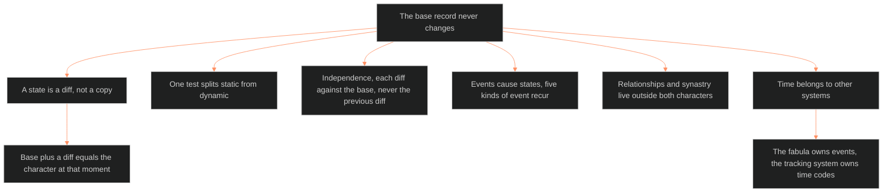

**Who it's for:** a narrative designer or writer tracking change over a story · **What it does:** explains why a character's record never changes while the character does · **Type:** concept

# Character state architecture: the idea

*The mind model: one base record never changes. Every change over the story is a diff that points to an event.*

## The base record never changes

A story changes its characters. Layer values shift. Flags fire. Wounds deepen. The LEECHSEED Vertical Slice captures a character only at the point of canonical definition.

The source answers with one rule: the static character record never changes. The designer produces the record once, locks it and never edits it during story development. A needed revision creates a new version with a documented reason. The old version is archived.

The base record is the birth certificate. The state diffs are the medical history.

## A state is a diff, not a copy

A state record lists only what differs from the base at one narrative moment, plus the reason. The base plus a diff equals the character at that moment. To know Victoria Midnight at M1B Delta Coast, read the base and apply the M1B diff.

Copying the whole record would invite drift. A diff keeps every change visible and every omission meaningful: an omitted field reads from the base.

## One test splits static from dynamic

The source gives one test. Freeze the character at two points in the narrative. If a value would differ, it is dynamic and belongs in a diff. If not, it is static and belongs in the base.

The main document's layer table carries a static/dynamic column. This document reads that column and keeps no list of its own. One place to look means one place to fix.

## Independence keeps errors from spreading

Each diff is computed against the base, never against the previous diff. If a wound reads 8 at M1B and 9 at M3, both diff against the base. An error in one state cannot travel to the next.

Other rules protect the same idea. Diffs add and modify but never delete. Flags are always re-evaluated. Diffs are versioned, and the base is never involved in a revision.

## Events cause states, and five kinds of event recur

Every state points to a fabula event through `origin_event`. Five categories of event leave a characteristic signature: trauma, systemic pressure, relational events, awakening and progression overlays. Knowing the category tells the writer which fields to expect to move.

## Relationships and synastry live outside both characters

A relationship changes two characters at once. The architecture stores it in its own record. An event to Character B never forces an edit to Character A's file. Synastry data, computed once from two static charts, lives there too.

## Time belongs to other systems

This document defines state tracking. It does not define story structure or the timeline. The fabula owns events. The tracking system owns time codes and story points. This document supplies the state format those systems read.

## The long read

The design is an audit trail for a person. Ledger accounting never erases an entry. It adds a correcting entry and keeps the first. The base record is the opening balance, and each checkpoint is a dated adjustment. The assembled character at any moment is a derived view. A reader can always trace the view back to the opening balance and the events that moved it. That traceability lets a writer, a game designer or an AI system read one assembled record and trust it.

See also: [reference](2-reference.md) · [how-to](3-how-to.md) · [tutorial](4-tutorial.md) · source: [🔮ssot_02_character_state_architecture.md](../../../_SSOT/02_CHARACTER_SYSTEMS/🔮ssot_02_character_state_architecture.md)
