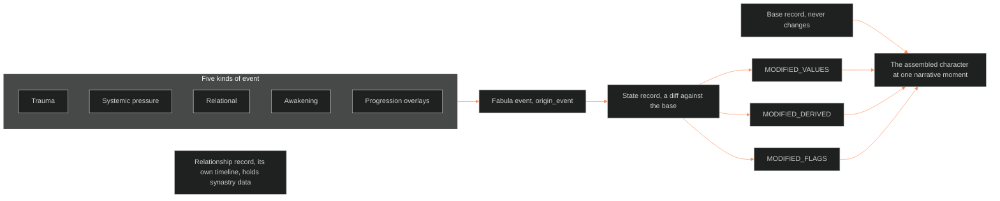

**Who it's for:** a narrative designer or writer looking up a field or rule · **What it does:** lists every component of the state architecture · **Type:** reference

# Character state architecture: reference

Source: [🔮ssot_02_character_state_architecture.md](../../../_SSOT/02_CHARACTER_SYSTEMS/🔮ssot_02_character_state_architecture.md). Concept: [1-concept.md](1-concept.md).

*The structure: an event produces a state diff. The diff plus the base gives the character at a moment. Relationships keep their own record.*



## The Core Principle

The static character record never changes.

- The LEECHSEED Vertical Slice and the Character Astrology natal chart are the canonical identity. The designer produces them once and locks them.
- A needed revision creates a new version with a documented reason. The old version is archived.
- A state record is an overlay. It lists only the changed values and the reason.
- Base record plus state diff equals the character at that moment.

## What Is Static vs What Is Dynamic

The main doc's layer table carries a static/dynamic column. This doc reads it. No field ships without the tag.

- Static fields live in the base record. Dynamic fields live in state diffs.
- Until the column lands in the main doc, the Decision Test breaks ties.

Items outside the layer table:

- The natal chart, natal aspects, natal dignities and house placements are static.
- Progressed planetary positions and active transits are dynamic overlays.
- All derived statistics and all flag states are dynamic. They are recomputed from the modified layer values.
- Relationship states are dynamic and live in relationship records.

### The Decision Test

Would this value differ if the character were frozen at two points in the narrative? Yes: dynamic, in a state diff. No: static, in the base record only.

## State Record Format

A state record is a structured block. It describes the delta between the base record and the character at one narrative moment.

### Required Fields

| Field | Description | Example |
|---|---|---|
| `character_id` | Character this state belongs to | `victoria_midnight` |
| `state_id` | Unique identifier | `vm_m1b_post_crash` |
| `origin_event` | (v1.1) The fabula event that produced the state. An `event_id` from [📐 ssot_04_fabula.md](../../../_SSOT/04_PLOT_SYSTEMS/📐%20ssot_04_fabula.md), grammar `<movement>_<slug>`. `null` only for Category 5 progression overlays | `m1b_crash_jebb_death` |
| `told_at` | (v1.2) List of time codes where the audience is shown this state, per [📐 ssot_08_tracking_system.md](../../../_SSOT/08_TRACKING_SYSTEMS/📐%20ssot_08_tracking_system.md) §4. An empty list means true but offstage | `["M2 · Q1 · S04 \| 012.3.2"]` |
| `narrative_moment` | The 08 time code of the moment the state takes hold (IF catalog call 1, ruled 2026-10-05). It is the first entry in `told_at`. An offstage state takes the code of its `origin_event`. The readable label is generated from the code. Free text retires as an alias | `M2 · Q1 · S04 \| 012.3.2` |
| `movement` | Read alias (IF catalog call 1, ruled 2026-10-05): the `M` of the time code. The movement tag retires as a key. A v1.3 record keeps it for reading | `m1b` |
| `mc_distance_temporal` | (v1.2) Computed, not authored. Distance from Tori's time code, with Tori fixed at (0,0) | `0` (this IS Tori) |
| `mc_distance_narrative` | Causal steps from the MC's throughline. Stays authored | `0` |
| `state_version` | Version of this state record | `1.0` |
| `base_record_version` | Version of the base record this diffs against | `1.0.0` |

### The State Diffs Parent (v1.1)

The three MODIFIED blocks sit under one parent field, `state_diffs:`. The block names are unchanged. A v1.0 record with the blocks at top level stays valid: read it as if the parent were there.

```
origin_event: m1b_crash_jebb_death
state_diffs:
  MODIFIED_VALUES:   { ... }
  MODIFIED_DERIVED:  { ... }
  MODIFIED_FLAGS:    { ... }
```

### Modified Values Block

Only values that differ from the base appear. Omitted values read from the base.

```
MODIFIED_VALUES:
  WOUND: 8          # was 4 pre-crash
  DRIVE: 12         # was 14 pre-crash
  WILL_EFFECTIVE: 13 # base WILL is 14, reduced under active trauma
  L8_IMPRINT:
    secure_base_object: brother_deceased  # was brother_alive
    attachment_style_score: 6  # was 7 pre-crash
  L10_SHADOW:
    shadow_density: 7  # was 4 pre-crash
    shadow_content:
      - culpability_for_brother  # NEW
      - distrust_of_own_judgment  # NEW
```

`secure_base_object` was renamed from `primary_attachment_object`. The old name is a read alias.

### Modified Derived Statistics Block

Derived statistics are recomputed from the modified values. Only statistics that change from the base appear.

```
MODIFIED_DERIVED:
  basic_damage_resistance: 10  # 13 - (8/2) — was 11 pre-crash
  stress_threshold: 5          # 13 - 8 — was 10 pre-crash
  collapse_risk: 6             # (8 + 4) / 2 — was 4 pre-crash
  # note: uses WILL_EFFECTIVE for stress_threshold in state context
```

### Modified Flags Block

Flags are re-evaluated against the modified values. Only flags whose state changes from the base appear. A PENDING flag that fires here matches the `event_id` stored beside it in the base record (IF catalog call 5, ruled 2026-10-05). That `event_id` is this state's `origin_event`.

```
MODIFIED_FLAGS:
  KINSHIP_COLLAPSE: FIRED       # was INACTIVE in base
  SHADOW_DENIAL: ACTIVE         # was INACTIVE in base
  TRUTH_VULNERABILITY: ACTIVE   # was INACTIVE in base
```

### State Narrative Note

A brief prose note, 2-5 sentences, saying what happened at this moment to produce the changes. It is the human-readable justification for the diff.

### Character Astrology State Overlay (Optional)

Progressions and transits active at this moment are documented here. The natal chart never mutates. Only this overlay changes from state to state, and it sits on top of the chart.

```
ASTROLOGY_OVERLAY:
  progressed_sun: [sign if changed from natal]
  progressed_moon: [current progressed moon sign]
  active_transits:
    - transit_saturn_conjunct_natal_moon: "System audit hitting emotional core"
    - transit_mars_square_natal_saturn: "Kinetic pressure against the wall"
```

## Checkpoints and Story Points (v1.2)

- A checkpoint is a complete state at a fabula event. It holds a full state record, `state_diffs` and the three MODIFIED blocks. The name is new in v1.2. The format is not.
- A checkpoint re-derives every value, statistic and flag. That is too heavy for a single trait tick or flag flip.
- Lighter single-field changes are story points. They live in [📐 ssot_08_tracking_system.md](../../../_SSOT/08_TRACKING_SYSTEMS/📐%20ssot_08_tracking_system.md) §5, which defines their shape. A value moves between them by step by default, or `ramp: true` for continuous values.
- Rule 6 governs checkpoints. A moment may carry many story points.

## State Diff Rules

| Rule | Statement |
|---|---|
| 1 | Diffs are additive, not destructive. A diff adds or modifies values and never deletes base fields. A value back at base level is omitted from the diff. |
| 2 | Diffs are independent of each other. Each diffs against the base record, not the previous diff. This stops error propagation. |
| 3 | `WILL_EFFECTIVE` is a state-only field. The base holds `WILL`. A diff may hold `WILL_EFFECTIVE`, the operating WILL under current conditions. The designer authors the reduction formula. |
| 4 | Flag re-evaluation is mandatory. Every diff re-evaluates all flag triggers against the modified values. A flag may fire. A flag may rarely go inactive. |
| 5 | State diffs are versioned. A revised diff archives the old version and replaces it. The base is never involved. |
| 6 | One state per narrative moment per character. A subdivided moment (M1B pre-crash and post-crash) gives separate states with separate `state_id` values. Story points may be many per moment. |
| 7 | Backward diffs are allowed (RULED 2026-09-29, BOLO 90 step 7 trial). A checkpoint dated earlier than the base's own position diffs backward, in the same additive shape as Rule 1. Mirrors [🔮 ssot_03_setting_state_architecture.md](../../../_SSOT/03_SETTING_SYSTEMS/🔮%20ssot_03_setting_state_architecture.md) §6 Rule 7. |

## Querying a Character at a Narrative Moment

The six steps that assemble the character at a given moment:

1. Load the base record (LEECHSEED Vertical Slice structured data block).
2. Load the state diff for the requested moment.
3. Apply the diff (the `state_diffs` parent, or the top-level blocks in a v1.0 record). Fields in `MODIFIED_VALUES` replace base values. Absent fields keep the base value.
4. Apply `MODIFIED_DERIVED`. These replace the base derived statistics.
5. Apply `MODIFIED_FLAGS`. These replace the base flag states.
6. If an astrology overlay exists, apply it alongside the natal chart. The natal chart stays visible.

The result is a complete record: all 12 layers, derived statistics, flag states and, optionally, the chart with overlays. Writers, game designers and AI systems read this assembled record.

## State Sources

Five categories of narrative event produce state diffs. Each has a signature.

### Category 1: Trauma Events

Sudden, high-impact events with immediate value changes.

- Signature: WOUND increases. New shadow_content entries. Flags fire. DRIVE may drop. Attachment objects may change.
- Example: Victoria's crash. WOUND jumps. KINSHIP_COLLAPSE fires. The attachment object becomes deceased.

### Category 2: Systemic Pressure Events

Sustained institutional or environmental forces that erode values over time.

- Signature: WILL_EFFECTIVE decreases. SHADOW projection_tendency increases. L11 resistance_index may decrease.
- Example: The Ban. Her social legibility is weaponized. WILL_EFFECTIVE drops. SHADOW_DENIAL intensity rises.

### Category 3: Relational Events

Bonds forming, deepening, breaking or transforming.

- Signature: L8 attachment variables change. L9 variables may shift. Relationship records are created or modified.
- Example: A new bond forms post-crash. attachment_style_score shifts. A new attachment object appears.

### Category 4: Awakening Events

Moments where the character sees what they could not see before.

- Signature: L11 resistance_index drops sharply. shadow_density may drop. New flag states may fire (EARNED_JUDGEMENT from PENDING to ACTIVE).
- Example: Movement 4 (Bourne). Victoria perceives the structural framework.

### Category 5: Progression Overlays

Slow internal changes that accumulate between moments, not at one event.

- Signature: progressed planetary positions change in the overlay. Moon progression shifts the effective emotional state gradually.
- Example: Between M2 and M3 the progressed Moon changes sign. attachment_style_score drifts by 1 point.
- `origin_event` is `null` for this category.

## Relationship Records

Relationships live in a separate structure, so one character's event never forces an edit to the other's record.

### Relationship Record Format

| Field | Description | Example |
|---|---|---|
| `relationship_id` | Unique identifier | `vm_jebb_siblings` |
| `character_a` | First character | `victoria_midnight` |
| `character_b` | Second character | `jebb_midnight` |
| `relationship_type` | Category | `sibling` / `romantic` / `antagonist` / `mentor` / `institutional` |
| `status` | Current state | `active` / `severed` / `transformed` / `dormant` |
| `synastry_data` | Chart comparison data, if both have charts | `[aspect mesh, composite chart variables]` |
| `state_history` | Array of relationship state changes. Each `moment` is an 08 time code (IF catalog call 1, ruled 2026-10-05); movement tags retire as aliases | `[{moment: "<time code before the crash>", status: active}, {moment: "<time code of the crash>", status: severed}]` |

**Ownership (IF catalog call 4, ruled 2026-10-05).** This doc owns the REL.* variables. Each field in the table is `REL.<field>`, for example `REL.relationship_type`, `REL.status` and `REL.state_history`. The variable registry cites this table and does not restate it. `status` and `state_history` are Dynamic. Every other field is Static.

### Relationship State Changes

- A relationship record keeps its own timeline of status changes keyed to narrative moments.
- Each `moment` is the 08 time code, the same code a character state's `narrative_moment` carries, so the two records line up by value.
- The changes are linked to, but not stored in, character state diffs.
- When a diff changes `primary_attachment_object`, the relationship record should show a status change at the same moment.

### Synastry Data

- Included when both characters have locked charts: the aspect mesh and the composite chart.
- Computed once from the two natal charts. It does not change.
- Synastry belongs in the relationship record, not in either character's record.

## Boundaries with plot_systems

This document defines character state tracking. It does not define story structure, scene sequencing or timeline management.

- Since v1.1 the world timeline is [📐 ssot_04_fabula.md](../../../_SSOT/04_PLOT_SYSTEMS/📐%20ssot_04_fabula.md). It owns every event. A state points to one through `origin_event`.
- This doc provides to plot_systems the state diff format and the narrative moment identification scheme. It also provides the MC-relative distance fields and the movement tag, which is a read alias for the `M` of the 08 time code since 1.4.0.
- plot_systems will provide: the movement sequence definition and the scene-to-state mapping.
- v1.1 (2026-09-24): the first structured key landed. One event may produce states in several characters. `narrative_moment` and `movement` stay as readable tags. Calendar coordinates wait on a world calendar (dated by movement until then).
- v1.2 (2026-09-29): the time code (`M2 · Q1 · S04 | 012.3.2`) comes from ssot_08. It is the key that `told_at` carries. Victoria-as-(0,0) is ruled. `mc_distance_narrative` stays authored.
- v1.4 (2026-10-05): `narrative_moment` and relationship `state_history.moment` carry the 08 time code, and the movement tag is a read alias (IF catalog call 1). This doc owns the REL.* variables (call 4). A PENDING or FIRED_PRE_STORY flag stores an `event_id` (call 5).

**Interfaces (IF catalog, ruled 2026-10-05).** Each line names one wiring by its IF id.

- Written by 09 (IF-02-09-06): the pipeline's Flow D updates a relationship record's `status` and `state_history` when an event changes a bond. For example, `active` becomes `severed` after a trauma event.
- Read by 09 (IF-02-09-05): Flow D reads the checkpoint: `character_id`, `state_id`, `origin_event`, `told_at`, `base_record_version`, `state_diffs`, STATE_NOTE, ASTROLOGY_OVERLAY and the five event types.
- Read by 08 (IF-02-08-08): 08 reads the query-assembly protocol, "Querying a Character at a Narrative Moment", to wire its inspector panel.
- Written to 04 (IF-02-04-14): each fabula event's `produces:` list names the `state_id`s whose `origin_event` is that event. The state record keeps only the forward pointer.
