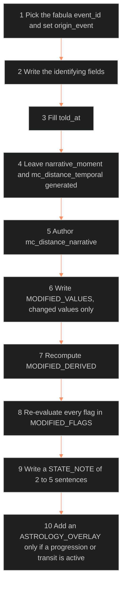

**Who it's for:** a narrative designer who knows the base record · **What it does:** step lists for authoring and reading state diffs · **Type:** how-to

# Character state architecture: how-to

Field definitions live in the [reference](2-reference.md).

## Decide whether a value is static or dynamic

1. Look up the field in the main doc's layer table, in the static/dynamic column.
2. If the column does not cover the field, freeze the character at two narrative points.
3. If the value would differ, treat it as dynamic and put it in a diff.
4. If it would not differ, treat it as static and keep it in the base only.

## Author a state diff (checkpoint)

*The ten steps of one checkpoint, in order, from the causing event to the optional astrology overlay.*

*The ten steps of one checkpoint, in order, from the causing event to the optional astrology overlay.*

1. Pick the fabula `event_id` that causes the state. Set `origin_event` to it.
2. Write `character_id`, `state_id`, `movement`, `state_version` and `base_record_version`.
3. Fill `told_at` with the time codes where the audience sees the state. Leave it empty if the state is offstage.
4. Leave `narrative_moment` and `mc_distance_temporal` to be generated and computed.
5. Author `mc_distance_narrative` as a judgment call.
6. Write `MODIFIED_VALUES` under `state_diffs:`. List only changed values.
7. Recompute the affected derived statistics. List only those that changed in `MODIFIED_DERIVED`.
8. Re-evaluate every flag. List only those that changed in `MODIFIED_FLAGS`.
9. Write a `STATE_NOTE` of 2-5 sentences.
10. Add an `ASTROLOGY_OVERLAY` only if a progression or transit is active.

## Add a reduced operating WILL

1. Keep the base `WILL` untouched.
2. Write `WILL_EFFECTIVE` in `MODIFIED_VALUES`.
3. Author the reduction yourself. No formula computes it.
4. Use `WILL_EFFECTIVE` for `stress_threshold` in the state context.

## Split a narrative moment

1. Give each part its own `state_id`, such as pre-crash and post-crash.
2. Diff each part against the base record, not against each other.
3. Keep one checkpoint per part per character.

## Write a state that diffs backward

1. Check whether the checkpoint is dated earlier than the base record's own narrative position.
2. Modify each field to its earlier value, in the additive shape of Rule 1.
3. Delete nothing from the base.

## Record a change smaller than a checkpoint

1. Write it as a story point, not a checkpoint.
2. Use [📐 ssot_08_tracking_system.md](../../../_SSOT/08_TRACKING_SYSTEMS/📐%20ssot_08_tracking_system.md) §5 for the shape.
3. Step the value by default. Set `ramp: true` for a continuous value.

## Revise a state diff

1. Archive the old diff version.
2. Write the new version with a higher `state_version`.
3. Leave the base record untouched.

## Query a character at a narrative moment

1. Load the base record.
2. Load the diff for the moment.
3. Replace each base value named in `MODIFIED_VALUES`. Keep the rest.
4. Replace the derived statistics with `MODIFIED_DERIVED`.
5. Replace the flag states with `MODIFIED_FLAGS`.
6. Lay the astrology overlay beside the natal chart, if one exists.

## Choose the signature for an event

1. Match the event to one of the five categories: trauma, systemic pressure, relational, awakening, progression.
2. Read the category's signature in the reference.
3. Check that your diff moves the fields the signature expects.
4. For a progression overlay, set `origin_event` to `null`.

## Add a relationship record

1. Write `relationship_id`, `character_a`, `character_b`, `relationship_type` and `status`.
2. Start the `state_history` with the first status and moment.
3. Add `synastry_data` only if both characters have locked charts. Compute it once.
4. When a character diff changes `primary_attachment_object`, add a matching status change to the relationship record.
