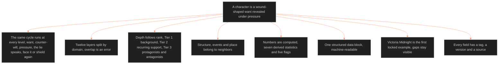

**Who it's for:** a writer or builder asking why the character system is built this way · **What it does:** explains the idea behind twelve layers, three tiers and one data block · **Type:** concept

# Character system (LEECHSEED vertical slice): concept

Pages in this set: [reference](2-reference.md) · [how-to](3-how-to.md) · [tutorial](4-tutorial.md). The source is [ssot_02_character_systems_vertical_slice.md](../../../_SSOT/02_CHARACTER_SYSTEMS/📐%20ssot_02_character_systems_vertical_slice.md).

*The mind model: one claim, a wound-shaped want revealed under pressure, drives twelve layers, three tiers and one computed data block.*

## A character is a wound-shaped want revealed under pressure

The system rests on one claim. A character is not a trait list. A character is a want, shaped by a wound, that shows itself when pressure rises.

Every model on the library shelf reaches the same engine under different names. Davis calls it a want that meets a counter-will. McKee calls it true character, the choice made under pressure when it costs something. Corbett anchors it in a ghost. The wound thesaurus gives it a chain of wound, lie, fear and shielding. Pelican shows a dated event turning an outside motive into an inside one.

The twelve layers store the person. The derived statistics and flags compute what pressure does to that person. WOUND, DRIVE, WILL and SHADOW act on CORE, VITAL and SOCIAL. The stack already implements this engine.

## The same cycle runs at every level

A want forms and DRIVE fires. A counter-will blocks it. Pressure climbs past the Stress Threshold. The wound's lie speaks. The character must face it or shield again. Facing it reveals true character. Shielding raises Collapse Risk, and the cycle returns one rung up.

L5 WOUND sets the lie's content. L4 WILL sets how hard the character resists. Stress Threshold is the number where the choice stops being optional.

## Twelve layers split by domain, and overlap is an error

Each layer governs one domain. If two layers claim the same thing, the schema is wrong. The character note is not wrong. This rule keeps the stack queryable.

The twelve layers run from surface to depth to structural function. Tier 1 is CORE, VITAL and SOCIAL. Tier 2 is WILL, WOUND and DRIVE. Tier 3 is the six deep stacks, L7 to L12. The setting slice and the plot slice mirror this architecture.

## Depth follows rank, so a background character stays thin

Tier 1 suffices for background characters. Tier 2 suffices for recurring support. Tier 3 is mandatory for protagonists and antagonists. The Hierarchy Rule states it: characterization effort tracks narrative rank. Filling every field on a background character is a schema error in the other direction.

## Structure, events and place belong to neighbors

The system owns who a character is. It leaves structure to Dramatica, events to plot systems and place to the setting slice. Viewpoint, person and tense are the telling, not the person, so they belong to the texture layer. The chart feed belongs to the astrology doc.

L12 FUNCTION shows the boundary at work. The storyform feeds it independently, as S12 and P12 are fed. A character with no storyform link can run L1 to L11 only. A filled L12 makes a character load-bearing to the argument.

## Numbers are computed, so a writer cannot fake them

Seven derived statistics and five flags come from the layer values. The writer never enters them. A state diff changes a layer value, and the system recomputes. A flag that fires unexpectedly points to a schema inconsistency, and the writer investigates the layer values before going on.

The structured data block gathers all of it into one machine-readable record. When the system moves from AI generation to hard-coded database infrastructure, that block is what the database ingests.

## One example proves the schema, and the gaps stay visible

Victoria Midnight is the first locked example. Her slice is the validation instrument: do the numbers produce the character that canon already says exists? It is also the seed record for ingestion.

The schema has grown past what her record documents. The system does not invent values to close the gap. Each blank carries the marker `⏸ VM fill pass (phase 2)`. A visible gap is a finding.

## Every field has a tag, a version and a source

No new field ships without a tag: static, dynamic or derived. The tag says whether the state architecture should log changes to it. Every field also carries the version that added it and the call that ruled it, such as CL16 or CH-2. Read aliases keep old names alive: `shame_index` still reads as `exposure_shame`, and `primary_attachment_object` still reads as `secure_base_object`. A coined name from a library book maps to an existing field, or it is dropped.

## The long read

The document grew by waves, and the waves explain its shape. The first version held the slice and Victoria's instance. On 2026-09-16 the character shelf of the library arrived and the system gained mind models and a library table. On 2026-09-29 the L9 EROS synthesis added ten changes. On 2026-10-04 four waves landed in one day: wave 2, wave 3, the schema pass and the library pass.

The schema pass shows the discipline best. The three waves coined 155 variable names. Twelve became fields. Four were added by ruling. Everything else became an alias of an existing field or was dropped. One idea keeps one name. The pass reads as a refusal to let the vocabulary sprawl.

The library pass applied 31 calls from 85 books. Each call names the book, the layer it feeds and the field it shapes. The CHARACTER × LIBRARY table is the audit trail. A reader who asks why a field exists finds its book there.

Chief ruled each wave with a short word: "Rex", "rec", "all rec". The version history keeps each ruling beside the change it authorized. Rulings stay provisional for a week, and the history records that too.
