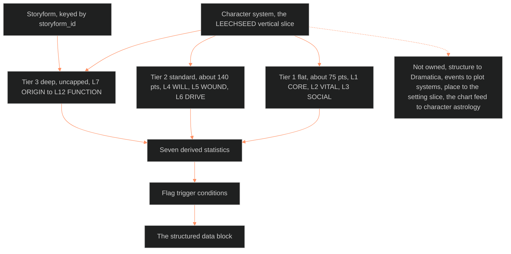

**Who it's for:** a writer or builder looking up a layer, field, formula, flag or alias · **What it does:** lists every component of the character system doc · **Type:** reference

# Character system (LEECHSEED vertical slice): reference

Why the system exists: [concept](1-concept.md). Steps: [how-to](3-how-to.md). A worked slice: [tutorial](4-tutorial.md). Source: [ssot_02_character_systems_vertical_slice.md](../../../_SSOT/02_CHARACTER_SYSTEMS/📐%20ssot_02_character_systems_vertical_slice.md), version 3.4.0, RULED 2026-10-05. Trunk: BLACK. Applies to OVEREXITOUT, ASTRO7EX, LAKAD. Tier: fabula and narratology.

The system is the LEECHSEED Character System promoted to a system. It has three tiers, twelve layers, seven derived statistics, flag trigger conditions and one machine-readable structured data block. It sits beside 03 (setting) and 04 (plot).

**Owns:** who a character is. The twelve domain declarations, the derived statistics, the flag states and the data block.

**Does not own:**

- Structure belongs to Dramatica (BVX.0089).
- Events belong to plot systems (04).
- Place belongs to the setting slice (03).
- Viewpoint, person and tense are the telling, not the person (BVX.0061). They belong to the texture layer.
- The chart feed belongs to [character astrology](../ssot_02_character_astrology/2-reference.md).

**Root claim:** a character is a wound-shaped want revealed under pressure. WOUND, DRIVE, WILL and SHADOW acting on CORE, VITAL and SOCIAL are the one engine the stack implements.

**Touchstones:** read the [Touchstones register](../../../_SSOT/01_NARRATIVE_FRAMEWORKS/📐%20ssot_01_touchstones_register.md) first.

*The structure: three tiers hold the twelve layers, the layers feed the computed numbers. The numbers end in one data block.*

## MIND MODELS

Three diagrams in the source.

**Diagram 1, the whole system on one screen** (mind map). Root: the character system. Branches:

- Three tiers: Tier 1 flat, Tier 2 standard, Tier 3 deep.
- Twelve layers: L1-L3 primary, L4-L6 secondary, L7-L12 deep stacks.
- Computed: derived statistics, flag trigger conditions, structured data block.
- Library: nine distills, one leaf each.
- Boundaries: structure is Dramatica, events are plot systems, place is the setting slice, telling is the texture layer.

**Diagram 2, the central mechanism** (flowchart).

- Tier 1 (CORE, VITAL, SOCIAL) and Tier 2 (WILL, WOUND, DRIVE) feed the seven derived statistics. Tier 3 (six deep stacks) feeds them too.
- CORE derives WILL. VITAL derives DRIVE.
- Character history feeds WOUND ("history, not bought").
- WOUND feeds the statistics. The statistics feed the flag trigger conditions. The flags feed the structured data block.

**Diagram 3, the recurring engine** (state diagram).

1. A want forms and DRIVE fires.
2. A counter-will blocks the want (Obstacle).
3. Pressure climbs past the Stress Threshold.
4. The wound's lie speaks.
5. Forced choice: face it or shield again.
6. Facing it leads to Revelation, and true character is shown.
7. Shielding leads to Collapse, and Collapse Risk climbs. The cycle recurs one rung up.

The same cycle repeats at every rung. L5 WOUND sets the lie's content. L4 WILL sets how hard it resists. Stress Threshold is the number where the choice stops being optional.

## PART A · THE CHARACTER SLICE, twelve layers, the stack the setting and plot slices mirror

One table, twelve layers. The setting slice and the plot slice mirror this architecture: surface to depth to structural function. L12 is fed independently from the storyform, as S12 and P12 are.

| Layer | Name | Question it answers | Source | Field it writes | Tier |
|---|---|---|---|---|---|
| **L1** | **CORE** | How much cognitive and ideological mass does the mind carry? | BVX.0075, BVX.0233 the Big Five, BVX.1123 Egri's psychology dimension, PSY.05 neurotype | `CORE`, `psychology_stack`, `assigned_labels`, `neurotype` (3.3.0) | Tier 1 |
| **L2** | **VITAL** | How much physical and energetic presence does the body carry? | BVX.0075, BVX.0233 the stress-response cascade, BVX.1123 Egri's physiology dimension | `VITAL`, `physiology_stack`, `body_capital` (adults only) | Tier 1 |
| **L3** | **SOCIAL** | How does the character project into and read the social world? | BVX.0233 the interpersonal circumplex (optional scored dial, 3.0.0), BVX.0061 reputation, BVX.1123 Egri's sociology dimension, MSX.12 and MSX.13 standing by conduct | `SOCIAL`, `sociology_stack`, `community_membership` (+ `standing`, 3.3.0; `catalog_ref`, 3.4.0), `circumplex` (optional), `pair_register`, `civic_standing` (+ `catalog_ref`, 3.4.0), `disclosure_posture` (outness), `voice_sheet` | Tier 1 |
| **L4** | **WILL** | How much resistance holds under pressure, and where does the capacity to decide bend? | BVX.0075 counter-will, BVX.0045 coping strategy, BVX.1123 strength of will | `WILL`, `coping_strategy`, `locus_of_control`, `system_stance` | Tier 2 |
| **L5** | **WOUND** | What accumulated damage failed to resolve, and how severe is it? | BVX.0209 the wound card, BVX.0196 the ghost, BVX.0075 back-story placement | `WOUND`, `severity`, `triggers` (incl. type `minority_stress`), `relational_refs` (+ `mentor_state`), `wound_kind`, `wound_work` | Tier 2 |
| **L6** | **DRIVE** | What fuels the active goal-pursuit, and from what source? | BVX.0075 super-objective, BVX.0233 the fifteen motivations, BVX.0045 cares-about/motivates | `DRIVE`, `futurity_stance`, `want_need` | Tier 2 |
| **L7** | **ORIGIN** | What birth context and formation set the starting conditions? | BVX.0075 birth marks, BVX.0061 justification, BVX.1123 heredity | `origin_class`, `origin_stability`, `family_coherence`, `origin_wound_seed`, `tech_level` (+ `catalog_ref`, 3.4.0), `system_exposure` (+ `layers`, whose `regime` takes `catalog_ref`, 3.4.0), `origin_event` (optional, 3.4.0), `hereditary_predisposition`, `life_script` | Tier 3 |
| **L8** | **IMPRINT** | What formative conditioning locked in before the story began? | BVX.0075, BVX.0233 life-stage emotional concerns, BVX.1127 attachment theory | `attachment_style`, `attachment_style_score`, `attachment_dimensions`, `protest_behaviors`, `deactivating_strategies`, `emotional_range`, `conditional_patterns`, `imprint_flexibility`, `secure_base_object` (was `primary_attachment_object`, kept as a read alias), `appeasement_strategies` | Tier 3 |
| **L9** | **EROS** | How is desire structured, armored, and made safe? | BVX.0075 sexuality as attitude, the L9 v2 doc, [victoria-midnight-L9-eros.md](../../../../../_CANON_NODES/victoria-midnight-L9-eros.md), the 3.3.0 craft and exchange books (MSX.11–MSX.15, PSY.02), and the L9 EROS synthesis (RULED 2026-09-29, MSX.18–MSX.36, PSY.08–PSY.13), [ssot_02_l9_eros_synthesis.md](../ssot_02_l9_eros_synthesis/2-reference.md) | `erotic_blueprint_type` (+ `arousal_curve`), `desire_vector` (+ `resolution_type`, `group_size`, `group_position`), `erotic_craft`, `power_exchange`, `consent_posture`, `client_script`, `signal_fluency`, `shame_index` (+ `exposure_shame`, `role_shame`), `armor_index`, `satisfaction_cycle_truncation`, `erotic_safety_precondition` (+ `erotic_safety_precondition_scope`), `intimacy_mode`, `disclosure_posture` (sexual-health register), `template_origin`, `compersion`, `fantasy_ledger`, `desire_object`, `pleasure_evidence`, `sex_creed`, `touch_rule`, `dissolution`, `compartment_practice`, `attraction_channels`, `risk_role`, `risk_account` | Tier 3 |
| **L10** | **SHADOW** | What is repressed, projected, or denied, and what does it generate? | BVX.0064 true character vs characterization, BVX.0196 secrets and the adaptation hierarchy, BVX.0045 the shadow face, BVX.0233 the Dark Triad and Light Triad (optional scored dials, 3.0.0) | `shadow_density`, `projection_tendency`, `regression_pattern`, `shadow_content`, `dark_triad` (optional), `light_triad` (optional), `disinhibition_context` | Tier 3 |
| **L11** | **DESTINY** | What is the character building toward, not where they stand? | BVX.0045 the two journeys, BVX.0196 growth vs transformation, BVX.0061 the four causes of change | `growth_axis`, `resistance_index`, `soul_evolution_archetype`, `karmic_memory`, `growth_requirement`, `arc_type`, `change_cause`, `catalyst_archetype`, `rail_ref` (3.4.0) | Tier 3 |
| **L12** | **FUNCTION** | What narrative role and mechanical function does the character discharge? | BVX.0089 the eight archetypes, BVX.0061 the hierarchy, BVX.0064 the cast map, BVX.1123 the pivotal character | `dramatica_archetype`, `mc_problem_element`, `methodology_element`, `evaluation_element`, `purpose_element`, `touchstone`, `story_outcome`, `story_judgement`, `limit_type`, `resolve`, `convention_role` | Tier 3 |

**Binding rule.** L12 FUNCTION is fed from the storyform, keyed by `storyform_id`. A character with no storyform link may run L1 through L11 only. A filled L12 makes a character load-bearing to the argument. The L12 field list lives in one place only. That place is the [Dramatica integration protocol](../../../_SSOT/02_CHARACTER_SYSTEMS/🔮%20ssot_02_dramatica_integration_protocol.md), version 1.2.0. That doc owns the cascade when a storyform is revised. It also defines `convention_role`.

**Interfaces (IF catalog, ruled 2026-10-05).** Each line names one wiring by its IF id.

- Reads from 05 (IF-02-05-02): WB-GRP ids from a catalog entry's `groups` field. A person points at a group through `community_membership.catalog_ref`. The group's style and customs stay in 05.
- Read by 05 (IF-02-05-03): the 05 L02 link check resolves each catalog group or person pointer to a 02 node. A missing node is owed by 02.
- Read by 03 (IF-02-03-04): 03 reads the four flag states for place flags: ACTIVE, PENDING, FIRED_PRE_STORY and INACTIVE. The record computes them and never assigns them.
- Read by 01 (IF-01-02-14): the trope register reads Tori's L5 WOUND instance, the car crash that kills Jebb, as its SIGNATURE WOUND record.
- Read by 06 (IF-02-06-01): 06 reads images already present in the character material as motif candidates.
- Read by 07.1 (IF-02-07-01): 07.1 reads L5 WOUND and L6 DRIVE, which set a character's motive. The page shows only its effects.

### Field tags · every field

Every field in the Structured Data Block carries one of three tags.

- **Static:** set once, at origin. A revision makes a new base record.
- **Dynamic:** changes across the story. The [state architecture](../ssot_02_character_state_architecture/2-reference.md) module records each change as a state diff.
- **Derived:** a computed statistic or flag state. The system recomputes it from current layer values and never stores it as a state diff.

Rules:

- No new field ships without a tag.
- Static or dynamic follows the state module's Decision Test. The test asks: would the value differ if the character were frozen at two points in the narrative?
- The four header lines (`CHARACTER_ID`, `IP`, `STATUS`, `VERSION`) are record metadata. Each is Static.
- Before 3.3.0, 44 of 103 keys in the block had no tag. All are tagged now (FU-1).
- The 3.2.0 pass (CL31) tagged `intimacy_mode` Dynamic, `desire_vector` Dynamic, `system_exposure` Static.

| Tag | Fields |
|---|---|
| **Static** | `CHARACTER_ID` · `IP` · `STATUS` · `VERSION` · `source_confidence` · `hereditary_predisposition` · `triggers` · `arc_type` · `change_cause` · `catalyst_archetype` · `resolution_type` · `arousal_curve` · `template_origin` · `vandalism_event` · `origin_disciplinary_formation` · `sexual_script_acquisition` · `wound_kind` · `system_exposure` · `layers` (under `system_exposure`) · `convention_role` · `life_script` (`source`, `version`) · `neurotype` (`label`, `known_to_self`) · `power_exchange` · `erotic_craft` (`training`) · `origin_class` · `origin_stability` · `family_coherence` · `origin_wound_seed` · `tech_level` · `attachment_style` · `attachment_style_score` · `emotional_range` · `conditional_patterns` · `imprint_flexibility` · `erotic_blueprint_type` · `satisfaction_cycle_truncation` · `regression_pattern` · `growth_axis` · `growth_requirement` · `soul_evolution_archetype` · `karmic_memory` · `dramatica_archetype` · `mc_problem_element` · `methodology_element` · `evaluation_element` · `purpose_element` · `touchstone` · `rail_ref` · `origin_event` · `story_outcome` · `story_judgement` · `limit_type` · `resolve` · `necessity` · `motivation_quad` |
| **Dynamic**, L1–L4 | `CORE` · `VITAL` · `SOCIAL` · `WILL` · `psychology_stack` · `physiology_stack` · `sociology_stack` · `body_capital` · `circumplex` · `knowledge_map` · `community_membership` · `standing` (under `community_membership`) · `agreement_style` · `risk_management_practice` · `self_presentation` · `identity_frame` · `coping_strategy` · `resistance_mode` · `locus_of_control` · `assigned_labels` · `pair_register` · `civic_standing` · `disclosure_posture` (L3, outness) · `voice_sheet` · `system_stance` · `neurotype` (`masked_by`, `attention_pattern`) |
| **Dynamic**, L5–L8 | `WOUND` · `DRIVE` · `severity` · `relational_refs` · `motivation_stack` · `drive_texture` · `futurity_stance` · `attachment_dimensions` · `protest_behaviors` · `deactivating_strategies` · `secure_base_object` · `somatic_archive` · `wound_work` · `mentor_state` · `want_need` · `appeasement_strategies` · `life_script` (`stance`, `cost`) |
| **Dynamic**, L9–L11 | `consent_posture` · `client_script` · `signal_fluency` · `exposure_shame` · `shame_index` · `role_shame` · `armor_index` · `erotic_safety_precondition` · `erotic_safety_precondition_scope` · `disclosure_posture` · `orientation_dimensions` · `charmed_circle_position` · `resonance_profile` · `polarity_role` · `love_lust_cleft` · `moral_incongruence` · `shadow_density` · `projection_tendency` · `shadow_content` · `dark_triad` · `light_triad` · `intimacy_mode` · `desire_vector` · `group_size` · `group_position` · `compersion` · `fantasy_ledger` · `desire_object` · `pleasure_evidence` · `sex_creed` · `touch_rule` · `dissolution` · `compartment_practice` · `attraction_channels` · `risk_role` · `risk_account` · `concordance` · `refractory_minutes` · `disinhibition_context` · `erotic_craft` (`domains`, `level`, `flow_access`) · `power_exchange` (`stage`) · `resistance_index` |
| **Derived** | `basic_damage_resistance` · `social_legibility` · `narrative_momentum` · `stress_threshold` · `collapse_risk` · `truth_exposure_index` · `expressive_range` · `SHADOW_DENIAL` · `TRUTH_VULNERABILITY` · `OPTIONLOCK_PROGRESSION` · `EARNED_JUDGEMENT` · `KINSHIP_COLLAPSE` |
| **Static**, sub-fields (3.3.1) | `setting_ref` · `character_id` |
| **Dynamic**, sub-fields (3.3.1) | `noticing_filter` · `false_belief` · `wound_belief_set` · `audience` · `container` · `triangle_position` · `reversal_wish` |

**Exceptions (CL19, CL29, CH-1, CH-2, CH-5).**

- `arousal_curve` stays Static. Its sub-fields `concordance` and `refractory_minutes` are Dynamic.
- `life_script`: `source` and `version` Static, `stance` and `cost` Dynamic.
- `erotic_craft` is Dynamic, except `training`, which is Static.
- `power_exchange` is Static per bond, except `stage`, which is Dynamic.
- `neurotype`: `label` and `known_to_self` Static, `masked_by` and `attention_pattern` Dynamic.
- `catalog_ref` (3.4.0) inherits the tag of the field it sits on.
- `rail_ref` and `origin_event` are Static. The `event_id` stored beside a PENDING or FIRED_PRE_STORY flag is Static. It is not a derived value.
- Every other sub-field inherits its parent's tag.

**Derived values are recomputed, never stored.** The seven statistics and five flags come from layer values. A state diff changes the layer values. The system then recomputes.

The weakest calls are `dark_triad`, `light_triad` and the three Egri stacks. They read dynamic because a story can move them. A writer who holds one fixed notes it on the instance.

## Core Methodology

The 12-Layer system is modular. Tier depth sets character complexity and database weight.

### The Three-Tier Structure

| Tier | Layers | Character class | Point budget |
|---|---|---|---|
| Tier 1 | L1-L3 | Flat | ~75 pts |
| Tier 2 | L4-L6 | Standard | ~140 pts |
| Tier 3 | L7-L12 | Deep | Uncapped |

Tier 1 suffices for background characters. Tier 2 suffices for recurring supporting characters. Tier 3 is mandatory for all protagonists and antagonists.

### The Hierarchy Rule

(Call 4, BVX.0061 Card, BVX.0064 McKee. APPLIED 2.1.0.) Characterization effort tracks narrative rank. A character earns deeper tiers and denser Tier 3 population. The writer scales both to the load-bearing weight the story places on the character. Filling every field on a background character is a schema error.

### Erotic Pacing

(L9 EROS synthesis, RULED 2026-09-29. MSX.26, MSX.33. APPLIED 2.2.0. No new field.) A four-device toolkit governs how any L9-driven scene is narrated: **withhold, fragment, bound, interrupt**. The devices are craft, not character data. See the [synthesis](../ssot_02_l9_eros_synthesis/2-reference.md).

### Library-pass rules

(CL1, CL10, CL18, CL25. APPLIED 3.2.0.)

| # | Rule |
|---|---|
| 1 Scoping (CL1) | Four fields accept a list of {ref: character_id or audience name, value}: `intimacy_mode`, `disclosure_posture`, `love_lust_cleft`, `self_presentation`. The bare value is the default. The list is Dynamic. |
| 2 Shame (CL10) | Shame intensity reads as norm distance times the stigmatizer's power over him. |
| 3 Disinhibition (CL18) | Only `disinhibition_context` scope `shadow_driven` feeds Collapse Risk. |
| 4 Stance (CL25) | A stated `system_stance` is a performance until a second source checks it. |

### The Villain-Arc Fork

(Call 7, BVX.0196, BVX.0061. APPLIED 3.0.0.) An L5 WOUND feeds an L8 IMPRINT. In an antagonist the pipeline stalls, and the wound hardens into imprint. Three paths open.

| Path | Condition | Layer effects |
|---|---|---|
| (a) The wound is refused | The villain arc | L5 stays high. L8 `imprint_flexibility` stays low and `conditional_patterns` calcify into belief. L10 SHADOW grows. L12 `resolve` holds. |
| (b) The wound is faced | The change arc | L5 `severity` falls. L8 loosens. L10 `shadow_content` surfaces. L11 `change_cause` fires. L12 `resolve` reads Change. |
| (c) The wound is staged and never resolves (3.2.0, CL22) | Healing never done | `severity` holds or oscillates. SHADOW_DENIAL falls. `shadow_content` surfaces on stage. L5 `wound_work` reads `reenacted_in_play`. This is a field value, not a failed arc. |

How to tell the paths apart: read `resistance_index`, `change_cause` and flag SHADOW_DENIAL together. A cause the character defeats, with SHADOW_DENIAL still ACTIVE at the climax, marks path (a). A cause the character accepts, with the shield collapsing, marks path (b).

### The 12 Layers: Domain Declarations

Each layer governs one and only one domain. Overlap between layers is a schema error, not a character note. Entries below give each layer's domain, defaults, costs and fields. Sub-field structure is in braces. "Added" marks the version that introduced a field.

#### L1 CORE

- **Domain:** cognitive and psychological mass. Mental skill defaults, ideological frameworks, problem-solving capacity.
- **Default 10.** Cost 20 pts per level above 10 (IQ equivalent).
- `psychology_stack` (call 12, BVX.1123 Egri, 2.1.0): the psychology third of Egri's bone structure. It is an auditable text checklist: moral standards, ambition, frustrations, temperament, attitude toward life, complexes, extrovert/introvert, abilities, qualities, IQ.
- `identity_frame` (2.5.0): the frame he names himself by. Gender persona, orientation label, era category, and the gender script he plays for each audience.
- `assigned_labels` (3.2.0, CL5, Dynamic), under `identity_frame`. It is a list of {label: text, by: law | medicine | church | state | buyer | family | peers, year: integer, accepted: bool}.
- `neurotype` (3.3.0, CH-5): {label: text, known_to_self: bool, masked_by: novelty | effort | none, attention_pattern: hyperfocus | scattered | mixed}. Source PSY.05. Method line: store the condition as one cause among others, never as the explanation.

#### L2 VITAL

- **Domain:** physical and energetic presence. Body precision, endurance, reaction capacity, physical expressiveness.
- **Default 10.** Cost 20 pts per level above 10 (DX equivalent).
- `physiology_stack` (call 12, 2.1.0): heredity, appearance, defects, posture, health as a text checklist. Heredity itself resolved to L7 `hereditary_predisposition`.
- `body_capital` (3.0.0, defined 3.2.0, CL14, Dynamic, adults only). The record holds price_factors: list of {factor: masculinity | build | race | role, direction: up | down}. It holds window: {curve, start_age, end_age}. It also holds venue_tier: integer, trust_signal: text, working_body_gap: text and embodied_cost: text.

#### L3 SOCIAL

- **Domain:** relational interface. Projection into the world, reception of others, social legibility, reaction modifier math.
- **Default 10.** Cost 10 pts per level above 10 (HT equivalent).
- `sociology_stack` (call 12, 2.1.0): class, occupation, education, home life, political affiliation, as text.
- `circumplex` (3.0.0): optional scored dial {agency, communion}, each -5 to +5. Agency runs yielding to dominant. Communion runs cold to warm. Null by default.
- `knowledge_map` (2.4.0, Sedgwick, MSX.68): per relationship, it records what each knows. It also records what each knows the other knows, and who may claim not to know. Shared with L9. It gains `cover` (3.2.0, CL8, Dynamic): list of {kind: overcompensation | double_life | passing | hidden_in_plain_view, sized_to: text, cost: text}. For a double life, the writer picks one home per case, `cover` or `shadow_content`.
- `community_membership` (2.5.0): the chosen community, its places, press and codes. It also holds the rooms he belongs in with each room's code. Gains `standing` (3.3.0, CH-3, Dynamic): {earned_by: list of dated acts, vouched_by: list of character_ids, cost_to_lose: text}. Keep apart from `civic_standing`. Takes `catalog_ref` (3.4.0, IF catalog call 3): a list of 05 catalog entry ids (`WB-<TYPE>-<nnnn>`), such as the community's WB-GRP entry. The free text stays as the gloss until the entry exists.
- `agreement_style` (2.5.0): relationship agreements, fuzzy or legalistic, open or closed. It gains (3.2.0, CL3) form: spoken | unspoken_pretense. It also gains symmetry: symmetric | asymmetric. It gains veto: held | given | none, plus a cost note. It gains reopen_triggers: list of text.
- `risk_management_practice` (2.5.0): the safety rules he makes and keeps. Shared with L6.
- `self_presentation` (2.5.0): the desirable self he builds for a public, such as apps, sites, a brand.
- `pair_register` (3.2.0, CL1, Dynamic): list keyed by character_id. Each entry holds attachment_dimensions {anxiety, avoidance} and pacing: slow | goal. It also holds rules: list of {rule: text, form: spoken | tacit, status: kept | bent | broken}. The last field is rule_gap: text or null.
- `civic_standing` (3.2.0, CL6, Dynamic): the record holds category: text, rank_or_score: number or null and rights_held: list. It also holds what_can_be_taken: list, by_whom: text, exemptions: list and last_reranked: story_beat. Class modifies it. Takes `catalog_ref` (3.4.0, IF catalog call 3): a list of 05 catalog entry ids, such as the regime that ranks him. A `story_beat` is a fabula `event_id` (IF catalog call 5): `<movement>_<slug>`, or `backstory_<slug>` before M1. `last_reranked` stores one.
- `disclosure_posture` (3.2.0, CL7, Dynamic): outness. It holds a list of {audience, concealed_trait, strategy: open | selective | covering | double_living | none, stake: text}. It also holds stages: list of {stage: self_recognition | circle | public, year}. It also holds cost_ledger: list of text and hiding_incentive: text or null. It is a view onto `knowledge_map`, not a second store. L9 keeps its own for the sexual-health register.
- `voice_sheet` (3.2.0, CL28, Dynamic): {register: text, dialect: text, native_pace: slow | even | fast, tic_with_reason: text, noticing_filter: list}. Derive `noticing_filter` from `sociology_stack` and L8 `conditional_patterns`. Texture keeps how the voice is narrated.

#### L4 WILL

- **Domain:** the capacity to decide under pressure (redefined 2026-09-29, call 13, BVX.1123). It is not raw toughness. The number measures whether a choice can be made at all.
- Derives from CORE by default (`WILL = CORE`). Buyable up or down at 5 pts per level.
- `coping_strategy` (call 10, BVX.0045 Schmidt's five strategies, 2.1.0, sited on L4 not L8).
- `resistance_mode` (2.5.0): everyday tactics against a system, such as dress, space, passing, hidden worlds.
- `locus_of_control` (3.0.0): internal to external, -5 to +5. -5 is fully internal, +5 fully external.
- `system_stance` (3.2.0, CL25, Dynamic): cog | believer | mask | bystander | resister, plus offstage_audience: text. `resistance_mode` covers how he resists. This field covers how he sits inside a system he does not resist.

#### L5 WOUND

- **Domain:** accumulated psychological damage that failed to resolve. Assigned from character history. High WOUND reduces effective WILL and SOCIAL under trigger conditions.
- **Scale:** 0 (undamaged) to 10 (functional collapse threshold). This scale is named `severity` (call 6, BVX.0209). It is the same number, not a second value.
- `triggers` (call 6): list of conditions that fire the wound. Each entry takes an optional `setting_ref` {setting_id, S-layer} (CL30). `minority_stress` is a trigger type (3.0.0), not a field. It fires the wound through the strain of belonging to a stigmatized group.
- `relational_refs` (call 1 folded into call 15, BVX.0196): list of {kind, character_id, note}. Kind takes ghost | revenant | mentor | shapeshifter, and from 3.2.0 (CL15) also helper | opponent | sender | receiver | rival | beloved. It supersedes separate `ghost_ref` and `revenant_ref` fields.
- `wound_kind` (3.2.0, CL22, Static): injury_suffered | error_committed | loss_unrecognized, plus a note.
- `wound_work` (3.2.0, CL22, Dynamic): none | avoided | reenacted_in_play | processed, plus terminating: bool.
- `mentor_state` (3.2.0, CL15, Dynamic): present | absent | flawed.

#### L6 DRIVE

- **Domain:** narrative motivation fuel. Derives from VITAL by default (`DRIVE = VITAL`). Spent on active goal-pursuit, recovered through narrative resolution. Buyable at 3 pts per level.
- `motivation_stack` (2.5.0): ordered motives, stated versus real. Entries gain `audience` (3.2.0, CL17, Dynamic): list of {who, named: bool}.
- `drive_texture` (2.5.0): the felt shape of the drive: more, risk, novelty, abundance. Note (3.3.0, CH-5): where the drive is hyperfocus, record when it fades. Record it as a state diff keyed to a checkpoint.
- `futurity_stance` (3.0.0): how the character holds the future. Values: planned, hoped, foreclosed, none, and from 3.2.0 (CL27) refused and horizon. Foreclosed means taken. Refused means he turns it down.
- `want_need` (3.2.0, CL16, Dynamic): the record holds want: text, need: text and false_belief: text. It also holds need_kind: psychological | moral, cost: text and fusion_beat: story_beat or null. `fusion_beat` stores a fabula `event_id` (3.4.0, IF catalog call 5). `false_belief` links to L5 `wound_belief_set`, so one belief is stored once.

#### L7 ORIGIN

- **Domain:** birth context, socioeconomic class, family architecture, environmental formation, system exposure timing. Numeric variables feed WOUND base and SOCIAL defaults.
- Numeric and enum fields: `origin_class`, `origin_stability`, `family_coherence`, `origin_wound_seed`, `tech_level`, `system_exposure`.
- `hereditary_predisposition` (call 12, 2.1.0): the trait inherited rather than formed. "Provisional" dropped in 3.0.0. A full field.
- `origin_disciplinary_formation` (2.5.0): the institution that bonded and policed him, such as a team, unit, club or church.
- `layers` (3.2.0, CL6, Static), under `system_exposure`: list of {regime: text, years: range, trace_still_showing: bool}. `system_exposure` holds when he met the system. L3 `civic_standing` holds the standing it gives him now.
- `life_script` (3.2.0, CL29): {source: text, version: text, stance: accept | bend | refuse, cost: text}. `source` and `version` are Static. `stance` and `cost` are Dynamic. L11 `growth_requirement` may read `stance`.
- `origin_class` and `origin_disciplinary_formation` entries take an optional `setting_ref` (CL30).
- `catalog_ref` (3.4.0, IF catalog call 3) sits on `system_exposure.layers.regime` and on `tech_level`: a 05 catalog entry id (`WB-<TYPE>-<nnnn>`). `tech_level` reads the scale of the TEC entry it points at. Where the entry states a scale, the entry wins and the writer types no per-character number.
- `origin_event` (3.4.0, IF catalog call 5, Static): an optional pointer to the fabula `event_id` that begins the character's existence. A copy, such as Anna Colson (the copy), carries one.

#### L8 IMPRINT

- **Domain:** formative emotional conditioning. Attachment architecture, emotional range, operational belief patterns set before story entry.
- Field list from BVX.1127 Levine & Heller, *Attached* (call 14, 2.1.0). The list holds `attachment_style` (four-way enum: secure, anxious, avoidant, fearful_avoidant). It also holds `attachment_dimensions` {anxiety, avoidance} beside the scalar `attachment_style_score`, `protest_behaviors` and `deactivating_strategies`.
- Also: `emotional_range`, `conditional_patterns`, `imprint_flexibility`.
- `secure_base_object`: renamed from `primary_attachment_object`. The old name stays a read alias. It was the only rename in 2.1.0.
- `vandalism_event` (2.3.0, Money, PSY.54): the dated early event that bent the lovemap. Paired with L9 `template_origin`. Static sub-fields (3.2.0, CL21): valence: taught | rewired | wounded | mixed; what_it_taught: text; what_it_still_powers: text; place; year. Adult formative scenes live here.
- `somatic_archive` (2.3.0, Paasonen, MSX.67): what the body has learned to answer. Habit builds it, with no trauma story required.
- `sexual_script_acquisition` (2.5.0): who and what taught him what sex means, and at which level.
- `appeasement_strategies` (3.2.0, CL23, Dynamic): list of text, beside `protest_behaviors` and `deactivating_strategies`. Covers self-erasure by submission. Cross-reference L9 `polarity_role`, so a chosen submissive role is told apart from a defense.

#### L9 EROS

- **Domain:** psycho-sexual conditioning. Desire structure, erotic patterning, shame architecture, body armor, satisfaction-cycle integrity, safety preconditions, intimacy mode.
- Core fields: `erotic_blueprint_type`, `desire_vector`, `shame_index`, `armor_index`, `satisfaction_cycle_truncation`, `erotic_safety_precondition`, `intimacy_mode`.
- **Synthesis fields (2.2.0, RULED 2026-09-29).** Derivation in the [synthesis](../ssot_02_l9_eros_synthesis/2-reference.md).
  - `consent_posture`: a "yes" and a want are different facts. Distinct from `erotic_safety_precondition`.
  - `client_script`: scripted to spontaneous, revisable mid-scene, for staged or paid intimacy.
  - `signal_fluency`: fluent, functional or illiterate. Nonverbal desire-and-consent literacy.
  - `resolution_type` under `desire_vector`: terminating or additive.
  - `exposure_shame` and `role_shame`: split `shame_index`, both on SC-12 (0-12) since 3.3.2. `shame_index` is a read alias for `exposure_shame`.
  - `arousal_curve` under `erotic_blueprint_type`: spike, plateau or current.
  - `erotic_safety_precondition_scope`: internal or external.
  - `disclosure_posture` on L9: the sexual-health register.
  - `template_origin`: a pointer from L9 to the L8 imprint event the adult desire follows.
- **2.3.0 (wave 2):**
  - `orientation_dimensions` (Laumann, PSY.53): behavior, desire and identity as three separate settings. Kinsey's 0-6 rides along as a per-age score (PSY.50).
  - `template_origin` also holds the lovemap design (Money, PSY.54).
  - `charmed_circle_position` (Rubin, MSX.46): per wanted act, which side of the world's good-sex line it falls on. It also records how the character carries it. Adults only. Reads beside `consent_posture`.
  - `resonance_profile` (Paasonen, MSX.67): what lands now, how it shifts, how it goes stale.
- **2.4.0 (wave 3):**
  - `template_origin` gains `core_erotic_theme`: one sentence per lead, worded from its wound (Morin, PSY.63).
  - `arousal_curve` gains an excitation and inhibition setting: SES, SIS1, SIS2 (Bancroft, PSY.58).
  - `consent_posture` gains `negotiation`, `signals`, `debrief`, plus the consent model the character works from (Wiseman, MSX.80; Barker, PSY.65). L9 reads L3 `knowledge_map`.
- **2.5.0 (schema pass):** `polarity_role` (top, bottom, switch, dom, sub; chosen or assigned). It also adds `love_lust_cleft` (how he settles saintly love against sinful lust).
- **3.2.0 (library pass):**
  - `intimacy_mode` values (CL2): partnered_merge | parallel_presence | solo_directed | bounded_no_strings. The {ref, value} list replaces separate {mode, context} pairs.
  - `consent_posture` gains (CL4, all Dynamic): scope: per_act | per_scene | standing. It gains redefended_per_scene: bool and enthusiasm_standard: required | not_required. It gains precommitments: list of text and veto_points: list of named checkpoints. It gains limits: {hard: list, soft: list} and recall: match | diverge. Consent-model values extend to affirmative | SSC | RACK | negotiated_safety | limit | consensual_minimalism.
  - `compersion` under `desire_vector` (CL3, Dynamic): {level 0-10, kind: erotic | emotional | none, learned: bool}.
  - `exposure_shame` gains direction: self | partner | group | down_hierarchy | none, and coping_style: attack_self | withdrawal | attack_other | avoidance. `role_shame` gains target: erection | orgasm | pretense | receiving | initiative | femininity | other (CL10).
  - `resonance_profile` holds fantasy and practice as two registers that may differ. It also holds type_tags: list of text and exceeds_type: bool (CL11).
  - `fantasy_ledger` under `desire_vector` (CL11, Dynamic): list of {theme, told_to: list, acted: yes | no, real_vs_imagined: text}. Theme values (PSY.62): multipartner | power_control | novelty | taboo | partner_sharing | passion_romance | non_conventional. A fantasy that fails the consent or risk test stays fantasy.
  - `pleasure_evidence` (CL12) sits under `desire_vector`: {asks_for: text, accepts: text}. `desire_object`: pleasure | activity | being_wanted | the_others_pleasure. `sex_creed`: reproductive | romantic | pleasure | communication. All Dynamic.
  - `polarity_role` gains reason: proof | giving | release | rank | market. It gains reversal_wish: text (feeds `shadow_content` as `denied_wish`). It gains history: list of {role, when, taught_by, outcome}. It gains stage: beginner | working | fluent (CL13). `touch_rule` {gives, receives, no_touch: bool} and `dissolution` {depth 0-10, with: text} join it, both Dynamic.
  - `arousal_curve` stays Static (CL19). Static sub-fields: signature {amplitude 0-10, areas: list, speed: slow | medium | fast, time_to_peak_min: integer, spasm_size 0-10}. Static sub-fields also include climb_rule (a closing signal drops the climb one step). Dynamic sub-fields: concordance: aligned | decoupled | variable; refractory_minutes: integer or null.
  - `risk_role` on `erotic_safety_precondition` (CL20, Dynamic): precondition | spark | trust_token. `risk_account` on `risk_management_practice` (CL20, Dynamic): justification | excuse | informed_consent_frame | none.
  - `compartment_practice` (CL24, Dynamic): {technique: schedule | dissociation | ritual_boundary | rule_set, reserved_act: text, leak_point: text}. The leak point feeds SHADOW.
  - `attraction_channels` under `orientation_dimensions` (CL26, Dynamic): sexual, romantic, sensual, platonic, aesthetic. Each is an integer 0-10 or null, each with its own target gender. A null sexual channel makes `desire_vector` run non-terminating.
- **3.3.0 (follow-up):**
  - `erotic_craft` (CH-1, Dynamic, `training` Static): the record holds domains: list and level: novice | competent | expert | master. It also holds training: self | partner | teacher | tradition and flow_access: reliable | sometimes | blocked. Read beside `sexual_script_acquisition`.
  - `power_exchange` (CH-2, Static, `stage` Dynamic): list keyed by `character_id`. Each entry holds scope: [physical, mental, financial] and protocol: list of named rules. It also holds container: {space, ritual, time_bound} and duration: scene_bound | standing. It also holds stage: trial | trained | owned, function: free text and role_integrity: the rule against slipping out of role. Cites [Touchstone 1:1](../../../_SSOT/01_NARRATIVE_FRAMEWORKS/📐%20ssot_01_touchstones_register.md), the bounded container, on `container`. `polarity_role.reason` gains the top's rewards: empathy, creativity, bigness, nurturing, bullying, control, competence. Role bleed keeps its home in `compartment_practice`.
  - `triangle_position` merge into `desire_vector` is kept (CH-4 narrow fix). Two sub-fields carry the group parts (PSY.02): `group_size` (Dynamic; 3 is a triad) and `group_position` (Dynamic). The `group_position` record holds structure: couple_plus_third | triad | group and standing: primary | equal | guest | disposable. It also holds rule_setter: character_id. It also holds motives: list of identity | novelty | partner_wish | relationship_test | power and script_followed: FFM | MMF | other | none. Pair with `agreement_style` veto and symmetry rules and with `compersion`.

#### L10 SHADOW

- **Domain:** repressed, projected and denied content. High values generate disadvantage clusters and modify stress behavior.
- Fields: `shadow_density`, `projection_tendency`, `regression_pattern`, `shadow_content`.
- `dark_triad` (3.0.0): optional dial {narcissism, machiavellianism, psychopathy}, each 0-10. `light_triad`: optional dial {kantianism, humanism, faith_in_humanity}, each 0-10. Both null by default.
- `moral_incongruence` (2.4.0, Burke, MSX.84): the gap between two things. One is what a character believes about his desire. The other is what he does.
- `shadow_content` entries carry a kind (3.2.0, CL9): denied_wish | assigned_by_world | feared_double | standing_alarm | scrubbed_bond | imposed_self_image. `reversal_wish` feeds `denied_wish`.
- `disinhibition_context` (3.2.0, CL18, Dynamic): {triggers: list of travel | venue | peers | substance | sanctioned_alter_state, scope: self_permitted | shadow_driven, authentic: bool}. Chemical effects on the body stay in `arousal_curve`.

#### L11 DESTINY

- **Domain:** directional growth vector. The MC Solution element, growth requirement, resistance index, soul evolution archetype. It describes what the character builds toward, not where they stand.
- Fields: `growth_axis`, `resistance_index`, `soul_evolution_archetype`, `karmic_memory`, `growth_requirement`.
- `arc_type` and `change_cause` (call 2, BVX.0196, BVX.0061, 2.1.0). `catalyst_archetype` (call 10, BVX.0045).
- `rail_ref` (3.4.0, IF catalog call 2, Static): a list of the 06 theme rails (R1 to R4) this character carries, for example R2 for Tori. 06 lists the character in each rail's `holders:`. `growth_axis`, `growth_requirement`, `resistance_index` and the MC Solution element stay the character-side carrier of the theme's proposition. 06 reads them through `rail_ref`.

#### L12 FUNCTION

- **Domain:** Dramatica narrative role, objective story function, throughline assignment, mechanical purpose. It bridges psychological construction to narrative mechanics.
- Fields: `dramatica_archetype`, `mc_problem_element`, `methodology_element`, `evaluation_element`, `purpose_element`, `touchstone`, `story_outcome`, `story_judgement`, `limit_type`, `resolve`, `convention_role`.
- **Necessity rule** (call 13, BVX.1123, 2.1.0): a Protagonist assignment needs a documented necessity. The character must be shown forced into the role.
- `convention_role` (3.2.0, CL15, Static, advisory): {genre_role: text, actant_slot: subject | object | sender | receiver | helper | opponent}. Blank when no genre applies. It never overrides `dramatica_archetype`.
- `touchstone` (3.4.0, IF catalog call 4): holds the TS n:m id, for example `TS 1:1`, so a query joins the Touchstones register. The old slug stays as an alias and reads back to the id. A slug with no minted id stays as the value until the register mints one.

### Derived Statistics

Computed columns. They are not entered. All fractions round down.

| Stat | Formula |
|---|---|
| Basic Damage Resistance | `WILL - (WOUND / 2)` |
| Social Legibility | `SOCIAL - (SHADOW.projection_tendency / 3)` |
| Narrative Momentum | `DRIVE + (DESTINY.resistance_index / 2)` |
| Stress Threshold | `WILL - WOUND` |
| Collapse Risk | `(WOUND + SHADOW.shadow_density) / 2` |
| Truth Exposure Index | `SOCIAL + max(0, 10 - EROS.shame_index)` |
| Expressive Range | `12 - EROS.armor_index` |

- **Truth Exposure Index** is the primary systemic legibility metric. Above 15 means the character cannot manage their own signal visibility. It feeds antagonist targeting logic and systemic response escalation. The clamp keeps it from going negative.
- **Expressive Range** (added 2026-08-24) is the deliberate-signal metric. It measures what the character can intentionally send. Low Expressive Range with high TEI is the armored-but-readable paradox.
- **Stress Threshold** (redefined 2026-09-29, call 13) reads as decision-capacity under load. The formula is unchanged.

### Flag Trigger Conditions

Status Flags are boolean conditions that fire when numeric thresholds are met. Flags are computed, not assigned. Each flag is a valid SQL WHERE clause against the character record.

| State | Meaning |
|---|---|
| ACTIVE | The condition is met. Behavior consequences are in force. |
| PENDING | The condition will be met at a defined narrative event. Used for climax-dependent flags. |
| FIRED_PRE_STORY | The condition was met before story entry. |
| INACTIVE | The condition is not met. The flag is dormant. |

**Flag event (IF catalog call 5, ruled 2026-10-05).** A PENDING flag stores the `event_id` of the fabula event that fires it, beside the flag state. A FIRED_PRE_STORY flag stores the `event_id` of the event that fired it. The key reads `<FLAG>_event_id`. ACTIVE and INACTIVE flags store none. A PENDING flag whose event is not yet in the fabula reads `null`, marked ⏸. The `origin_event` of the state record that fires the flag matches this `event_id`.

### The Structured Data Block

Every vertical slice ends in a machine-readable block. It is the database seed record. It holds all primary values, derived statistics and flag states in a queryable format. When the system moves from AI generation to hard-coded database infrastructure, the block is the ingestion artifact.

## Implementation

Seven steps, in order.

### Step 1 — Source Verification

Run the [Step 1 source verification gate](../ssot_02_step_1_source_verification_protocol/2-reference.md) (module, 1.1.0) before assigning any value. It checks the authority document, the [Dramatica ingest](../ssot_02_template_dramatica_ingest/2-reference.md) and the [astrology ingest](../ssot_02_template_astrology_ingest/2-reference.md). A red result stops the slice. Numeric instability in the source produces unstable values.

### Step 2 — Tier 1 Assignment

Assign CORE, VITAL and SOCIAL. Read the Tier 1 values first. They must produce a recognizable character outline without any other layer. If they do not, the primary values are wrong.

### Step 3 — Tier 2 Derivation

- Derive WILL from CORE, then adjust by documented resolve behavior.
- Assign WOUND from history. It is the only value that is not a choice or a buy. It records what happened.
- Derive DRIVE from VITAL, then adjust by motivation source. Ambition-driven characters keep DRIVE = VITAL. Meaning-driven characters sit below it.
- **Check (CL16, 3.2.0):** a Tier 2 or 3 character with an empty `want_need.need` is incomplete.

### Step 4 — Tier 3 Variable Population

Populate L7 through L12 from canonical source documentation. Each variable needs a documented source. If none exists, mark it `[INFERRED]` and note the basis. Inferred values need a follow-up extraction query. **Setting rule (CL30, 3.2.0):** the setting may have a matching S4, S6 or S8 entry. Then the writer cites it through `setting_ref`.

### Step 5 — Derived Statistic Computation

Compute the derived statistics. Read Truth Exposure Index and Collapse Risk first. They most reliably show whether the numeric assignments cohere.

### Step 6 — Flag Evaluation

Evaluate each flag trigger against the computed values. Document flag state and narrative timing. Store the fabula `event_id` beside each PENDING or FIRED_PRE_STORY flag. A flag that fires unexpectedly signals a schema inconsistency. Investigate the contributing layer values first.

### Step 7 — Structured Data Block Generation

Produce the block. It is the output artifact. All other documentation is human-readable justification for its values.

## THE INSTANCE · Victoria Midnight, the full slice

Summary table.

| Layer | Victoria Midnight |
|---|---|
| L1 | CORE 13, merit earns freedom, a sound architecture on a wrong premise |
| L2 | VITAL 14, motion under pressure, never ornamental |
| L3 | SOCIAL 10, accurate in a world that cannot process accuracy |
| L4 | WILL 14 (CORE+1), resolve is change, bends only at maximum pressure |
| L5 | WOUND 8/10, the pace-notes, the choice not to listen that killed him |
| L6 | DRIVE 12 (VITAL-2), meaning-driven, the tank is dented not destroyed |
| L7 | ORIGIN working_criminal_adjacent, the salvage economy before system awareness |
| L8 | IMPRINT secure_anxious, brother as navigator, attachment lost pre-story |
| L9 | EROS kinesthetic, low shame, high armor, control as the safety precondition |
| L10 | SHADOW density 7, the choice not the grief, control escalation under stress |
| L11 | DESTINY inequity axis, resistance 8, certainty toward accepted asymmetry |
| L12 | FUNCTION Protagonist, mc_problem Equity, Optionlock, resolves via Change |

IP: OVEREXITOUT (The Outliers). Character status: Canonical / Locked. Slice version: 1.0.0.

Her blank fields are parked as the VM fill pass, phase 2 of BOLO 100. Each carries the marker `⏸ VM fill pass (phase 2)`. No value is invented. Two 3.2.0 values come from the record. `wound_kind` is error_committed. `civic_standing` is the Ban plus her Sync-era standing, with numbers ⏸.

### Tier 1 — Primary Layers

| Layer | Value | Cost | Reading |
|---|---|---|---|
| L1 CORE | 13 | 60 pts | A sophisticated causal model (merit earns freedom), applied consistently, updated only under catastrophic contradiction. MC Problem is Equity: a framework error, not an intellectual failure. |
| L2 VITAL | 14 | 80 pts | Racing driver. Reaction time, spatial processing, mechanical intuition, physical courage. Post-crash hardware needs a ceiling high enough for the manifestation load. |
| L3 SOCIAL | 10 | 0 pts | MC Critical Flaw is Truth: speaking truth desyncs her hardware and triggers Noise. She lacks the capacity for social dishonesty. |

Tier 1 total: 140 pts. Blank (⏸): `psychology_stack`, `neurotype`, `physiology_stack`, `body_capital`, `sociology_stack`, `circumplex`, `standing`.

### Tier 2 — Secondary Layers

| Layer | Value | Reading |
|---|---|---|
| L4 WILL | 14 (CORE + 1) | Resolve is Change. She survives the crash, the brother's death, the academy intake and the Ban before breaking. Buy-up 5 pts. Read as decision-capacity. |
| L5 WOUND | 8 / 10 | The pace-notes. She ignored her brother's guidance. The car exploded and he died. The wound is the knowledge that she chose not to listen. 8 because 9 or 10 gives behavioral collapse incompatible with protagonist load. `severity` is 8. |
| L6 DRIVE | 12 (VITAL - 2) | Meaning-driven. The crash dented the tank. Buy-down return 6 pts. |

Active triggers: [mechanical_failure_events, guidance_she_is_inclined_to_refuse, brothers_name, scenes_where_listening_would_prevent_harm].

Tier 2 total (net): 139 pts. Blank (⏸): `coping_strategy`, `locus_of_control`, `relational_refs` (the brother has no `character_id` card yet), `futurity_stance`.

### Tier 3 — Deep Variable Stacks

**L7 ORIGIN**

| Variable | Value |
|---|---|
| `origin_class` | working_criminal_adjacent |
| `origin_stability` | 4 |
| `family_coherence` | 7 |
| `origin_wound_seed` | 6 |
| `tech_level` | 6 |
| `system_exposure` | early_pre_awareness |
| `hereditary_predisposition`, `layers`, `life_script`, `origin_event`, `catalog_ref` | ⏸ |

**L8 IMPRINT**

| Variable | Value |
|---|---|
| `attachment_style` | secure_anxious (predates the four-way enum, kept) |
| `attachment_style_score` | 6 |
| `emotional_range` | 9 |
| `conditional_patterns` | [merit_earns_freedom, loyalty_to_kinship, distrust_of_institution] |
| `imprint_flexibility` | 3 |
| `secure_base_object` | brother_deceased |
| `attachment_dimensions`, `protest_behaviors`, `deactivating_strategies`, `appeasement_strategies` | ⏸ |

**L9 EROS** (v2, authored 2026-08-15, propagated 2026-08-24, widened 2026-09-29)

| Variable | Value |
|---|---|
| `erotic_blueprint_type` | kinesthetic |
| `desire_vector` | 3 |
| `shame_index` / `exposure_shame` | 2 (immune to public Desync and legibility) |
| `armor_index` | 8 |
| `satisfaction_cycle_truncation` | reach |
| `erotic_safety_precondition` | control |
| `erotic_safety_precondition_scope` | internal |
| `intimacy_mode` | parallel_presence |
| `template_origin` | L8 `secure_base_object` (brother_deceased) |
| All other L9 fields | ⏸ VM fill pass, not documented |

Source: PSY.01 Walker, MSX.17 Perel, PSY.04 Rehor & Schiffman, in `victoria-midnight-L9-eros.md`. The load-bearing distinction is low shame with high armor.

**L10 SHADOW**

| Variable | Value |
|---|---|
| `shadow_density` | 7 |
| `projection_tendency` | 6 |
| `regression_pattern` | control_escalation |
| `shadow_content` | [culpability_for_brother, distrust_of_own_judgment, fear_of_being_right_and_wrong_simultaneously] |
| `dark_triad`, `light_triad`, `disinhibition_context` | ⏸ |

**L11 DESTINY**

| Variable | Value |
|---|---|
| `growth_axis` | inequity |
| `resistance_index` | 8 |
| `soul_evolution_archetype` | tactical_disruptor |
| `karmic_memory` | meritocratic_certainty |
| `growth_requirement` | accept_asymmetry |
| `rail_ref` | R2, R4 (06 rails: R2 Tori, R4 Tori and Anna) |
| `arc_type`, `change_cause`, `catalyst_archetype` | ⏸ |

Arc, in her words: "Merit earns freedom", then "Visibility invites ownership", then "Control is the only form of safety left", then at the climax "Rigged is not the same as wrong."

**L12 FUNCTION**

| Variable | Value |
|---|---|
| `dramatica_archetype` | Protagonist |
| `mc_problem_element` | Equity |
| `methodology_element` | Proaction |
| `evaluation_element` | Result |
| `purpose_element` | Actuality |
| `touchstone` | cost_and_meaning (slug alias; the TS n:m id is not minted, the register parks it) |
| `story_outcome` | Failure |
| `story_judgement` | Good |
| `limit_type` | Optionlock |
| `resolve` | Change |

Renamed 2026-08-24 (STATE #4): `motivation_element` became `mc_problem_element`. The motivation quad is [Consider, Pursuit] in `L12_DRAMATICA_EXTENDED.motivation_quad`. Necessity is satisfied: she is the storyform's sole MC anchor. The Truth-is-Enough Veto, the Heroic Recognition Veto and the Reset Veto each close one option class permanently.

### Derived Statistics

| Stat | Computation | Result |
|---|---|---|
| Basic Damage Resistance | `14 - (8 / 2)` | 10 |
| Social Legibility | `10 - (6 / 3)` | 8 |
| Narrative Momentum | `12 + (8 / 2)` | 16 |
| Stress Threshold | `14 - 8` | 6 |
| Collapse Risk | `(8 + 7) / 2` | 7 |
| Truth Exposure Index | `10 + max(0, 10 - 2)` | 18 |
| Expressive Range | `12 - 8` | 4 |

TEI 18 is the primary diagnostic. It explains why the Ban acts on her and not on others with equal capability. She is maximally legible: low shame, average social masking.

### Active Flags

| Flag | State | Trigger |
|---|---|---|
| SHADOW_DENIAL | ACTIVE | `WOUND > 6 AND SHADOW.projection_tendency >= 5 AND IMPRINT.conditional_patterns contains "merit_earns_freedom"` |
| TRUTH_VULNERABILITY | ACTIVE | `SOCIAL < 12 AND FUNCTION.mc_problem_element = "Equity" AND SHADOW.shadow_density > 6` |
| OPTIONLOCK_PROGRESSION | ACTIVE | `WOUND > 7 AND DESTINY.resistance_index > 7 AND FUNCTION.limit_type = "Optionlock"` |
| EARNED_JUDGEMENT | PENDING | `FUNCTION.dramatica_archetype = "Protagonist" AND FUNCTION.story_outcome = "Failure" AND WILL > 10` |
| KINSHIP_COLLAPSE | FIRED_PRE_STORY | `IMPRINT.attachment_style_score > 5 AND secure_base_object = "deceased" AND WOUND > 7` |

- SHADOW_DENIAL: she blames systemic injustice for the crash. That is true, and it shields her from "I chose not to listen and he died." Her arc is the collapse of the shield.
- TRUTH_VULNERABILITY: when she speaks truth, wound content surfaces through her social interface. The Ban answers this flag firing in public.
- OPTIONLOCK_PROGRESSION: exits close because of who she is. Each Veto Rule is one option class closing.
- EARNED_JUDGEMENT: fires at the climax (`event_id`: `null`, ⏸ the fabula has no climax event yet). WILL 14 lets her find meaning in total defeat.
- KINSHIP_COLLAPSE: fired at the crash (`event_id`: `m1b_crash_jebb_death`). She enters the story with no active secure base.

### Structured Data Block

A plain-text block with these top-level keys, in order:

`CHARACTER_ID: victoria_midnight` · `IP: overexitout` · `STATUS: locked` · `VERSION: 1.0.0`, then `TIER_1`, `TIER_2`, `L5_WOUND`, `L7_ORIGIN`, `L8_IMPRINT`, `L9_EROS`, `L10_SHADOW`, `L11_DESTINY`, `L12_FUNCTION`, `L12_DRAMATICA_EXTENDED`, `DERIVED`, `FLAGS`.

- Every blank field reads `null` with the ⏸ comment. Lists with no entries read `[]`.
- `civic_standing` holds {category: "the Ban; Sync-era standing", rank_or_score: null, catalog_ref: null}.
- `source_confidence: canonical` sits in L9.
- `L12_DRAMATICA_EXTENDED` holds `motivation_quad: [Consider, Pursuit]`.
- `DERIVED` lists seven values: 10, 8, 16, 6, 7, 18, and `expressive_range: 4`.
- `FLAGS` holds the five flag states above, with `EARNED_JUDGEMENT_event_id: null` (⏸) and `KINSHIP_COLLAPSE_event_id: m1b_crash_jebb_death` beside them.
- `L11_DESTINY` holds `rail_ref: [R2, R4]`.

**Anna Colson (the copy), record stub (IF catalog call 5, ruled 2026-10-05).** The fabula gives the copy her own origin event, `backstory_colson_copy_made`. She is a person apart from Anna Colson. She gets her own record, never a state diff on the original.

- `CHARACTER_ID: anna_colson_copy` · `IP: overexitout` · `STATUS: stub` · `VERSION: 0.1.0`.
- `L7_ORIGIN` holds `origin_event: backstory_colson_copy_made`. Every other field is not started, author pending.
- L8, L9 and L10 wait on the author. A relationship record, not either character record, holds the tie between the two Colsons.

## THE SCHEMA PASS — aliases and drops (RULED 2026-10-04, BOLO 88, "all recommendations")

The three 10/4 waves coined 155 variable names. Twelve became fields (2.5.0). Four were added in 3.0.0: `body_capital` (L2, adults only), `locus_of_control` (L4) and `futurity_stance` (L6). The fourth is `minority_stress`, a trigger type under L5 `triggers`. The rest are read aliases. A distill that names one maps to the field shown. So one idea keeps one name (07.2 rule 3.1). Source: `_tools/bolostatus/work/drop1004/SCHEMA-PASS.md`. The variable registry cites this table for every alias it does not carry itself (IF-00-02-28, IF catalog call 4, ruled 2026-10-05).

Call values: MERGE INTO a field, or DROP.

| Coined name | Layer | Call |
|---|---|---|
| `gender_performance` | L1 | MERGE INTO `gender_performance_register` |
| `identity_coherence_effect` | L1 | MERGE INTO `identity_frame` |
| `orientation_components` | L1 | MERGE INTO `orientation_dimensions` |
| `preference_spectrum_position` | L1 | MERGE INTO `orientation_dimensions` |
| `shame_free_pleasure_value` | L1 | MERGE INTO `psychology_stack` |
| `straight_acting_frame` | L1 | MERGE INTO `gender_performance_register` |
| `body_boundary_marking` | L2 | MERGE INTO `charmed_circle_position` |
| `body_marketability_window` | L2 | MERGE INTO `body_capital` |
| `body_price` | L2 | MERGE INTO `body_capital` |
| `sexual_response_physiology` | L2 | MERGE INTO `physiology_stack` |
| `belonging_in_difference` | L3 | MERGE INTO `community_membership` |
| `body_display` | L3 | MERGE INTO `self_presentation` |
| `breastplate_compensation` | L3 | MERGE INTO `knowledge_map` |
| `camp_register` | L3 | MERGE INTO `gender_performance_register` |
| `chain_network` | L3 | MERGE INTO `community_membership` |
| `chosen_family` | L3 | MERGE INTO `community_membership` |
| `class_position` | L3 | MERGE INTO `sociology_stack` |
| `contact_capacity` | L3 | MERGE INTO `community_membership` |
| `contested_zone` | L3 | MERGE INTO `venue_belonging` |
| `counterpublic_membership` | L3 | MERGE INTO `community_membership` |
| `digital_self_presentation` | L3 | MERGE INTO `self_presentation` |
| `elder_transmission` | L3 | MERGE INTO `community_membership` |
| `era_legal_exposure` | L3 | MERGE INTO `system_exposure` |
| `homosocial_continuum_position` | L3 | MERGE INTO `intimacy_mode` |
| `imposed_value_system` | L3 | DROP |
| `masculinity_market_value` | L3 | MERGE INTO `body_capital` |
| `master_status_signals` | L3 | MERGE INTO `sociology_stack` |
| `mate_value_matching` | L3 | DROP |
| `moral_tribe` | L3 | MERGE INTO `community_membership` |
| `networking_posture` | L3 | DROP |
| `partnering_network` | L3 | MERGE INTO `community_membership` |
| `public_secret` | L3 | MERGE INTO `knowledge_map` |
| `relation_to_women` | L3 | MERGE INTO `intimacy_mode` |
| `relationality_style` | L3 | MERGE INTO `intimacy_mode` |
| `scene_responsibility` | L3 | MERGE INTO `risk_management_practice` |
| `sex_as_status_declaration` | L3 | MERGE INTO `charmed_circle_position` |
| `sexual_citizenship` | L3 | MERGE INTO `system_exposure` |
| `sexual_script` | L3 | MERGE INTO `sexual_script_acquisition` |
| `social_code_gate` | L3 | DROP |
| `stranger_address` | L3 | MERGE INTO `self_presentation` |
| `subcultural_venue_stratification` | L3 | MERGE INTO `venue_belonging` |
| `tribe_entry_by_attitude` | L3 | MERGE INTO `community_membership` |
| `venue_exposure` | L3 | MERGE INTO `venue_belonging` |
| `control_relinquishment` | L4 | MERGE INTO `locus_of_control` |
| `emotion_ownership` | L4 | MERGE INTO `locus_of_control` |
| `label_stance` | L4 | MERGE INTO `identity_frame` |
| `perceived_control` | L4 | MERGE INTO `locus_of_control` |
| `proof_of_capacity` | L4 | DROP |
| `resistance_tradition` | L4 | MERGE INTO `resistance_mode` |
| `self_authorship` | L4 | MERGE INTO `resistance_mode` |
| `speech_act_silence` | L4 | MERGE INTO `resistance_mode` |
| `will_that_it_be_different` | L4 | MERGE INTO `resistance_mode` |
| `abuse_history_link` | L5 | MERGE INTO `wound` |
| `betrayal_trigger` | L5 | MERGE INTO `triggers` |
| `comorbid_wound` | L5 | MERGE INTO `wound` |
| `cost_of_openness` | L5 | MERGE INTO `wound` |
| `insecurity_worked_in_play` | L5 | MERGE INTO `wound` |
| `internalized_treatment_wound` | L5 | MERGE INTO `minority_stress` |
| `jealousy_mask` | L5 | MERGE INTO `projection_tendency` |
| `spectator_fear` | L5 | MERGE INTO `exposure_shame` |
| `wound_source` | L5 | MERGE INTO `wound` |
| `boredom_and_repetition` | L6 | MERGE INTO `drive_texture` |
| `money_meaning` | L6 | MERGE INTO `motivation_stack` |
| `motive_for_use` | L6 | MERGE INTO `motivation_stack` |
| `partner_gender_neutrality` | L6 | MERGE INTO `orientation_dimensions` |
| `scarcity_or_abundance_economy` | L6 | MERGE INTO `drive_texture` |
| `value_scale` | L6 | MERGE INTO `intimacy_mode` |
| `work_motive_pattern` | L6 | MERGE INTO `motivation_stack` |
| `class_origin` | L7 | MERGE INTO `origin_class` |
| `desire_template_origin` | L7 | MERGE INTO `sexual_script_acquisition` |
| `forbidden_fruit_first_contact` | L7 | MERGE INTO `vandalism_event` |
| `genre_setting_contract` | L7 | DROP |
| `historical_situatedness` | L7 | MERGE INTO `system_exposure` |
| `initiation_rite` | L7 | MERGE INTO `origin_disciplinary_formation` |
| `marginal_formation` | L7 | MERGE INTO `origin_disciplinary_formation` |
| `monogamy_norm_origin` | L7 | MERGE INTO `agreement_style` |
| `origin_cultural_script` | L7 | MERGE INTO `sexual_script_acquisition` |
| `origin_generational_script` | L7 | MERGE INTO `sexual_script_acquisition` |
| `origin_open_secret` | L7 | MERGE INTO `knowledge_map` |
| `origin_polis_formation` | L7 | MERGE INTO `origin_disciplinary_formation` |
| `origin_social_level_pattern` | L7 | MERGE INTO `origin_class` |
| `origin_status_pattern` | L7 | MERGE INTO `origin_class` |
| `place_formation` | L7 | MERGE INTO `origin_disciplinary_formation` |
| `sex_law_exposure` | L7 | MERGE INTO `system_exposure` |
| `sexual_regime_formation` | L7 | MERGE INTO `system_exposure` |
| `sexual_script_origin` | L7 | MERGE INTO `sexual_script_acquisition` |
| `state_category_exposure` | L7 | MERGE INTO `system_exposure` |
| `venue_etiquette_code` | L7/L9 | MERGE INTO `venue_belonging` |
| `erotic_education_source` | L8 | MERGE INTO `sexual_script_acquisition` |
| `first_experience_conditioning` | L8 | MERGE INTO `vandalism_event` |
| `racial_sexual_stereotype_imprint` | L8 | MERGE INTO `polarity_role` |
| `scene_as_imprint` | L8 | MERGE INTO `vandalism_event` (3.2.0, CL21: pointed straight, no chain) |
| `sensory_imprint_rewiring` | L8 | MERGE INTO `vandalism_event` |
| `utopian_memory_imprint` | L8 | MERGE INTO `vandalism_event` (3.2.0, CL21: pointed straight, no chain) |
| `aftercare_practice` | L9 | MERGE INTO `consent_posture` |
| `attraction_fluidity` | L9 | MERGE INTO `orientation_dimensions` |
| `authentic_pleasure_standard` | L9 | MERGE INTO `pleasure_evidence` (now under `desire_vector`) |
| `chemical_disinhibition` | L9 | MERGE INTO `arousal_curve` |
| `compulsion_cycle` | L9 | MERGE INTO `satisfaction_cycle_truncation` |
| `cruising_signal_literacy` | L9 | MERGE INTO `signal_fluency` |
| `cue_profile` | L9 | MERGE INTO `resonance_profile` |
| `disclosure_practice` | L9 | MERGE INTO `disclosure_posture` |
| `excitation_inhibition_balance` | L9 | MERGE INTO `arousal_curve` |
| `fantasy_exchange` | L9 | MERGE INTO `client_script` |
| `fantasy_register` | L9 | MERGE INTO `resonance_profile` |
| `kink_identity` | L9 | MERGE INTO `orientation_dimensions` |
| `known_unknown_pairing` | L9 | MERGE INTO `knowledge_map` |
| `negotiated_role_play` | L9 | MERGE INTO `consent_posture` |
| `orientation_position` | L9 | MERGE INTO `orientation_dimensions` |
| `position_persona` | L9 | MERGE INTO `polarity_role` |
| `psychosexual_arousal_range` | L9 | MERGE INTO `arousal_curve` |
| `public_sex_as_world_making` | L9 | MERGE INTO `venue_belonging` |
| `risk_account_style` | L9 | MERGE INTO `risk_management_practice` (3.2.0, CL20: kept as sub-field `risk_account`) |
| `safety_practice_repertoire` | L9 | MERGE INTO `risk_management_practice` |
| `scene_vocabulary` | L9 | DROP |
| `self_shattering_capacity` | L9 | MERGE INTO `arousal_curve` |
| `sex_gender_desire_alignment` | L9 | MERGE INTO `orientation_dimensions` |
| `sex_versus_affection_split` | L9 | MERGE INTO `love_lust_cleft` |
| `shame_architecture` | L9 | MERGE INTO `exposure_shame` |
| `sociosexual_orientation` | L9 | MERGE INTO `love_lust_cleft` |
| `triangle_position` | L9 | MERGE INTO `desire_vector` (narrow fix, 3.3.0, merge kept: sub-fields `group_size`, `group_position` added under `desire_vector`) |
| `venue_comfort_and_practice` | L9 | MERGE INTO `venue_belonging` |
| `deactivated_love_shadow` | L10 | MERGE INTO `love_lust_cleft` |
| `disappointment_shadow` | L10 | MERGE INTO `shadow_content` |
| `disgust_shame_pull` | L10 | MERGE INTO `shadow_content` |
| `double_life_structure` | L10 | MERGE INTO `shadow_content` |
| `hidden_in_plain_view` | L10 | MERGE INTO `knowledge_map` |
| `internalized_homonegativity` | L10 | MERGE INTO `minority_stress` |
| `passing_cover` | L10 | MERGE INTO `knowledge_map` |
| `shadow_double` | L10 | MERGE INTO `shadow_content` |
| `ecstasy_and_balance` | L11 | MERGE INTO `growth_requirement` |
| `horizon_not_yet_here` | L11 | MERGE INTO `futurity_stance` |
| `protagonist_antagonist_role` | L12 | DROP |
| `trust_signal_strategy` | L12 | MERGE INTO `body_capital` |
| `venue_belonging` | L3 | MERGE INTO community_membership |
| `gender_performance_register` | L3 | MERGE INTO identity_frame |
| `formative_scene` | L8 | MERGE INTO vandalism_event (adult history only) |
| `wound_belief_set` | L5 | MERGE INTO L5 WOUND (sub-field) |
| `pleasure_evidence` | L9 | MOVED 3.2.0 (CL12): sub-field of `desire_vector`, no longer merged into `resonance_profile`; `authentic_pleasure_standard` still points here |

## CHARACTER × LIBRARY

`feeds:` for this limb. The first twelve rows were read in full for this document. Rows after BVX.1124 were added in 3.2.0 (BOLO 100 library pass). They are the books behind CL1-CL31 and the Cite list. The last twelve rows were added in 3.3.0: the books behind CH-1 to CH-5. Each row names the layers it feeds and what it gives.

| ID | Book | Feeds hardest | What it gives the stack |
|---|---|---|---|
| BVX.0064 | McKee, *Character* | L12 FUNCTION, L10 SHADOW | the cast map's concentric-circle characterization budget and the true character / characterization / subconscious split |
| BVX.0075 | Davis, *Creating Compelling Characters* | L6 DRIVE, L4 WILL | the super-objective and counter-will, the want-versus-opposition engine |
| BVX.0193 | Truby, *The Anatomy of Story* | L4 WILL, L5 WOUND | the 22 steps as a WILL-layer plan/battle/reveal sequence, and the ghost as WOUND's structural name |
| BVX.0089 | Dramatica | L12 FUNCTION | the eight archetypes and the storyform binding that keys L12 independently, exactly as P12 and S12 are keyed |
| BVX.0196 | Corbett, *The Art of Character* | L10 SHADOW, L5 WOUND | the adaptation hierarchy, the ghost/revenant pairing, and the tyranny of motive as a cross-cutting narration rule |
| BVX.0061 | Card, *Characters and Viewpoint* | L12 FUNCTION, L6 DRIVE | the hierarchy's characterization budget, elaboration of motive, and viewpoint declared out of scope |
| BVX.0209 | Puglisi & Ackerman, *The Emotional Wound Thesaurus* | L5 WOUND, L6 DRIVE | the wound-lie-fear-shielding chain and a nine-factor severity dial for WOUND's 0–10 scale |
| BVX.0233 | Pelican, *The Science of Writing Characters* | L6 DRIVE, L1 CORE, L3 SOCIAL | the fifteen evolutionary motivations, the Big Five as CORE's substrate, and the interpersonal circumplex |
| BVX.0045 | Schmidt, *45 Master Characters* | L10 SHADOW, L11 DESTINY | the light face / shadow face pairing and the two nine-stage soul-evolution journeys |
| BVX.1123 | Egri, *The Art of Dramatic Writing* | L4 WILL, Tier 1 (via the bone structure) | the 27-field descriptive ancestor of the stack, strength of will as L4's definition, the premise as L6's single proposition |
| BVX.1127 | Levine & Heller, *Attached* | L8 IMPRINT | the attachment-style enum, the two-dimension score, protest behaviors and deactivating strategies |
| BVX.1124 | Vogler, *The Writer's Journey* | L12 FUNCTION, L10 SHADOW | archetypes as masks beside Dramatica's eight, the Shadow as a mask any character wears |
| BVX.0054 | Jeff Lyons, *Anatomy of a Premise Line* | L6 | CL16 `want_need` |
| BVX.0084 | Gloria Kempton, *Write Great Fiction* | L3 | CL28 `voice_sheet`; feeds L3 `voice_sheet` (CL28) |
| BVX.0163 | Blake Snyder, *Save the Cat! The Last Book on Screenwriting You'll Ever Need* | L6 | CL16 `want_need` |
| BVX.0175 | Robert McKee, *Story* | L4, L6 | feeds L6 `drive` Narrative Momentum (the Gap as escalation engine); L4 WILL Stress Threshold (the Crisis Decision) |
| BVX.0191 | John Truby, *The Anatomy of Genres* | L5, L6, L12 | CL15 `convention_role` and `relational_refs` kinds; CL16 `want_need` |
| BVX.0258 | Clarissa Pinkola Estés, *Women Who Run with the Wolves* | L1, L3, L5, L8, L10, L11 | feeds L5 `severity` and `triggers`; L3 `community_membership`; L10 `shadow_content`; L11 `soul_evolution_archetype`; L8 `attachment_style`; L1 `psychology_stack` |
| BVX.0273 | Rayne Hall, *Writing Deep Point of View* | L3 | CL28 `voice_sheet` |
| BVX.0399 | Mike Pondsmith, *Cyberpunk 2020 (Version 2.0)* | L5, L6, L7 | CL16 `want_need`; CL30 `setting_ref` on origin and triggers |
| BVX.0576 | Jule Selbo, *Film Genre for the Screenwriter* | L5, L12 | CL15 `convention_role` and `relational_refs` kinds |
| BVX.0596 | Mieke Bal, *Narratology in Practice* | L5, L12 | CL15 `convention_role` and `relational_refs` kinds |
| BVX.0614 | Tzvetan Todorov, *The Fantastic* | L9 | feeds L9 `charmed_circle_position` |
| BVX.0822 | David Adams Leeming, *Mythology* | L11 | feeds L11 `soul_evolution_archetype` (eight monomyth stages as alternate vocabulary) |
| BVX.1125 | Jessica Brody, *Save the Cat! Writes a Novel* | L6 | CL16 `want_need` |
| BVX.1126 | Aristotle, *Poetics* | L5 | CL22 `wound_kind` and `wound_work` |
| BVX.1129 | Salem Harry-Hernández et al., *Sex Tourism, Condomless Anal Intercourse, and HIV Risk Among Men Who Have Sex With Men* | L10 | CL18 `disinhibition_context` |
| BVX.1130 | Dianne Elise, *Creativity and the Erotic Dimensions of the Analytic Field* | L5, L8 | CL22 `wound_kind` and `wound_work`; CL23 `appeasement_strategies` |
| BVX.1131 | Patrick O'Byrne & Dave Holmes, *Desire, drug use and unsafe sex* | L10 | CL18 `disinhibition_context` |
| BVX.1132 | Todd M. Solomon et al., *Sex Parties among Young Gay, Bisexual, and Other Men Who Have Sex with Men in New York City* | L10 | CL18 `disinhibition_context` |
| BVX.1133 | Wynward H. Oliver, *The Gooner's Handbook* | L3, L9, L10 | CL1 per-pair scoping and `pair_register`; CL2 `intimacy_mode` values; CL18 `disinhibition_context` |
| BVX.1134 | Anthony M. A. Smith, Jeffrey W. Grierson & Henry von Doussa, *Gay men's sex venues, the men who use them, and gay community perceptions* | L3 | CL7 L3 `disclosure_posture` as outness |
| BVX.1135 | Candace Parrish et al., *No Strings Attached* | L3, L9, L10 | CL1 per-pair scoping and `pair_register`; CL2 `intimacy_mode` values; CL18 `disinhibition_context` |
| BVX.1148 | Michel Foucault, *The History of Sexuality, Vol. 1* | L4 | feeds L4 `resistance_mode` (resistance inscribed inside the power it opposes) |
| BVX.1149 | Michel Foucault, *Society Must Be Defended* | L3, L7 | CL6 `civic_standing` and regime `layers` |
| BVX.1150 | Hannah Arendt, *Eichmann in Jerusalem* | L4, L10 | feeds L10 `dark_triad` / `light_triad` and the Villain-Arc Fork; L4 WILL |
| BVX.1151 | Gilles Deleuze, *Postscript on the Societies of Control* | L6 | feeds L6 `drive_texture` and `futurity_stance` |
| BVX.1152 | Steffen Mau, *The Metric Society* | L3, L7 | CL6 `civic_standing` and regime `layers` |
| BVX.1154 | Ursula K. Le Guin, *The Ones Who Walk Away from Omelas* | L4 | feeds L4 `resistance_mode` |
| BVX.1155 | Ursula M. Franklin, *The Real World of Technology (CBC Massey Lectures, revised ed.)* | L7 | feeds L7 `origin_disciplinary_formation` |
| BVX.1158 | Marc Miller & Matthew Sprange, *Traveller Core Rulebook (Update 2022)* | L7 | feeds L7 `origin_disciplinary_formation`; also supports CL30 |
| BVX.1172 | Kaitlin Tremblay, *Collaborative Worldbuilding for Video Games* | L12 | feeds L12 Protagonist-necessity rule |
| BVX.1175 | Wizards RPG Team, *Player's Handbook (5th ed.)* | L5, L7 | feeds L5 WOUND and L7 `origin_wound_seed` (forced "what changed?" prompt, Step 4) |
| CRE.05 | Kenneth Burke, *A Grammar of Motives* | L4 | feeds L4 WILL as decision-capacity |
| CRE.07 | A.-J. Greimas, *Structural Semantics* | L5, L12 | CL15 `convention_role` and `relational_refs` kinds |
| MSX.28 | People Living with HIV/AIDS, *Sex Pigs* | L3 | CL7 L3 `disclosure_posture` as outness |
| MSX.37 | Jennifer Leigh Syvertsen, *Dangerous Love* | L3, L9 | CL1 per-pair scoping and `pair_register`; CL3 `agreement_style` mechanics and `compersion`; CL20 `risk_role` and `risk_account`; and 1 more calls |
| MSX.38 | ed. Natalie West, *We Too* | L3, L5, L9 | CL1 per-pair scoping and `pair_register`; CL4 `consent_posture` scope, limits and recall; CL22 `wound_kind` and `wound_work`; and 1 more calls |
| MSX.39 | ed. Matilda Bickers, *Working It* | L3, L9 | CL1 per-pair scoping and `pair_register`; CL4 `consent_posture` scope, limits and recall; CL24 `compartment_practice` |
| MSX.40 | Rebecca Saunders, *Bodies of Work* | L2 | CL14 `body_capital` structure |
| MSX.41 | Angela Jones, *Camming* | L3, L9 | CL1 per-pair scoping and `pair_register`; CL20 `risk_role` and `risk_account` |
| MSX.42 | Linda Williams, *Hard Core* | L9 | CL11 `fantasy_ledger` and fantasy against practice; CL12 `desire_object`, `pleasure_evidence`, `sex_creed` |
| MSX.43 | David M. Halperin, *One Hundred Years of Homosexuality* | L1, L2, L10 | CL5 `assigned_labels`; CL9 kinds of `shadow_content`; CL14 `body_capital` structure |
| MSX.44 | Eve Kosofsky Sedgwick, *Between Men* | L3, L5, L10, L12 | CL8 `cover` under `knowledge_map`; CL9 kinds of `shadow_content`; CL15 `convention_role` and `relational_refs` kinds |
| MSX.45 | George Chauncey, *Gay New York* | L8 | CL21 `vandalism_event` valence |
| MSX.47 | Dossie Easton, Janet W. Hardy, *The Ethical Slut* | L3, L9 | CL3 `agreement_style` mechanics and `compersion`; CL4 `consent_posture` scope, limits and recall |
| MSX.48 | Judith Butler, *Gender Trouble* | L1, L4 | feeds L1 `identity_frame` and L4 `resistance_mode` |
| MSX.49 | Michael Warner, *Publics and Counterpublics* | L3, L9 | feeds L3 `community_membership` and L9 `intimacy_mode` |
| MSX.50 | Lee Edelman, *No Future* | L6, L10 | CL9 kinds of `shadow_content`; CL27 `futurity_stance` values |
| MSX.51 | José Esteban Muñoz, *Cruising Utopia* | L6, L8 | CL21 `vandalism_event` valence; CL27 `futurity_stance` values |
| MSX.52 | Judith Halberstam, *Female Masculinity* | L9, L10 | CL9 kinds of `shadow_content`; CL13 `polarity_role` reason, history, `touch_rule`, `dissolution` |
| MSX.53 | Staci Newmahr, *Playing on the Edge* | L3, L5, L9 | CL1 per-pair scoping and `pair_register`; CL13 `polarity_role` reason, history, `touch_rule`, `dissolution`; CL22 `wound_kind` and `wound_work` |
| MSX.54 | John D'Emilio and Estelle B. Freedman, *Intimate Matters* | L3, L7 | CL6 `civic_standing` and regime `layers`; CL7 L3 `disclosure_posture` as outness |
| MSX.55 | Jonathan Ned Katz, *Gay American History* | L1, L3, L7, L10 | CL5 `assigned_labels`; CL6 `civic_standing` and regime `layers`; CL8 `cover` under `knowledge_map`; and 1 more calls |
| MSX.56 | Jeffrey Weeks, *Coming Out* | L1, L3, L7, L10 | CL5 `assigned_labels`; CL6 `civic_standing` and regime `layers`; CL7 L3 `disclosure_posture` as outness; and 1 more calls |
| MSX.57 | Matt Houlbrook, *Queer London* | L1, L3, L7 | CL5 `assigned_labels`; CL6 `civic_standing` and regime `layers` |
| MSX.58 | Margot Canaday, *The Straight State* | L1, L3, L7 | CL5 `assigned_labels`; CL6 `civic_standing` and regime `layers`; CL7 L3 `disclosure_posture` as outness; and 1 more calls |
| MSX.59 | Trevon D. Logan, *Economics, Sexuality, and Male Sex Work* | L2, L10 | CL9 kinds of `shadow_content`; CL14 `body_capital` structure |
| MSX.60 | Laud Humphreys, *Tearoom Trade* | L3, L7, L9 | CL6 `civic_standing` and regime `layers`; CL8 `cover` under `knowledge_map`; CL20 `risk_role` and `risk_account`; and 1 more calls |
| MSX.61 | Samuel R. Delany, *Times Square Red, Times Square Blue* | L3, L4 | feeds L3 `community_membership` and L4 `resistance_mode` |
| MSX.62 | Martin P. Levine, *Gay Macho* | L2, L3, L9 | CL1 per-pair scoping and `pair_register`; CL11 `fantasy_ledger` and fantasy against practice; CL14 `body_capital` structure; and 1 more calls |
| MSX.63 | Geoff Mains, *Urban Aboriginals* | L5, L8, L9 | CL13 `polarity_role` reason, history, `touch_rule`, `dissolution`; CL21 `vandalism_event` valence; CL22 `wound_kind` and `wound_work` |
| MSX.64 | Jeffrey Escoffier, *Bigger Than Life* | L9 | CL11 `fantasy_ledger` and fantasy against practice |
| MSX.65 | John Mercer, *Gay Pornography* | L9 | CL11 `fantasy_ledger` and fantasy against practice |
| MSX.66 | Richard Dyer, *The Culture of Queers* | L1, L3, L7, L9, L10 | CL5 `assigned_labels`; CL6 `civic_standing` and regime `layers`; CL7 L3 `disclosure_posture` as outness; and 2 more calls |
| MSX.69 | Rusty Barrett, *From Drag Queens to Leathermen* | L9, L10 | feeds L9 `signal_fluency` and L10 `shadow_content` |
| MSX.70 | Jeremy Atherton Lin, *Gay Bar* | L5, L8, L9, L12 | CL15 `convention_role` and `relational_refs` kinds; CL20 `risk_role` and `risk_account`; CL21 `vandalism_event` valence |
| MSX.71 | Leo Bersani, *Homos* | L1, L9 | CL5 `assigned_labels`; CL13 `polarity_role` reason, history, `touch_rule`, `dissolution` |
| MSX.72 | Guy Hocquenghem, *Homosexual Desire* | L1, L9, L10 | CL5 `assigned_labels`; CL9 kinds of `shadow_content`; CL11 `fantasy_ledger` and fantasy against practice |
| MSX.74 | Peter Aggleton and Richard Parker, eds., *Men Who Sell Sex* | L1, L2 | CL5 `assigned_labels`; CL14 `body_capital` structure |
| MSX.75 | Tristan Taormino, *Opening Up* | L3, L9 | CL1 per-pair scoping and `pair_register`; CL3 `agreement_style` mechanics and `compersion`; CL4 `consent_posture` scope, limits and recall |
| MSX.76 | Pat Califia, *Public Sex* | L3, L9 | CL7 L3 `disclosure_posture` as outness; CL8 `cover` under `knowledge_map`; CL24 `compartment_practice` |
| MSX.77 | Michel Dorais, *Rent Boys* | L2, L3, L9 | CL1 per-pair scoping and `pair_register`; CL12 `desire_object`, `pleasure_evidence`, `sex_creed`; CL14 `body_capital` structure |
| MSX.78 | Alan Soble, ed., *Sex from Plato to Paglia* | L9 | CL4 `consent_posture` scope, limits and recall; CL12 `desire_object`, `pleasure_evidence`, `sex_creed` |
| MSX.79 | John D'Emilio, *Sexual Politics, Sexual Communities* | L1, L3, L7 | CL5 `assigned_labels`; CL6 `civic_standing` and regime `layers`; CL8 `cover` under `knowledge_map` |
| MSX.81 | Kane Race, *The Gay Science* | L8 | CL21 `vandalism_event` valence |
| MSX.82 | Larry Townsend, *The Leatherman's Handbook (Silver Jubilee Edition)* | L9 | CL13 `polarity_role` reason, history, `touch_rule`, `dissolution` |
| MSX.83 | Shira Tarrant, *The Pornography Industry* | L3, L6, L9 | feeds L6 `motivation_stack` and `disclosure_posture` |
| MSX.85 | Jack Halberstam, *The Queer Art of Failure* | L7 | CL29 `life_script` |
| MSX.86 | Michael Warner, *The Trouble with Normal* | L9 | CL10 shame direction, coping and target |
| MSX.87 | Meg Barker and Darren Langdridge, eds., *Understanding Non-Monogamies* | L3, L9 | CL1 per-pair scoping and `pair_register` |
| MSX.88 | Michael S. Kimmel, *Manhood in America* | L6 | CL17 `motivation_stack` audience |
| MSX.SET.01 | FagMasterPDX, *The FagMasterPDX Progression* | L9 | CL4 `consent_posture` scope, limits and recall; CL13 `polarity_role` reason, history, `touch_rule`, `dissolution` |
| PHI.03 | James C. Scott, *Domination and the Arts of Resistance* | L4 | CL25 `system_stance` |
| PHI.04 | Bettina Stangneth, *Eichmann Before Jerusalem* | L4 | CL25 `system_stance` |
| PSY.14 | Salt and Sage Books, *Writing Asexual Characters* | L3, L9 | CL7 L3 `disclosure_posture` as outness; CL26 `attraction_channels` |
| PSY.15 | Stephane Hemon, *Intro to Female Ejaculation* | L9 | feeds `arousal_curve`, `signal_fluency`; a named bad `consent_posture` value (override pattern) |
| PSY.16 | Margot Weiss, *Techniques of Pleasure* | L9 | feeds `consent_posture` model values and `signal_fluency` |
| PSY.17 | Sheri Winston, *Women's Anatomy of Arousal* | L9 | CL19 `arousal_curve` signature and concordance |
| PSY.18 | Yvonne K. Fulbright, *The Secrets of Great Sex* | L9 | feeds `signal_fluency` and `client_script` |
| PSY.19 | Quiver, *The Complete Photo Guide to Great Sex* | L9 | feeds `arousal_curve` and `consent_posture` |
| PSY.20 | Violet Blue, *The Ultimate Guide to Fellatio* | L9 | feeds `arousal_curve` and `desire_vector` (also CL11) |
| PSY.23 | Elizabeth Groeneveld, *Lesbian Porn Magazines and the Sex Wars* | L3, L9 | feeds `community_membership` and `disclosure_posture` |
| PSY.24 | ed. Harold Bloom & Blake Hobby, *Bloom's Literary Themes* | L9 | CL10 shame direction, coping and target |
| PSY.25 | Silva Neves, *Sexology* | L9 | CL19 `arousal_curve` signature and concordance |
| PSY.26 | ed. Katherine M. Hertlein, *Systemic Sex Therapy, Third Edition* | L9 | CL19 `arousal_curve` signature and concordance |
| PSY.27 | Jack Morin, Ph.D., *Anal Pleasure and Health* | L9 | CL4 `consent_posture` scope, limits and recall; CL10 shame direction, coping and target |
| PSY.28 | Harry Fisch, MD, with Karen Moline, *The New Naked* | L9 | CL4 `consent_posture` scope, limits and recall |
| PSY.29 | ed. Thaddeus Birchard and Joanna Benfield, *The Routledge International Handbook of Sexual Addiction* | L9 | CL10 shame direction, coping and target |
| PSY.30 | ed. Brittany C. Slatton & Kamesha Spates, *Hyper Sexual, Hyper Masculine? Gender, Race and Sexuality in the Identities of Contemporary Black Men* | L3 | CL7 L3 `disclosure_posture` as outness |
| PSY.31 | Luciana Parisi, *Abstract Sex* | L9, L11 | feeds `resolution_type`; `growth_requirement` |
| PSY.32 | The Kinsey Institute, Indiana University, *Kinsey Institute Annual Report 2022* | L9 | CL4 `consent_posture` scope, limits and recall |
| PSY.33 | Hugh B. Urban, *Magia Sexualis* | L9 | feeds `template_origin` and `erotic_safety_precondition` |
| PSY.35 | Avgi Saketopoulou, *Sexuality Beyond Consent* | L9 | CL4 `consent_posture` scope, limits and recall |
| PSY.36 | ed. SJ Dodd, *The Routledge International Handbook of Social Work and Sexualities* | L3, L9 | CL3 `agreement_style` mechanics and `compersion`; CL4 `consent_posture` scope, limits and recall; CL26 `attraction_channels` |
| PSY.37 | Barbara G. Brents, Crystal A. Jackson, and Kathryn Hausbeck, *The State of Sex* | L9 | CL4 `consent_posture` scope, limits and recall; CL10 shame direction, coping and target |
| PSY.38 | Ian Kerner, Ph.D., *DSI* | L3, L8 | feeds `knowledge_map` and `sexual_script_acquisition` |
| PSY.39 | ed. Thomas G. Bauer and Bob McKercher, *Sex and Tourism* | L9 | feeds `erotic_safety_precondition_scope` |
| PSY.40 | Meredith G. F. Worthen, *Sexual Deviance and Society* | L3, L9 | CL4 `consent_posture` scope, limits and recall; CL7 L3 `disclosure_posture` as outness; CL10 shame direction, coping and target |
| PSY.49 | Philip Zimbardo, *The Lucifer Effect* | L4 | CL25 `system_stance` |
| PSY.51 | Alfred C. Kinsey et al., *Sexual Behavior in the Human Female* | L9 | CL19 `arousal_curve` signature and concordance |
| PSY.52 | William H. Masters, Virginia E. Johnson, *Homosexuality in Perspective* | L3, L9 | CL1 per-pair scoping and `pair_register` |
| PSY.55 | Kane Race, *Pleasure Consuming Medicine* | L3 | feeds `consent_posture.negotiation` and `risk_management_practice` |
| PSY.60 | Jessica Fern, *Polysecure* | L3, L9 | CL1 per-pair scoping and `pair_register` |
| PSY.61 | Christopher Ryan and Cacilda Jethá, *Sex at Dawn* | L8, L9 | feeds `sexual_script_acquisition` and `love_lust_cleft` |
| PSY.62 | Justin J. Lehmiller, *Tell Me What You Want* | L9 | CL11 `fantasy_ledger` and fantasy against practice |
| PSY.67 | William H. Masters & Virginia E. Johnson, *Human Sexual Response* | L9 | CL10 shame direction, coping and target; CL19 `arousal_curve` signature and concordance |
| MSX.11 | FagMasterPDX, *How to Suck Cock Like a Pro* | L9 | CH-1 `erotic_craft`: the absorbed zone, mindset over mechanics, technique switches |
| MSX.12 | FagMasterPDX, *The Faggot Bible* | L3, L9 | CH-2 `power_exchange` deference protocol; CH-3 `standing` on `community_membership` (reputation by conduct) |
| MSX.13 | FagMasterPDX, *ALPHA-BETA* | L3, L9 | CH-2 `power_exchange` domains, ladder and role integrity; CH-3 `standing` (a slave is vetted by his record) |
| MSX.14 | Easton & Hardy, *The New Bottoming Book* | L9 | CH-1 `erotic_craft` (receptive skill); CH-2 `power_exchange` (power-with against power-over) and the `polarity_role.reason` values |
| MSX.15 | Easton & Hardy, *The New Topping Book* | L9 | CH-1 `erotic_craft` (competence as a reward); CH-2 `power_exchange` container and the top's rewards |
| PSY.02 | Scoats, *Understanding Threesomes* | L9 | CH-4 `group_size` and `group_position` under `desire_vector` (couple-third hierarchy, layered motives, the gendered script) |
| PSY.03 | Dean, *Unlimited Intimacy* | L3, L9 | feeds `community_membership` (kinship made by shared risk) and `risk_role` (trust_token); backs `motivation_stack` (many motives at once) |
| PSY.05 | Tuckman, *ADHD After Dark* | L1, L6 | CH-5 `neurotype`; the `drive_texture` fade note |
| PSY.06 | Downing, Morland & Sullivan, *Fuckology* | L1, L8 | feeds `assigned_labels` (a label given by medicine) and `vandalism_event` (Money's lovemap) |
| PSY.07 | Parry & Johnson, *Sex and Leisure* | L9 | backs `motivation_stack` (sex as leisure, not duty or work); CH-1 `erotic_craft` (skill and community from practice) |
| PHI.01 | Anand, *The Art of Sexual Ecstasy* | L9 | feeds `resolution_type` (additive desire against tension-release) and `erotic_safety_precondition` (sacred space); CH-1 `erotic_craft` |
| PHI.02 | Blavatsky, *Phallicism and Phallic Worship* | L9 | feeds `love_lust_cleft` (spirit against sex as two readings of one energy) and `template_origin` (a belief system as origin) |

The L5 shelf holds 82 items keyed 9/16 (BOLO 18), twelve distilled to date. The next wave's top candidates are BVX.0202 (Corbett, *The Compass of Character*) and BVX.0271 (Weiland, *Archetypal Arcs*). They also include BVX.0135 (Jorstad, *Character Arcs*), BVX.0207 (Dunne, *Dramatic Writer's Companion*) and BVX.0229 (Smith, *Psychology Workbook*).

## TROPES

Added 2026-09-29 (BOLO 89). Every TV Tropes trope in the character domain is keyed to L1-L12 in the [trope register](../../../_SSOT/01_NARRATIVE_FRAMEWORKS/📐%20ssot_01_trope_register.md). The pull list is [LAYERS.md](../../../../_tools/tropes/data/domains/LAYERS.md) under **character**. A layer that needs a known pattern pulls from its list. The register holds each trope's one-line definition. Sexuality tropes key onto the same layers, mostly L9, and are listed under **sexuality** in the pull list.

**Also in the source: the OPEN calls.** Sixteen numbered calls, RULED 2026-09-16 ("character calls go"). They were applied at 2.1.0 (2026-09-29, "Rex"). Calls 3, 5, 7, 9 were held, and 3.0.0 closed them.

| Call | Subject | Status |
|---|---|---|
| 1 | Ghost and revenant links on L5 | APPLIED 2.1.0, folded into call 15 |
| 2 | Typed arc field on L11 | APPLIED 2.1.0: `arc_type`, `change_cause` |
| 3 | Tyranny of motive as a narration rule | MOVED 2026-10-04 to 07.1 prose, CLOSED |
| 4 | Hierarchy as an allocation rule | APPLIED 2.1.0 |
| 5 | Viewpoint out of scope | CLOSED 2026-10-04, owned by the texture system |
| 6 | Wound card and severity dial | APPLIED 2.1.0: `severity`, `triggers` |
| 7 | Villain-arc fork | APPLIED 3.0.0 |
| 8 | Circumplex and Dark/Light Triad | APPLIED 2.1.0 as a pilot note, PROMOTED 3.0.0 to optional dials |
| 9 | Audience trust ledger | MOVED 2026-10-04 to 08 tracking section 9A, CLOSED |
| 10 | Growth-pairing and coping strategy | APPLIED 2.1.0: `catalyst_archetype` (L11), `coping_strategy` (L4) |
| 11 | Attachment theory absent from the shelf | CLOSED: distilled as BVX.1127 |
| 12 | Egri's bone structure as Tier 1 text stack | APPLIED 2.1.0; "provisional" dropped 3.0.0 |
| 13 | Strength of will and the pivotal character | APPLIED 2.1.0 |
| 14 | L8 field list from *Attached* | APPLIED 2.1.0 |
| 15 | Masks, Shapeshifter, Mentor | APPLIED 2.1.0 as `relational_refs` |
| 16 | L9 synthesis ruled and applied | APPLIED 2.2.0, all ten changes |

**Also in the source: version history.**

| Version | Date | Change |
|---|---|---|
| 1.0.0 | 2026-02-17 | Initial slice protocol. Victoria Midnight as canonical example. |
| 1.1.0 | 2026-08-24 | L9 v2 propagation. Expressive Range added. `motivation_element` became `mc_problem_element`. |
| 2.0.0 | 2026-09-16 | BOLO 18 character wave: frontmatter, intro block, MIND MODELS, PART A table, CHARACTER × LIBRARY, eleven OPEN calls. |
| 2.0.1 | 2026-09-16 | The eleven OPEN calls ruled as recommended. |
| 2.0.2 | 2026-09-16 | Drop-folder intake folded in. Sources gained BVX.1123, BVX.1124, BVX.1127. |
| 2.1.0 | 2026-09-29 | The schema bump the 9/16 calls waited for. Egri stacks, WILL redefined, `severity`, `triggers`, `relational_refs`, Attached fields, L11 arc fields. |
| 2.2.0 | 2026-09-29 | L9 EROS synthesis applied in full. |
| 2.3.0 | 2026-10-04 | Wave 2: `orientation_dimensions`, `vandalism_event`, `charmed_circle_position`, `resonance_profile`, `somatic_archive`. |
| 2.4.0 | 2026-10-04 | Wave 3: `knowledge_map`, `core_erotic_theme`, SES/SIS, `consent_posture` sub-fields, `moral_incongruence`. |
| 2.5.0 | 2026-10-04 | Schema pass: 12 fields, 139 aliases and drops, 4 held. |
| 3.0.0 | 2026-10-04 | Batch 1: VM fill pass parked, calls closed, optional dials, four thin names. |
| 3.1.0 | 2026-10-04 | Batch 2: six sibling docs stamped as modules, two ingest templates written, field tags added. |
| 3.2.0 | 2026-10-04 | Library pass: CL1-CL31 from 85 books. |
| 3.3.0 | 2026-10-04 | Follow-up: CH-1 to CH-5, FU-1. Third tag Derived. |
| 3.3.1 | 2026-10-04 | Nine untagged sub-fields tagged. |
| 3.3.2 | 2026-10-04 | Three scale fixes: Expressive Range `12 - armor_index`; shame fields on SC-12; TEI clamp. Victoria's Expressive Range 2 to 4. |
| 3.3.3 | 2026-10-04 | Field `narrative_invariant` renamed `touchstone`. Front-door line added. |
| 3.3.4 | 2026-10-05 | Block fixed: `expressive_range: 4`, `collapse_risk: 7`. Step 5 says seven statistics. Step 7 points to THE INSTANCE. |
| 3.4.0 | 2026-10-05 | BOLO 102 stage 2 (Chief: "My word"): L11 `rail_ref`, `catalog_ref` on four world fields, `touchstone` holds the TS n:m id, `story_beat` is a fabula `event_id`, flag `event_id`, L7 `origin_event`, Anna Colson (the copy) stub, six interface lines. |
