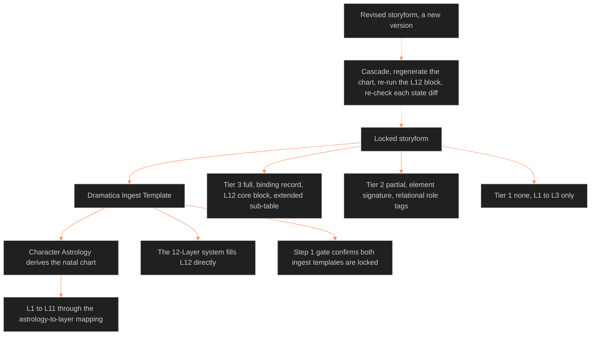

**Who it's for:** a narrative designer looking up a field or rule · **What it does:** lists every component of the protocol · **Type:** reference

# Dramatica integration protocol: reference

Source: [🔮 ssot_02_dramatica_integration_protocol.md](../../../_SSOT/02_CHARACTER_SYSTEMS/🔮%20ssot_02_dramatica_integration_protocol.md). Concept: [1-concept.md](1-concept.md).

*The structure: one locked storyform feeds the ingest template, the template feeds two consumers, and a revision restarts the chain.*

## What Dramatica Is in This System

The narrative structure engine. It produces the thematic argument and assigns each character a mechanical role.

- Defines what the story is about (the storyform).
- Defines what each character does to the argument (structural function).
- Defines the terms of transformation (resolve, growth, outcome, judgment).
- Output is deterministic. A locked storyform gives fixed assignments. A change means a new storyform version.
- Connects to: Character Astrology and the 12-Layer system, which both consume its output.

## What Dramatica Is Not

Dramatica does not produce personality, psychology, physicality, sexuality, origin, trauma, shadow content or aesthetic presentation.

- Those belong to the LEECHSEED Character System and Character Astrology.
- Dramatica does not produce plot. The plot_systems domain authors events, scenes and beats.

## Storyform Architecture

### The Primary Unit: One Storyform Per Story

One complete storyform per story. It holds one Grand Argument. For OVEREXITOUT the primary storyform governs Movement 1 through Movement 6.

### Nested Storyforms (Pattern 1)

Each nested storyform is a complete argument inside a parent storyform.

- Every nested storyform gets its own `storyform_id`.
- A character may hold different roles across storyforms (MC in the parent, IC in a nested form).
- Each role produces a separate L12 sub-table record keyed to its `storyform_id`.
- The parent governs when assignments conflict.
- Nesting is optional.

### Storyform Identification

| Field | Description | Example |
|---|---|---|
| `storyform_id` | Unique identifier | `oxo_primary_v1` |
| `ip` | Intellectual property | `overexitout` |
| `scope` | What the storyform covers | `full_narrative` |
| `parent_storyform_id` | Parent form if nested | `null` (primary) |
| `status` | Lock state | `locked` / `draft` |
| `version` | Storyform version | `1.0` |

### Future Scaling (Flagged for plot_systems)

Act-level mini-forms and IP-level meta-forms are possible but not built.

- The `storyform_id` keying supports them without schema change.
- Plot_systems development adds them with the same binding architecture.
- No character-system change is needed.

## Character-Storyform Binding

Every character with a Dramatica role is bound to at least one storyform. The binding record connects a `character_id` to a `storyform_id`.

| Field | Description | Example |
|---|---|---|
| `character_id` | Character identifier | `victoria_midnight` |
| `storyform_id` | Which storyform | `oxo_primary_v1` |
| `structural_role` | Dramatica role held | `mc_protagonist` |
| `archetype` | Dramatica archetype | `Protagonist` |
| `resolve` | Change / Steadfast | `Change` |
| `throughline` | Assigned throughline | `mc` |

- A character with roles in several storyforms has several binding records.
- The core L1-L11 record stays singular.

## Tier Integration Rules

### Tier 3 (Deep Characters — Protagonists, Antagonists, Key IC)

Dramatica integration: full.

- A complete storyform binding record.
- A full L12 FUNCTION core block (10 variables).
- A full L12_DRAMATICA_EXTENDED sub-table.
- A locked Dramatica Ingest Template. Blank form: [ssot_02_template_dramatica_ingest.md](../../../_SSOT/02_CHARACTER_SYSTEMS/📐%20ssot_02_template_dramatica_ingest.md).
- Tier 3 is the only tier that needs a Dramatica ingest before the Vertical Slice.

### Tier 2 (Standard Characters — Recurring Supporting)

Dramatica integration: partial.

- An element signature: 2-4 elements from the Motivation, Methodology, Evaluation and Purpose sets.
- One or more relational role tags against specific Tier 3 characters.
- No binding record, no throughline, no extended sub-table.
- Same element vocabulary as Tier 3, so one query finds both. Example: every character carrying Faith.

| Role | Definition |
|---|---|
| `mirror` | Reflects a Tier 3 character's traits or situation back |
| `foil` | Presents an opposing approach to the same thematic problem |
| `catalyst` | Accelerates change in a Tier 3 character |
| `threshold_guardian` | Tests readiness before a Tier 3 character advances |
| `herald` | Signals incoming change or threat |
| `mentor` | Provides knowledge, skill or perspective the Tier 3 character lacks |
| `trickster` | Disrupts assumptions or exposes contradictions |
| `shapeshifter` | Allegiance or identity is unstable relative to the Tier 3 character |
| `anchor` | Stabilizing presence the Tier 3 character relies on or resists |

A Tier 2 character may hold several relational roles against different Tier 3 characters.

### Tier 1 (Flat Characters — Background, Environmental)

Dramatica integration: none.

- Carries L1-L3 values only.
- Promoted to Tier 2, with an element signature, if the character becomes significant.

## L12 FUNCTION Architecture

This document holds the only copy of the L12 core block and the L12_DRAMATICA_EXTENDED sub-table.

- Prose says Touchstone. The machine field is `touchstone`. The old name `narrative_invariant` is an alias in the variable registry. Cite as TS n:m. The field holds the Touchstone's TS n:m id, for example `TS 1:1` (1.3.0, IF catalog call 4, ruled 2026-10-05). The slug is kept as an alias that reads back to the id. A slug with no minted id stays as the value until the register mints one.

### Design Decision: Option C — Core + Sub-Table

L12 has two parts. The core block takes part in derived statistics and flag triggers. The extended sub-table holds the complete Dramatica dataset for reference and querying.

### L12 Core Block (All Tiers That Carry L12)

Tier 3 core:

| Variable | Source | Used by |
|---|---|---|
| `dramatica_archetype` | Storyform | Flag triggers |
| `mc_problem_element` | Storyform, MC Problem (renamed from `motivation_element` 2026-08-24) | Flag triggers, derived stats |
| `methodology_element` | Character element set | Behavioral reference |
| `evaluation_element` | Character element set | Behavioral reference |
| `purpose_element` | Character element set | Behavioral reference |
| `touchstone` | Authored | Flag triggers |
| `story_outcome` | Storyform dynamics | Flag triggers |
| `story_judgement` | Storyform dynamics | Flag triggers |
| `limit_type` | Storyform dynamics | Flag triggers |
| `resolve` | Storyform dynamics | Flag triggers, derived stats |

Tier 2 core:

| Variable | Source |
|---|---|
| `tier` | `2` |
| `element_signature` | Authored from the Dramatica element vocabulary |
| `relational_roles` | Authored (array of target + role pairs) |

Convention role (1.2.1, RULED 2026-10-04, CL15):

- `convention_role` is an advisory L12 field, Static: {genre_role: text, actant_slot: subject | object | sender | receiver | helper | opponent}.
- It stays blank when no genre applies.
- It never overrides `dramatica_archetype`.
- The main doc cites it from the L12 row.
- Same call: L5 `relational_refs` kinds gain helper, opponent, sender, receiver, rival and beloved. `mentor_state` (present | absent | flawed, Dynamic) is added. The main doc defines both.

### L12_DRAMATICA_EXTENDED Sub-Table (Tier 3 Only)

Attaches to L12 for Tier 3. It does not feed derived stats or flag triggers. It serves reference, cross-character queries and Character Astrology.

| Variable | Description | Example (Victoria Midnight) |
|---|---|---|
| `storyform_id` | Binding key | `oxo_primary_v1` |
| `mc_domain` | MC throughline domain | `Situation` |
| `mc_concern` | MC throughline concern | (from storyform) |
| `mc_issue` | MC throughline issue | `Interdiction` |
| `mc_problem` | MC throughline problem | `Equity` |
| `mc_solution` | MC throughline solution | `Inequity` |
| `mc_symptom` | MC throughline symptom | (from storyform) |
| `mc_response` | MC throughline response | (from storyform) |
| `mc_unique_ability` | MC unique ability | `Destiny` |
| `mc_critical_flaw` | MC critical flaw | `Truth` |
| `mc_benchmark` | MC benchmark | (from storyform) |
| `mc_focus` | MC focus | `Desire` |
| `mc_direction` | MC direction | `Ability` |
| `motivation_quad` | Full motivation set | `[Consider, Pursuit]` |
| `methodology_quad` | Full methodology set | `[Certainty, Proaction]` |
| `evaluation_quad` | Full evaluation set | `[Proven, Effect]` |
| `purpose_quad` | Full purpose set | `[Knowledge, Actuality]` |
| `os_domain`, `os_concern`, `os_issue`, `os_problem` | OS throughline | (from storyform) |
| `ic_domain`, `ic_concern` | IC throughline | (from storyform) |
| `rs_domain`, `rs_concern` | RS throughline | (from storyform) |

- The schema is fixed. A field marked "from storyform" is filled when the Dramatica Ingest Template is completed.
- An empty field means not yet extracted. It does not mean the data does not exist.

## Dramatica Report Manifest

Dramatica software exports PDF reports. The manifest sorts them by function.

### Character-Pipeline Reports (Load-Bearing)

| Report | Contains | Feeds |
|---|---|---|
| Character Report | Per-character elements, archetype, motivation/methodology/evaluation/purpose | L12 core, element signatures |
| Theme Report (per throughline) | Domain, Concern, Issue, Problem, Solution, Symptom, Response, Unique Ability, Critical Flaw, Benchmark | L12_DRAMATICA_EXTENDED |
| Story Dynamics Report | Resolve, Growth, Outcome, Judgment, Limit, Driver, Timelock/Optionlock | L12 core (resolve, outcome, judgment, limit_type) |
| Character Relationships Report | Relationship mappings | Tier 2 relational role reference |

### Story-Level Reports (Reference)

| Report | Contains | Future use |
|---|---|---|
| Plot Progression Report | Signpost sequence per throughline | plot_systems (act structure) |
| Storyweaving Report | Scene-level argument progression | plot_systems (scene design) |
| Story Points Report | Complete storyform point listing | Master reference, validation |

### Informational Reports (Non-Load-Bearing)

| Report | Contains | Use |
|---|---|---|
| Audience Appreciation Reports | How elements feel to an audience | Writing guide reference |
| Storytelling Reports | Suggestions for dramatizing elements | Writing guide reference |
| Genre Reports | Genre classification analysis | IP-level reference |

### Report Extraction Priority

Order for completing a Tier 3 Dramatica Ingest Template:

1. Story Dynamics Report: lock resolve, outcome, judgment, limit type.
2. Theme Report (MC throughline): lock the full MC variable set.
3. Character Report: lock element quads and archetype.
4. Theme Reports (OS, IC, RS): lock the rest.
5. Character Relationships Report: reference for Tier 2 roles.

Unlisted reports are consulted as needed. They do not block template completion.

## Cascade on a Revised Storyform

A revised storyform is a new version. Three steps follow, in order.

1. Regenerate the chart. Re-run the DAI derivation on the new ingest. The new ingest passes the Step 1 gate first. The new chart gets its own file stamped to the new version. The old chart stays, marked superseded.
2. Re-run the L12 block. Re-extract the core block and sub-table. The Vertical Slice re-runs Steps 5 and 6 (derived statistics, flags). The result is a new base record version.
3. Re-check each state diff against the new base. Each "was ..." value must match the new base. A diff that no longer matches is revised or retired, and the change is logged. A diff never edits the base.

Connects to: [DAI](../ssot_02_character_astrology_dai/2-reference.md), [Step 1 gate](../ssot_02_step_1_source_verification_protocol/2-reference.md), [state architecture](../ssot_02_character_state_architecture/2-reference.md).

## Pipeline Position

Order of flow:

1. A locked Dramatica storyform produces a Dramatica Ingest Template.
2. The template feeds two consumers at once: Character Astrology (derives the natal chart) and the 12-Layer system (fills L12 directly).
3. Character Astrology produces its own ingest template, which feeds L1-L11 through the astrology-to-layer mapping.
4. The Step 1 gate confirms both ingest templates exist and are locked before the Vertical Slice reaches Step 2. Blank forms: [Dramatica](../../../_SSOT/02_CHARACTER_SYSTEMS/📐%20ssot_02_template_dramatica_ingest.md) and [astrology](../../../_SSOT/02_CHARACTER_SYSTEMS/📐%20ssot_02_template_astrology_ingest.md).
