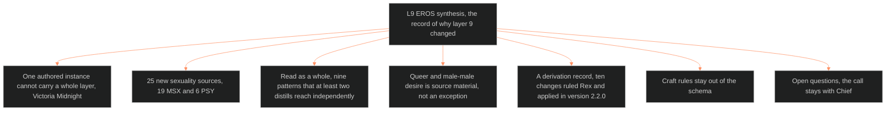

**Who it's for:** a writer or schema owner asking why layer 9 changed · **What it does:** explains why the synthesis was done and what it decided · **Type:** concept

# L9 EROS synthesis: concept

Pages in this set: [reference](2-reference.md) · [how-to](3-how-to.md) · [tutorial](4-tutorial.md). The source is [ssot_02_l9_eros_synthesis.md](../../../_SSOT/02_CHARACTER_SYSTEMS/📐%20ssot_02_l9_eros_synthesis.md). The schema it changed is in the [vertical slice](../ssot_02_character_systems_vertical_slice/1-concept.md).

*The mind model: one authored instance was too thin. The Command read 25 sources as a whole. Ten ruled changes reshaped layer 9.*

## One authored instance cannot carry a whole layer

Layer 9 EROS had one authored instance: Victoria Midnight, built on 2026-08-15 from three sources. Every later change to L9 was that one instance's logic, copied forward. A layer built on one case inherits that case's blind spots.

On 2026-09-29 the Command distilled 25 new sexuality sources in one wave. Nineteen are in the MSX series and six are in the PSY series. The wave fills the gap that Victoria's L9 note named as its own open item. The gap is orientation and partners.

## The synthesis reads the shelf as a whole, not source by source

This was the first time the shelf was read together against L9's seven fields. A single source can only suggest a field. Two or three sources that agree without knowing each other make a stronger case. The synthesis therefore looks for patterns that at least two distills reach independently.

Nine such patterns appear. Consent and desire are separate axes. Paid or staged intimacy runs on a scripted-to-spontaneous spectrum. Nonverbal signal literacy is its own skill. Arousal is a trainable mechanism. Masculinity-policing shame attaches to the receptive role. Substances and context act on a want that already exists. The object of desire stands in for something else. Disclosure runs its own register. Venue comfort is measurable and distinct from desire.

## Queer and male-male desire is source material, not an exception

Two facts made this unavoidable. Nine of the 25 distills concern gay or bi male sex work, cruising or chemsex. Several sources also test whether a mechanism built for a man and a woman transfers to two men. They answer yes for the mechanism and no for the ritual script.

That answer shaped the rule. A mechanism built once and gender-neutral beats a mechanism tolerated by exception. The ten changes treat queer and male-male desire as first-class material and not a case added after a straight default.

## The doc is a derivation record, not an edit

The synthesis proposed ten changes. Chief ruled all ten on 2026-09-29 with the word "Rex". The character system applied them in version 2.2.0. This doc now stands as the record of why. It does not edit the schema. A reader who wants to know why `consent_posture` exists reads the synthesis. A reader who wants the current field definition reads the vertical slice.

## Craft rules stay out of the schema

One of the ten changes is not a field. The pacing toolkit of withhold, fragment, bound and interrupt is scene craft. The synthesis records it as a writing rule under Core Methodology. The line it draws is this: the schema stores what is true of a character. Craft rules govern how prose narrates it.

## The long read

The synthesis ends with open questions, and the shape of those questions is instructive. The first concerns where a field belongs when two layers both claim it, as with `polarity_role` and `venue_comfort_and_practice`. The second concerns whether two named fields are really one. The third concerns a source that argues something different in kind. It is Foucault's claim that naming a practice manufactures a permanent identity.

The fourth is a gap in the shelf itself. No source in the wave addresses lesbian or WLW-specific desire architecture, and Victoria is the only authored L9 instance. Chief ruled on 2026-09-29 that this gap goes on the acquisition list. The sweep already running covers it.

The pattern is consistent. The synthesis names what it does not know, and it leaves the call to Chief.
