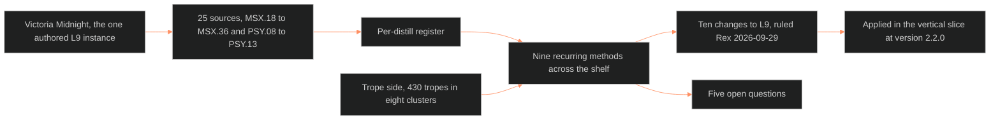

**Who it's for:** a writer or schema owner looking up a source, field or change · **What it does:** lists every section of the synthesis · **Type:** reference

# L9 EROS synthesis: reference

Why it exists: [concept](1-concept.md). Steps: [how-to](3-how-to.md). A worked trace: [tutorial](4-tutorial.md). Source: [ssot_02_l9_eros_synthesis.md](../../../_SSOT/02_CHARACTER_SYSTEMS/📐%20ssot_02_l9_eros_synthesis.md), version 1.0.0, RULED, BOLO 100 C20. Trunk: BLACK. Applies to OVEREXITOUT. Dependencies: the [vertical slice](../ssot_02_character_systems_vertical_slice/2-reference.md) and `victoria-midnight-L9-eros.md`.

The shelf: MSX.18 to MSX.36 and PSY.08 to PSY.13, 25 sources. Status: all ten changes RULED 2026-09-29 (Chief: "Rex") and APPLIED in the vertical slice at version 2.2.0.

*The structure: 25 sources become nine shared methods, the methods become ten changes, and five questions stay open.*

## 1. What this is

- L9 EROS has one authored instance: Victoria Midnight. The Command built her on 2026-08-15 from PSY.01 Walker, MSX.17 Perel and PSY.04 Rehor & Schiffman.
- On 9/29 (BOLO 87/88) the Command distilled 25 sources: 19 MSX and 6 PSY.
- The wave fills the gap that `victoria-midnight-L9-eros.md` named: orientation and partners.
- Mix: gay and male sex-work distills, bareback and pig-culture sources (MSX.24, MSX.28, MSX.35). It also holds cruising and venue ethnography (MSX.20, MSX.29, PSY.12) and chemsex (PSY.08, PSY.11). It holds sex-tourism epidemiology (MSX.34, PSY.09) and craft sources (MSX.26, MSX.33). It holds practice manuals (MSX.21, 22, 23, 25, 30, 32). It also holds two theory texts (MSX.36 Foucault, PSY.13 Jung).
- This was the first reading of the shelf as a whole against L9's seven fields. It is a synthesis, not an edit.
- Two findings: queer and male-male desire cannot be bolted onto a hetero-authored schema. Mechanism transfers to two men and ritual script does not (MSX.30, MSX.32).

## 2. The per-distill register

Columns in the source: ID, Title, What it says L9 should hold, Field fed or gap exposed.

| ID | Source | Field fed or gap exposed |
|---|---|---|
| MSX.18 | Porn Work, Berg (2021) | `intimacy_mode`, `desire_vector`, `erotic_safety_precondition` (primary) |
| MSX.19 | Routledge Handbook of Male Sex Work | Gaps: `client_script`, `digital_self_presentation` |
| MSX.20 | Sex on Premises Venues, Smith et al. (2010) | Gap: `venue_comfort_and_practice` |
| MSX.21 | Do Me!, Müller (2014) | Gaps: `practice_repertoire`, `signal_language` |
| MSX.22 | Ultimate Guide to Kink, Taormino (2012) | Gaps: `consent_protocol`, `power_dynamic`, `aftercare_need` |
| MSX.23 | Ultimate Guide to Prostate Pleasure, Glickman & Emirzian (2013) | Gap: arousal-curve subfield; shame mechanism distinct from `shame_index` |
| MSX.24 | Bareback Porn, Florêncio (2020) | `desire_vector`, `intimacy_mode`, `erotic_safety_precondition`, `shame_index` need a second register |
| MSX.25 | How to Bottom Like a Porn Star, Miller (2014) | Confirms MSX.23's shame-mechanism finding |
| MSX.26 | Pornographic Art, Maes (2013) | Gap: craft-facing pacing/register field |
| MSX.27 | Routledge Handbook of Sex Industry Research | Confirms `client_script`, `digital_self_presentation` |
| MSX.28 | Sex Pigs, PLWHA NSW (2007) | Gap: `disclosure_practice` / `disclosure_posture` |
| MSX.29 | Cruising Guide, Thorne Harbour Health (2018) | Confirms `signal_fluency` / `cruising_signal_literacy` |
| MSX.30 | Urban Tantra, Carrellas (2017) | Gap: mechanism field for desire-as-current |
| MSX.31 | Porn: An Oral History, Barton (2023) | `desire_vector` authored from specifics; `intimacy_mode` self-time register |
| MSX.32 | Art of Sexual Ecstasy, Anand (1989) | Gap: `polarity_role` |
| MSX.33 | Space of Sex, Waldrep (2021) | Gap: `erotic_pacing` |
| MSX.34 | Places, Spaces and Bodies, Mendoza (2014) | `intimacy_mode` holds non-cash relational payment |
| MSX.35 | Sex Pigs, PLWHA NSW (n.d.) | Confirms `disclosure_practice`; proposes `scene_vocabulary` |
| MSX.36 | History of Sexuality, Foucault (1978) | `shame_index` read as intrinsic; an origin/mechanism question |
| PSY.08 | Lust, Men, and Meth, Fawcett (2015) | Gap: pointer to a fixed early template |
| PSY.09 | Sex Tourism and HIV Risk, Harry-Hernández et al. (2019) | `intimacy_mode` holds context-triggered change |
| PSY.10 | Magnificent Sex, Kleinplatz & Ménard (2020) | Gap: skill/practice that operationalizes intimacy |
| PSY.11 | Desire, Drugs, and Unsafe Sex, O'Byrne & Holmes (2011) | `desire_vector` needs an object-general mode |
| PSY.12 | Sex Parties among YMSM in NYC, Solomon et al. (2011) | Confirms `venue_comfort_and_practice` (third source) |
| PSY.13 | Psychology of the Unconscious, Jung (1916) | Theory under `desire_vector`'s "reinterpreted" status; no new field |

What each says L9 should hold, in brief:

- **MSX.18:** paid sex is manufactured feeling. Consent and desire are separate axes. Pre-scene checklists are the safety precondition.
- **MSX.19:** paid encounters run on a scripted-to-spontaneous spectrum that can move mid-scene. Online self sits under five layers of platform regulation.
- **MSX.20:** comfort with sexualised space predicts venue use.
- **MSX.21:** a character can be fluent or illiterate in an act-vocabulary and a signal grammar, regardless of want.
- **MSX.22:** SSC and RACK are competing risk ethics. Top, Dominant and Sadist are three independent axes. Aftercare is structural.
- **MSX.23:** arousal has a shape (plateau-and-wave or spike-and-drop). Masculinity shame blocks receptive pleasure.
- **MSX.24:** desire can be additive and non-satiating. Intimacy can be built through porosity to strangers. Disgust is boundary-defense.
- **MSX.25:** masculinity shame about bottoming is cultural and enforced by mockery.
- **MSX.26:** the imagination axis decides whether a scene reads as desire or art, not explicitness.
- **MSX.27:** client motive is braided. Platforms make digital self-presentation real infrastructure.
- **MSX.28:** HIV and STI disclosure runs its own scripts, apart from shame or desire.
- **MSX.29:** cruising is a learnable nonverbal grammar, with a matching etiquette code at L7.
- **MSX.30:** sexual energy is a trainable current. Orgasm and ejaculation are separable.
- **MSX.31:** porn taste runs independent of stated orientation. Disclosure to partners is a spectrum.
- **MSX.32:** active and receptive polarity is a tradeable role. Its mechanism transfers to two men.
- **MSX.33:** four devices (withhold, fragment, bound, interrupt) let film borrow porn's structure.
- **MSX.34:** stigma tracks role (penetrator or receiver), not the act.
- **MSX.35:** "pig" identity is claimed and eroticized, and still self-governed under drugs.
- **MSX.36:** naming a practice manufactures a permanent identity. Four strategic unities build shame from outside.
- **PSY.08:** a sexual template is fixed by puberty. Drugs expose it and do not invent it.
- **PSY.09:** travel is a deliberate context shift that licenses risk-elevated sex.
- **PSY.10:** empathic communication, not genitals, crosses Perel's separateness gap.
- **PSY.11:** desire is object-general and connection-seeking. Substances are tools acting on an existing want.
- **PSY.12:** party type is a measured spectrum: safe-sex-only, mixed or bareback.
- **PSY.13:** desire's object is a symbol standing in for something else. Blocked desire displaces into symbol.

## 3. Recurring methods across the shelf

Patterns that at least two distills reach independently.

| Method | Sources |
|---|---|
| Consent and desire are separate axes. | MSX.18, MSX.22, MSX.27, PSY.11 |
| Paid or staged intimacy runs on a scripted-to-spontaneous spectrum. "Bounded authenticity" (Bernstein). | MSX.19, MSX.27, MSX.18 |
| Nonverbal signal literacy is its own fluency. | MSX.21, MSX.29, MSX.22 |
| Arousal is a trainable mechanism. | MSX.23, MSX.30, MSX.32, PSY.10 |
| Masculinity-policing shame attaches to receptive role, not to desire. | MSX.23, MSX.25, MSX.34 |
| Substances and context are tools acting on a pre-existing want. | PSY.08, PSY.11 |
| The object of desire stands in for something else. | PSY.13, MSX.17 |
| Disclosure runs its own register, apart from shame or desire. | MSX.28, MSX.29, MSX.31, MSX.35 |
| Venue and context comfort is measurable and distinct from general desire. | MSX.20, MSX.29, PSY.12 |

L9 had no field that kept consent and desire apart. `desire_vector` and `erotic_safety_precondition` were both asked to carry it.

## 4. The trope side

The pull list keys 430 tropes to sexuality · L9 (`_tools/tropes/data/domains/LAYERS.md`). They fall into eight clusters.

| # | Cluster | Examples |
|---|---|---|
| 1 | Arousal mechanics and physiology | Anatomically Impossible Sex, Fantastic Arousal, Anorgasmia |
| 2 | Consent, coercion and power | Bed Trick, Safe Word, Power Dynamics Kink |
| 3 | Identity and orientation policing | But Not Too Gay, All Gays are Promiscuous, Pragmatic Pansexuality |
| 4 | Shame, secrecy and discretion | Walk of Shame, Covert Pervert, Slut-Shaming |
| 5 | Desire as narrative engine | Sex Signals Death, Redemption Equals Sex, Plot-Inciting Infidelity |
| 6 | Kink and fetish taxonomy, scene furniture | Fetish, Kinky Role-Playing, Chastity Belt |
| 7 | Commercial and transactional sex | Casting Couch, Sex for Services, Sex Tourism |
| 8 | Body, display and desirability | Hot as Hell, Lust Object, Exotic Equipment |

The smaller character · L9 list holds 60 tropes. It restates clusters 3, 4 and 8 at the character-trait level. Examples: Manly Gay, Straight Gay, Lipstick Lesbian (cluster 3), Hot Teacher, Femme Fatale (cluster 8). The two lists are the same territory seen from character and from scene.

## 5. PROPOSED CHANGES to L9

Ten changes. All APPLIED in vertical slice version 2.2.0. Rule: queer and male-male desire is first-class source material.

| # | Change | Cites | Result |
|---|---|---|---|
| 1 | Split consent from desire: `consent_posture` beside `desire_vector`, distinct from `erotic_safety_precondition`. | MSX.18, MSX.22, MSX.27, PSY.11 | APPLIED |
| 2 | Scripted-to-spontaneous axis: `client_script`, revisable mid-scene. | MSX.18, MSX.19, MSX.27 | APPLIED |
| 3 | `signal_fluency`: fluent, functional or illiterate. | MSX.21, MSX.22, MSX.29 | APPLIED |
| 4 | `resolution_type` under `desire_vector`: terminating or additive. | MSX.24, PSY.13, MSX.32 | APPLIED |
| 5 | Split `shame_index` into `exposure_shame` and `role_shame`, both 0-10. `shame_index` stays a read alias for `exposure_shame`. | MSX.23, MSX.25, MSX.34 | APPLIED, additive |
| 6 | `arousal_curve` (spike, plateau or current) under `erotic_blueprint_type`. | MSX.23, MSX.30, MSX.32 | APPLIED |
| 7 | `erotic_pacing` as a craft rule, no new field. | MSX.26, MSX.33 | APPLIED as a Core Methodology subsection |
| 8 | Tag `erotic_safety_precondition` internal or external: `erotic_safety_precondition_scope`. Victoria backfilled `internal`. | MSX.18, MSX.24, MSX.29 | APPLIED |
| 9 | `disclosure_posture` on L9 for the sexual-health register. L3 keeps its own field. | MSX.28, MSX.29, MSX.31, MSX.35 | APPLIED, directly on L9 |
| 10 | `template_origin`: a pointer from L9 to an L8 imprint event. Victoria backfilled to L8 `secure_base_object` (brother_deceased). | PSY.08, PSY.13, MSX.23 | APPLIED |

Context for change 5: Victoria's `shame_index: 2` describes immunity to being shamed for being seen. Role shame (bottoming, receiving) is a different mechanism.
Context for change 8: Victoria's precondition is `control`, internal to her. Several gay-male sources document an external precondition invisible to the scene, such as PrEP or U=U.

## 6. Open questions

Five questions.

1. **`polarity_role` (MSX.32) has no home.** It overlaps L6 `drive_texture`'s dominant/submissive default (MSX.21, MSX.22). A ruling is needed on which layer owns role-as-behavior and which owns role-as-arousal-source.
2. **`practice_repertoire` and `scene_vocabulary` (MSX.21, MSX.35) may be one field.** Merge or stay separate is unresolved.
3. **Foucault's claim (MSX.36) is different in kind.** It may mean `shame_index` and `shadow_content` need an origin-event field. This is close to change 10.
4. **No source addresses lesbian or WLW-specific desire architecture.** RULED 2026-09-29: logged to the acquisition list. The whole-spectrum sexuality library sweep already running covers it.
5. **`venue_comfort_and_practice` sits between L7 and L9.** The synthesis followed the majority keying (L9 primary). The schema owner should confirm. It was not among the ten applied changes.

The history records the open-question count at the time of each version.

## 7. Version history

| Version | Date | Change |
|---|---|---|
| 0.1.0 | 2026-09-29 | Initial synthesis: 25-source register, recurring methods, trope survey, ten PROPOSED CHANGES, four open questions. Status PROPOSED. |
| 0.2.0 | 2026-09-29 | RULED, Chief: "Rex". All ten changes APPLIED in vertical slice 2.2.0. The WLW gap went to the acquisition list. Status PROPOSED to RULED. |
| 1.0.0 | 2026-10-04 | RULED, Chief ("rec", BOLO 100 C20). Stamped 1.0.0 as the L9 EROS module of the character system (`module_of` set). Content unchanged. |
