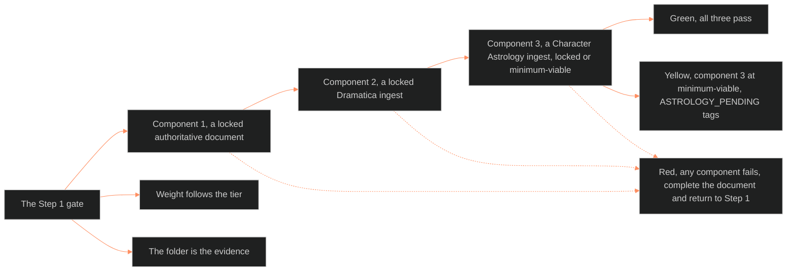

**Who it's for:** a narrative designer starting a Vertical Slice · **What it does:** explains why the Step 1 gate exists and how it decides · **Type:** concept

# Step 1 source verification: the idea

*The mind model: three checks run in order of dependence, a failure stops the chain at its root. The result is a light.*

## A single sentence could not guard the slice

The Vertical Slice once opened with one sentence. It said to confirm that canonical documentation exists and is locked. The sentence was correct but did not say what that documentation looks like. It did not name the upstream systems that must finish first. It gave no way to check completeness.

This protocol replaces that sentence with a gate. The Vertical Slice does not reach Step 2 until every item passes. Steps 2 through 7 stay unchanged.

## The gate follows the order of dependence

The gate has three components, checked in order. Component 1 asks for a locked authoritative document. Component 2 asks for a locked Dramatica ingest. Component 3 asks for a Character Astrology ingest, locked or minimum-viable.

The order is not a convenience. Dramatica needs the authoritative document, so Component 1 failing makes Component 2 impossible to pass. Character Astrology consumes Dramatica output, so Component 2 failing makes Component 3 impossible to pass. A failure stops the chain at its root.

## Weight follows the tier

A Tier 3 character needs all three documents. A Tier 2 character needs an authoritative document and a documented element signature. A partial astrology chart helps but never gates. A Tier 1 character needs only a character brief that supports L1-L3 values.

The gate asks for as much proof as the character will carry later. It asks no more.

## Three lights keep the decision simple

Green means all three components pass. The designer proceeds with full upstream documentation.

Yellow means Components 1 and 2 pass and Component 3 passes at minimum-viable level. The designer proceeds, but L1-L11 values that lean on astrology carry an `[ASTROLOGY_PENDING]` tag. The slice stays a draft until the full chart is locked.

Red means any component fails. The designer completes the failing document and returns to Step 1.

## The folder is the evidence

A passing character has one canonical folder. It holds the authoritative document and the two ingest templates. Later it also holds the slice and its states. The folder is how a later reader sees at a glance that the gate was passed.

## The long read

The gate is a promise about order. Story data flows from the authoritative document, to Dramatica, to astrology, to the layers. If any earlier link is soft, every later number inherits the softness. The yellow light exists because the full chart is a luxury and the core planets are the need. It lets work move while the debt stays visible in tags and in the draft label.

See also: [reference](2-reference.md) · [how-to](3-how-to.md) · [tutorial](4-tutorial.md) · source: [🔮ssot_02_step_1_source_verification_protocol.md](../../../_SSOT/02_CHARACTER_SYSTEMS/🔮ssot_02_step_1_source_verification_protocol.md)
