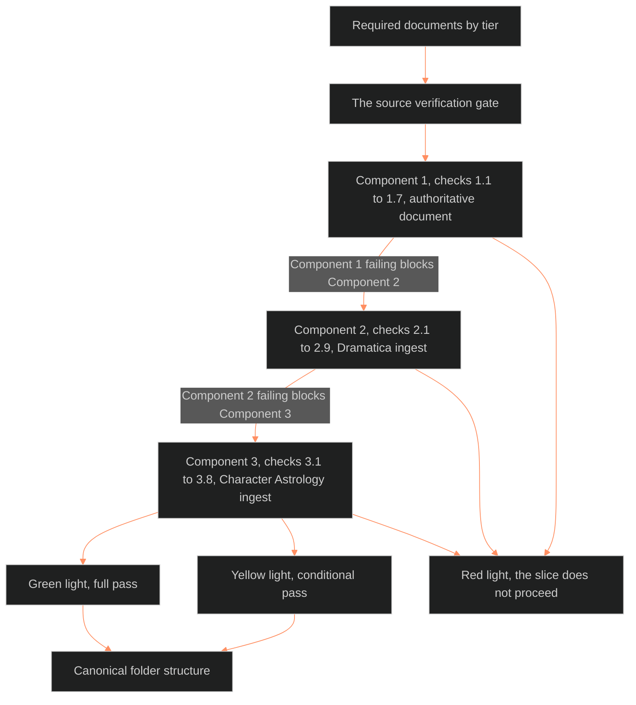

**Who it's for:** a narrative designer checking a character against the gate · **What it does:** lists every requirement, check and result · **Type:** reference

# Step 1 source verification protocol: reference

Source: [🔮ssot_02_step_1_source_verification_protocol.md](../../../_SSOT/02_CHARACTER_SYSTEMS/🔮ssot_02_step_1_source_verification_protocol.md). Concept: [1-concept.md](1-concept.md).

*The structure: three components checked in order, three lights as the result, and one canonical folder as the proof.*



## What This Replaces

This protocol replaces Step 1 of the Vertical Slice protocol only. Steps 2 through 7 are unchanged.

- Old Step 1: confirm that canonical documentation exists and is locked before assigning values.
- When the Vertical Slice document is next revised, its Step 1 should point here.
- As of 2026-10-04 the main doc still carries the old sentence. The pointer is open on the main-doc writer.
- Main doc: [📐 ssot_02_character_systems_vertical_slice.md](../../../_SSOT/02_CHARACTER_SYSTEMS/📐%20ssot_02_character_systems_vertical_slice.md).

## The Source Verification Gate

Three components, checked in order. All three must pass.

1. Authoritative Document Verification: a locked canonical document defines who the character is.
2. Dramatica Ingest Verification: a locked Dramatica Ingest Template defines narrative function.
3. Character Astrology Ingest Verification: a locked or minimum-viable Character Astrology Ingest Template defines the symbolic dataset.

- If Component 1 fails, Components 2 and 3 cannot pass.
- If Component 2 fails, Component 3 cannot pass.

## Required Documents by Tier

Blank forms: [Dramatica ingest](../../../_SSOT/02_CHARACTER_SYSTEMS/📐%20ssot_02_template_dramatica_ingest.md) and [astrology ingest](../../../_SSOT/02_CHARACTER_SYSTEMS/📐%20ssot_02_template_astrology_ingest.md). Section numbers in the checks follow those forms.

### Tier 3 (Deep Characters — Full Verification Required)

| Document | Status required | Location |
|---|---|---|
| Authoritative Character Document | LOCKED | `_AUTHORITATIVE/[IP]/characters/[CHARACTER_ID]/` |
| Dramatica Ingest Template | LOCKED | Same folder |
| Character Astrology Ingest Template | LOCKED or MINIMUM_VIABLE | Same folder |

- All three must be present.
- The Dramatica Ingest must be fully locked.
- The astrology ingest may be minimum-viable (Sections 1-5 and 8-10 populated). The core planetary assignments must still be in place.

### Tier 2 (Standard Characters — Partial Verification)

| Document | Status required | Location |
|---|---|---|
| Authoritative Character Document | LOCKED | `_AUTHORITATIVE/[IP]/characters/[CHARACTER_ID]/` |
| Dramatica Element Signature | DOCUMENTED | Inline in the authoritative document or a standalone file |
| Character Astrology Partial Chart | OPTIONAL | Sun + Moon + one defining aspect, if completed |

- No full Dramatica Ingest Template or full astrology ingest is needed.
- A partial chart supplements the slice. It does not gate it.
- An element signature is 2-4 Dramatica elements plus relational role tags.

### Tier 1 (Flat Characters — Minimal Verification)

| Document | Status required | Location |
|---|---|---|
| Character Brief | EXISTS | A paragraph in a scene document, a cast list entry, or a standalone note |

- The brief must hold enough detail to assign L1-L3 values.
- No Dramatica or astrology documentation is needed.

## Verification Sequence

### Component 1: Authoritative Document Verification

The authoritative document is the character's canonical bible. For Victoria Midnight it is the "Character Authority Document". It holds identity, structural spine, origin commitments, behavior under pressure, relationship to the system, core bonds, non-negotiables and signature imagery.

| Check | Rule |
|---|---|
| 1.1 | Document exists in the character's canonical folder. |
| 1.2 | Document is locked: header status reads LOCKED or CANON LOCKED, with a version number. |
| 1.3 | Identity is defined: full name, narrative role, primary bond(s). |
| 1.4 | Narrative function is defined: Dramatica structural role (MC/IC/OS), resolve (Change/Steadfast), at least the Problem/Solution pair. |
| 1.5 | Origin is defined: origin context, family architecture, the inciting wound or formation event. This supports L7 ORIGIN. |
| 1.6 | Behavioral signature is defined: behavior under pressure. L4 WILL, L5 WOUND and L10 SHADOW depend on it. |
| 1.7 | Non-negotiables are defined: character laws, things this character will not do. They act as invariant constraints downstream. |

Result: PASS if 1.1-1.7 all hold. FAIL if any does not.

### Component 2: Dramatica Ingest Verification

The ingest holds the complete storyform data for the character. It is extracted using the report manifest and extraction priority in the [Dramatica integration protocol](../ssot_02_dramatica_integration_protocol/2-reference.md).

| Check | Rule |
|---|---|
| 2.1 | Template exists in the canonical folder. |
| 2.2 | Template is locked: header status and `storyform_status` both read `locked`. |
| 2.3 | Section 1 (Storyform Dynamics) complete: story_outcome, story_judgement, story_driver, story_limit populated. |
| 2.4 | Section 2 (Structural Role) complete: structural_role, dramatica_archetype, resolve, growth, approach, mental_sex. |
| 2.5 | Section 3 (Element Quads) complete: all eight element fields, plus a written structural meaning statement. |
| 2.6 | Applicable throughline sections complete: Section 4 if MC, Section 5 if IC, Section 6 (OS) always, Section 7 (RS) if an RS principal. |
| 2.7 | Section 9 (Touchstones) holds at least one Touchstone. Machine field `touchstone`; old alias `narrative_invariant`. |
| 2.8 | Section 10 (L12 Core Block) is populated, matches the earlier sections, and lists exactly the Tier 3 core variables of the integration doc. If that list changes, this check follows it. |
| 2.9 | Downstream handoff checklist is complete, all items checked. |

Result: PASS if all applicable checks hold. FAIL if any required check does not.

> **OPEN:** check 2.3 names `story_limit`, but the Dramatica ingest form renamed that field `limit_type` in version 1.0.2. The source still reads `story_limit`.

### Component 3: Character Astrology Ingest Verification

The ingest holds the natal chart derived from the Dramatica Ingest by the DAI rules. It may be full or minimum-viable.

| Check | Rule |
|---|---|
| 3.1 | Template exists in the canonical folder. |
| 3.2 | `dramatica_ingest_ref` points to the locked Dramatica Ingest verified in Component 2. |
| 3.3 | Minimum viable chart populated, with derivation justifications: Sun, Moon, Mercury, Venus, Mars (Section 1), Saturn (Section 2), Ascendant (Section 3). |
| 3.4 | Aspect map holds at least 3 aspects. Each cites its Dramatica tension source. |
| 3.5 | House placements assigned for the seven minimum planets, with justifications. |
| 3.6 | Chart Summary (Section 8) written: 6-10 sentences of prose. |
| 3.7 | LEECHSEED Feed Map (Section 9) completed. |
| 3.8 | Template status is `locked` or `minimum_viable`. Either passes. |

Result: PASS if 3.1-3.8 hold. CONDITIONAL PASS if 3.8 reads `minimum_viable`: the slice proceeds and the astrology template is completed during or after. FAIL if any check fails.

## Pass and Fail Conditions

### Full Pass (Green Light)

All three components pass. The Vertical Slice proceeds to Step 2 (Tier 1 Assignment) with full upstream documentation.

### Conditional Pass (Yellow Light)

Components 1 and 2 pass. Component 3 passes at minimum-viable level. The slice may proceed under three constraints.

- L1-L11 assignments that depend on astrology data carry an `[ASTROLOGY_PENDING]` tag until the full chart is completed.
- The Feed Validation Checklist (from the [12-layer mapping](../ssot_02_character_astrology_12_layer_mapping/2-reference.md)) cannot run until the full chart is locked.
- The Vertical Slice structured data block is versioned `draft` until the astrology ingest reaches full status. It also stays `draft` until the Feed Validation Checklist passes.

### Fail (Red Light)

Any component fails. The slice does not proceed. The designer completes the failing document and returns to Step 1.

| Failure point | Action required |
|---|---|
| Component 1: no authoritative document | Write and lock the canonical documentation. |
| Component 1: document not locked | Review and lock it. Resolve all draft elements. |
| Component 1: missing sections | Complete the missing sections. |
| Component 2: no Dramatica Ingest | Complete the template from the locked storyform. |
| Component 2: template not locked | Resolve all draft fields and lock the template. |
| Component 2: missing sections | Extract the missing data per the extraction priority. |
| Component 3: no astrology ingest | Run the DAI derivation sequence from the locked Dramatica Ingest. |
| Component 3: minimum viable chart incomplete | Complete Sun, Moon, Mercury, Venus, Mars, Saturn, Ascendant, 3 aspects, houses, chart summary and feed map. |

## Canonical Folder Structure

When all three components pass, the character's folder holds:

```
_AUTHORITATIVE/[IP]/characters/[CHARACTER_ID]/
├── [CHARACTER_ID]_authoritative.md          [LOCKED]
├── [CHARACTER_ID]_dramatica_ingest.md       [LOCKED]
├── [CHARACTER_ID]_astrology_ingest.md       [LOCKED or MINIMUM_VIABLE]
├── [CHARACTER_ID]_vertical_slice.md         [produced at Step 7]
└── states/
    ├── [CHARACTER_ID]_state_[moment].md     [produced during story development]
    └── ...
```

- The `states/` subfolder appears when the first state diff is authored. It need not exist at Step 1.
- Relationship records live at the IP level, not in a character folder: `_AUTHORITATIVE/[IP]/relationships/[RELATIONSHIP_ID].md`.
