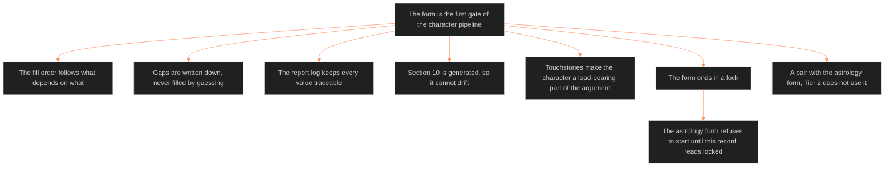

**Who it's for:** a writer asking why each Tier 3 character carries a locked storyform record · **What it does:** explains why the form exists and what its order and lock protect · **Type:** concept

# Dramatica ingest template: concept

Pages in this set: [reference](2-reference.md) · [how-to](3-how-to.md) · [tutorial](4-tutorial.md). The source is [ssot_02_template_dramatica_ingest.md](../../../_SSOT/02_CHARACTER_SYSTEMS/📐%20ssot_02_template_dramatica_ingest.md).

*The mind model: the form is the character pipeline's first gate. The writer fills it by dependency, traces it by report and ends it with a lock.*

## The form is the first gate of the character pipeline

Everything in the character system starts from Dramatica. The astrology chart derives from it. Layer 12 of the 12-layer slice is fed by it. This template is the one blank form that holds the locked storyform data for one character. The writer makes one copy per Tier 3 character.

Because every later record cites this one, a mistake here spreads. The form therefore ends in a lock. The astrology form refuses to start until this record reads `locked`.

## The fill order follows what depends on what

The form does not ask for sections in numeric order. It asks for Section 1 first, then 4, then 3 and 2, then 6, 5 and 7. Section 8 is the log that runs alongside. Section 10 comes last.

The order follows the extraction priority. The Story Dynamics Report fixes the story-wide settings first. The main character throughline comes next, since most characters hang on it. Elements and roles follow. The less common throughlines come after. A writer who follows the order never has to revise an early section because of a later one.

## Gaps are written down, never filled by guessing

The form allows a field to stay empty when the storyform does not give it yet. The writer writes `⏸` and the reason. The form forbids guessing. This one rule keeps invented data out of a record that every other system trusts.

## The report log keeps every value traceable

Section 8 records each Dramatica report the writer consulted. It records what it was used for, where it lives and when it was read. A value without a source report cannot be checked. The log lets a reviewer trace any field back to the page it came from.

## Section 10 is generated, so it cannot drift

The L12 core block is not written by hand. It is generated from Sections 1 to 9. It must list exactly the Tier 3 L12 core variables named in the Dramatica integration doc. If that list changes, the block follows it. The form owns no field list of its own for layer 12.

## Touchstones make the character a load-bearing part of the argument

Section 9 records Touchstones, the structural laws the storyform produces. Every Tier 3 character has at least one. A character with no Touchstone is not yet tied to the argument the story makes.

## The long read

This form and the astrology form are a pair. The Dramatica form says what the storyform decides. The astrology form says what that decision looks like in a second notation. The handoff checklist at the end of this form names the astrology form explicitly. Once this record is locked, the astrology ingest can cite it in `dramatica_ingest_ref`.

A Tier 2 character does not use the form. That character gets an element signature and relational roles, set out in the integration doc. The form stays reserved for characters who carry the argument.
