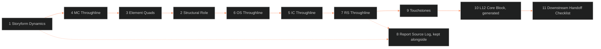

**Who it's for:** a writer filling the blank Dramatica ingest form · **What it does:** lists every section of the form with its fields, values and rules · **Type:** reference

# Dramatica ingest template: reference

Why the form exists: [concept](1-concept.md). Steps: [how-to](3-how-to.md). A fill-in lesson: [tutorial](4-tutorial.md). Source: [ssot_02_template_dramatica_ingest.md](../../../_SSOT/02_CHARACTER_SYSTEMS/📐%20ssot_02_template_dramatica_ingest.md), version 1.0.1, status RULED, BOLO 100 C18.

Dependencies named in the source: the Dramatica integration protocol, the Step 1 source verification protocol, the DAI doc. Applies to OVEREXITOUT, ASTRO7EX and LAKAD. Tier 3 characters only.

The old name `narrative_invariant` is an alias for `touchstone` in the variable registry.

*The fill order: Section 1, then 4, then 3 and 2, then 6, 5 and 7. The log runs alongside. Section 10 comes last.*

## How to use this form

1. Copy the file to the character's folder as `[CHARACTER_ID]_dramatica_ingest.md`, as the Step 1 protocol sets out.
2. Delete this section and the frontmatter. Keep the section numbers. The Step 1 checks cite them.
3. Fill in the extraction-priority order: Section 1, then 4, then 3 and 2, then 6, 5 and 7. Keep Section 8 as the log. Report names are in the integration doc.
4. Leave a field empty if the storyform does not give it yet. Write `⏸` and the reason. Never guess.
5. Section 10 is generated from Sections 1 to 9. Fill it last.

A Tier 2 character gets an element signature and relational roles instead (integration doc, Tier 2 section). It does not use this form.

## Header

A YAML block.

| Field | Meaning |
|---|---|
| `character_id` | The character's id. |
| `ip` | The intellectual property. |
| `tier` | Set to 3. |
| `storyform_id` | The storyform's id, e.g. `oxo_primary_v1`. |
| `storyform_version` | The storyform's version. |
| `storyform_status` | `draft` or `locked`. |
| `status` | `draft` or `locked`. |
| `locked_on` | Date, when status is locked. |
| `authoritative_doc_ref` | The locked character document. |

## 1. Storyform Dynamics

Source: Story Dynamics Report. Lock these first.

| Field | Values |
|---|---|
| `story_outcome` | Success / Failure |
| `story_judgement` | Good / Bad |
| `story_driver` | Action / Decision |
| `limit_type` | Timelock / Optionlock |

## 2. Structural Role

Source: Character Report and Story Dynamics Report.

| Field | Values |
|---|---|
| `structural_role` | e.g. `mc_protagonist` |
| `dramatica_archetype` | The archetype name. |
| `resolve` | Change / Steadfast |
| `growth` | Start / Stop |
| `approach` | Do-er / Be-er |
| `mental_sex` | The mental sex setting. |

## 3. Element Quads

Source: Character Report. Write both elements of each quad. All eight fields are required.

| Quad | Element 1 | Element 2 |
|---|---|---|
| `motivation_quad` | required | required |
| `methodology_quad` | required | required |
| `evaluation_quad` | required | required |
| `purpose_quad` | required | required |

Also required: the **structural meaning statement**. Two or three plain sentences saying what this element set makes the character do to the argument.

## 4. MC Throughline

Source: Theme Report, MC throughline. Required if the character is the MC.

Fields: `mc_domain`, `mc_concern`, `mc_issue`, `mc_problem_element`, `mc_solution`, `mc_symptom`, `mc_response`, `mc_unique_ability`, `mc_critical_flaw`, `mc_benchmark`, `mc_focus`, `mc_direction`, `mc_inhibitor`.

`mc_inhibitor` is not in the L12 sub-table. The DAI uses it for Saturn.

## 5. IC Throughline

Source: Theme Report, IC throughline. Required if the character is the IC.

Fields: `ic_domain`, `ic_concern`. Plus a free-text line for other IC points the storyform gives.

## 6. OS Throughline

Source: Theme Report, OS throughline. Always required.

Fields: `os_domain`, `os_concern`, `os_issue`, `os_problem`, `os_role`, `story_goal`.

- `os_role` is this character's role in the OS. The DAI uses it for the Midheaven.
- `story_goal` is also used by the DAI for the Midheaven.

## 7. RS Throughline

Source: Theme Report, RS throughline. Required if the character is an RS principal.

Fields: `rs_domain`, `rs_concern`.

## 8. Report Source Log

One line per report consulted, in extraction order. Columns: Report, Used for, File or page, Date read.

| Report | Used for |
|---|---|
| Story Dynamics Report | Sections 1, 2 |
| Theme Report (MC) | Section 4 |
| Character Report | Sections 2, 3 |
| Theme Reports (OS, IC, RS) | Sections 5, 6, 7 |
| Character Relationships Report | Tier 2 relational roles (reference) |

## 9. Touchstones

A Touchstone is a structural law derived from the storyform. Every Tier 3 character has at least one. The machine field is `touchstone`.

Columns: Touchstone (written TS and a number), Statement (one sentence), Storyform source, What it costs the character.

## 10. L12 Core Block

Generate this from Sections 1 to 9. It must list exactly the Tier 3 L12 core variables in the integration doc. If that list changes, this block follows it.

The block is a YAML key `L12_FUNCTION` with ten fields:

`dramatica_archetype`, `mc_problem_element`, `methodology_element`, `evaluation_element`, `purpose_element`, `touchstone`, `story_outcome`, `story_judgement`, `limit_type`, `resolve`.

## 11. Downstream Handoff Checklist

Eight checks, each a box:

- Section 1 is complete and matches the Story Dynamics Report.
- Section 2 has all six fields.
- Section 3 has all eight element fields and the meaning statement.
- The throughline sections this character needs are complete.
- Section 9 has at least one Touchstone.
- Section 10 matches Sections 1 to 9.
- `storyform_status` and `status` read `locked`.
- The Character Astrology Ingest can now cite this file in `dramatica_ingest_ref`. See the [astrology form](../ssot_02_template_astrology_ingest/2-reference.md).
