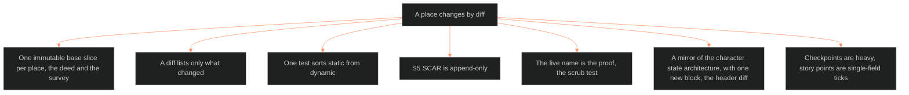

**Who it's for:** a writer or Chief asking how a place changes over a story · **What it does:** explains base slice plus state diffs · **Type:** concept

# Setting state architecture: why a place changes by diff

*The mind model: one base slice never changes. Every version of a place is a dated diff laid on top of it.*

## Places change like characters, and the story needs to know each version

A campus is built, damaged, renamed, sold and rebranded. A faction's grip tightens or slips. The story must know what Delta Coast Ultra School (DCUS) is at its founding as Skeeter Creek. It must also know it at the Red Hills rename and at the Bishop acquisition. One record per place cannot hold all of those at once.

## The base slice never changes, so every version stays checkable

The system keeps one immutable base slice per place. Dated state diffs sit on top of it. The base slice is the deed and the survey. The diffs are the renovation history. A writer who wants the place at a moment reads the base and applies the diff.

## A diff lists only what changed

A state record never copies the base. It names the S-layer values, header fields and flags that differ, and the reason. Omitted fields read from the base. This keeps each diff small and keeps every diff independent of the others.

## One test sorts static from dynamic

The test asks: would this value differ if the writer froze the place at two points in the story? Founding history and storyform binding stay fixed. Construction, law, economy, allure and trajectory move. Each layer is judged alone, because a layer's character twin does not decide it.

## Scars accrete and never overwrite

S5 SCAR is append-only. A later era may change how an old scar reads, but the entry stays. Skeeter Creek's erasure stays on record after the DCUS rebrand adds a second entry on top.

## The live name is the proof that the design works

The scrub test demands that moving the timeline past a rename flips the live name in every view. A view that reads only the base slice shows "DCUS" during a Skeeter Creek scene. That is the exact failure the header diff prevents.

## A mirror of the character doc lets one engine read both

The place architecture copies the character state architecture layer for layer. One query engine reads either with the same code. The one new block is the header diff, which holds renames.

## The long read

The architecture draws a line between checkpoints and story points. A checkpoint is a full state at a fabula event, and it is heavy. A story point is a single-field tick between events, and it lives in the tracking system. A fading value such as S9 glamour ticks across story points and needs no new checkpoint. The setting doc owns the lattice of names. The fabula only cross-references it. Look up fields in the [reference](2-reference.md). Do the tasks in the [how-to](3-how-to.md). Learn by doing in the [tutorial](4-tutorial.md).
