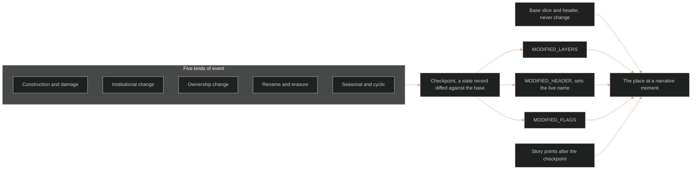

**Who it's for:** a writer or maintainer looking up place-state rules · **What it does:** lists sections, fields, rules and checkpoints · **Type:** reference

# Setting state architecture: reference

Frontmatter: category `state_architecture`, tier `fabula`, `module_of: ssot_03_setting_system`, `applies_to: [all IPs]`, last updated 2026-10-04. It mirrors `ssot_02_character_state_architecture` layer for layer. The base system is [ssot_03_setting_system](../ssot_03_setting_system/2-reference.md).

*The structure: the base slice plus a checkpoint diff, then story points, gives the place at a moment. Five kinds of event produce the diffs.*

## 1. Purpose

- It tracks how a place changes over narrative time without editing the base slice.
- Design: one immutable base slice per place, plus any number of state diffs keyed to narrative time.
- The base slice is the deed and the survey. State diffs are the renovation history.
- One query engine should read a character checkpoint or a place checkpoint with the same code.

## 2. The Core Principle

- The static Setting Slice (S1 to S12 plus header) never changes. A revision makes a new version and archives the old.
- A state record lists only changed S-layer values, header fields and flags, plus the reason.
- Base slice plus a state diff equals the place at that moment.

## 3. What Is Static vs What Is Dynamic

Each S-layer is judged on its own terms with one test. A layer's mirror partner does not decide it.

### Static (Lives in the Base Slice, Never Changes)

| Data | Reason |
|---|---|
| S7 FOUNDING | Historical record. The present-tense-bite test is a reading, not a rewrite. |
| S12 FUNCTION binding | Fixed per storyform. A place may hold several S12 records, one per `storyform_id`. |
| Scale class (Axis 1) | A campus does not become a room. |
| Parent and child place links | Structural nesting. |
| Canon node link | Administrative pointer. |
| The fact that a name was once used | Permanent once it happens. What changes is which name is live. |

### Dynamic (Lives in State Diffs)

| Data | Reason |
|---|---|
| S1 BODY | Construction, demolition and damage. The border/seam sub-field can change. |
| S2 WEATHER, functional reading only | Climate facts stay static. What the weather means (who gets relief, what it costs) is dynamic. |
| S3 SENSORIUM | The presentation surface shifts with institutional change. |
| S4 LAW | Governance changes with regime and ownership. |
| S5 SCAR | Accretes. Entries are added, never removed or overwritten (Rule 1a). |
| S6 ECONOMY | Resource flows and ownership capital change. |
| S8 HABIT | Patterned life shifts with population and regime. |
| S9 ALLURE | The promise can be dismantled, intensified or replaced. |
| S10 UNDERSIDE | A fact moves between secret, folk and public. |
| S11 VECTOR | Updated at each checkpoint. |
| Header: live name and active aliases | Changes at a rename event. The scrub test reads it. |
| Header: state track pointer | Names the current `state_id` for a moment. |

### The Decision Test

Would this value differ if the place were frozen at two points in the narrative? Yes: dynamic, in a state diff. No: static, in the base slice.

## 4. State Record Format

A state record is a data block. It holds the delta between the base slice and the place at one narrative moment.

### Required Fields

| Field | Meaning |
|---|---|
| `place_id` | The place, e.g. `dcus`. |
| `state_id` | Unique id, e.g. `dcus_red_hills_rename`. |
| `origin_event` | The fabula `event_id`, grammar `<movement>_<slug>`. `null` only for Category 5 overlays. With no fabula record, write the `backstory_<slug>` id plus `⏸ <pass name> (phase 2)`. Never blank, never invented as canon. |
| `told_at` | List of time codes where the audience sees the state. An empty list means true but offstage. |
| `narrative_moment` | Generated from the time code, a readable label only. |
| `movement` | The movement, or the ruled `backstory` tag for deep past with no Mn (ruled 2026-09-29). |
| `state_version` | Version of this record. |
| `base_slice_version` | Version of the base slice it diffs against. |

### The State Diffs Parent

Three blocks sit under one parent field, `state_diffs:`: `MODIFIED_LAYERS`, `MODIFIED_HEADER` and `MODIFIED_FLAGS`.

### Modified Layers Block

It lists only S-layer values that differ from the base slice. Omitted layers read from the base. It is the setting twin of the character doc's `MODIFIED_VALUES`.

### Modified Header Block (renames)

It has no character analog. Fields seen: `live_name`, `aliases_active`, `aliases_legacy`. Only differing header fields appear.

### Modified Flags Block

Flags re-evaluate against modified values. The starter set is in ssot_03 SETTING FLAGS. List a flag only when its state changes at this checkpoint. A story may add its own flags.

### State Narrative Note

A `STATE_NOTE` of 2 to 5 sentences explains what happened at the moment.

## 5. Checkpoints and Story Points

- A checkpoint is a complete state at a fabula event. It re-derives every changed S-layer value and header field.
- A single-field change is a story point. It lives in ssot_08_tracking_system §5 with `subject.kind: place`.
- A fading value such as S9 glamour can tick down across story points with `ramp: true`.
- Rule 6, amended: one state per moment per place applies to checkpoints only.

## 6. State Diff Rules

| Rule | Statement |
|---|---|
| 1 | Diffs are additive, not destructive. A value back at base is omitted. |
| 1a | S5 SCAR is append-only. A diff may add an entry, never remove or overwrite one. |
| 2 | Each diff computes against the base slice, not the previous diff. |
| 3 | `WEATHER_EXPERIENCED` is a state-only field: the functional read of weather. The narrative designer authors the formula. |
| 4 | Every diff re-evaluates all flag triggers. |
| 5 | Diffs are versioned. A revision archives the old one. |
| 6 | One checkpoint per narrative moment per place. Story points may be many. |
| 7 | Backward diffs are allowed (ruled 2026-09-29). A checkpoint earlier than the base slice's own moment diffs backward against the base. |

## 7. Querying a Place at a Narrative Moment

1. Load the base slice and header.
2. Load the checkpoint at or nearest before the requested time code.
3. Apply `MODIFIED_LAYERS`.
4. Apply `MODIFIED_HEADER`. This sets the live name.
5. Apply `MODIFIED_FLAGS`.
6. Apply story points logged after the checkpoint and before the moment.

The result is a complete place record: twelve S-layers, the header with the live name, and flag states.

## 8. State Sources

Five categories of event produce state diffs.

### Category 1: Construction/Damage Events

S1 BODY changes. S5 may accrete an entry. S11 may shift. Example (hypothetical, not canon): a hurricane-damaged wing left unrepaired.

### Category 2: Institutional Change Events

S4 LAW and S8 HABIT change. S12 is untouched unless a new storyform enters. Example: Star-Rating and Feed-linked clothing.

### Category 3: Ownership Change Events

S6 ECONOMY changes. S9 may shift. The header may change if a rename comes with it. Example: the Bishop acquisition.

### Category 4: Rename/Erasure Events

The live name flips in `MODIFIED_HEADER`. S5 accretes. S10 may gain a tier shift. Example: Skeeter Creek to Red Hills, and Red Hills to DCUS.

### Category 5: Seasonal/Cyclic Events (Progression Overlay)

No single event triggers it. S2's dynamic sub-value drifts with season or cycle. `origin_event` is `null`. Example: hurricane season across M2 to M4.

## 9. Faction States

- A FACTION / NATION CARD is static at authoring. A state diff can modify its fields: `binding_principle`, `government`, `economy_tier`, `border_seam_rating`, `one_secret`.
- Diffs use the same `origin_event`, `told_at` and time-code shape as a place.
- Rule 6 applies per faction.
- Worked case: the Bishops' `border_seam_rating` is low-friction at the Red Hills acquisition and high-friction once DCUS is live.

## 10. Boundaries

This doc owns the base/diff split, record format, diff rules and query protocol. It does not own:

- the grid, time code and checkpoint/story-point split (ssot_08_tracking_system);
- world events (ssot_04_fabula; a place checkpoint points to one through `origin_event`);
- the DCUS eras as a timeline. The fabula ruling of 2026-09-24 keeps the setting doc as the one authoring surface for the lattice.

## 11. THE INSTANCE — the DCUS rename lattice — worked example (phase 2 fills)

Built from existing canon: the DCUS base slice (v1.4.1), the canon node, and the fabula's world clock. No fabula record exists for the three transitions. Each `origin_event` carries `⏸ DCUS rename lattice fill pass (phase 2)`.

Notes: DCUS's base slice is written at the current era, so the earlier checkpoints diff backward (Rule 7). The `movement` is `backstory` for all three.

### Checkpoint 1 — the founding, as Skeeter Creek

- `state_id: dcus_skeeter_creek_founding`; `told_at: []`; live name Skeeter Creek.
- S5 SCAR is empty (no erasure yet). Other layers stay thin by the fill rule.
- Aliases: active Skeeter Creek; legacy none.

### Checkpoint 2 — the first erasure, Skeeter Creek sanded to Red Hills

- `state_id: dcus_red_hills_rename`; `told_at: []`; live name Red Hills Academy.
- S5 gains `skeeter_creek_sanded_to_red_hills`. S6: grandfather-versus-son ownership war, prestige-based, pre-Bishop. S8: the alumni-legacy bloc forms.
- S9 (old-money prestige draw) and S10 (Skeeter Creek sinks to folk or secret) are parked. They wait for the phase 2 pass.
- Aliases: active Red Hills Academy, The Academy; legacy Skeeter Creek.

### Checkpoint 3 — the second erasure, the Bishop acquisition and the DCUS rebrand

- `state_id: dcus_bishop_rebrand`; `told_at: []`; live name Delta Coast Ultra School (DCUS).
- `MODIFIED_LAYERS` is empty: the base slice already holds DCUS-era values.
- Aliases: active DCUS, the Ultra School; legacy Red Hills Academy, Skeeter Creek.
- The M2 grief-outburst sequence is a candidate `told_at` entry, pending a fixed scene address.

### The scrub test (ruled 2026-09-24)

Scrubbing the timeline past a rename's time code must flip the place's live name in every view that reads it. A view that reads only the base header fails the test. Querying DCUS at Checkpoint 1 or 2 must return Skeeter Creek or Red Hills, per §7 step 4.

## 12. Version History

- **1.2.0 (2026-10-04):** ruled "REC" (BOLO 100 setting batch 1). Stamped `module_of`; scope all IPs; the `origin_event` no-record rule; DCUS values parked.
- **1.1.0 (2026-09-29):** ruled "line up the recs". `backstory` tag ruled; Rule 7 added; Checkpoint 3 `told_at` note.
- **1.0.0 (2026-09-29):** initial document, BOLO 90 step 3.
