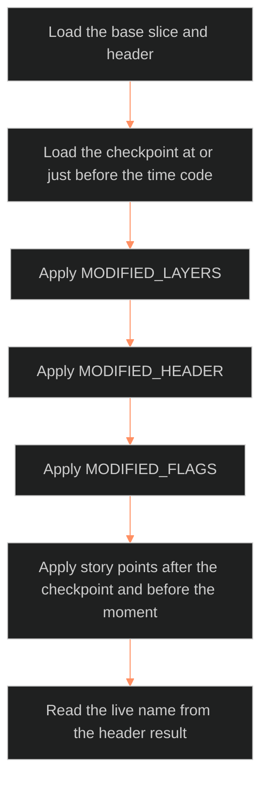

**Who it's for:** a writer recording a place's change · **What it does:** steps for state-architecture tasks · **Type:** how-to

# Setting state architecture: how-to

Field meanings are in the [reference](2-reference.md).

## Decide whether a value is static or dynamic

1. Take the value.
2. Imagine the place frozen at two different points in the story.
3. If the value would differ, it is dynamic. Put it in a state diff.
4. If it would not differ, it is static. Keep it in the base slice only.

## Write a checkpoint (state record)

1. Write `place_id` and a unique `state_id`.
2. Write `origin_event`: the fabula `event_id`. If none exists, write the `backstory_<slug>` id plus `⏸ <pass name> (phase 2)`. Never leave it blank or invent canon.
3. Write `told_at` as a list of time codes. Use `[]` if the state is true but offstage.
4. Set `movement`. Use `backstory` for deep past with no Mn.
5. Write `state_version` and `base_slice_version`.
6. Add the `state_diffs:` parent with `MODIFIED_LAYERS`, `MODIFIED_HEADER` and `MODIFIED_FLAGS`.
7. List only layers that differ from the base.
8. Write a `STATE_NOTE` of 2 to 5 sentences.

## Record a rename

1. Put the new `live_name` in `MODIFIED_HEADER`.
2. Update `aliases_active`. Move the old name to `aliases_legacy`.
3. Add a new S5 SCAR entry. Never replace an old one.
4. Check S10: the old name may sink from public to folk or secret.

## Add a scar

1. Add one entry to S5 in the diff.
2. Do not remove or overwrite any earlier entry (Rule 1a).
3. Check S11 for a shift.

## Write a backward diff

1. Confirm the checkpoint is earlier than the base slice's own moment.
2. Diff it against the base slice, not against a later checkpoint.
3. Change each field to its earlier value. Delete nothing.

## Query a place at a moment

*The query in order: load the base, load the checkpoint, apply the three blocks, then the story points. The live name comes from the header.*

1. Load the base slice and header.
2. Load the checkpoint at or just before the time code.
3. Apply `MODIFIED_LAYERS`, then `MODIFIED_HEADER`, then `MODIFIED_FLAGS`.
4. Apply any story points after that checkpoint and before the moment.
5. Read the live name from the header result.

## Re-evaluate flags after a diff

1. Read each flag trigger in the setting-system SETTING FLAGS list.
2. Test it against the modified values.
3. List in `MODIFIED_FLAGS` only the flags whose state changed here.

## Change a faction card over time

1. Pick the field: `binding_principle`, `government`, `economy_tier`, `border_seam_rating` or `one_secret`.
2. Write a state diff keyed to `origin_event` and `told_at`.
3. Keep one checkpoint per moment per faction.

## Run the scrub test

1. Scrub the timeline past a rename's time code.
2. Check that every view shows the new live name.
3. If a view shows the base name, fix it so it reads the header diff.
