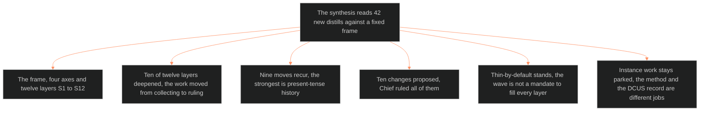

**Who it's for:** a writer or Chief asking why the setting slice changed · **What it does:** explains the synthesis and its findings · **Type:** concept

# Setting synthesis: why the wave changed the system

*The mind model: 42 distills, read against a fixed frame, produce deeper layers, nine recurring moves and ten ruled changes. Instance work stays parked.*

## A new shelf of books is worth reading only against a fixed frame

The setting system already has a frame: four axes and a twelve-layer slice (S1 to S12). The synthesis reads 42 new setting-shelf distills against that frame. A distill is a short, structured digest of one book. Each distill carries a `feeds:` block that maps it to S-layers at a strength: primary, supporting or contextual. The synthesis sorts that load by layer, then reads across it.

## Ten of twelve layers deepened, and that moved the work from collecting to ruling

The wave was the largest infusion the slice has had. Ten layers moved from adequate to deep. S3 cleared its thin flag. S12 climbed off "DCUS-only". S2 is the honest exception: the method gap closed, but the instance gap did not. Those are two kinds of thin, and the old flag did not tell them apart.

## What recurs across books is the real finding

Nine moves recur. The strongest is present-tense history: the writer finds the past only where it bites now. Twelve further sources reach that rule alone. Others turn tone into a rule and repeat a faction card. They also keep a forward-dated ledger of what has not happened yet.

## Ten changes were proposed and Chief ruled all of them

Chief ruled the changes on 2026-09-29 ("go on all those recs") and again on 2026-10-04 ("REC"). Eight were applied to the system as proposed. Change 5 was benched, then ruled into an S12 sub-note. Change 10 reaffirmed that no structural change follows.

## Thin-by-default stands, and the wave is not a mandate to fill every layer

The system keeps most layers thin until the story visits them. One source shows that completeness trades against consistency. A writer who sees deep layers in this wave must not read that as an order. The wave never asks for S1 to S11 everywhere.

## Instance work stays parked, because the method and the DCUS record are different jobs

Part Four lists eight DCUS application items. Items 1, 4 and 7 are done. The rest wait for phase 2. The synthesis never writes the DCUS instance itself.

## The long read

The wave shows a pattern the older notes only hinted at. A setting survives play when each layer costs the writer something. Dread costs a resource. Honor is a score. History appears only when a scene needs it. The five contradictions in Part Five all resolve the same way. The writer picks a direction, commits, and keeps the center dense and the edges vague. See the [reference](2-reference.md), the [how-to](3-how-to.md) and the [tutorial](4-tutorial.md).
