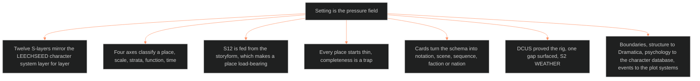

**Who it's for:** a writer or Chief learning why place is a system · **What it does:** explains the idea behind the setting system · **Type:** concept

# The setting system: why place is a pressure field

*The mind model: setting is the pressure field. It is built at character grade, thin by default, and bound to the argument at S12.*

## Setting is pressure, and a place that pressures nothing is scenery

The system's root claim is that setting is the pressure field. It is the total state of the world at a story address. That field presses on every unit of the ladder. In spine terms, setting is where the argument becomes matter, a Domain embodied. A backdrop does none of that work.

## A place gets the same twelve layers a character gets

Chief ruled that setting is built at character grade. The setting slice has twelve S-layers and mirrors the LEECHSEED character system layer for layer. S1 BODY mirrors L1 CORE, and S12 FUNCTION mirrors L12 FUNCTION. The writer reads a place the way the writer reads a person: surface first, then depth, then structural function.

## Four axes classify a place before the slice describes it

Scale says where the place nests. Strata say what it is made of. Function says what the setting does in a scene. Time says how it changes. Each axis answers a different question, so no axis replaces another.

## S12 is fed from the storyform, and that makes a place load-bearing

S1 to S11 describe the place. S12 binds the place to the story's argument, keyed by storyform. A place with S12 empty is a mere location, and that is legal. A place with S12 filled carries a throughline Domain.

## Every place starts thin, because completeness is a trap

Kennedy's counter-argument shaped the fill rule. The writer fills a layer only when a scene's pressure needs it. A header plus S12 is a complete slice. The encyclopaedic full fill is the failure, not the goal.

## Cards turn the schema into working notation

The SCENE CARD pins one scene. The SEQUENCE CARD pins a run of scenes. The FACTION / NATION CARD pins a bounded institution. Each card is thin by default, with depth reserved for what the story visits. Flags then compute place conditions from the fields, so no one assigns them by hand.

## DCUS proved the rig, and the proof exposed one gap

Delta Coast Ultra School (DCUS) filled every layer from canon on the first try. One authorable gap surfaced, S2 WEATHER, and S12 snapped onto the storyform without force. The instance is a worked example, not the system.

## The long read

The setting system sits at a boundary. Structure belongs to Dramatica. Psychology belongs to the character database. Events belong to the plot systems. Setting owns the field in which those three meet. The trade cannot supply what the slice asks for. A professional gazetteer fills BODY, LAW, ECONOMY, FOUNDING, HABIT and VECTOR richly. It leaves WEATHER, SENSORIUM, SCAR, ALLURE and UNDERSIDE thin, and it cannot fill FUNCTION at all. That gap is the differentiation, and it is also the cost. Details are in the [reference](2-reference.md). Tasks are in the [how-to](3-how-to.md), and a lesson is in the [tutorial](4-tutorial.md).
