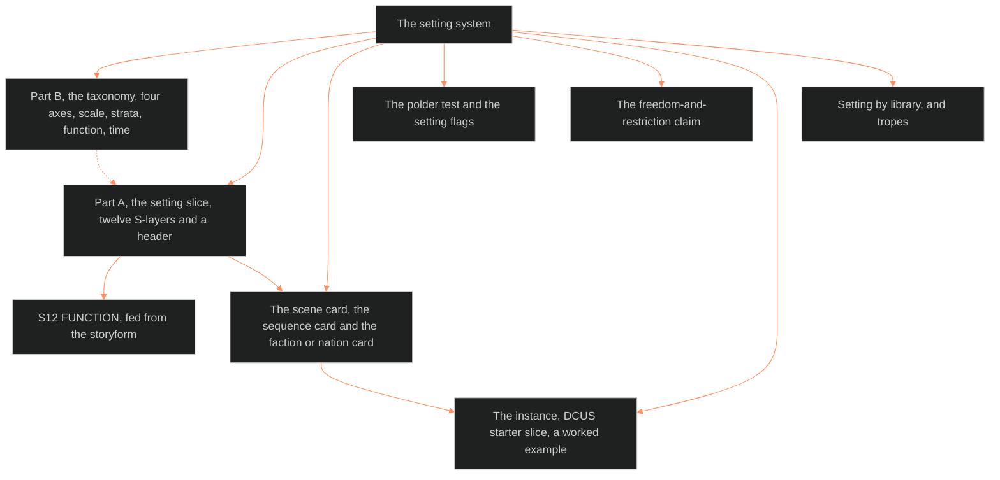

**Who it's for:** a writer or maintainer looking up a setting field · **What it does:** lists each component, part and field · **Type:** reference

# The setting system: reference

Frontmatter: category `setting_system`, tier `[fabula, narratology]`, trunk BLACK, `applies_to: [all IPs]`, last updated 2026-10-05. Root claim: setting is the pressure field, the total state of the world at a story address. A place that pressures nothing is scenery. Companions: [synthesis](../ssot_03_setting_synthesis/2-reference.md) and [state architecture](../ssot_03_setting_state_architecture/2-reference.md). Read the Touchstones register first.

*The structure: the taxonomy classifies the place. The slice describes it. The cards put it on the page. DCUS is the worked example.*

## MIND MODELS

Three diagrams.

- **Diagram 1, the whole system.** Root: the setting system. Branches: Taxonomy (four axes) and the Setting Slice (twelve S-layers, one per place, S12 fed from the storyform). The rest are the Scene Card (one screen, one scene, paired to the Plot Card), Library, and Boundaries.
- **Diagram 2, the pressure field.** Layers S1 to S11 deploy six functions: Anchor, Characterize, Pressure, Mood, Argue, Afford. They meet in one scene (a story address), then feed the collision engine (L-layer × S-layer).
- **Diagram 3, the setting arc.** Baseline, then a dated state overlay, then place changed. The arc recurs one scale class up. It draws Axis 4, not the fill rule.

Boundaries: structure belongs to Dramatica, psychology to the LEECHSEED character system, events to plot_systems.

## PART B · THE TAXONOMY — four axes

The four axes classify what a place is. Every slice declares its place on all four.

### Axis 1 · SCALE — places nest (rhymes with the ladder's 8 rungs)

- Values, small to large: spot, room, site, locale, settlement, region, world, cosmos.
- Every slice declares its scale class and its parent and child places.
- Address form: `DCUS.campus.hall3.room12`.
- A scene (ladder R2) plays on a span of setting scale, as it sits at a ladder address.

### Axis 2 · STRATA — what a place is made of

- Strata are the twelve layers of the slice (Part A).
- Sources: Buckham's active-setting functions, the Kobold and GURPS gazetteer structure, and narratology's space theory (Bal, Chatman).

### Axis 3 · FUNCTION — what setting DOES (Buckham-derived deployment modes)

| Mode | The setting is |
|---|---|
| Anchor | orienting: the reader knows where and when they stand |
| Characterize | revealing: the room tells who lives in it |
| Pressure | opposing: obstacle, constraint, danger |
| Mood | emotional weather before dialogue |
| Argue | thematic: the place makes the argument in matter |
| Afford | action surface: what the space permits or forbids |

A scene deploys one or two modes on purpose. All six at once is noise. The SCENE CARD records the modes.

### Axis 4 · TIME — baseline and states (the setting arc)

- The slice is the baseline. States are dated overlays keyed to ladder addresses.
- The setting arc is the sequence of states, for example `DCUS[M1] → DCUS[M4]`.
- It mirrors the character state architecture in 02.
- Full rules: [state architecture](../ssot_03_setting_state_architecture/2-reference.md). The time code lives in ssot_08_tracking_system.

## PART A · THE SETTING SLICE — twelve layers, mirror of the character stack

S12 is fed independently from the storyform, as L12 is fed from the Dramatica ingest. Layer names are ruled as they stand (2026-09-29). Each row gives the layer, what it holds, its named fields, and its character mirror.

| Layer | Holds and named fields | Mirrors |
|---|---|---|
| S1 BODY | Physical fabric: geography, terrain, architecture, dimensions, materials, layout. Fields: border/seam sub-field (rated permeability between adjacent zones); seam type `passageway` (crossing changes which rules bind); `border_type` (natural, national, contractual or buffer, plus its history); `boundary_kind` (border divides two domains, boundary rings one). | L1 CORE |
| S2 WEATHER | Climate, seasons, light, temperature, atmosphere, rhythms. Fields: `climate_band`, `seasons`, `light`, `rhythms`. | L2 VITAL |
| S3 SENSORIUM | The presentation surface: soundscape, smellscape, texture, palette. Field: `governing detail` (one defining sensory factor). Draft in sight, sound and smell only. Three details at most on the SCENE CARD. Measured physical facts may serve as texture. | L3 SOCIAL |
| S4 LAW | Rules that bind. Fields: `dials` (five: density, ruling class, source of legitimacy, enforcer, banned list); `material context`; `strained_leg` (coercion, capital or legitimacy); `power_mode` (enclosure or modulation); `access_form` (watchword or password). Each rule carries a modality, a stated-volume and a deviation outcome. | L4 WILL |
| S5 SCAR | Damage in the fabric: ruins, erasures, renames. Fields: `record` (five entries: what it was, yearly upkeep, how it fell, who used it since, why it is not picked clean); `repeats_at`; `overwritten_by`; `trace_kept` (yes or no). Cross-reference S9. | L5 WOUND |
| S6 ECONOMY | What fuels the place. Field: `position` (core, semi-periphery or periphery; it can flip across states). | L6 DRIVE |
| S7 FOUNDING | Origin and deep history. Fields: present-tense-bite test; `founding_type` (conquest, inheritance or alliance); `capital_type` (organic, primate or relocated). | L7 ORIGIN |
| S8 HABIT | Rituals, routines, belonging gradients, insider and outsider. Fields: `reason_remembered` (yes, partly or no); incorporation strategy (destroy-or-tribute, co-opt, assimilate); up to three gauges; `price` on each belonging tier, `{criterion, cost, witness}`, where `witness` is the `character_id` of one named member who pays, read from the character system (IF catalog call 5, ruled 2026-10-05). | L8 IMPRINT |
| S9 ALLURE | The place's erotics. Fields: `promise`, `draw`, `glamour`, `source_rupture`. Cross-reference S5. | L9 EROS |
| S10 UNDERSIDE | What the place represses. Three tiers: public (stated), folk (known, unstated), secret (buried, recoverable). | L10 SHADOW |
| S11 VECTOR | Trajectory: bloom, rot, collapse, redemption. Fields: optional forward-ledger sub-field (each dated state carries the 08 time code and sits on the fabula event's `scheduled:` field; IF catalog calls 1 and 5, ruled 2026-10-05); `phase` (rising, plateau, declining, past-disintegration); `vacuum` (yes or no); state `tone` (Light or Dark); up to three gauges. | L11 DESTINY |
| S12 FUNCTION | Storyform binding, independent of S1 to S11. Fields: conflict level (subconscious, personal, institutional, environmental); tone-to-mechanic sub-note; `touchstone` set; `contradiction`; `salient surplus`; `link` (`{character_id, kind: none, political, direct or metonymic}`). The Domain it names is what P12 `domain_ref` reads for a unit set at the place (IF catalog call 5, ruled 2026-10-05). | L12 FUNCTION |

**Slice header (machinery, not a layer).** Fields: `place_id`, names and aliases (the rename lattice), scale class, parent and child places. It also has canon node link, state track, `job`, `dramatic role` and `adjacent` (neighbors with travel cost). The last fields are `canon_tier` per fact (core, semi or fringe) and `real_anchor` (dynamic: `{source, as_of date, categories kept}`).

**Binding rule.** A place that embodies a throughline Domain gets one S12 record per storyform, keyed by `storyform_id`. S12 empty is legal. S12 filled makes the setting load-bearing.

**Fill rule.** Every place starts thin. The writer fills a layer only when a scene's pressure needs it. A full twelve-layer fill is the encyclopaedic trap.

**S12 working rule (TAW/TRW).** Only what a scene narrates is canon for a place's binding clause.

### PART A rules (added 1.9.0, RULED 2026-10-04)

- **Fill rule, gap status.** Each detail is explicit, implicit or gap. A gap stays a gap until a scene needs it. Then the writer rules a "small miracle" that agrees with everything established. Where the past is unsettled, list two or three candidates and fix none.
- **Canon tier and continuity.** A contradiction in the main storyline is fatal. A contradiction in background mechanics is logged. One custodian keeps the record. Fringe material is kept.
- **S4 codex sort.** Tag each S4 rule with a modality (permitted, prohibited, obligatory, valued, known). Also tag it with a stated-volume (formal, informal, unspoken). Record the deviation outcome: fall, test or predicament.
- **Gauges.** A place may carry up to three gauges. Each has a floor, a ceiling and an effect per rung. A state diff writes the tick. GAUGE_AT_LIMIT watches the ends.
- **Derivation check.** Four checks. Every settlement names its reason. Every S6 resource traces to an S1 feature or S4 rule. Every invented rule has a cost and a limit. One changed variable propagates across layers. Cold-start fill order: S1, S2, S6, S4, S8, S7.
- **Build order, premise ripple, derivation chain (1.10.0).** Fill S1 first, then S6 and S8. Then fill S4 and S7. Write one line per filled layer for a place resting on one premise. For a culture, write its means of living first.

## THE SCENE CARD — the R2 notation (slot reserved in the ladder, delivered here)

One card per scene, one screen. Twenty-four fields:

| Field | Holds |
|---|---|
| address | ladder address, e.g. `OXO.primary.M2.q3.s12` |
| setting | slice plus state, e.g. `DCUS.campus.hall3 @ state M2` |
| active strata | which layers work in the scene |
| function mode | Axis 3, two at most |
| sensorium | three details at most, S3 `governing detail` first |
| commandments | Coyne's five: II / TP / CR / CL / RES |
| value turn | McKee; no turn, no scene |
| duration | scene, summary, stretch, pause or ellipsis (Genette) |
| telling | voice and focalization for this scene |
| threads | what advances through this container |
| touchstones | in-scope set; a breach means the scene is wrong |
| collision | seeding row, e.g. L9×S9 |
| exit state | what is now true that was not |
| notes | exit rule by S4 `power_mode`, prompt bank on demand |
| crossing | optional; staged entry steps |
| citation | each actor's rule, who knows better |
| transcript | public or hidden, and what changes |
| rail_tested | theme record: R1, R2, R3 or R4, the debate this scene tests (IF catalog call 2, ruled 2026-10-05) |
| side_argued | theme record: the side of that debate the scene argues |
| gauge | theme record: the 08 gauge name and the step this scene moves |
| focal | one character id, the focal character for this scene; 07.1 reads it (IF catalog call 6, ruled 2026-10-05) |
| fantasy | one breath: what the audience gets to be, feel or do (the P8 check) |
| sexy | yes or no, plus one line why (the P9 check) |
| aesthetic | color, shape or texture: the one that carries it (the P10 check) |

Notes: an enclosure ends on a gate walked through; a modulation ends on a code granted or a rate moved. The SEAM_CROSSING flag fires on a crossing.

Theme record, focal and checks (1.11.0): the writer fills `rail_tested`, `side_argued` and `gauge` from 06. The writer fills them beside the `citation` and `transcript` tests. The writer fills `focal` with one character id. The writer answers `fantasy`, `sexy` and `aesthetic` in one breath each (IF catalog calls 2 and 6, ruled 2026-10-05).

## THE SEQUENCE CARD — the R3 notation (added 2026-09-29, BOLO 90 step 7 trial)

One card per R3 sequence, ruled 2026-09-29. It sits beside the SCENE CARD. Seven fields: address, sequence question, scene-slots, rolled-up turn, commandments (read across the run), threads, exit state. It omits active strata, sensorium, function mode, telling, touchstones and collision. Those stay on a per-scene card. Optional `test_phase`: contract, contest or consequence. A sequence with no scene card is legal.

## THE FACTION / NATION CARD — companion notation to the SCENE CARD

One card per faction, nation or institution. A stub is legal. Fields:

- **Core six (2026-09-29):** founding sentence, binding principle, government, economy tier, border/seam rating, one secret. A `name` line heads the card.
- **1.9.0 fields:** `goal` (one line); `clock` (4 to 8 ticks, one tick per state diff). It also has `quotable wound` (linked to an S5 entry), `claimed vs rewarded` and folk tier.
- **1.10.0 fields:** `fault line` (the condition that breaks the binding principle); `drift` (dated change, tagged dynamic).

Fed by S4, S6 and S7. A stub (founding sentence, principle, one secret) serves any place the story does not center. A full card needs both goal and clock.

## THE POLDER TEST — for an enclosed place (RULED 2026-10-04, BOLO 87, "all recs")

From Ekman, *Here Be Dragons*. Four questions for a ringed place. Run it only where a scene needs it.

1. The ring (S1): is there a boundary, and what is it made of?
2. The keepers (S4): who maintains it, and by what right?
3. The flood (S11): what outside force would collapse it? S11 records a threat clock.
4. The inside law (S4): which rules hold inside and not outside?

## SETTING FLAGS — starter set (RULED 2026-10-04, Chief "REC", BOLO 100)

The place record computes each flag. Nobody assigns one. States: ACTIVE, PENDING, FIRED_PRE_STORY, INACTIVE. A state diff re-evaluates every flag. A story may add flags in its instance file.

| Flag | Trigger | Layers |
|---|---|---|
| SEAM_CROSSING | The SCENE CARD `setting` spans two zones with a rated seam. | S1, S4 |
| SCAR_ACCRETED | A state diff adds an S5 entry. | S5, S11 |
| WOUND_PROMISE_FUSED | One rupture appears in S5 and S9. | S5, S9 |
| UNDERSIDE_SURFACING | A state diff moves an S10 fact up one tier. | S10, S5 |
| LEDGER_DUE | The S11 forward ledger holds a date and the checkpoint reaches it. | S11, S5 |
| LOAD_BEARING | The place has an S12 record keyed by `storyform_id`. | S12, S4, S9 |
| RUIN_INERT | An S5 entry has no builder or no fall. | S5, S7 |
| GAUGE_AT_LIMIT | A gauge sits at its floor or ceiling. | S8, S11 |
| REASON_LOST | An S8 custom has `reason_remembered: no` and still binds. | S8, S7 |

Flag hand-offs (IF catalog calls 1 and 5, ruled 2026-10-05):

- UNDERSIDE_SURFACING hands the plot card P7 `reveal_content` (the surfaced fact) and `reveal_type`.
- LEDGER_DUE future states carry the 08 time code. The writer records them on the fabula event's `scheduled:` field.
- LOAD_BEARING hands the plot card the S12 Domain, which P12 `domain_ref` records for each unit set at the place.

## THE FREEDOM-AND-RESTRICTION CLAIM — the dystopia mechanism (ruled 2026-09-16, genre OPEN 11; landed 2026-10-04)

Truby's dystopia mechanism is a touchpoint on S12. The world offers apparent choice over hidden restriction. The writer records the claim in one line on the S12 entry, keyed by `storyform_id`. P10 records which obligatory beat fires, not this claim.

## THE INSTANCE — DCUS starter slice (proof of rig) — worked example (phase 2 fills)

The slice is filled from canon. Header: `dcus`; names DCUS, the Ultra School and Red Hills Academy (legacy). The names also include Skeeter Creek (founding, buried) and Inner Spiral Academy (pre-ruling). The header also has scale site (campus). Its parent is the Middle Bands, Delta Coast, tri-state Spiral (FL/AL/GA).

| Layer | DCUS entry |
|---|---|
| S1 | Century-old Southern prestige campus on the Delta Coast. |
| S2 | Gulf-South heat, humidity and hurricane season (June to November). The cooled-building split (ruled 1.4.1): Feed-conditioned interiors, heat outside. |
| S3 | Southern Gothic register; palette descent clean to NEON-ROT. |
| S4 | The Administration as depersonalized OS; Star-Rating; Sync Cult mechanics. |
| S5 | The rename lattice Skeeter Creek, Red Hills, DCUS. Erasure done twice. |
| S6 | Bishop acquisition capital; the ownership war. |
| S7 | 100+ years of private prestige; founding name sanded to "Red Hills". |
| S8 | Alumni-legacy bloc against Sync-era students; split faculty. |
| S9 | The meritocratic promise Tori must stop believing (Growth: Stop). |
| S10 | The first name under the second; what the rebrand overwrote. |
| S11 | The six-movement descent: clean, NEON-ROT, hunt. |
| S12 | `storyform_id: oxo_primary_v1`; OS Domain embodied, Situation and The Past. Touchstone set: the Institutional Invariants (Ecclesial Laws). |

**Faction cards (ruled 1.4.1).** Full cards: the Administration and the Bishops, which are two factions. Stubs: the alumni-legacy bloc, the faculty split, the Sync Cult (held until it has a canon node). Benched: the dueling bells.

> **OPEN:** many DCUS instance fields are parked as "DCUS faction fill pass (phase 2)", including the Administration's `goal`, `clock` and `fault line`.

## SETTING × LIBRARY

Maps library distills to the system. Buckham 0268, 0269, 0270, 0267 and 0056 feed Axis 3 and S3. Kobold 0458 and 0541, GURPS 0447 and Collaborative Worldbuilding 0067 feed Axis 2. Kennedy 0349 is the counter-argument that worldbuilding serves pressure. Bal and Chatman feed space theory. Once Upon a Pixel 0144 feeds Afford. Two rulings follow. The first is the 42-distill synthesis ([reference](../ssot_03_setting_synthesis/2-reference.md)). The second is Ryan's nine-axis scoring (BVX.0630) as the genre-contract tool for 03 and 01 both. IF catalog call 10 ruled it on 2026-10-05, with Baur's five lineages as lineage. Library passes on 2026-10-04 added the 1.9.0 and 1.10.0 citations.

Interfaces (IF catalog, ruled 2026-10-05), one line for each wiring another system states first:

- Reads from 05 (IF-03-05-02): 05 shows the catalog entries found at each place beside that place's slice header. Its filter keys are `place` (this doc's `place_id`) and `era`.
- Read by 05 (IF-03-05-03): 05 takes S5 (ruins and SCARs) and S7 (present-tense bite) as test inputs.
- Read by 00 (IF-00-03-01): the variable registry reads `setting_ref` {setting_id, S-layer}. It is an optional sub-field of T2.WOUND.triggers and of T3.ORIGIN `origin_class` and `origin_disciplinary_formation` entries.
- Read by 06 (IF-03-06-04): 06 reads images already present in the setting material as motif candidates. Examples are the Feed and the uniform.
- Read by 07 (IF-03-07-01): 07.1 reads S3 SENSORIUM, the setting's sensory layer, to feed description.
- Read by 09 (IF-03-09-01): the process pipeline cites `setting_ref` in the L7 to L12 variable stacks. It does so where the place has an S4, S6 or S8 entry.

## TROPES

Added 2026-09-29 (BOLO 89). Every setting-domain TV Tropes trope is keyed to S1 to S12 in the trope register. The pull list is LAYERS.md under "setting". S2 holds only 3 tropes, a gap in TV Tropes and not in the slice.

## Other sections

The source also holds OPEN (trade-gap note, parked OXO scene-card fill pass). It also holds a version history from 1.0.0 (2026-08-25) to 1.11.0 (2026-10-05).
