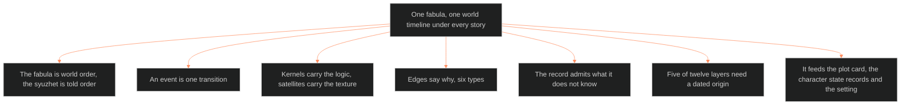

**Who it's for:** a writer or Chief learning why one fabula exists · **What it does:** explains world time under every story · **Type:** concept

# The fabula: why one world timeline sits under every story

*The mind model: one world timeline sits under every story. Typed edges join its single-transition events, and movements date them.*

## A shared universe needs exactly one fabula

OXO and EVIL CHECK are two tellings of one world. Wolf's internarrative theory gives the warrant: separate stories in one world nest inside the history of that world. Each new story must fit the events already there. So the Command keeps one timeline, not one per story.

## The fabula is world order, and the syuzhet is told order

Bal's three layers name the seam. The fabula is the series of related events in their own logical and chronological order. The syuzhet doc owns how a story tells them. The fabula owns when they happened. A writer who confuses the two will put the telling's gaps into the world.

## An event is one transition

Bal defines an event as a change from one state to another, caused or experienced by actors. A state alone is not an event. So each record holds one transition, never a scene or a label bundling several. That rule keeps the registry queryable.

## Kernels carry the logic and satellites carry the texture

Bal and Chatman agree on what counts. A kernel opens, realizes or reveals a choice, and the plot breaks without it. A satellite works out a choice already made. Every record carries that flag.

## Edges say why, not just what came next

Precedence is not cause. Six edge types keep that line sharp: precede, cause, enable, embed, specify and simultaneous. An edge marked cause asserts the full process fired. An edge marked enable asserts only that a door opened.

## The record admits what it does not know

No calendar existed for most of the world. So the clock dates by movement, and it stores reach and extent as ranges. A gap in the record claims only that nothing is on record. The fabula refuses to invent a year.

## Five of twelve layers need a dated origin

A character layer needs an origin moment when its baseline forms at one datable event. Wound, origin, imprint, eros and shadow qualify. Core, vital, social and function never move. Will, drive and destiny describe a rate or a direction, so they need none.

## The long read

The fabula adjudicates. When two tellings give conflicting glimpses of one event, this doc holds the settled version. Each record names its source and a confidence level. The doc then feeds the plot card, the character state records and the setting. Era dating lives here. What happened to a place stays in the setting doc. The universe now runs in five sequential eras, from Skeeter Creek on Earth outward to the beyond. Its calendar years are few: OXO's present is 2199 and the Moon Severance is 2099. See the [reference](2-reference.md), the [how-to](3-how-to.md) and the [tutorial](4-tutorial.md).
