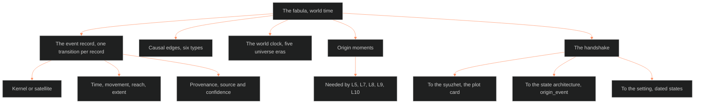

**Who it's for:** a writer or maintainer looking up a fabula fact · **What it does:** lists each component, field and event · **Type:** reference

# The fabula: reference

- Frontmatter: category `plot_system`, tier `fabula`, trunk BLACK, rung standard, `applies_to` OVEREXITOUT, EVIL CHECK, LAKAD, ASTRO7EX and all future IPs. It was last updated 2026-10-05. The fabula is the world-time layer. One timeline sits under OXO and EVIL CHECK. The told order lives in [ssot_04_plot_system](../ssot_04_plot_system/2-reference.md).

**Owns:** world time, the EVENT RECORD schema, typed CAUSAL EDGES, THE WORLD CLOCK, the ORIGIN MOMENTS rule.
**Does not own:** the told order (the plot doc, P11); the pattern layer ([trope graph](../ssot_04_trope_graph/2-reference.md)). It also does not own place itself (03) or the static character layers (02).

*The structure: the fabula owns the event record, the edges, the clock and the origin moments. It hands events to three neighbors.*

## MIND MODELS

- **Diagram 1.** Root: the fabula. Branches: World layer (one timeline), the Event Record, Causal Edges, The World Clock, Origin Moments, Boundaries.
- **Diagram 2, the handshake.** The event record feeds the syuzhet (P2, P3, P4, P5, P6, P7, P9, P11). It also feeds character state (`origin_event` points back to `event_id`) and the setting (dated states, cross-referenced only).

## THE EVENT RECORD

An event is a transition from one state to another, caused or experienced by actors (Bal). One record is one transition, never a scene or a summary label.

Fields:

| Field | Value or rule |
|---|---|
| `event_id` | `<movement>_<slug>`, e.g. `m1b_crash_jebb_death`. `backstory_<slug>` for pre-M1 history. The character system's `story_beat` type is this id, and a PENDING or FIRED_PRE_STORY flag stores its firing event's `event_id` (IF catalog call 5). |
| `transition` | `<state-before> -> <state-after>`. |
| `actors` | Each with `actant_role`: subject, object, helper or opponent. |
| `kernel_satellite` | `kernel` (cannot be deleted without breaking the logic) or `satellite`. Bal's functional test and Chatman's kernel test agree. |
| `time` | `movement` (Mn, Mn stage, or `backstory`); `time_code` (the 08 time code, null if not placed); `calendar_year` (the year where canon gives one, null if not); `reach` (distance from story-present, range allowed); `extent` (span, point or duration). The code and the year sit side by side (IF catalog call 1). |
| `gap_type` | `logged` (an event is on record) or `unknown` (nothing recorded, not the same as nothing happened). |
| `repeat` | `true` for an iterative class (Genette frequency). |
| `source_kind` | One of 03's five state-source categories (construction, institutional, ownership, rename, seasonal) or `character`. 03 reads from it which S-layers the event moves (IF catalog call 5). |
| `canon_source` | The canon-source citation the truth check reads. `provenance.source` stays the working note (IF catalog call 5). |
| `produces` | The `state_id`s the event yields across characters. It is the back-reference to each state's `origin_event` (IF catalog call 5). |
| `scheduled` | The 08 time code of a future state that 03's LEDGER_DUE flag fixed in advance. Null for a past event (IF catalog call 5). |
| `location` | A place, an S-doc address if known. |
| `stories` | `[OXO, EVIL_CHECK, backstory_only]`. Reserved field. |
| `provenance` | `source` plus `confidence`: `direct_quote`, `inferred` or `uncertain`. |
| `causal_edges` | List of `{type, to}`. |

Criteria for a functional event (Bal): Choice, and Confrontation (two actors, one action).

## CAUSAL EDGES

Precedence is necessary but not sufficient for cause (Bal). Every edge carries one of six types.

| Edge | Meaning |
|---|---|
| precede | Chronological order only. No causal claim. |
| cause | A's realization produces B. All three process phases fired. |
| enable | A opens the possibility that B later realizes. |
| embed | A opens a second process's own possibility phase, nested. |
| specify | An embedded series specifies the primary series. |
| simultaneous | A and B occur at the same time. |

Bal's process model has three phases: possibility, event, result. Any phase can fail to occur.

## THE WORLD CLOCK

**Eras.** The DCUS naming lattice read as clock eras. The first is Skeeter Creek (founding, buried, no date). The second is Red Hills (first rename, about a century before the Bishop acquisition). The third is DCUS (the current era). No calendar date exists for any transition. The clock cross-references the setting doc and does not re-author the eras (OPEN call 4).

**Universe eras (ruled 2026-09-29).** Sequential, with overlap allowed at the seams.

| Era | Story | Where |
|---|---|---|
| 1 Skeeter Creek | no story yet | Earth, the Delta Coast before DCUS. Ends at the Bishops' rebrand. The Narco Republic rises here. |
| 2 DCUS | OVEREXITOUT (*The Outliers*), EVIL CHECK, TREMOR CULT | Earth, the Delta Coast. Opens at `backstory_dcus_rebrand`. Only era with story event records. |
| 3 LAKAD | LAKAD (codename) | cislunar space. Band only. |
| 4 ASTRO7EX | ASTRO7EX | the Moon. Band only. |
| 5 beyond | none yet | past the Moon. Band only. |

**Calendar and the Moon Severance (ruled 2026-10-01, BOLO 96).** OXO's present is 2199. The Moon Severance is 2099, in era 1. Event id `backstory_moon_severance`. The Moon cut itself off by nukes in orbit and a Kessler cascade. The Outliers descend from Moon people who came back down. ASTRO7EX (era 4) is Earth's return to the Moon.

> **OPEN:** the Severance's order against the Deep Meridian beam, and whether ASTRO7EX's own "Moon Severance" is this event.

**The Narco Republic.** Rises in era 1, stands in era 2, is a mature vice economy by era 4. Era 3 is silent. Its names and flag wait on Chief's calls.

**The two 3rd impacts (ruled 2026-09-29, era 2).** Ids `backstory_south_pole_third_impact` and `backstory_ocean_third_impact`. The south-pole impact wakes the Kudzu. The ocean impact is its pair, the Atlantic nexus.

> **OPEN:** what the ocean impact wakes, and how both impacts sit against the Deep Meridian beam.

**The hinge (ruled 2026-09-29): the Deep Meridian beam.** A geothermal drill front fires a beam. The beam punches a mile-wide hole in the sky. The beam signals the quasar that reaches the time of Vivian (ASTRO7EX). The Moon Severance and the AI Collapse follow from it. Future ids: `deep_meridian_beam`, `astro7ex_backstory_moon_severance`, `astro7ex_backstory_ai_collapse`.

**Superseded.** The 2026-02-09 ruling that the three stories occur simultaneously is kept as history. The eon stays the umbrella.

**Fuzzy and unknown dates.** The working answer is movement-relative dating (M1, M2, M3). Reach and extent take ranges or are marked unknown. A calendar layer now sits beside it (IF catalog call 1). `time.calendar_year` holds a year where canon gives one, and `time.time_code` holds the 08 grid coordinate. Both stay null where canon is silent.

**Iterative events.** The `repeat` flag marks one record standing for a repeated class.

**Gaps.** `gap_type: unknown` claims only that nothing is on record.

**Backstory events (ruled 2026-09-29).** Deep past with no Mn takes `movement: "backstory"` and `event_id: backstory_<slug>`.

## ORIGIN MOMENTS

A layer needs an origin moment when its baseline forms from one datable event.

| Layer | Needs one? | Reason |
|---|---|---|
| L1 CORE | No | Static. |
| L2 VITAL | No | Static. Injuries are diffs. |
| L3 SOCIAL | No | Static. |
| L4 WILL | Optional | Derives from CORE. |
| L5 WOUND | Yes | A record of what happened. |
| L6 DRIVE | Optional | Derives from VITAL. |
| L7 ORIGIN | Yes | Birth context sets starting conditions. |
| L8 IMPRINT | Yes | Early relational events lock it in. |
| L9 EROS | Yes | Authored from datable intimate history. |
| L10 SHADOW | Yes | Forms from wounded events. |
| L11 DESTINY | Optional | A trajectory. |
| L12 FUNCTION | No | Fed from the Dramatica ingest. |

## THE HANDSHAKE

**To the syuzhet (plot card).**

| Plot card field | Reads from the fabula |
|---|---|
| P2 `driver_event` | An event's `event_id` and `transition`. |
| P3 `value`, `polarity_in` | The state-before half of `transition`. |
| P4 `turn_mechanism` | The `cause` or `enable` edge from value-in to value-out. |
| P5 `polarity_out`, `irony_flag` | The state-after half. |
| P6 `throughline`, `signpost_or_journey`, `act` | Not the fabula (ruled 2026-09-24). The trope graph's walk seats P6. The fabula supplies only `time`. |
| P7 `reveal_content`, `reveal_type` | An event that was `logged` but untold. UNDERSIDE_SURFACING (03) hands P7 both fields and logs the event as `logged`, surfacing as untold (IF catalog call 5). |
| P9 `stakes_delta` | The chain of `cause` and `enable` edges back to the prior event. |
| P11 `order_told`, `order_happened`, `duration_mode` | `order_happened` is the event's `time`, with its time code and year. `order_told` is a time code. The gap is classed as an anachrony. |

**To the state architecture.** Landed in `ssot_02_character_state_architecture` v1.1.0 on 2026-09-24. It added an `origin_event` field and `state_diffs` as a parent field. It also added event id standardization (worked pair `m1b_crash_jebb_death` and `vm_m1b_post_crash`).

**To the setting.** Axis 4 TIME states read the world-clock eras for dating. S7, S11 and S5 stay the authoring surface for what happened. The fabula is the surface for when.

**To the readers of the world clock.** Read by 01 (IF-01-04-06): the story registry reads the universe eras 1 to 5 and the world clock. Each story row carries an era. Read by 05 (IF-04-05-01): a catalog entry's `origin: "<fabula event_id>"` names the event that brought the entry into being.

## THE INSTANCE

Scope: Tori (Victoria Midnight) only for wave 1. No calendar dates exist, so reaches are fuzzy.

| Event id | Transition | Kernel | Movement | Edge |
|---|---|---|---|---|
| `m1b_crash_jebb_death` | Tori overrides the pace notes, Jebb dies. | kernel | M1B | cause to `m1b_untouchable_resolve` |
| `m1b_untouchable_resolve` | Reactive grief to the resolve "I will become untouchable". | kernel | M1B | precede to `m2_recruited` |
| `m2_recruited` | Outside the Academy to recruited. | kernel | M2 entry | none |
| `m2_first_sync_verified` | Her first Sync-rating session: she reaches, the Feed archives "Unrecognized input", she is marked Verified. | kernel | M2 | specify to `m2_grief_outbursts` |
| `m2_grief_outbursts` | Grief held to surreal outbursts, dismissed as "Digital Puberty". Iterative. | satellite | M2 | precede to `m3_underground_search` |
| `m3_underground_search` | Jebb's data unrecovered to Tori working the underground. Iterative. | satellite | M3 | none |

`m2_first_sync_verified` was added 2026-09-24 (call 12) from the M2 row 9 scene card. Its location is flagged ⧗.

**Tori's family origin (ruled 2026-09-29, BOLO 91).** The trash zone delta, not Bikini Atoll. It is L7 ORIGIN context and gets no event record. The car crash stays her WOUND. The earlier Bikini Atoll draft is discarded history.

**Left out.** Tori's pre-M1B racing career is a background condition, not a transition.

## ANNA COLSON'S ORIGIN (BOLO 91, RULED 2026-09-29)

Five `backstory` events fill her L7 ORIGIN chain. The copy is not a state diff on Anna Colson. She gets her own fabula node.

| Event id | Transition | Edge |
|---|---|---|
| `backstory_colson_skating_death` | Colson dies in a freak ice-skating accident. | cause to the father seeking a scientist |
| `backstory_colson_father_seeks_scientist` | The father seeks a scientist who can rebuild her, better. | enable to the attachment |
| `backstory_colson_scientist_attachment` | The scientist grows too close to Colson. Extent is extended. | cause to the reclaim |
| `backstory_colson_father_reclaims` | The father steals her back. | simultaneous with the copy |
| `backstory_colson_copy_made` | The scientist secretly keeps her own copy, a second Colson. It is the copy's own L7 ORIGIN moment. Her own 02 character record, apart from `anna-colson-conway.md`, names it as `origin_event` (IF catalog call 5). | none yet |

This does not fill L8, L9 or L10 for either Colson, and it does not place post-origin events.

## FABULA × LIBRARY

| Source | What it gives |
|---|---|
| Bal, *Narratology* (BVX.0591) | Event definition, Choice and Confrontation, causal phases, the gap versus silence split. |
| Chatman, *Story and Discourse* (BVX.0167) | Kernel and satellite. |
| Genette, *Narrative Discourse* | Order, duration, frequency; reach and extent; anachrony types. |
| Rimmon-Kenan, *Narrative Fiction* | Warrant for `provenance` and `confidence`. |
| Wolf, *Building Imaginary Worlds* (BVX.0562) | Internarrative theory; the `stories:` field. |
| Sternberg | Curiosity, suspense and surprise as queries against the fabula. |
| Propp, *Morphology of the Folktale* | Functions are a pattern layer, the trope graph's job. |

## Other sections

The source also holds OPEN (six calls, all ruled 2026-09-24). The calls cover the Tori-only instance, EVIL CHECK in wave 2 and `<movement>_<slug>` ids. They also cover DCUS eras cross-referenced, movement-relative dates and the v1.1 patch. It also holds a version history from 0.1.0 (2026-09-24) to 0.3.0 (2026-10-05).
