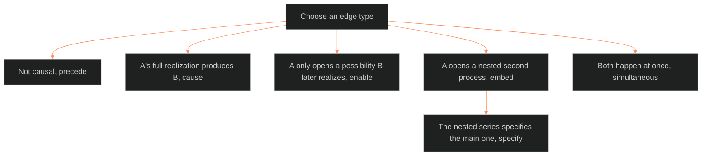

**Who it's for:** a writer or maintainer working the event registry · **What it does:** steps for fabula tasks · **Type:** how-to

# The fabula: how-to

Field meanings are in the [reference](2-reference.md).

## Add an event record

1. Confirm the event is one transition. Split a bundle into separate records.
2. Write `event_id` as `<movement>_<slug>`. Use `backstory_<slug>` if the event precedes M1.
3. Write `transition` as `<state-before> -> <state-after>`.
4. List each actor with an `actant_role`: subject, object, helper or opponent.
5. Flag `kernel_satellite`. Ask: does the plot break if you delete it?
6. Fill `time`: `movement`, `time_code`, `calendar_year`, `reach` and `extent`. Use ranges or "unspecified". Write `calendar_year` only where canon gives a year. Never invent a year or a code.
7. Set `gap_type` to `logged` and `repeat` to `true` only for an iterative class.
8. Set `source_kind` to construction, institutional, ownership, rename, seasonal or `character`.
9. Set `stories` to the tellings that show the event.
10. Write `provenance`: the source and a confidence of `direct_quote`, `inferred` or `uncertain`. Write `canon_source` as the citation the truth check reads.
11. List the `state_id`s the event yields in `produces`. Set `scheduled` to a time code only for a future state fixed in advance.
12. Add `causal_edges`.

## Choose an edge type

*The edge types as a choice. Pick the one that matches what A does to B, and never claim cause from sequence alone.*

1. Ask whether the link is causal. If not, use `precede`.
2. If A's full realization produces B, use `cause`.
3. If A only opens the possibility B later realizes, use `enable`.
4. If A opens a nested second process, use `embed`. If the nested series specifies the main one, use `specify`.
5. If both happen at once, use `simultaneous`.
6. Do not claim cause from sequence alone.

## Date an event with no calendar

1. Use the movement: M1, M2, M3.
2. For deep past with no Mn, set `movement: "backstory"`.
3. Write reach and extent as ranges, or mark them unknown.
4. Do not leave them blank.
5. Write `time_code` and `calendar_year` only where canon gives them. Leave each null where canon is silent.

## Decide whether a character layer needs an origin event

1. Name the layer.
2. Check the ORIGIN MOMENTS table in the reference.
3. L5, L7, L8, L9 and L10 need a dated fabula event.
4. L4, L6 and L11 are optional. L1, L2, L3 and L12 need none.
5. If the baseline is a background condition, not a transition, keep it as layer context. Do not make an event.

## Feed a plot card from the fabula

1. Pick the event the unit turns on. Copy its `event_id` into P2.
2. Read P3 from the state-before half of `transition`, and P5 from the state-after half.
3. Read P4 from the `cause` or `enable` edge between the two events.
4. Read P9 from the edge chain back to the prior event.
5. For P11, copy `time` into `order_happened`. The plot doc owns `order_told`.
6. Do not read P6 from the fabula. The trope graph's walk seats it.
7. Where 03's UNDERSIDE_SURFACING fires, give P7 `reveal_content` and `reveal_type`. Keep the event `logged`, surfacing as untold.

## Link a character state record to an event

1. Find the event's `event_id` in the registry.
2. Copy that exact string into the state record's `origin_event`.
3. Keep `narrative_moment` as a readable tag.
4. Add the record's `state_id` to the event's `produces` list.

## Place an era on the world clock

1. Choose the era: Skeeter Creek (1), DCUS (2), LAKAD (3), ASTRO7EX (4) or beyond (5).
2. Use the era prefix when the clock spans stories.
3. Cross-reference the setting doc for DCUS lattice eras. Do not re-author them.

## Add a second telling's events

1. Wait for an extraction on that story, sourced as Tori's events were.
2. Mark each event's `stories` field.
3. Where tellings conflict, record the adjudicated version and its confidence.
