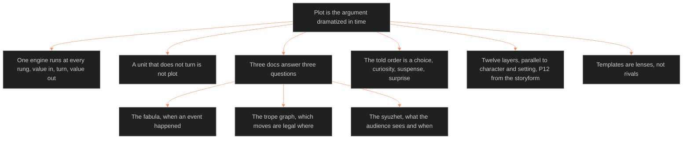

**Who it's for:** a writer or Chief learning why plot is one engine · **What it does:** explains the syuzhet and its engine · **Type:** concept

# The plot system: why plot is one turning engine

*The mind model: plot is the argument dramatized in time, one turning engine at every rung, split across three docs.*

## Plot is the argument dramatized in time

Plot answers three questions: what happens, in what order, and what changes because it happened. Dramatica supplies the fixed structure. The plot system fills that structure with events. A writer who treats plot as a list of beats misses the change.

## One engine runs at every rung

A value enters a unit charged one way. A turn forces it to a different charge. The unit closes changed. McKee, Coyne, Truby and Snyder describe that engine in four vocabularies. It runs at beat, scene, sequence and act, and each value-out feeds the next value-in.

## A unit that does not turn is not plot

Exposition, description and scenery can wear plot's clothes. The test is the turn. At scene level the unit needs a value turn and all five commandments. At beat level it needs only a small value shift.

## The plot system is three docs because it answers three questions

The fabula owns when an event happened in the world. The trope graph owns which moves are legal where. The syuzhet, this doc, owns what the audience sees and when. Chief ruled the split on 2026-09-23. A plot card no longer invents its values. It points at a fabula event and reads them.

## The told order is a choice, and every reordering pays off

Order told can differ from order happened. Sternberg names the payoffs: curiosity, suspense and surprise. They are queries against the fabula, never stored fields. A writer reorders to buy one of those three.

## Twelve layers keep the plot slice parallel to character and setting

The plot slice mirrors the character and setting stacks. P12 is fed from the storyform, so a unit with no storyform link is eventful but not load-bearing. P10 is the plot slice's own contribution: the reader-contract obligation a unit discharges.

## Templates are lenses, not rivals

Snyder's 15 beats, Truby's 22 steps and Coyne's Foolscap each pre-fill part of the slice. None overrides the spine's sixteen ruled signposts. A writer picks the lens that fits the genre or the medium.

## The long read

The plot card sits beside the scene card as a sibling. Merging them would put setting-state and turn fields on one screen and break the ten-second scan. The system also keeps its scope honest. Story-level genre stays fixed, while scene-level obligation moves by movement. Each story declares its own told-unit-to-act map once. The M2 row 9 instance proved the slice: ten of twelve layers filled from a card written earlier. Two gaps surfaced, and both were scope gaps, not schema failures. See the [reference](2-reference.md), the [how-to](3-how-to.md) and the [tutorial](4-tutorial.md).
