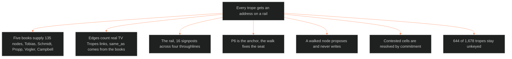

**Who it's for:** a writer or Chief learning why the walk has a rail · **What it does:** explains the graph and its rule · **Type:** concept

# The trope graph: why patterns ride a rail

*The mind model: every trope gets an address among 135 nodes. A walk moves only along the rail Dramatica locked.*

## A trope names a pattern, and a pattern needs an address

A trope is a recurring pattern. TV Tropes holds thousands and supplies volume. It supplies no order. The graph gives each trope an address: one of 135 structural units drawn from five books. Without an address, a trope floats free and cannot help a writer place anything.

## Five books supply the nodes

Tobias gives 20 whole master plots. Schmidt gives 55 whole dramatic situations. Propp gives 31 folktale functions. Vogler gives 12 hero's journey stages. Campbell gives 17 monomyth stages. The count is exact, and no node is invented.

## Edges measure how patterns co-occur

An edge between two nodes is a count of real TV Tropes article links. Each link runs from a trope keyed to one node into a trope keyed to the other. A second edge type, `same_as`, comes from the books themselves and marks that two nodes name one unit. Love is the busiest node, and every family's strongest content gravitates toward it.

## The rail is the one thing here that is not a pattern

Dramatica locked a fixed order: sixteen signposts across four throughlines. That order is the storyform. A walk may move from node to node only along it. Signpost N cannot come before signpost N-1 in the same throughline. Whole-plot nodes ride along inside the rail and replace nothing.

## P6 is the anchor, so the walk fixes the seat

Of the twelve plot layers, P6 is the one a trope must anchor to. The walk fixes it. The other layers then take dramatization detail from the node and the trope. A writer never guesses the seat scene by scene.

## A walked node proposes and never writes

The graph supplies pattern. The fabula supplies world time and adjudication. When the walk lands on a node, it proposes an event. The fabula's event record decides whether that proposal becomes a dated, sourced fact. This keeps the pattern layer from writing canon.

## Contested cells are resolved by commitment

Two alternate embodiments of one beat do not both fire. A trope's `alt` node flags a contested placement. The walk commits to one node at that signpost, and the view shows the contest as an `or:` line.

## The long read

The graph also decides what it leaves out. 644 of 1,678 tropes stay unkeyed. The 352 that clearly do not belong are out of scope for good. The 292 that might fit a finer node wait for a second pass. Empty nodes render as bypassed cells, so the walk stays walkable where research has gaps. The workspace view draws the graph as a focus tree on the 16 by 4 rail grid. It shows tropes inside capped tooltips. The free network is an opt-in toggle. For OXO, six movements fold into four acts at the Bourne pivot. See the [reference](2-reference.md), the [how-to](3-how-to.md) and the [tutorial](4-tutorial.md).
