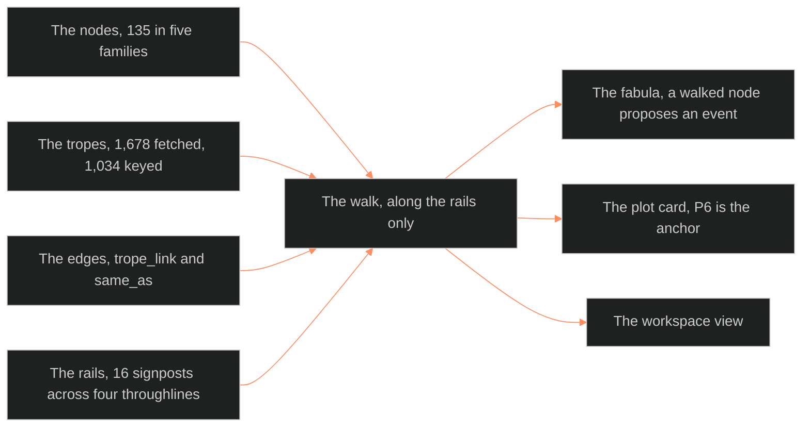

**Who it's for:** a writer or maintainer looking up a trope-graph fact · **What it does:** lists each component, part and count · **Type:** reference

# The trope graph: reference

Frontmatter: category `plot_system`, tier `narratology`, `module_of: ssot_04_plot_system`, trunk BLACK, rung standard, `applies_to: [all IPs]`, last updated 2026-10-04. The graph is the pattern layer. A trope names a recurring pattern. A node is a named unit from one of five structure books. An edge is a measured relationship between two nodes. Sibling docs: [plot system](../ssot_04_plot_system/2-reference.md) and [fabula](../ssot_04_fabula/2-reference.md).

**Owns:** the 135 nodes and their `same_as` clusters; trope keying; node-to-node edges; the rail for the walk. It also owns the handshake to the fabula, the plot card and the workspace view.
**Does not own:** the storyform (Dramatica), world time (fabula), the told order (plot doc P11). It also does not own psychology, place, and the workspace view's rendering code (BOLO 79).

**Root claim:** every trope sits on one of 135 fixed structural units. Every unit sits on a rail Dramatica already locked. TV Tropes supplies volume and cross-reference, never order. A walk moves only along the rail.

*The structure: nodes, tropes and edges feed the walk, and the walk hands a proposal to the fabula, a seat to the plot card and a grid to the workspace view.*

## MIND MODELS

- **Diagram 1.** Root: the trope graph. Branches: The Nodes (135, five families, 31 `same_as` edges), The Tropes (1,678 fetched, 1,034 keyed, 644 unkeyed). Then come The Edges (`trope_link` 2,584; `same_as` 31; busiest node `tob.14` Love with 94 tropes). The last branches are The Rails (16 signposts across 4 throughlines; P6 is the anchor), The Walk, Boundaries.
- **Diagram 2, the handshake.** Nodes, tropes and edges feed the walk. The walk feeds the fabula (a walked node proposes an event, never writes canon). It also feeds the plot card (P6 is the anchor) and the workspace view (BOLO 79).

## THE NODES

135 nodes in five families, with no invented items.

| Family | Prefix | Count | Phase | Kind of unit |
|---|---|---|---|---|
| Tobias | `tob.*` | 20 | any | Whole master plots. |
| Schmidt | `sch.*` | 55 | any | Whole dramatic situations. The 55th is the Blank Situation Template, a worksheet. |
| Propp | `prp.*` | 31 | beginning 8, middle 12, end 11 | Folktale functions in a fixed sequence. |
| Vogler | `vog.*` | 12 | beginning 5, middle 5, end 2 | Hero's journey stages on a three-act seam. |
| Campbell | `cam.*` | 17 | beginning 5, middle 6, end 6 | Monomyth stages: Departure, Initiation, Return. |

Tobias and Schmidt are `any` phase and can sit at any signpost. The three sequenced families keep their own order.

**Equivalence clusters (`same_as`).** Ten text-confirmed clusters produce 31 pairwise `same_as` edges. A three-way cluster gives three edges. Journey clusters:

- the Call: `vog.02` = `cam.01` = `prp.09`
- the Threshold: `vog.05` = `cam.04` = `prp.11`
- the Mentor/Donor: `vog.04` = `cam.03` = `prp.12` + `prp.14`
- the Ordeal: `vog.08` = `cam.05` = `prp.16` + `prp.18`
- the Trials block: `cam.06` = `vog.06` + `vog.07`
- the Boon: `vog.09` = `cam.11` = `prp.19`
- the Flight home: `vog.10` = `cam.13` = `prp.20`
- the second death: `vog.11` = `cam.15`
- the final state: `vog.12` = `cam.17`

Tobias and Schmidt clusters: `tob.06_revenge` = `sch.05_vengeance_for_a_crime`; `tob.16_sacrifice` = `sch.39_self_sacrifice`; `tob.01_quest` = `sch.17_daring_enterprise`. Two more clusters: `tob.03_pursuit` = `sch.09_flight` + `sch.10_pursuit`; `tob.04_rescue` = `sch.52_rescue_of_a_loved_one`.

**Node record fields:** `id`, `family`, `n`, `name`, `def`, `cite`, `bvx`, `phase`, `same_as`. Example id: `prp.11_departure`. Propp nodes once carried `bvx: null`. OPEN call 5 minted Propp as BVX.1136 and patched all 31 nodes.

## THE TROPES

- **Keying.** Eight Payload Specialist batches read 1,678 fetched TV Tropes entries against the 135 nodes. Each trope gets `node`, `alt` and `conf` (`high`, `medium` or `low`). Every batch was checked before the join.
- **Keyed and unkeyed.** 1,034 keyed. 644 unkeyed. Of the unkeyed, 352 are high-confidence "does not belong" and 292 are low-confidence "might fit a finer node". No unkeyed trope has medium confidence.
- **Confidence mix (keyed).** High 479, medium 368, low 187.
- **The `alt` field.** 269 keyed tropes carry a second plausible node. 178 cross to another family, and 91 stay in the same family. `alt` flags a contested placement. It is not a second edge.
- **What unkeyed means.** A production trope or a pure audience-reaction trope. It can also be a pattern the taxonomy is too coarse to place.

**Trope record fields:** `slug`, `name`, `def` (the TV Tropes index's one-line definition only, never page body text). The rest are `indexes`, `node`, `alt` and `conf`.

## THE EDGES

- **`trope_link`** (2,584 edges). A trope keyed to node A may link to a trope keyed to node B. Each such link raises the A-B weight by one.
- **`same_as`** (31 edges). The books' own equivalence. A flag, not a count.

The ten strongest `trope_link` pairs:

| Weight | Node A | Node B |
|---|---|---|
| 85 | `tob.08_rivalry` | `tob.14_love` |
| 63 | `tob.12_transformation` | `tob.14_love` |
| 54 | `tob.12_transformation` | `tob.20_descension` |
| 53 | `sch.23_obtaining` | `tob.14_love` |
| 50 | `tob.14_love` | `vog.12_return_with_the_elixir` |
| 45 | `tob.20_descension` | `vog.12_return_with_the_elixir` |
| 43 | `prp.31_wedding` | `tob.14_love` |
| 42 | `vog.02_call_to_adventure` | `vog.03_refusal_of_the_call` |
| 40 | `tob.06_revenge` | `tob.20_descension` |
| 40 | `tob.14_love` | `vog.05_crossing_the_first_threshold` |

`tob.14_love` is the busiest node: 94 tropes, in seven of the ten pairs.

## THE RAILS

Quoted from PS-R.rails.md. Four throughlines, each with 4 signposts and 3 journeys in a fixed 4-act order. 16 signposts across the form.

| Throughline | Perspective | Role |
|---|---|---|
| OS (Overall Story) | THEY | External genre, "the A-plot". |
| MC (Main Character) | I | The hero's journey from inside one skin. |
| IC (Influence Character) | YOU | Pressures the MC toward or away from change. |
| RS (Relationship Story) | WE | The MC-IC argument, "the B-story". |

**OXO's eight dynamics:** Resolve Change · Growth Stop · Approach Do-er · Problem-Solving Style Linear · Driver Action · Limit Optionlock · Outcome Failure · Judgment Good. The shape is Failure/Good, personal triumph.

**Phase counts.** Propp 8/12/11, Vogler 5/5/2, Campbell 5/6/6 (beginning/middle/end). Tobias 20 and Schmidt 55 are any-phase.

**P6 is the anchor.** P6 SIGNPOST/JOURNEY SEAT is the one plot layer a trope must anchor to. All other layers add detail around it.

### The movements map (ruled 2026-09-24, BOLO 77 call 77-L) — OXO instance

Method rule (BOLO 100): each story declares its own told-unit-to-act map once, in its instance file. The table is OXO's instance. Chief: "I like the Bourne method." Six movements fold into four acts at the Bourne pivot.

| Act | Movements | MC (Tori) | OS (the Factions) | IC (Anna Colson) | RS (Tori ↔ Anna Colson) |
|---|---|---|---|---|---|
| 1 | M1 (M1A + M1B as two journey beats) + M2 | The Past | Conceiving an Idea | Impulsive Responses | Obtaining |
| 2 | M3 | The Present | Developing a Plan | Innermost Desires | Understanding |
| 3 | M4 (Bourne) + M5 | How Things are Changing | Playing a Role | Contemplation | Doing |
| 4 | M6 | The Future | Changing One's Nature | Memories | Gathering Information |

M2 row 9 re-seats to MC signpost 1, The Past. Per-node seating beyond this map is parked: `⏸ OXO signpost seating (phase 2)`.

### The node seating (call 77-I, seated 2026-09-24)

- Every node carries an `act` and a `throughline`.
- Sequenced families (Propp 31, Vogler 12, Campbell 17) sit in Acts 1 to 4. They never run backward within a family. Act 1 holds 14, Act 2 holds 11, Act 3 holds 14, Act 4 holds 21.
- Hero-journey stages sit on MC. Propp's functions sit on OS, except Beginning Counteraction and The Hero's Reaction (MC).
- Tobias and Schmidt ride any act. They have a throughline affinity: RS 31, MC 24, OS 15, IC 4, any 1.
- One `same_as` pair differs by an act. Campbell's Road of Trials (Act 3) spans Vogler's Tests, Allies, Enemies (Act 2). It also spans Approach to the Inmost Cave (Act 3). It stays a one-to-many match.

## THE WALK

**The rule.** A writer or tool moves node to node only inside the storyform's signpost order. Within one throughline, signpost N cannot come before signpost N-1. Any-phase nodes ride along and attach at the current signpost.

**Mutually exclusive branches.** Two alternate embodiments of one beat do not both fire. A trope's `node` versus `alt` is that contest. The walk commits to one.

**Worked example (MC throughline, real nodes).**

1. Beginning: `vog.01_ordinary_world`.
2. Beginning: `vog.02_call_to_adventure`. An any-phase node such as `tob.01_quest` may attach as the call's type.
3. Middle: `vog.08_the_ordeal`. The walk cannot reach it before signpost 2 resolves. `prp.16_struggle` tropes such as `BigBadassBattleSequence` and `CataclysmClimax` supply dramatization.
4. End: `vog.12_return_with_the_elixir`. Love and Descension patterns link heavily into it.

## THE HANDSHAKE

**To the fabula.** A walked node proposes an event. The fabula's event record turns the proposal into a dated, sourced fact, or does not.

**To the plot card.** P6 is the anchor. Other fields:

| P-layer | What a node or trope fills |
|---|---|
| P1 ADDRESS | The rung where its tropes tend to occur. |
| P2 DRIVER | A trope's action-or-decision character, where its definition states one. |
| P3/P5 | The node's `def` names the entering and exiting condition. |
| P6 | The anchor: the seat, fixed by the walk. |
| P7 REVEAL | A trope whose definition names a reversal or discovery. |
| P8 COLLISION | The node-pair edge firing between two roles. |
| P9 STAKES | Edge weight as a rough proxy, never a substitute for a carded prior unit. |
| P10 GENRE OBLIGATION | A Schmidt or Tobias node may itself be the obligatory scene. |
| P12 FUNCTION | Fed from the storyform. A node never overrides it. |

**To the workspace view (BOLO 79).** From the HOI4 study's H-rules: the 16 signposts are the x-axis. The 4 throughlines are fixed lanes (H1). Only the 135 nodes draw as cells. Tropes live in capped tooltips, six shown plus "× more" (H7, H8, H10). Signpost order is the fixed AND chain (H3, H4). A rail-required cell with no confirmed node renders bypassed-empty (H9). The free trope network is an opt-in "explore" toggle (H11).

## TROPE GRAPH × LIBRARY

| Source | What it gives | Cite |
|---|---|---|
| Tobias, *20 Master Plots* | 20 any-phase nodes. | BVX.0043 |
| Schmidt, *Story Structure Architect* | 55 any-phase nodes. | BVX.0238 |
| Propp, *Morphology of the Folktale* | 31 sequenced nodes. | BVX.1136 (minted 2026-09-24) |
| Campbell, *Hero With a Thousand Faces* | 17 sequenced nodes. | BVX.0616 |
| Vogler, *The Writer's Journey* | 12 sequenced nodes. | BVX.1124 |
| TV Tropes (fetch.py) | 1,678 trope names, one-line definitions and the raw link graph. | external index, names and one-line defs only |
| PS-R.rails.md | The signpost order, OXO's eight dynamics, the twelve P-layers, six blocking gaps. | quotes the spine, the Dramatica protocol and the plot doc |
| HOI4-FOCUS-TREE-STUDY.md §6 | The H-rules for the workspace view. | internal study |

## Other sections

The source also holds OPEN (six calls, all closed 2026-10-04). The calls cover seating by method rule and 23 empty nodes bypassed. They also cover 352 unkeyed permanent and 292 held for `⏸ trope second keying pass (phase 2)`. They also cover the movements map and Propp's id. The `or:` tooltip is verified built at `_tools/workspace/build.py:2576-2585` and `:2445`. It also holds a version history from v0.1.0 (2026-09-24) to v1.0.0 (2026-10-04).
