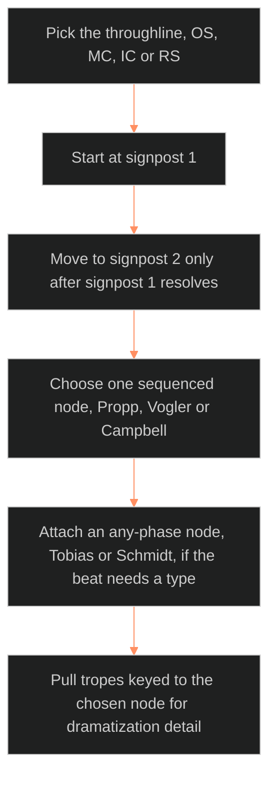

**Who it's for:** a writer or maintainer using the graph · **What it does:** steps for trope-graph tasks · **Type:** how-to

# The trope graph: how-to

Counts and fields are in the [reference](2-reference.md).

## Walk the graph for one throughline

*The walk in order: pick a throughline and move one signpost at a time. Seat one sequenced node, then pull tropes for detail.*

1. Pick the throughline: OS, MC, IC or RS.
2. Start at signpost 1 of that throughline.
3. Move to signpost 2 only after signpost 1 resolves. Never skip ahead or go back.
4. At each signpost, choose one sequenced node (Propp, Vogler or Campbell) that fits the seat.
5. Attach an any-phase node (Tobias or Schmidt) if you need a type for the beat.
6. Pull tropes keyed to the chosen node for dramatization detail.

## Resolve a contested cell

1. Find the trope's `node` and its `alt`.
2. Read `conf` beside them. A low `conf` means the placement is contested.
3. Commit to one node at this signpost. Do not fire both.
4. Check that the tooltip shows an `or:` line so the contest stays visible.

## Seat a plot-card unit with the graph (P6)

1. Find the unit's walked node.
2. Read the node's `act` and `throughline` from the seating.
3. Write that as P6. Do not guess the seat from the scene.
4. Fill other P-layers from the node and trope as the handshake table says.

## Propose a fabula event from a walked node

1. Name the node the walk lands on, e.g. `vog.02_call_to_adventure`.
2. Write a candidate transition for the character.
3. Send it to the fabula's event record schema.
4. Treat it as a proposal. The fabula decides whether it becomes canon.

## Declare a story's own movements map

1. List the story's told units, any count.
2. Fold them into the four signpost acts at the story's own pivot.
3. Write the map once in the story's instance file.
4. For each throughline, write its signpost per act.
5. Do not copy OXO's map.

## Key a new trope to a node

1. Open the trope's record in the register's `register.json`. Read its one-line TV Tropes index definition. Use no page body text.
2. Pick the best-fit node, or `null` if none fits.
3. Pick a second plausible node as `alt`, or `null`.
4. Set `conf`: `high`, `medium` or `low`.
5. Write the keys on that register record. Do not keep a second key file.
6. Check the batch before joining it to the node list.

## Handle an unkeyed trope

1. Check its confidence.
2. A high-confidence "does not belong" is out of scope for good.
3. A low-confidence "might fit" waits for the named second keying pass: `⏸ trope second keying pass (phase 2)`.

## Handle an empty node

1. Check that the node has zero keyed tropes.
2. Leave it as a bypassed-empty cell. Do not force a low-confidence keying.
3. Flag it for the next TV Tropes fetch round.
