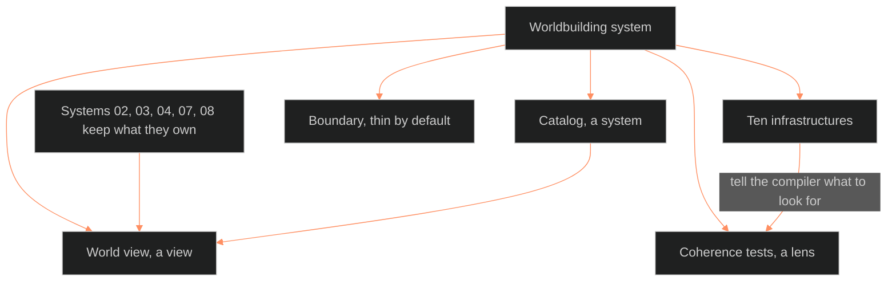

**Who it's for:** a writer or Chief who wants the why · **What it does:** explains why a world needs a catalog, a lens and a view · **Type:** concept

# The worldbuilding system: a world, defined once, built around a catalog

*The mind model: the catalog, the tests and the world view sit beside the systems that own their data.*

## Some world things belong to no system

The Command already has systems for people (02), places (03), plot (04), theme (07) and state over time (08). None owns a clan, a style of building, a way of dressing, or a vehicle. None owns a custom or a school of thought.

Those shared things sit between the systems and get lost. The worldbuilding system gives them one home, the catalog.

The system also gives the world one set of rules to check against: the infrastructures and the coherence tests. A read-only page, the world view, compiles everything into one picture.

## A world is shared things plus the rules that make them fit

Worldbuilding is the work of defining the shared things of a story's world. It then checks that they, and the places, people and events other systems hold, fit together.

The books agree on this shape. Every list in them mixes things that already have an owner with things that do not. The unowned half is the catalog.

The existing systems keep what they own. Worldbuilding owns what nobody else owns, and it reads the rest.

## The books split worldbuilding three ways

The books do not support calling all of worldbuilding one thing. Tested against them, it splits into three kinds of object.

The catalog is a system, because it is data with no other owner. The coherence tests are a lens, because they store nothing and ask questions across parts. The compiled page is a view, because it arranges records that live elsewhere.

The catalog is why 09 counts as a system. Drop the catalog and 09 becomes a lens and nothing else.

## Four words keep the kinds apart

A system owns its data. A layer owns data that attaches across systems, like the trope layer. A lens owns no data. A view is a read-only arrangement of records other files own.

Chief ruled these four words on 2026-09-29. The coherence tests are a lens. The world view is a view.

## Ten infrastructures tell a world what it must answer for

An infrastructure is an area a complete world must answer for. Nine sources list the same ground under different names, so the system merges them into ten.

The list does two jobs. It tells the compiler what to look for. It tells the author what a world is missing.

## Coherence is checked by named tests

A coherence test is a named check a reader or script can pass or fail. A test that cannot be made checkable is not run.

Scripts run the tests that can be mechanical. A person reads the rest. A stub entry reads "stub, not yet checkable", never "fail".

## The books also warn against building too much

Fifteen warnings limit the system. Kennedy's counter-voice leads them: an encyclopaedic inventory rewards the wrong thing. Felt, implied texture makes a place matter.

The system is thin by default. Every catalog entry starts as a stub of id, type, name and one line. A stub is a complete entry.

An entry fills only when a scene, a place or a person needs it. No type is built out ahead of the story that visits it.

## The world view edits nothing

A script reads 02, 03, 04, 08, the catalog and the trope layer. It writes one page. The page has no input fields.

Each row links to the file that owns the fact. That read-only rule keeps the view from becoming a second store.

## The long read

The worldbuilding system began as the BOLO 93 first draft on 2026-09-29. It held a definition, three mind models, ten infrastructures, sixteen coherence tests, fifteen boundary warnings and a twelve-type catalog.

Chief ruled OPEN calls 1 to 7 as recommended the same day. The first catalog opens eight types, not twelve. The fill rule says a type opens when a story needs it.

The DCUS proof then filled seven entries from canon. The proof found that the Tremor Cult was misfiled as a belief. It is a story, so its entry is retired and its id is never reused.

The compiler's first build was thin. It read only the catalog files and place slice headers, and ran four script tests. Later builds added reads from 02, 04 and 08.

Version 1.1.0 stripped stale marks. It wrote the inference rule and the stub-promotion and retired-entry rules.

The books tension is left open and the document takes both sides. The catalog is a shared reference. Every change to it is a 08 record, not a rewrite.

See the [reference](2-reference.md), the [how-to](3-how-to.md) and the [tutorial](4-tutorial.md).
