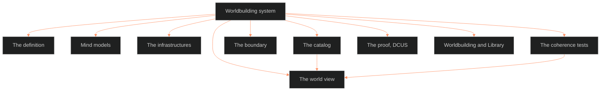

**Who it's for:** a writer or script author looking things up · **What it does:** lists every worldbuilding component, field and value · **Type:** reference

# The worldbuilding system: reference

*The structure: nine components under one system; the catalog and the coherence tests both feed the world view.*



Front matter facts: trunk BLACK, tier fabula, applies to OVEREXITOUT, ASTRO7EX, MOON/SAGA and all future IPs. Dependencies: ssot_03_setting_system (v1.5.0), ssot_02_character_systems, ssot_08_tracking_system (v1.0.0), ssot_04_fabula and ssot_04_plot_system, ssot_01_trope_register. Sources: 27 books (BVX and NEW ids) read through two PS batches.

## What this is

The Command's systems cover people (02), places (03), plot (04), theme (07) and state over time (08). None owns shared world things. This system gives them one home, the **catalog**, plus the **infrastructures**, the **coherence tests** and the **world view**.

- **Root claim:** a world is the set of shared things plus the rules that make them fit.
- Read [the Touchstones register](../../../_SSOT/01_NARRATIVE_FRAMEWORKS/📐%20ssot_01_touchstones_register.md) first.

## THE DEFINITION

Worldbuilding is the work of defining the shared things of a story's world (groups, styles, customs, tools, beliefs). It also checks that they fit together with the places, people and events other systems hold. Cited definitions: BVX.0067, NEW-ultimate-gm, NEW-anderson.

### What this system owns

| Owned thing | Kind | Where defined |
|---|---|---|
| The catalog | System (data) | THE CATALOG |
| The infrastructures | Reference | THE INFRASTRUCTURES |
| The coherence tests | Lens (no data) | THE COHERENCE TESTS |
| The world view | View (compiled, read-only) | THE WORLD VIEW |

### What it does not own

| Thing | Owner |
|---|---|
| Places and one place's architecture | 03 Setting (S1 BODY and eleven other layers) |
| Individual people, their outfit and habits | 02 Character |
| Anything that changes over time | 08 Tracking; the catalog points to it, never copies |
| Event order and telling order | 04 Plot; an entry's `origin` points to a fabula event |
| The story's argument | 07 Theme |
| The list of stories | 01 registry (v0.1.7) |
| Tropes | The trope layer (BOLO 89); entries carry a `tropes` field |

### How it relates to each system

| System | Relation | Direction |
|---|---|---|
| 01 Narrative | Registry lists stories; entry places and eras tell which stories it touches | reads |
| 02 Character | A person belongs to a catalog group; outfit and habits stay in 02 | catalog is pointed at by 02 |
| 03 Setting | Places name styles and groups; faction card notation stays in 03 | two-way pointers |
| 04 Plot | Entry `origin` names a fabula event | catalog points to 04 |
| 05 Operations | No world-fact type; runs the compiler as a procedure | none |
| 06 Style | No world-fact type; write-up follows 07.1 | none |
| 07 Theme | The coherence lens asks 07 whether mechanics, environment and narrative reinforce one theme (BVX.0144) | lens asks 07 |
| 08 Tracking | Every change is a 08 record; entries hold a `state` pointer; the reader track is in 08 §9A | catalog points to 08 |
| Trope layer | Every entry carries `tropes` | catalog points to layer |

### Vocabulary (ruled 9/29)

Ruled 2026-09-29 (OPEN 1, "Adopt"); recorded in SOP §5.

| Word | Meaning |
|---|---|
| System | Owns its data: 02, 03, 04, 07, 08 and this one |
| Layer | Owns data that attaches across systems: the trope layer |
| Lens | Owns no data; a set of questions asked across systems. The coherence tests |
| View | A read-only arrangement of records others own. The world view; the plot workspace's Fabula view and Told view |

### The plain verdict

1. The catalog is a system: data with no other owner.
2. The coherence tests are a lens: every test asks across parts and stores nothing.
3. The compiled page is a view.

System 09 is a system because of the catalog. Without it, 09 would be a lens only.

## MIND MODELS

Three Mermaid diagrams in the source.

- **Diagram 1, the whole system on one screen:** a mindmap with root 09 WORLDBUILDING. Branches: Definition (infrastructures), Catalog (twelve type families), Lens (coherence tests). Next comes View (the world view; filters era, place, group, type). Last comes Boundary (thin by default, Kennedy counter-voice).
- **Diagram 2, the owner map:** a flowchart that routes a world fact. About one place goes to 03. One person goes to 02. A change over time goes to 08 (story points and checkpoints). An event or its telling goes to 04. The story's argument goes to 07. Anything else goes to the 09 catalog.
- **Diagram 3, the compile flow:** 02, 03, 04, 08, the catalog and the trope layer feed a read-only compiler. The compiler runs the coherence tests, then writes the world view. Edits happen at the owning file, not in the view.

## THE INFRASTRUCTURES

An infrastructure is an area a complete world must answer for. Ten merge nine sources. The "Home" column says where data lives.

| # | Infrastructure | What it answers | Home |
|---|---|---|---|
| I1 | Space | Geography, climate, terrain, borders, settlements | 03 S1, S2 |
| I2 | Time | History, founding, ruins, genealogy, events | 04 events; 03 S5, S7; 08 change |
| I3 | Peoples and groups | Clans, classes, factions, species | 09 catalog (groups); 02 (individuals) |
| I4 | Governance and law | Who rules, by what right, how enforced | 03 S4; 09 catalog (institution forms) |
| I5 | Economy and material life | Trade, goods, money, food, work | 03 S6; 09 catalog (goods, food) |
| I6 | Belief, myth, and thought | Religion, cosmology, philosophy, values | 09 catalog |
| I7 | Custom and belonging | Rites, festivals, taboos, dress, habit | 09 catalog; 03 S8 |
| I8 | Knowledge, craft, and technology | Science, tools, transport, language, arts, education | 09 catalog |
| I9 | Nature | Flora, fauna, ecosystem, non-human beings | 09 catalog (kinds); 03 S1 (where) |
| I10 | World rules | Magic, physics, causality | 09 catalog (rules) |

- **Sourcing:** Wolf's list (BVX.0562) is not in the shelf extraction. OPEN 8 closed it from BVX.0562's distill. Wolf's eight (maps, timelines, genealogies, nature, culture, language, mythology, philosophy) all land in the spine.
- **Departure dial:** how far each infrastructure departs from our world: nominal, cultural, natural, ontological (BVX.0562). Scored on nine axes as same, augmented or different (BVX.0630).
- **Scale ladder:** world-economy, nation-state, locality (BVX.1161). The dial says which rung pressure starts from.
- **Not separate infrastructures:** Stars and Planets go to 03 S1. Urban Fantasy and Paranormal Romance is a genre choice, so it goes to the departure dial. Audio-Visual maps to 03 S3 SENSORIUM. Game Mechanics is dropped.
- **Method:** bricolage (BVX.0141). Two build orders, top-down and bottom-up (NEW-blueprint). Geography comes before culture (BVX.0458).

## THE COHERENCE TESTS

A coherence test is a named, checkable pass-or-fail check. "Runs as": S is script, R is a person reading.

| # | Test | Rule | Runs as |
|---|---|---|---|
| CT1 | Four pillars | A stub for governance, economics, social relations and cultural influences, or "none by design" | S |
| CT2 | Geography feeds economy | Every economy line names a resource the place supplies; every building style names its habitat material | R |
| CT3 | The gap-fill | Every institution names the rupture it fills; the rupture is a fabula event or an S5 SCAR | S |
| CT4 | Apocalypso | Every ruin has a dated fall; every dungeon-like ruin has a builder | S |
| CT5 | Bookends | Each place or group has a founding and a current endpoint; a founding line counts only if it still bites now | S |
| CT6 | Legitimacy | Every governing entry states coercion, rule-making and consent, or says which is missing | S |
| CT7 | Departure consistency | Each departure is scored on nine axes once and applied the same everywhere | R |
| CT8 | Distinctiveness | An entry used in a scene exerts pressure or is marked scenery | R |
| CT9 | Onstage canon | A fact enters canon only when a scene narrates it | S |
| CT10 | Compossibility and retcon cost | A new entry is checked against existing entries; a change to a narrated entry is logged as a retcon with its cost | R |
| CT11 | Reinforcement | Mechanics, environment and narrative point at the same theme; the answer lives in 07 | R |
| CT12 | Honest consequence | Consequences run as stated, not bent to convenience | R |
| CT13 | Scale source | Every pressure names its starting rung | S |
| CT14 | Referential density | Dense at the story's center, fuzzy at the edge | R |
| CT15 | What a character knows | A character knows only history relevant to that person; owner 02 | R |
| CT16 | Tension generator | The world's systems create built-in pressures a scene can use | R |

**Mechanic-only rule.** A test that cannot become a checkable statement is not run. Tone claims follow 03's tone-to-mechanic sub-note.

## THE BOUNDARY

Fifteen warnings limit this system.

| # | Warning |
|---|---|
| B1 | Never add a date without good reason (BVX.0349) |
| B2 | Never take the reader all the way; withholding creates allure (BVX.0349) |
| B3 | Kennedy's counter-voice: distinctiveness, not expansiveness (BVX.0349) |
| B4 | Thin by default, thick where scene pressure needs it (BVX.0100) |
| B5 | Completeness trades against consistency; a retcon costs trust (BVX.0630) |
| B6 | Enough economic logic that questions feel answerable (BVX.0562) |
| B7 | Only what is narrated is canon (BVX.0538) |
| B8 | Do not chase full completeness (BVX.0630) |
| B9 | Keep worldbuilding and storytelling apart; worldbuilding never finishes (BVX.0067; NEW-tremblay) |
| B10 | Do not put everything you designed into the story (NEW-anderson) |
| B11 | Work with intention; "realism" alone is no reason (NEW-ultimate-gm) |
| B12 | Audiences meet a world detail by detail, inside-out (NEW-101prompts) |
| B13 | Not every question needs an answer (NEW-blueprint) |
| B14 | Some layers stay thinner than others (BVX.1137) |
| B15 | Characters must be able to change their world (NEW-ultimate-gm) |

**The open tension:** B9 versus the "living world" sources. This doc takes both: the catalog is shared reference, and every change is a 08 record.

**The fill rule:**
1. Every entry starts as a stub: id, type, name, one line.
2. An entry fills only when a scene, place or person needs it.
3. A stub is a complete entry.
4. No type is built out ahead of the story that visits it.

A bounded stat block is the model for every type: a short fixed set of fields.

## THE CATALOG

The set of entries for shared things. One entry is one thing, in one file.

### The entry schema

```yaml
id: "WB-<TYPE>-<nnnn>"
type: "<type code>"
name: "<working name>"
aliases: []
era: ["<time code range>"]       # uses the 08 time code
places: ["<place_id>"]           # -> 03
groups: ["<WB-GRP id>"]
origin: "<fabula event_id>"      # -> 04
state: "<08 subject id>"         # -> 08; never copy state here
tropes: ["<trope_id>"]
one_line: "<a stub is one sentence>"
fields: {}                       # type-specific, bounded
sources: ["<BVX / NEW / canon node>"]
status: "stub | filled | canon | provisional"
```

- **Inference:** an inferred field reads `inferred`. A field not yet narrated reads `—`. `status` reads `provisional`, never a glyph.
- **Stub promotion:** a stub becomes `filled` with a source, a state id and one era.
- **Retired entries:** keep the file, set `status: retired`, point to the doc that took it. The id is never reused.

### The types

The code is the id prefix. Twelve types is the ceiling. OPEN 4 opened eight first: GRP, ARC, WDR, CUS, TEC, INS, BEL, FSU.

| Code | Type | Holds | Boundary |
|---|---|---|---|
| GRP | Groups, clans, factions, peoples | A body of people with shared identity, rule and edge | Faction card stays in 03 |
| ARC | Architecture styles | A reusable way of building | One building's fabric stays in 03 S1 |
| WDR | Wardrobe and dress | How a group dresses | One person's outfit stays in 02 |
| CUS | Customs, rites, and behaviors | Ritual, festival, taboo, rite, etiquette | A place's habit stays in 03 S8 |
| BEL | Beliefs and myths | Religion, folk belief, cult, myth, philosophy, hidden layer | none stated |
| TEC | Technology, tools, and vehicles | A technique or device; vehicles merged in | none stated |
| FSU | Food and substances | What people eat, drink and take; merged from food, subsistence, drug culture | none stated |
| INS | Institutions and forms of rule | A court, school board, guild, standards body | none stated |
| ECO | Goods, money, and trade | A good, currency or route | A place's economy stays in 03 S6 |
| LNG | Language and naming | A tongue, naming custom or term body | none stated |
| BIO | Creatures and flora | An animal, plant or non-human being | none stated |
| RUL | World rules | A rule departing from our world, with source, cost, limits; nine-axis score | none stated |

**Merged or dropped.** Vehicles went to TEC. Drug culture went to FSU. Arts and education fold into CUS and TEC. Stars and planets go to 03. Game mechanics is dropped.

### Where the files live

```
ShroomsQ/_CANON/_SSOT/05_WORLDBUILDING_SYSTEMS/
  📐 ssot_05_worldbuilding_system.md
  catalog/<type code>/<id>.md
  catalog/_INDEX.md      generated, never hand-edited
```

One entry, one file. The id never changes. The entry's file is the only place its fields are edited.

### Seed entries (names only)

Marked "catalog fills (phase 2)". None is filled.

| Seed | Type |
|---|---|
| The Administration (DCUS) | INS |
| The Bishops (DCUS) | GRP |
| Delta Coast Ultra School | INS |
| ASTRO7EX Standards Body | INS |
| Trash Land Standards Body | INS |
| ASTRO7EX Space Cuisine (three rows) | FSU |
| The moon societies (May 2024) | GRP |
| The MOON/SAGA Civ table (Jul 2025) | GRP |
| Tremor Cult (RETIRED 9/29; a story, not a belief) | BEL |
| Sync Cult (held) | BEL |

> **OPEN:** the seed entries and the catalog fill wait for phase 2, when Chief orders the catalog built.

## THE WORLD VIEW

The compiled, read-only page. A script reads 02, 03, 04, 08, the catalog and the trope layer. It edits nothing.

- **Shows:** each catalog entry as a row (type, name, eras, places, groups). Each place's catalog entries beside its 03 slice header. Each group's members, customs, dress, styles and faction card.
- **Test results:** CT1, CT3, CT4, CT5, CT6, CT9, CT13 as pass, fail, or "stub, not yet checkable".
- **Gap list:** infrastructures I1 to I10 with no entry, shown as gaps, not failures.
- **Filters:** era (08 time code), place (03 `place_id`), group (GRP id), type (type code).
- **Edits:** happen at the owning file. The view has no input fields.

## THE PROOF — DCUS (1.0, 2026-09-29)

DCUS narration is marked phase 2. The catalog proved itself on DCUS: filled from canon, every inference marked `inferred`.

| Entry | Type | Era | Origin | Rung |
|---|---|---|---|---|
| WB-INS-0001 The Administration | INS | backstory to M4 | backstory_dcus_rebrand (inferred) | nation-state (inferred) |
| WB-GRP-0001 The Bishops | GRP | backstory to M4 | backstory_dcus_rebrand | locality |
| WB-INS-0002 Delta Coast Ultra School | INS | backstory to M4 | backstory_dcus_rebrand | locality |
| WB-ARC-0001 Southern Gothic prestige brick | ARC | backstory to M4 | backstory_skeeter_creek_founding | locality |
| WB-CUS-0001 The Star-Rating | CUS | M2 to M4 | backstory_dcus_rebrand (inferred) | locality |
| WB-TEC-0001 The Feed (DCUS) | TEC | M2 to M4 | backstory_dcus_rebrand (inferred) | locality |
| WB-WDR-0001 Feed-linked clothing | WDR | M2 to M4 | none in canon | locality |

- **Findings:** Tremor Cult was misfiled; its entry is retired. Quinn Bishop has no 02 node yet; the link check reports it owed by 02. Every era ends at M4 because canon casts DCUS for Movements 2 to 4.
- **State ids:** `state:` reads `<kind>:<slug>`, with kind one of `place`, `group`, `belief`, `custom`, `tech`, `wardrobe`, `architecture`. A subject need not have story points yet.
- **The lens, run 9/29:** script tests CT1, CT3, CT5, CT6, CT13 pass on the filled set. CT4 has no ruins yet. CT9 has no canon claims yet. Reader tests CT10, CT11, CT14, CT16 pass. CT2, CT7, CT8, CT12, CT15 stub. No fails.
- **1.0 bar (SOP §5):** Shape, Shelf (27 books), Proof (DCUS), Ruled (OPEN 1 to 9). Wired (02, 03, 04, 08, tropes) and Store (7 filled) follow. The system meets all of them.

## WORLDBUILDING × LIBRARY

The 27 books the system reads, with what each gave.

| Source | What it gave |
|---|---|
| BVX.0562 Wolf, *Building Imaginary Worlds* | Three mechanisms; four realms; food-and-water limit on economy detail |
| BVX.0575 Wolf ed., *Exploring Imaginary Worlds* | The gap-fill rule |
| BVX.0630 Wolf ed., *Routledge Companion* | Nine ontological axes; compossibility and retcon cost |
| BVX.0100 Pavel, *Fictional Worlds* | Referential density; thin by default |
| BVX.0349 Kennedy, *Against Worldbuilding* | Counter-voice; no date without reason |
| BVX.0530 Mizer | Honest consequence |
| BVX.0504 Zagal and Deterding | World detail as belief |
| BVX.0538 Cover | Only narrated is canon |
| BVX.0458 *Kobold Guide* | Nation-first build order; economy in one page per culture; ruins imply a fall |
| BVX.0141 Brennan | Bricolage; palimpsest; wardrobe; rites; food systems |
| BVX.0405 *Dungeon Master's Guide* | Forms of government; map scales |
| BVX.0480 *GameMastery Guide* | Terrain order; society archetypes |
| BVX.0465 Robbins, *Microscope* | Bookend history |
| BVX.1156 Robbins, *Kingdom* | Touchstone and Roles; Crossroad procedure |
| BVX.1137 Rejec | Pointcrawl; reusable precursor fall |
| BVX.1138 Baur et al., *Midgard* | Trade goods; trading houses; Masks doctrine |
| BVX.1161 Flint and Taylor | Scale ladder; sovereignty and boundaries |
| BVX.1162 Morris and Scheidel | Coercion, rule-making, consent |
| BVX.1165 Nelson | Habitats as raw material; wardrobe |
| BVX.0067 *Collaborative Worldbuilding for Writers and Gamers* | Definition; four pillars |
| BVX.0144 *Once Upon a Pixel* | Six-part definition; reinforcement |
| NEW-tremblay | World as story engine; four principles |
| NEW-blueprint | Element list; top-down and bottom-up |
| NEW-pyramid341 | Actors; historical landscape; festivals |
| NEW-ultimate-gm | Intention rule; living process |
| NEW-anderson | Nine-part list; seasoning rule; what a character knows |
| NEW-101prompts | Fantasy conceits; culture list; inside-out audience |

Not read for this draft: the rest of the 03 and 08 shelf that those systems already cite.
